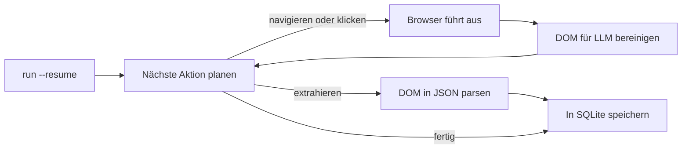

<a id="readme-top"></a>
<p align="center">
  
</p>
<p align="center">
  <strong>Ein autonomer Web-Research- und strukturierter Scrape-to-JSON-Agent.</strong>
  <br />
  Geben Sie ihm ein Ziel in einfachem Englisch und ein JSON-Schema. Er plant seine eigene Navigation, liest die Seite und liefert validierte, strukturierte Daten zurück.
</p>

<p align="center">
  <a href="https://github.com/EmanueleTorrisi/verboisy/actions/workflows/ci.yml"></a>
  <a href="https://codecov.io/gh/EmanueleTorrisi/verboisy"></a>
  <a href="https://emanueletorrisi.github.io/verboisy/"></a>
  <a href="#installation"></a>
  <!--<a href="https://pypi.org/project/verboisy/"></a>-->
  
  <a href="LICENSE"></a>
  <a href="https://github.com/astral-sh/ruff"></a>
</p>

<p align="center">
  <em>v0.1.0 | Pre-1.0 und in aktiver Entwicklung. Bis Version 1.0 ist mit Breaking Changes zwischen Minor-Versionen zu rechnen.</em>
</p>

<p align="center">
  <a href="../../README.md" title="English" aria-label="English">🇬🇧</a> ·
  <a href="README.it.md" title="Italiano" aria-label="Italiano">🇮🇹</a> ·
  <strong title="Deutsch" aria-label="Deutsch">🇩🇪</strong> ·
  <a href="README.zh-CN.md" title="简体中文" aria-label="简体中文">🇨🇳</a> ·
  <a href="README.fr.md" title="Français" aria-label="Français">🇫🇷</a> ·
  <a href="README.es.md" title="Español" aria-label="Español">🇪🇸</a> ·
  <a href="README.ko.md" title="한국어" aria-label="한국어">🇰🇷</a> ·
  <a href="README.ja.md" title="日本語" aria-label="日本語">🇯🇵</a>
</p>

## Inhaltsverzeichnis

- [Demo](#demo)
- [Warum Verboisy](#warum-verboisy)
- [Im Vergleich zu](#im-vergleich-zu)
- [Schnelles Beispiel](#schnelles-beispiel)
- [Anwendungsfälle](#anwendungsfälle)
- [Wie es funktioniert](#wie-es-funktioniert)
- [Installation](#installation)
- [Konfiguration](#konfiguration)
- [Nutzung](#nutzung)
- [Docker](#docker)
- [Bekannte Einschränkungen](#bekannte-einschränkungen)
- [Verantwortungsbewusste Nutzung](#verantwortungsbewusste-nutzung)
- [Dokumentation](#dokumentation)
- [Mitwirken](#mitwirken)
- [Sicherheit](#sicherheit)
- [Lizenz](#lizenz)

## Demo

<p align="center">
  
</p>

## Warum Verboisy

- **Zielgesteuert, nicht selektorgesteuert.** Beschreiben Sie das Ziel in einfachem Englisch. Der Planer entscheidet über den nächsten Klick, das Scrollen oder das Lesen der tatsächlich vor ihm liegenden Seite. Nichts ist hartcodiert, was bei einem Redesign der Website umgeschrieben werden müsste.
- **Schema-first, nicht Best-Effort.** Jeder Datensatz wird vor dem Speichern anhand eines Pydantic-Modells überprüft, das aus Ihrem JSON-Schema erstellt wurde. Fehlerhafte Daten gelangen niemals in Ihre Datenbank.
- **Bringen Sie Ihr eigenes Modell mit, behalten Sie Ihre eigene Infrastruktur.** OpenAI, Anthropic oder ein lokales Ollama-Modell über [LiteLLM](https://github.com/BerriAI/litellm): eine Umgebungsvariable zum Wechseln. Läuft auf Ihrem Computer oder Ihren Servern, nicht in einer gehosteten Blackbox.
- **Konstruktionsbedingt fortsetzbar.** Jeder Datensatz landet in SQLite, sobald er validiert ist. `verboisy run --resume` (oder `run(resume=True)` in Python) nimmt den neuesten unvollständigen Lauf wieder auf. Ein Absturz kostet Sie den aktuellen Schritt, nicht die bereits gespeicherte Arbeit.

Was um diese Schleife herum mitgeliefert wird: asynchrones Playwright (Chromium, headed oder headless), DOM-Bereinigung, die für LLM-Kontextfenster statt für rohe HTML-Dumps optimiert ist, und JSON- oder CSV-Export – oder fragen Sie die SQLite-Datenbank direkt ab.

## Im Vergleich zu

Verboisy ist die Schnittmenge aus einem autonomen Browser-Agenten und einem schema-validierten Extraktor. Nahegelegene Tools decken eines davon gut ab; dieses Tool ist für beides gebaut.

| | Verboisy | [Browser Use](https://github.com/browser-use/browser-use) | [Firecrawl](https://github.com/firecrawl/firecrawl) | [Crawl4AI](https://github.com/unclecode/crawl4ai) |
| --- | --- | --- | --- | --- |
| Sie beschreiben | ein Ziel **und** ein JSON-Schema | ein Ziel | eine URL + Prompt oder Schema | Crawl-Regeln + ein Prompt |
| Navigation | Planer wählt Klicks | Planer wählt Klicks | Crawl / Sitemap | Crawl |
| Validierung | Pydantic aus Ihrem Schema, vor dem Schreiben | Ihr Code | optionales Extraktionsschema | Ihr Code |
| Persistenz | SQLite pro Datensatz, `--resume` | Arbeitsspeicher / Ihr Code | API oder Ihre DB | Ihr Code |
| Wo es läuft | Ihr Computer | Ihr Computer | gehostet oder selbstgehostet | Ihr Computer |

Wenn Sie die URL bereits kennen und nur Markdown benötigen, sind Firecrawl oder Crawl4AI einfacher. Wenn Sie einen allgemeinen Agenten zur Computernutzung benötigen und später validieren, ist Browser Use besser geeignet. Wenn das Ergebnis Zeilen sein müssen, die einem Schema entsprechen, und der Agent sie finden muss, ist das Verboisy.

## Schnelles Beispiel

Das Schema ist ein JSON-Schema. Für eine Liste von Datensätzen ist die oberste Ebene ein `"array"`, dessen `"items"` die Objektform einer Zeile bilden:

```json
{
  "type": "array",
  "items": {
    "type": "object",
    "properties": {
      "name": { "type": "string" },
      "website": { "type": "string" },
      "description": { "type": "string" },
      "batch": { "type": "string" }
    },
    "required": ["name", "website"]
  }
}
```

Verboisy erstellt daraus zur Laufzeit ein Pydantic-Modell und lehnt Zeilen ab, die nicht passen, bevor sie in SQLite gelangen.

CLI:

```bash
verboisy run \
  --goal "Find AI startups from the Y Combinator Fall 2026 (F26) batch" \
  --schema examples/yc_startups/schema.json \
  --export result.json
```

Gleicher Lauf aus Python:

```python
from verboisy import run

result = run(
    goal="Find AI startups from the Y Combinator Fall 2026 (F26) batch",
    schema="examples/yc_startups/schema.json",
    export="result.json",
)

print(result.run_id, len(result.records))
for row in result.records:
    print(row["name"], row["website"])
```

Beide Formen erzeugen dies:

```json
[
  {
    "name": "Marrow",
    "website": "[https://marrow.example.com](https://marrow.example.com)",
    "description": "Staging-Umgebungen für Produktions-KI-Agenten.",
    "batch": "F26"
  },
  {
    "name": "Kiln Trace",
    "website": "[https://kilntrace.example.com](https://kilntrace.example.com)",
    "description": "Latenz- und Kosten-Debugging für Agenten-Workflows.",
    "batch": "F26"
  }
]
```

*(Anschauliche Ausgabe: Reale Ergebnisse hängen von den Live-Inhalten der Seite zur Laufzeit ab. Beispielnamen verwenden absichtlich `.example.com`.)*

Wenn der Prozess während der Ausführung abbricht, setzen Sie ihn fort, ohne bereits gespeicherte Zeilen erneut zu verarbeiten:

```bash
verboisy run --resume
```

```python
result = run(resume=True)
```

## Anwendungsfälle

Verboisy ist für Recherche-Muster konzipiert, die sich mehrmals auszuführen lohnen:

- **Konkurrenz- & Marktbeobachtung:** Verfolgen Sie Preise, Produktseiten und Ankündigungen von Mitbewerbern nach Zeitplan, anstatt manuell nachzusehen.
- **B2B-Lead-Recherche:** Verwandeln Sie eine Liste von Unternehmensnamen in strukturierte Firmen- und Tech-Stack-Datensätze, bereit für den CRM-Import.
- **E-Commerce- & Einzelhandelsüberwachung:** Überwachen Sie Katalog- und Preisänderungen auf JavaScript-lastigen Schaufenstern.
- **Research Operations (ResOps):** Führen Sie dasselbe Abfragemuster für Hunderte von Entitäten nach einem wiederkehrenden Zeitplan aus.
- **RAG- / Wissensdatenbank-Integrierung:** Speisen Sie eine Retrieval-Pipeline mit strukturierten, quellengestützten Datensätzen anstelle von manuell kuratiertem Kontext.

Jeder dieser Anwendungsfälle folgt demselben Ziel-plus-Schema-Muster wie das schnelle Beispiel oben, gerichtet auf eine andere Website und eine andere Struktur.

## Wie es funktioniert

Verboisy führt eine Kernschleife **Planen → Handeln → Beobachten → Extrahieren** aus, bis der Planer entscheidet, dass er genügend Daten hat oder sein Schrittbudget erreicht.



Jeder extrahierte Datensatz wird in SQLite gespeichert, sobald er validiert ist, unter einer `run_id`. Unterbrechen Sie die Schleife an einem beliebigen Punkt – ein Ratenlimit, ein Absturz, ein abgebrochener Prozess – dann lädt `verboisy run --resume` (oder `run(resume=True)`) das Ziel, das Schema und die gespeicherten Zeilen dieses Laufs neu und fährt fort. `--resume <id>` zielt auf einen bestimmten Lauf ab; `--resume` ohne ID nimmt den neuesten unvollständigen Lauf.

`--export` wird geschrieben, wenn der Lauf endet (oder wenn ein fortgesetzter Lauf endet). Teilweise Ergebnisse verbleiben in der Zwischenzeit in `SQLITE_DB_PATH`.

Vollständige Aufschlüsselung jedes Moduls in [`ARCHITECTURE.md`](../../ARCHITECTURE.md).

## Installation

Erfordert Python 3.11+.

Noch nicht auf PyPI. Von der Quelle installieren:

```bash
git clone [https://github.com/EmanueleTorrisi/verboisy.git](https://github.com/EmanueleTorrisi/verboisy.git)
cd verboisy && pip install -e .
playwright install --with-deps chromium
```

Sobald das erste Release erscheint, wird dies sein:

```bash
pip install verboisy
playwright install --with-deps chromium
```

## Konfiguration

Kopieren Sie `.env.example` nach `.env`. Alle Einstellungen werden über Pydantic in `utils/config.py` geladen; alles, was Sie nicht festlegen, greift auf die folgenden Standardwerte zurück.

```bash
# Erforderlich: mindestens ein LLM-Anbieter
OPENAI_API_KEY=sk-your-api-key-here
# ANTHROPIC_API_KEY=sk-ant-your-api-key-here

# LiteLLM Modell-Routing (z. B. gpt-4o, claude-sonnet-5, ollama/llama3)
LITELLM_MODEL=gpt-4o

SQLITE_DB_PATH=verboisy.db
VERBOISY_LOG_LEVEL=INFO
VERBOISY_HEADLESS=true
```

| Variable | Standard | Beschreibung |
| --- | --- | --- |
| `OPENAI_API_KEY` | - | OpenAI-Zugangsdaten. Erforderlich, außer bei Verwendung von Anthropic oder einem lokalen Modell. |
| `ANTHROPIC_API_KEY` | - | Anthropic-Zugangsdaten, anstelle von OpenAI verwendet. |
| `LITELLM_MODEL` | `gpt-4o` | Jeder von [LiteLLM](https://github.com/BerriAI/litellm) unterstützte Modell-String. |
| `MAX_TOKENS` | `4096` | Maximale Tokens pro Planer- oder Extraktionsaufruf. |
| `TEMPERATURE` | `0.0` | Sampling-Temperatur für den Planer. |
| `VERBOISY_HEADLESS` | `true` | Chromium headless ausführen. Auf `false` setzen, um den Browser zu beobachten. |
| `BROWSER_TIMEOUT_MS` | `30000` | Navigations-Zeitüberschreitung pro Seite in ms. |
| `USER_AGENT_ROTATION` | `true` | User-Agents zwischen Anfragen rotieren. |
| `SQLITE_DB_PATH` | `verboisy.db` | Wo Läufe und extrahierte Datensätze gespeichert werden. |
| `VERBOISY_LOG_LEVEL` | `INFO` | Standard-Python-Loglevel. `DEBUG` druckt jeden Planerschritt. |

Sie bezahlen den LLM-Anbieter direkt. Planer- und Extraktionsaufrufe sind auf `MAX_TOKENS` (Standard 4096) mit `TEMPERATURE` 0.0 begrenzt. Ein Ziel in Verzeichnisgröße umfasst in der Regel Dutzende von Aufrufen, nicht Hunderte. Es gibt keinen gehosteten Zähler.

## Nutzung

### CLI

```bash
verboisy run \
  --goal "Find AI startups from the Y Combinator Fall 2026 (F26) batch" \
  --schema examples/yc_startups/schema.json \
  --export result.json
```

Der Befehl gibt eine `run_id` aus (ebenfalls in SQLite gespeichert). Verwenden Sie diese, um später fortzusetzen.

| Flag | Alias | Erforderlich | Beschreibung |
| --- | --- | --- | --- |
| `--goal` | `-g` | Ja, außer bei `--resume` | Beschreibung in einfachem Englisch, was und wo gesucht werden soll. Seien Sie spezifisch. |
| `--schema` | `-s` | Ja, außer bei `--resume` | Pfad zu einem JSON-Schema, das die zu extrahierenden Felder beschreibt. Top-Level-`array` von Datensatz-`object`s. |
| `--export` | `-e` | Nein | Ausgabepfad. Unterstützt `.json` und `.csv`. Wird geschrieben, wenn der Lauf endet. |
| `--resume` | `-r` | Nein | Einen Lauf fortsetzen. Ein einfaches `--resume` setzt den neuesten unvollständigen Lauf in `SQLITE_DB_PATH` fort. `--resume <id>` setzt diesen speziellen Lauf fort. Ziel und Schema werden aus dem gespeicherten Lauf geladen; `--export` / Headless-Modus können weiterhin überschrieben werden. |

Führen Sie `verboisy run --help` aus, um die vollständige Flag-Referenz zu sehen.

### Resume (Fortsetzen)

```bash
# Neueste unvollständige Ausführung in verboisy.db
verboisy run --resume

# Eine bestimmte Ausführung
verboisy run --resume 7f3a2c1b --export result.json
```

Bereits validierte Zeilen werden nicht erneut extrahiert. Wenn kein unvollständiger Lauf vorhanden ist, wird der Befehl mit einem Fehler beendet, der die durchsuchte Datenbank nennt.

### Python

`run()` ist die öffentliche API. Die CLI ist ein dünner Wrapper darum.

```python
from pathlib import Path
from verboisy import RunResult, run

result: RunResult = run(
    goal="Find AI startups from the Y Combinator Fall 2026 (F26) batch",
    schema="examples/yc_startups/schema.json",  # Pfad, Path oder dict
    export="result.json",
)

print(result.run_id)
print(result.records[0]["name"])
```

Schema als Dictionary, keine Datei erforderlich:

```python
result = run(
    goal="Find AI startups from the Y Combinator Fall 2026 (F26) batch",
    schema={
        "type": "array",
        "items": {
            "type": "object",
            "properties": {
                "name": {"type": "string"},
                "website": {"type": "string"},
                "description": {"type": "string"},
                "batch": {"type": "string"},
            },
            "required": ["name", "website"],
        },
    },
)
```

Fortsetzen:

```python
from verboisy import run

# Neueste unvollständige Ausführung
result = run(resume=True)

# Bestimmte Ausführung, Export schreiben, wenn sie endet
result = run(resume=result.run_id, export="result.json")
```

Signatur:

```python
def run(
    *,
    goal: str | None = None,
    schema: str | Path | dict | None = None,
    export: str | Path | None = None,
    resume: bool | str = False,
    headless: bool | None = None,
) -> RunResult: ...
```

`RunResult`-Felder:

| Feld | Typ | Bedeutung |
| --- | --- | --- |
| `run_id` | `str` | Stabile ID, die in SQLite gespeichert ist. Übergeben Sie sie an `run(resume=...)`. |
| `records` | `list[dict]` | Jede bisher validierte Zeile für diesen Lauf. |
| `export_path` | `Path \| None` | Wo der Export geschrieben wurde, falls `--export` / `export=` gesetzt war und der Lauf beendet wurde. |
| `db_path` | `Path` | Die verwendete SQLite-Datei. |
| `completed` | `bool` | `True`, wenn der Planer anhielt, weil er fertig war, und nicht wegen eines Absturzes. |

Regeln:

- Neuer Lauf: `goal` und `schema` sind erforderlich; `resume` wird weggelassen oder ist `False`.
- Fortsetzen: `resume=True` oder `resume="<id>"`; `goal` / `schema` sind optional und werden ignoriert, wenn der Lauf sie bereits hat.
- `headless=None` verwendet `VERBOISY_HEADLESS`. Übergeben Sie `True` / `False`, um es für diesen Aufruf zu überschreiben.

### Einen Lauf beobachten

```bash
VERBOISY_HEADLESS=false VERBOISY_LOG_LEVEL=DEBUG \
  verboisy run \
    --goal "Find AI startups from the Y Combinator Fall 2026 (F26) batch" \
    --schema examples/yc_startups/schema.json \
    --export result.json
```

## Docker

```bash
docker compose -f docker/docker-compose.yml up -d --build
docker compose -f docker/docker-compose.yml exec verboisy verboisy run \
  --goal "Find AI startups from the Y Combinator Fall 2026 (F26) batch" \
  --schema examples/yc_startups/schema.json \
  --export result.json
```

Der Container startet und bleibt in Betrieb, wobei die Browser-Abhängigkeiten von Playwright bereits installiert sind, sodass Befehle über `exec` und nicht als Entrypoint des Containers ausgeführt werden. Mappen oder persistieren Sie `SQLITE_DB_PATH`, wenn Sie möchten, dass `--resume` über Container-Neustarts hinweg funktioniert. `OPENAI_API_KEY` wird automatisch aus Ihrer Shell übergeben: exportieren Sie ihn zuerst. Um andere Variablen zu übergeben (`ANTHROPIC_API_KEY`, `LITELLM_MODEL` usw.), exportieren Sie diese ebenfalls oder tauschen Sie die Liste `environment:` in `docker/docker-compose.yml` gegen `env_file: [../.env]` aus.

## Bekannte Einschränkungen

Beta-Software, und offen damit umgehend:

- **Keine Benutzerkonten oder gehostete Historie:** Einzelbenutzer. Run-IDs leben in der lokalen SQLite-Datei, nicht in einem Dashboard.
- **Keine Ablaufplanung (Scheduling):** Führen Sie Läufe manuell aus oder binden Sie sie in Ihren eigenen Cron oder Orchestrator ein. `--resume` ist für Abstürze und Ratenlimits gedacht, nicht als Scheduler.
- **Keine gehostete HTTP-API:** Die CLI, `verboisy.run()` und das Docker-Image sind derzeit die Schnittstellen.
- **Inkonsistent auf aggressiven Anti-Bot-Seiten:** Einige Ziele erfordern erneute Versuche oder manuelle Eingriffe.

Haben Sie ein Problem festgestellt, das Ihren Anwendungsfall blockiert? [Öffnen Sie ein Issue](https://github.com/EmanueleTorrisi/verboisy/issues): Es ist der direktste Weg, Einfluss darauf zu nehmen, was zuerst behoben wird.

## Verantwortungsbewusste Nutzung

Verboisy steuert in Ihrem Namen einen realen Browser. Sie sind dafür verantwortlich, die Nutzungsbedingungen der jeweiligen Zielseite, die `robots.txt`, Ratenlimits und die Gesetze in Ihrer Rechtsprechung einzuhalten. Verwenden Sie es nicht, um Authentifizierungen oder Zugangskontrollen zu umgehen, für die Sie keine Berechtigung haben.

## Dokumentation

Die vollständige Dokumentation, einschließlich der kompletten Konfigurationsreferenz und API-Details, ist veröffentlich unter **[emanueletorrisi.github.io/verboisy](https://emanueletorrisi.github.io/verboisy/)**.

## Mitwirken

Beiträge sind willkommen. Siehe [`CONTRIBUTING.md`](../CONTRIBUTING.md) für das lokale Setup und Konventionen, und folgen Sie bitte dem [Code of Conduct](../CODE_OF_CONDUCT.md). Suchen Sie nach einem Einstieg? Schauen Sie sich Issues an, die mit [`good first issue`](https://github.com/EmanueleTorrisi/verboisy/labels/good%20first%20issue) getaggt sind.

## Sicherheit

Eine Sicherheitslücke gefunden? Bitte öffnen Sie kein öffentliches Issue: Nutzen Sie die [private Meldung von Sicherheitslücken](https://github.com/EmanueleTorrisi/verboisy/security/advisories/new) oder lesen Sie [`SECURITY.md`](../SECURITY.md).

## Lizenz

BSD 2-Clause: Siehe [`LICENSE`](../../LICENSE) für den vollständigen Text.

---

<p align="center">
  Erstellt von <a href="https://github.com/EmanueleTorrisi">Emanuele Torrisi</a> · <a href="#readme-top">Zurück nach oben ↑</a>
</p>
