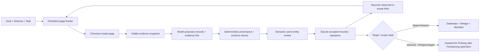

<a id="readme-top"></a>
<p align="center">
  
</p>
<p align="center">
  <strong>Beleggestützte Webrecherche, die begrenzte Quellen in typisierte Datensätze verwandelt.</strong>
  <br />
  Gib Verboisy ein Ziel, ein JSON-Schema und eine Quellenrichtlinie. Es navigiert, extrahiert, prüft Provenienz, bewertet die Bedeutung und liefert nachvollziehbare strukturierte Daten.
</p>

<p align="center">
  <a href="https://github.com/EmanueleTorrisi/verboisy/actions/workflows/ci.yml"></a>
  <a href="https://codecov.io/gh/EmanueleTorrisi/verboisy"></a>
  <a href="https://emanueletorrisi.github.io/verboisy/"></a>
  <a href="#installation"></a>
  
  <a href="../../LICENSE"></a>
  <a href="https://github.com/astral-sh/ruff"></a>
</p>

<p align="center">
  <em>v0.2.0rc1 | Veröffentlichungskandidat. Beleggestützt, fortsetzbar und bewusst klar über unvollständige Abdeckung.</em>
</p>

<p align="center">
  <a href="../../README.md" title="English" aria-label="English">🇬🇧</a> ·
  <a href="README.it.md" title="Italiano" aria-label="Italiano">🇮🇹</a> ·
  <strong title="Deutsch" aria-label="Deutsch">🇩🇪</strong> ·
  <a href="README.zh-CN.md" title="简体中文" aria-label="简体中文">🇨🇳</a> ·
  <a href="README.fr.md" title="Français" aria-label="Français">🇫🇷</a> ·
  <a href="README.es.md" title="Español" aria-label="Español">🇪🇸</a> ·
  <a href="README.ko.md" title="한국어" aria-label="한국어">🇰🇷</a> ·
  <a href="README.ja.md" title="日本語" aria-label="日本語">🇯🇵</a>
</p>

## Inhaltsverzeichnis

- [Demo](#demo)
- [Warum Verboisy](#why-verboisy)
- [Vergleich](#compared-to)
- [Schnellbeispiel](#quick-example)
- [Anwendungsfälle](#use-cases)
- [Funktionsweise](#how-it-works)
- [Installation](#installation)
- [Konfiguration](#configuration)
- [Verwendung](#usage)
- [Ausgaben und CSV](#outputs-and-csv)
- [Docker](#docker)
- [Bekannte Einschränkungen](#known-limitations)
- [Verantwortungsvolle Nutzung](#responsible-use)
- [Dokumentation](#documentation)
- [Mitwirken](#contributing)
- [Sicherheit](#security)
- [Lizenz](#license)

<a id="demo"></a>
## Demo

Die [historische Animation](../../docs/demo.gif) dient nur zur Veranschaulichung und stammt aus der Zeit vor der 0.2-Evidence-Engine. Für das aktuelle Verhalten nutze den [Live-Demo-Ablauf](../../docs/demo.md) und den [Validierungsleitfaden](../../docs/validation.md).

0.2.0rc1 wurde mit vollständiger Offline-Statement-/Branch-Abdeckung, echtem Chromium, sauberer Wheel-Installation, Docker-Sandbox-Start, wiederholten Live-Fixtures, Held-out-Paginierung, Unterbrechung/Fortsetzung, nicht verfügbaren Quellen, Identitätskonflikten und einem nicht-eCommerce-Held-out-Fall geprüft. Das sind Release-Belege, keine Garantie für jede Website oder Modellantwort.

<a id="why-verboisy"></a>
## Warum Verboisy

- **Beleggestützt statt „das Modell sagt es“.** Jeder Nicht-Null-Skalar muss auf beobachtete Seitenevidenz verweisen; Code prüft Quellen-ID, Entitätsscope, wörtliche Zitate, Typen, Links, Transformationen und Schema.
- **Schema-first ohne stilles Aufweichen.** JSON Schema Draft 2020-12 definiert Zeilenform und Sammlungsregeln. Fehlende Pflichtbelege blockieren den Kandidaten statt Werte zu erfinden.
- **Getrennte semantische Prüfung.** Nach den deterministischen Prüfungen bewertet ein zweiter Modellschritt Relevanz, Feldbedeutung und Same-Entity-Zuordnung ausschließlich aus den gelieferten Belegen. Er ist fehlbar und kein externer Wahrheitsorakel.
- **Begrenzte Recherche, expliziter Scope.** Seed-URLs, erlaubte Hosts, Include/Exclude-Pfade, Tiefe, Seitenzahl, Links pro Seite und optionale JS-Paginierung begrenzen die Beobachtung.
- **Fortsetzbar von Grund auf.** Seitenstatus, Snapshots, Kandidaten, akzeptierte Datensätze, Events, Modellabrechnung und Queue liegen in SQLite.
- **Konflikte bleiben sichtbar.** Identitätsfelder deduplizieren gleiche Datensätze; widersprüchliche Payloads derselben Identität werden quarantänisiert statt zusammengeführt.

Playwright/Chromium + SQLite + LiteLLM + JSON/CSV + Belegdatei + Manifest mit Prüfsummen.

<a id="compared-to"></a>
## Vergleich

Verboisy liegt zwischen Browser-Recherche-Agent und strukturiertem Extraktor; sein besonderes Versprechen ist die Belegspur für jeden akzeptierten Wert.

| | Verboisy | Allgemeiner Browser-Agent | Crawler / Extraktor | Ad-hoc-LLM-Extraktion |
| --- | --- | --- | --- | --- |
| Du beschreibst | Ziel + JSON-Schema + Quellenrichtlinie | Ziel | URLs / Crawl-Regeln | Prompt + Seitentext |
| Navigation | begrenzte beobachtete Links + optionale Paginierung | modellgesteuerte Aktionen | Crawler-Regeln | meist keine |
| Feldprovenienz | für jeden Nicht-Null-Skalar erforderlich | dein Code | unterschiedlich | meist nur Prompt |
| Validierung | JSON-Schema + deterministische Belege + semantische Prüfung | dein Code | unterschiedlich | meist Best Effort |
| Persistenz | SQLite-Warteschlange, Snapshots, Kandidaten, Datensätze, Ereignisse | unterschiedlich | unterschiedlich | meist beim Aufrufer |
| Fortsetzung | dauerhafte Lauf-ID + persistente Suchfront | unterschiedlich | unterschiedlich | meist beim Aufrufer |
| Identitätskonflikte | deterministische Quarantäne | Aufrufer | Aufrufer | Aufrufer |

<a id="quick-example"></a>
## Schnellbeispiel

Definiere genau, was ein Datensatz bedeutet:

```json
{
  "type": "array",
  "minItems": 2,
  "items": {
    "type": "object",
    "properties": {
      "sku": {"type": "string", "description": "Produkt-SKU exakt wie von der Quelle veröffentlicht"},
      "price_usd": {"type": "number", "minimum": 0, "description": "Angegebener Stückpreis in USD; keine Währungsumrechnung"},
      "source_url": {"type": "string", "format": "uri", "description": "Finale Seiten-URL, von der dieser Datensatz beobachtet wurde"}
    },
    "required": ["sku", "price_usd", "source_url"],
    "additionalProperties": false
  }
}
```

Definiere danach die begrenzte Quellenrichtlinie in `task.json`:

```json
{
  "seed_urls": ["https://catalog.example/products"],
  "allowed_hosts": ["catalog.example"],
  "include_paths": ["/products*"],
  "target_records": 20,
  "identity_fields": ["/sku"],
  "max_depth": 3,
  "max_pages": 100,
  "field_rules": {
    "/source_url": {"source": "page_url"}
  }
}
```

Ausführen:

```bash
verboisy run \
  --goal "Veröffentlichte Produkt-SKUs und angegebene USD-Preise sammeln" \
  --schema schema.json \
  --task task.json \
  --export dataset.json \
  --max-steps 40
```

Eine mögliche illustrative Ausgabeform:

```json
[
  {"sku": "LAMP-001", "price_usd": 39.95, "source_url": "https://catalog.example/products/lamp-001"},
  {"sku": "CHAIR-014", "price_usd": 129.0, "source_url": "https://catalog.example/products/chair-014"}
]
```

*Beispieldomains und Datensätze sind illustrativ. Reale Ergebnisse hängen von den tatsächlich beobachteten Seiten ab.*

<a id="use-cases"></a>
## Anwendungsfälle

Verboisy ist nützlich, wenn „gib mir Zeilen“ nicht reicht und auch „woher kommt dieser Wert?“ beantwortet werden muss.

- **Markt- und Wettbewerbsrecherche:** begrenzte Katalog-, Preis-, Feature- oder Ankündigungsdaten mit Feldbelegen.
- **B2B-Recherche:** strukturierte Organisations-/Verzeichnisdatensätze mit Identitätsfeldern und Quell-URLs.
- **E-Commerce-Monitoring:** typisierte Produktdaten, wobei Konflikte sichtbar bleiben.
- **Research Operations:** Schema und Richtlinie über kontrollierte Seiten wiederholen und aus SQLite fortsetzen.
- **Register und Referenzdaten:** Tabellen/technische Register als typisierte Zeilen mit exakten Boolean-, Zahlen-, Text- und URL-Belegen.
- **RAG / Datenpipelines:** kanonisches JSON plus Evidenz-Sidecar und Manifest statt unbelegter Prosa.

<a id="how-it-works"></a>
## Funktionsweise

0.2 ersetzt den alten freien Plan/Action-Loop durch eine begrenzte Evidence-Research-Engine:



Ein Snapshot enthält kompakte sichtbare Fakten, aufgelöste Links, Entity-Scope-IDs, finale URL, Zeitstempel und Content-Hash. Vollständiges beobachtetes HTML bleibt in SQLite. Das Modell darf Kandidaten vorschlagen, kann Schema- oder Provenienzprüfungen aber nicht umgehen. `COMPLETED` bedeutet Zielerreichung plus Sammlungsvalidierung, nicht globale Web-Vollständigkeit.

[`ARCHITECTURE.md`](../../ARCHITECTURE.md)

<a id="installation"></a>
## Installation

Benötigt Python 3.11–3.14.

Nach einer stabilen Veröffentlichung ist die normale Installation vorgesehen als:

```bash
pip install verboisy
```

Für diesen unveröffentlichten Release Candidate installiere die gelieferte Wheel oder den Quell-Checkout:

```bash
pip install -e .
verboisy --help
```

Beim ersten Browser-Einsatz wird die passende Chromium-Version vor Modellaufrufen geladen. Import oder `--help` laden keinen Browser. Explizite Vorbereitung:

```bash
verboisy setup
```

Unter Linux können native Chromium-Bibliotheken nötig sein, zum Beispiel:

```bash
python -m playwright install-deps chromium
```

Verboisy ruft `sudo` nicht selbst auf und deaktiviert die Chromium-Sandbox nicht stillschweigend.

<a id="configuration"></a>
## Konfiguration

Kopiere `.env.example` nach `.env` und halte Zugangsdaten aus der Versionskontrolle.

```bash
OPENAI_API_KEY=sk-your-api-key-here
# ANTHROPIC_API_KEY=sk-ant-your-api-key-here
LITELLM_MODEL=gpt-4o
SQLITE_DB_PATH=verboisy.db
SEARCH_PROVIDER=disabled
BROWSER_SANDBOX=true
ALLOW_PRIVATE_NETWORK=false
```

Häufige Einstellungen:

| Variable | Zweck |
| --- | --- |
| `OPENAI_API_KEY / ANTHROPIC_API_KEY` | Anbieter-Zugangsdaten, die über LiteLLM geroutet werden |
| `LITELLM_MODEL` | Modellkennung für Vorschlags- und Prüfaufrufe |
| `LITELLM_API_KEY / LITELLM_API_BASE` | Optionaler alternativer Anbieter oder Proxy |
| `SQLITE_DB_PATH` | Dauerhafte Laufdatenbank für 0.2 |
| `SEARCH_PROVIDER` | Bei bekannten Start-URLs deaktiviert; optional Suche über Brave |
| `BRAVE_SEARCH_API_KEY` | Zugangsdaten für die Brave-Suche |
| `MAX_TOKENS` | Maximale Modellausgabe-Tokens pro Anfrage |
| `MODEL_REQUEST_BUDGET` | Konservatives lokales Anfrageeinheiten-Budget |
| `LLM_TIMEOUT_SECONDS` | Zeitlimit pro Modellanfrage |
| `LLM_RETRIES` | Begrenzte Wiederholungen für vorübergehende oder unbrauchbare Antworten |
| `RUN_TIMEOUT_SECONDS` | Zeitlimit pro Aufruf |
| `MAX_DOM_CHARS` | Belegdaten-Budget pro Modellbatch |
| `ACTION_DELAY_SECONDS` | Pause zwischen Seitenverarbeitungsschritten |
| `BROWSER_SANDBOX` | Chromium-Sandbox ein-/ausschalten; aktiviert lassen |
| `ALLOW_PRIVATE_NETWORK` | Expliziter Zugriff auf private/Loopback-Ziele; standardmäßig aus |
| `ALLOWED_DOMAINS` | Optionale Einschränkung auf exakte Ziel-Hosts |

`verboisy doctor` zeigt nicht geheime Konfiguration und Umgebungsbereitschaft; `verboisy setup` bereitet Chromium ohne Modellaufrufe vor.

<a id="usage"></a>
## Verwendung

### CLI

```bash
verboisy run \
  --goal "Veröffentlichte Produkt-SKUs und angegebene USD-Preise sammeln" \
  --schema schema.json \
  --task task.json \
  --export dataset.json \
  --max-steps 40
```

Wichtige Optionen:

| Flag | Erforderlich | Bedeutung |
| --- | --- | --- |
| `--goal`, `-g` | neuer Lauf | Recherche-Ziel in natürlicher Sprache |
| `--schema`, `-s` | neuer Lauf | Pfad zum JSON-Schema |
| `--task`, `-t` | neuer Lauf | Begrenzte Quellen- und Entdeckungsrichtlinie |
| `--export`, `-e` | nein | Ausgabe als `.json` oder `.csv` |
| `--resume`, `-r` | Fortsetzung | Letzten unvollständigen oder bestimmten Lauf fortsetzen |
| `--max-steps`, `-m` | nein | Arbeitslimit für diesen Aufruf |
| `--headless` / `--headed` | nein | Sichtbarkeit des Browsers überschreiben |

Exit-Codes: `0` Ziel erreicht, `2` normaler Teil-/Exhausted-Stand, `1` Fehler, `130` Unterbrechung.

### Fortsetzung

```bash
# Letzten unvollständigen Lauf fortsetzen
verboisy run --resume

# Bestimmten Lauf fortsetzen und beim Stopp exportieren
verboisy run --resume 7f3a2c1b --export dataset.json
```

Fortsetzung behält ursprüngliches Ziel, Schema, Task-Richtlinie, akzeptierte Records, Queue und kumulative Abrechnung. Unterbrochene/aktive Seitenarbeit wird erneut planbar; deterministische Identität verhindert gleiche Duplikate.

### Python

`run()` ist die synchrone API; in Async-Anwendungen `await arun(...)` verwenden.

```python
from verboisy import run

result = run(
    goal="Veröffentlichte Produkt-SKUs und USD-Preise sammeln",
    schema="schema.json",
    task="task.json",
    export="dataset.json",
    max_steps=40,
)

print(result.run_id)
print(result.status, result.stop_reason)
for record in result.records:
    print(record)
```

<a id="outputs-and-csv"></a>
## Ausgaben und CSV

Ein JSON-Export erzeugt drei zusammengehörige Artefakte:

- `dataset.json` — nur die vom Nutzer angeforderten Felder.
- `dataset.json.evidence.json` — akzeptierte Records mit Snapshot-/Evidence-Provenienz.
- `dataset.json.manifest.json` — Run-Status, Schema/Task, Modell-Metadaten, Sammlungsvalidierung und SHA-256-Hashes.

SQLite enthält zusätzlich Seiten-Frontier, Snapshots/HTML, Kandidaten, Ablehnungsgründe, akzeptierte Records, Coverage-Gaps, Identitätskonflikte und Abrechnung.

Standard `csv_mode: "json"` speichert jede vorhandene Zelle als JSON und erhält Typen exakt. Leer bedeutet abwesend; `null` bleibt von Abwesenheit unterscheidbar.

`csv_mode: "spreadsheet"` erzeugt klassische Tabellenzellen und schützt formelartige Strings. Bequemer für Menschen, aber nicht kanonisch typisiert.

Vor Weiterverwendung die Manifest-Hashes prüfen.

<a id="docker"></a>
## Docker

Der Container führt Verboisy als unprivilegierten Nutzer aus und ist als stärkerer Deployment-Rand als eine persönliche Browser-Sitzung gedacht.

```bash
docker build -f docker/Dockerfile -t verboisy:0.2.0rc1 .

docker run --rm --init --shm-size=1g \
  --security-opt seccomp=docker/seccomp_profile.json \
  --entrypoint verboisy \
  verboisy:0.2.0rc1 setup
```

Für echte Workloads SQLite und Exporte persistent machen, Sandbox aktiv lassen und Egress kontrollieren.

<a id="known-limitations"></a>
## Bekannte Einschränkungen

- Traversal folgt breadth-first beobachteten In-Scope-HTTP(S)-Links; das Modell kann priorisieren, aber keine beliebigen Ziele erfinden.
- `pagination_selector` unterstützt begrenzte JS-Paginierung; allgemeine Formulare, beliebige Filter, implizites Infinite Scroll, Downloads, iframe/shadow-root und beliebiges JavaScript sind nicht implementiert.
- Authentifizierung, CAPTCHAs, Anti-Bot-Bypass, OCR, PDF und Cross-Page-Joins liegen außerhalb des Vertrags.
- DOM/Evidence-Kontext ist begrenzt; übergroße oder unbrauchbare Modellbatches werden explizite Coverage-Gaps.
- Wörtliche Provenienz zeigt Beobachtung im zugelassenen Scope, nicht Wahrheit der Quelle.
- Semantische Review ist modellbasiert und fehlbar.
- `COMPLETED` bedeutet Zielerreichung, nicht globale Vollständigkeit.
- Nicht verfügbare Quellen können den Lauf fehlschlagen/unvollständig lassen; wiederholtes Budgeterhöhen ersetzt fehlende Belege nicht.
- Ohne `identity_fields` nur exakte Record-Deduplizierung; mit Identität werden widersprüchliche Payloads quarantänisiert.

<a id="responsible-use"></a>
## Verantwortungsvolle Nutzung

Verboisy steuert einen echten Browser und speichert Quellmaterial lokal. Du bist für Nutzungsbedingungen, robots, Rate-Limits, Lizenzen, Datenschutz und geltendes Recht verantwortlich. Keine Authentifizierung oder Zugriffskontrollen ohne Berechtigung umgehen.

URL-Prüfungen und Sandbox sind Defense in Depth, keine vollständige Netzwerksandbox. Für nicht vertrauenswürdiges Browsing dediziertes Konto/Container/VM, keine sensiblen Mounts und eingeschränktes Egress verwenden.

Quellseiten und Records können personenbezogene oder lizenzierte Daten enthalten. Verboisy verschlüsselt SQLite nicht automatisch; Zugänglichkeit ist keine Weiterverbreitungs-/Trainingslizenz.

<a id="documentation"></a>
## Dokumentation

- [Vertrag und Task-Richtlinie](../../docs/contracts.md)
- [Validierung und Release-Prüfungen](../../docs/validation.md)
- [Suche und Wiederherstellung](../../docs/search-and-recovery.md)
- [Migration von 0.1](../../docs/migration.md)
- [Live-Demo-Ablauf](../../docs/demo.md)
- [Release-Betrieb](../../docs/release.md)
- [Architektur](../../ARCHITECTURE.md)

<a id="contributing"></a>
## Mitwirken

Beiträge sind willkommen. Siehe [`CONTRIBUTING.md`](../CONTRIBUTING.md). Neues Verhalten deterministisch testen und Evidence-/Sandbox-Regeln nicht nur für eine Fixture schwächen.

<a id="security"></a>
## Sicherheit

Sicherheitslücke gefunden? Kein öffentliches Issue öffnen. Nutze [private Sicherheitsmeldung](https://github.com/EmanueleTorrisi/verboisy/security/advisories/new) oder [`SECURITY.md`](../SECURITY.md).

<a id="license"></a>
## Lizenz

BSD 2-Clause. Siehe [`LICENSE`](../../LICENSE).

---

<p align="center">
  Erstellt von <a href="https://github.com/EmanueleTorrisi">Emanuele Torrisi</a> · <a href="#readme-top">Nach oben ↑</a>
</p>
