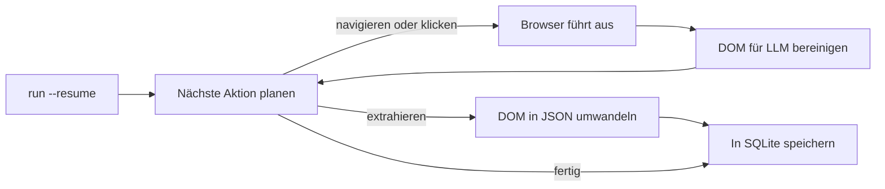

<a id="readme-top"></a>
<p align="center">
  
</p>
<p align="center">
  <strong>Ein autonomer Agent für Webrecherche und strukturierte Extraktion nach JSON.</strong>
  <br />
  Gib ihm ein Ziel in natürlicher Sprache und ein JSON-Schema. Er plant die Navigation selbst, liest die Seite und liefert validierte, strukturierte Daten zurück.
</p>

<p align="center">
  <a href="https://github.com/EmanueleTorrisi/verboisy/actions/workflows/ci.yml"></a>
  <a href="https://codecov.io/gh/EmanueleTorrisi/verboisy"></a>
  <a href="https://emanueletorrisi.github.io/verboisy/"></a>
  <a href="#installation"></a>
  <!--<a href="https://pypi.org/project/verboisy/"></a>-->
  
  <a href="../../LICENSE"></a>
  <a href="https://github.com/astral-sh/ruff"></a>
</p>

<p align="center">
  <em>v0.1.0 | Vor Version 1.0 und in aktiver Entwicklung. Bis 1.0 ist zwischen Nebenversionen mit inkompatiblen Änderungen zu rechnen.</em>
</p>

<p align="center">
  <a href="../../README.md" title="English" aria-label="English">🇬🇧</a> ·
  <a href="README.it.md" title="Italiano" aria-label="Italiano">🇮🇹</a> ·
  <strong title="Deutsch" aria-label="Deutsch">🇩🇪</strong> ·
  <a href="README.zh-CN.md" title="简体中文" aria-label="简体中文">🇨🇳</a> ·
  <a href="README.fr.md" title="Français" aria-label="Français">🇫🇷</a> ·
  <a href="README.es.md" title="Español" aria-label="Español">🇪🇸</a> ·
  <a href="README.ko.md" title="한국어" aria-label="한국어">🇰🇷</a> ·
  <a href="README.ja.md" title="日本語" aria-label="日本語">🇯🇵</a>
</p>

## Inhaltsverzeichnis

- [Demo](#demo)
- [Warum Verboisy](#why-verboisy)
- [Vergleich](#compared-to)
- [Schnellbeispiel](#quick-example)
- [Anwendungsfälle](#use-cases)
- [Funktionsweise](#how-it-works)
- [Installation](#installation)
- [Konfiguration](#configuration)
- [Verwendung](#usage)
- [Docker](#docker)
- [Bekannte Einschränkungen](#known-limitations)
- [Verantwortungsvolle Nutzung](#responsible-use)
- [Dokumentation](#documentation)
- [Mitwirken](#contributing)
- [Sicherheit](#security)
- [Lizenz](#license)

<a id="demo"></a>

## Demo

Die [ältere Animation](../../docs/demo.gif) dient nur zur Veranschaulichung und stellt keine Verifizierung des Produkts dar. Die vorhandene Aufnahme entstand vor der Implementierung der Wiederaufnahmefunktion. Verwende den [Ablauf für eine authentische Live-Demo](../../docs/demo.md), um das tatsächliche Verhalten von Browser, Modell, SQLite, Unterbrechung und Export aufzuzeichnen. Eine neue Live-Aufnahme bleibt eine Abnahmevoraussetzung.

Diese Überarbeitung umfasst ausführbare Offline-Regressionstests und einen vorgeschriebenen Chromium-Integrationstest. Lies vor dem Einsatz die [Validierungs- und Freigabeprüfungen](../../docs/validation.md); damit wird keine Produktionsreife behauptet.

<a id="why-verboisy"></a>

## Warum Verboisy

- **Zielgesteuert statt selektorgesteuert.** Beschreibe das Ziel in natürlicher Sprache. Der Planer wählt anhand der tatsächlich angezeigten Seite den nächsten Klick, Scrollvorgang oder Lesezugriff. Das Modell versucht, sich an das beobachtete DOM anzupassen; eine Neugestaltung der Website kann einen Lauf trotzdem unterbrechen.
- **Schema zuerst statt ungefährer Ergebnisse.** Jeder Datensatz wird gegen dein JSON-Schema geprüft und vor dem Speichern in ein Pydantic-Modell eingebunden. Die Validierung prüft Struktur und Einschränkungen, belegt aber nicht die sachliche Richtigkeit.
- **Eigenes Modell, eigene Infrastruktur.** OpenAI, Anthropic oder ein lokales Ollama-Modell über [LiteLLM](https://github.com/BerriAI/litellm): Zum Wechsel genügt eine Umgebungsvariable. Die Ausführung erfolgt auf deinem Rechner oder Server, nicht in einem undurchsichtigen gehosteten Dienst.
- **Wiederaufnahme von Grund auf.** Jeder validierte Datensatz wird in SQLite festgeschrieben, bevor der nächste Kandidat bearbeitet wird. `verboisy run --resume` (oder `run(resume=True)` in Python) setzt den letzten unvollständigen Lauf fort. Frühere Schreibvorgänge überstehen einen unterbrochenen Schritt. Wiederhergestellt werden Fortschritt und zuletzt gespeicherte URL, nicht der Browser-Sitzungszustand.

Zum Kernablauf gehören asynchrones Playwright (Chromium mit oder ohne sichtbares Fenster), eine auf LLM-Kontextfenster abgestimmte DOM-Bereinigung statt roher HTML-Ausgaben sowie JSON- oder CSV-Export. Die SQLite-Datenbank lässt sich auch direkt abfragen.

<a id="compared-to"></a>

## Vergleich

Verboisy verbindet einen autonomen Browser-Agenten mit einem schema-validierten Extraktor. Vergleichbare Werkzeuge decken häufig nur einen dieser Bereiche gut ab; Verboisy ist für beide ausgelegt.

| | Verboisy | [Browser Use](https://github.com/browser-use/browser-use) | [Firecrawl](https://github.com/firecrawl/firecrawl) | [Crawl4AI](https://github.com/unclecode/crawl4ai) |
| --- | --- | --- | --- | --- |
| Du beschreibst | ein Ziel **und** ein JSON-Schema | ein Ziel | URL + Anweisung oder Schema | Crawling-Regeln + Anweisung |
| Navigation | Planer wählt Klicks | Planer wählt Klicks | Crawling / Sitemap | Crawling |
| Validierung | JSON-Schema + Pydantic, vor dem Schreiben | dein Code | optionales Extraktionsschema | dein Code |
| Persistenz | SQLite pro Datensatz, `--resume` | Arbeitsspeicher / dein Code | API oder deine Datenbank | dein Code |
| Ausführungsort | dein Rechner | dein Rechner | gehostet oder selbst betrieben | dein Rechner |

Kennst du die URL bereits und brauchst nur Markdown, sind Firecrawl oder Crawl4AI einfacher. Suchst du einen allgemeinen Agenten zur Computernutzung und möchtest später validieren, passt Browser Use besser. Sollen die Ergebnisse schema-konforme Zeilen sein, die der Agent selbst findet, ist das der Einsatzbereich von Verboisy.

<a id="quick-example"></a>

## Schnellbeispiel

Das Schema verwendet JSON Schema. Bei einer Liste von Datensätzen ist die oberste Ebene ein `"array"`, dessen `"items"` die Objektstruktur einer Zeile beschreiben:

```json
{
  "type": "array",
  "items": {
    "type": "object",
    "properties": {
      "name": { "type": "string" },
      "website": { "type": "string" },
      "description": { "type": "string" },
      "batch": { "type": "string" }
    },
    "required": ["name", "website"]
  }
}
```

Verboisy erzeugt zur Laufzeit daraus ein Pydantic-Modell und verwirft unpassende Zeilen, bevor sie SQLite erreichen.

Kommandozeile (CLI):

```bash
verboisy run \
  --goal "Finde KI-Start-ups aus dem Y-Combinator-Herbstjahrgang 2026 (F26)" \
  --schema examples/yc_startups/schema.json \
  --export result.json
```

Derselbe Lauf aus Python:

```python
from verboisy import run

result = run(
    goal="Finde KI-Start-ups aus dem Y-Combinator-Herbstjahrgang 2026 (F26)",
    schema="examples/yc_startups/schema.json",
    export="result.json",
)

print(result.run_id, len(result.records))
for row in result.records:
    print(row["name"], row["website"])
```

Eine mögliche beispielhafte Ausgabe sieht so aus:

```json
[
  {
    "name": "Marrow",
    "website": "https://marrow.example.com",
    "description": "Staging-Umgebungen für produktiv eingesetzte KI-Agenten.",
    "batch": "F26"
  },
  {
    "name": "Kiln Trace",
    "website": "https://kilntrace.example.com",
    "description": "Analyse von Latenz und Kosten in Agenten-Workflows.",
    "batch": "F26"
  }
]
```

*(Beispielausgabe: Tatsächliche Ergebnisse hängen davon ab, was zum Laufzeitpunkt auf der Seite steht. Die Beispieldomains verwenden absichtlich `.example.com`.)*

Wird der Prozess während eines Laufs beendet, kann er ohne erneute Verarbeitung gespeicherter Zeilen fortgesetzt werden:

```bash
verboisy run --resume
```

```python
result = run(resume=True)
```

<a id="use-cases"></a>

## Anwendungsfälle

Verboisy eignet sich für wiederkehrende Recherchen:

- **Wettbewerbs- und Marktbeobachtung:** Preise, Produktseiten und Ankündigungen von Mitbewerbern regelmäßig verfolgen statt von Hand prüfen.
- **B2B-Lead-Recherche:** Firmennamen in strukturierte Unternehmens- und Technologieprofile für den CRM-Import umwandeln.
- **E-Commerce- und Einzelhandelsüberwachung:** Katalog- und Preisänderungen auf stark JavaScript-basierten Shops beobachten.
- **Research Operations (ResOps):** dasselbe Abfragemuster regelmäßig auf Hunderte von Unternehmen oder anderen Entitäten anwenden.
- **RAG-/Wissensdatenbank-Einspielung:** Retrieval-Pipelines mit strukturierten, quellenbelegten Datensätzen statt manuell zusammengestelltem Kontext versorgen.

Alle Fälle verwenden dasselbe Ziel-plus-Schema-Muster wie das Schnellbeispiel, nur für andere Seiten und Datenstrukturen.

<a id="how-it-works"></a>

## Funktionsweise

Verboisy durchläuft **planen → handeln → beobachten → extrahieren**, bis der Planer genügend Daten gesammelt hat oder sein Schrittbudget verbraucht ist.



Jeder extrahierte Datensatz wird nach erfolgreicher Validierung sofort unter einer `run_id` in SQLite festgeschrieben. Wird die Schleife durch eine Ratenbegrenzung, einen Absturz oder einen beendeten Prozess unterbrochen, lädt `verboisy run --resume` (oder `run(resume=True)`) Ziel, Schema, gespeicherte Zeilen, Verlauf und zuletzt gespeicherte URL und setzt den Lauf fort. `--resume <id>` wählt einen bestimmten Lauf; `--resume` ohne ID den letzten unvollständigen.

`--export` schreibt die Datei am Ende des Laufs, auch nach einer Wiederaufnahme. Teilergebnisse liegen bis dahin in `SQLITE_DB_PATH`.

Eine vollständige Modulübersicht steht in [`ARCHITECTURE.md`](../../ARCHITECTURE.md).

<a id="installation"></a>

## Installation

Benötigt Python >=3.11,<3.15.

Noch nicht auf PyPI verfügbar. Installation aus dem Quellcode:

```bash
git clone https://github.com/EmanueleTorrisi/verboisy.git
cd verboisy
python -m pip install -e .
python -m playwright install chromium
```

Nach der ersten Veröffentlichung gilt stattdessen:

```bash
python -m pip install verboisy
python -m playwright install chromium
```

Chromium wird bei der Einrichtung installiert. Verboisy lädt während eines Laufs keine Browser herunter und startet keinen Systempaketmanager. Verwende für Installation und Ausführung dasselbe Benutzerkonto und dieselbe Python-Umgebung. Unter Linux installierst du Browser und Systemabhängigkeiten mit `python -m playwright install --with-deps chromium` (Systempakete erfordern Administratorrechte). Mit Poetry lautet der Befehl `poetry run playwright install --with-deps chromium`.

<a id="configuration"></a>

## Konfiguration

Kopiere `.env.example` nach `.env`. Pydantic lädt alle Einstellungen über `utils/config.py`; nicht gesetzte Werte erhalten die folgenden Voreinstellungen.

```bash
# Erforderlich: mindestens ein LLM-Anbieter
OPENAI_API_KEY=sk-your-api-key-here
# ANTHROPIC_API_KEY=sk-ant-your-api-key-here

# LiteLLM-Modellauswahl (z. B. gpt-4o, claude-sonnet-5, ollama/llama3)
LITELLM_MODEL=gpt-4o

SQLITE_DB_PATH=verboisy.db
VERBOISY_LOG_LEVEL=INFO
VERBOISY_HEADLESS=true
```

| Variable | Standardwert | Beschreibung |
| --- | --- | --- |
| `OPENAI_API_KEY` | - | OpenAI-Zugangsdaten. Erforderlich, sofern nicht Anthropic oder ein lokales Modell genutzt wird. |
| `ANTHROPIC_API_KEY` | - | Anthropic-Zugangsdaten statt OpenAI. |
| `LITELLM_MODEL` | `gpt-4o` | Beliebige von [LiteLLM](https://github.com/BerriAI/litellm) unterstützte Modellbezeichnung. |
| `MAX_TOKENS` | `4096` | Maximale Tokens je Planungs- oder Extraktionsaufruf. |
| `TEMPERATURE` | `0.0` | Sampling-Temperatur des Planers. |
| `VERBOISY_HEADLESS` | `true` | Chromium ohne sichtbares Fenster ausführen; `false` zeigt den Browser. |
| `BROWSER_TIMEOUT_MS` | `30000` | Navigationszeitlimit je Seite in ms. |
| `USER_AGENT_ROTATION` | `true` | Beim Erstellen des Browserkontexts einen User-Agent wählen; kein Wechsel bei jeder Anfrage. |
| `SQLITE_DB_PATH` | `verboisy.db` | Speicherort für Läufe und extrahierte Datensätze. |
| `VERBOISY_LOG_LEVEL` | `INFO` | Normale Python-Protokollierungsstufe. `DEBUG` zeigt jeden Planungsschritt. |

Du bezahlst den LLM-Anbieter direkt. Planungs- und Extraktionsaufrufe werden durch `MAX_TOKENS` (standardmäßig 4096) mit `TEMPERATURE` 0.0 begrenzt. Die Anzahl der Aufrufe hängt von Navigation, Extraktion und Wiederholungen ab. Es gibt keinen gehosteten Verbrauchszähler.

<a id="usage"></a>

## Verwendung

### CLI

```bash
verboisy run \
  --goal "Finde KI-Start-ups aus dem Y-Combinator-Herbstjahrgang 2026 (F26)" \
  --schema examples/yc_startups/schema.json \
  --export result.json
```

Der Befehl protokolliert eine `run_id` (auch in SQLite gespeichert). Bei ausgeschöpftem Budget liefert er ein unvollständiges Ergebnis und Exit-Code 2; Fehler liefern 1 und Ctrl-C liefert 130. Ein Lauf ist nur nach FINISH und erfolgreicher Validierung der Sammlung abgeschlossen. Die ID kann später zur Wiederaufnahme dienen.

| Option | Kurzform | Erforderlich | Beschreibung |
| --- | --- | --- | --- |
| `--goal` | `-g` | Ja, außer mit `--resume` | Beschreibung in natürlicher Sprache, was wo gesucht werden soll. Möglichst genau. |
| `--schema` | `-s` | Ja, außer mit `--resume` | Pfad zum JSON-Schema der zu extrahierenden Felder. Auf oberster Ebene `array` aus `object`-Datensätzen. |
| `--export` | `-e` | Nein | Ausgabepfad für `.json` oder `.csv`. Wird am Ende des Laufs geschrieben. |
| `--resume` | `-r` | Nein | Lauf fortsetzen. Ohne ID setzt `--resume` den letzten unvollständigen Lauf in `SQLITE_DB_PATH` fort; `--resume <id>` den angegebenen. Ziel und Schema werden aus dem gespeicherten Lauf geladen; `--export` und die Sichtbarkeit des Browsers lassen sich weiterhin ändern. |

Alle Optionen zeigt `verboisy run --help`.

Weitere Optionen sind `--max-steps/-m` und `--headless/--headed`. Das Schrittbudget wird beim Fortsetzen erneuert; gespeicherte Zähler bleiben kumulativ. Ein eindeutiges Präfix der Lauf-ID wird akzeptiert. Abgeschlossene Läufe lassen sich ohne Browser- oder Modellaufruf erneut exportieren. Exportfehler liefern einen Exit-Code ungleich null und können so erneut versucht werden. Auch leere Ergebnisse erzeugen eine Ausgabedatei.

<a id="resume"></a>

### Wiederaufnahme

```bash
# Letzter unvollständiger Lauf in verboisy.db
verboisy run --resume

# Bestimmten Lauf fortsetzen
verboisy run --resume 7f3a2c1b --export result.json
```

Nach einer Unterbrechung kann eine Seite erneut gelesen oder extrahiert werden. Kanonisch identische Zeilen werden innerhalb desselben Laufs nicht erneut eingefügt. Cookies, offene Tabs, Scrollposition und vorübergehender JavaScript-Zustand werden nicht wiederhergestellt. Existiert kein unvollständiger Lauf, endet der Befehl mit einem Fehler und Exit-Code ungleich null und nennt die untersuchte Datenbank.

### Python

`run()` ist die synchrone öffentliche API; verwende `await arun(...)` in Notebooks oder asynchronen Anwendungen. Die CLI ist eine dünne Hülle darum.

```python
from pathlib import Path
from verboisy import RunResult, run

result: RunResult = run(
    goal="Finde KI-Start-ups aus dem Y-Combinator-Herbstjahrgang 2026 (F26)",
    schema="examples/yc_startups/schema.json",  # Pfad, Path oder dict
    export="result.json",
)

print(result.run_id)
print(result.records[0]["name"])
```

Schema als Dictionary, ohne separate Datei:

```python
result = run(
    goal="Finde KI-Start-ups aus dem Y-Combinator-Herbstjahrgang 2026 (F26)",
    schema={
        "type": "array",
        "items": {
            "type": "object",
            "properties": {
                "name": {"type": "string"},
                "website": {"type": "string"},
                "description": {"type": "string"},
                "batch": {"type": "string"},
            },
            "required": ["name", "website"],
        },
    },
)
```

Wiederaufnahme:

```python
from verboisy import run

# Letzter unvollständiger Lauf
result = run(resume=True)

# Bestimmter Lauf, nach Abschluss exportieren
result = run(resume=result.run_id, export="result.json")
```

Signatur:

```python
def run(
    *,
    goal: str | None = None,
    schema: str | Path | dict | None = None,
    export: str | Path | None = None,
    resume: bool | str = False,
    headless: bool | None = None,
    max_steps: int | None = None,
    config: Settings | None = None,
) -> RunResult: ...
```

Felder von `RunResult`:

| Feld | Typ | Bedeutung |
| --- | --- | --- |
| `run_id` | `str` | Stabile ID in SQLite. An `run(resume=...)` übergeben. |
| `records` | `list[dict]` | Alle bisher validierten Zeilen dieses Laufs. |
| `export_path` | `Path \| None` | Exportpfad, wenn `--export` / `export=` gesetzt und der Lauf beendet wurde. |
| `db_path` | `Path` | Verwendete SQLite-Datei. |
| `completed` | `bool` | `True` nach FINISH und erfolgreicher Validierung der Sammlung. |
| `status` | `str` | COMPLETED oder PAUSED bei normaler Rückgabe. |
| `stop_reason` | `str \| None` | Grund für das Ende des Aufrufs. |

Regeln:

- Neuer Lauf: `goal` und `schema` sind erforderlich; `resume` fehlt oder ist `False`.
- Wiederaufnahme: `resume=True` oder `resume="<id>"`; `goal` / `schema` sind optional und werden ignoriert, falls sie im gespeicherten Lauf vorhanden sind.
- `headless=None` verwendet `VERBOISY_HEADLESS`. Mit `True` / `False` kannst du dies für diesen Aufruf überschreiben.

<a id="watching-a-run"></a>

### Einen Lauf beobachten

```bash
VERBOISY_HEADLESS=false VERBOISY_LOG_LEVEL=DEBUG \
  verboisy run \
    --goal "Finde KI-Start-ups aus dem Y-Combinator-Herbstjahrgang 2026 (F26)" \
    --schema examples/yc_startups/schema.json \
    --export result.json
```

Schemadetails: Die Wurzel kann ein Array von Objekten oder ein Schema für ein einzelnes Datensatzobjekt sein. Ältere Property-Maps funktionieren weiterhin. Die Validierung nach Draft 2020-12 prüft verschachtelte Typen, Unterschiede zwischen erforderlich/optional/null, enum, Muster, Zahlenbereiche, additionalProperties und Standardformate. Nur lokale Fragmentreferenzen sind erlaubt. Sammlungsbedingungen wie minItems werden vor dem Abschluss über alle gespeicherten Zeilen geprüft. JSON-Exporte erhalten die Werte; CSV stellt formelähnlichem Text ein Apostroph voran und kodiert verschachtelte Werte als JSON.

## Docker

```bash
# Zuerst .env erstellen und konfigurieren.
docker compose -f docker/docker-compose.yml up -d --build
docker compose -f docker/docker-compose.yml exec verboisy verboisy run \
  --goal "Finde KI-Start-ups aus dem Y-Combinator-Herbstjahrgang 2026 (F26)" \
  --schema examples/yc_startups/schema.json \
  --export /data/result.json
docker compose -f docker/docker-compose.yml cp verboisy:/data/result.json ./result.json
```

Der Container läuft mit einem nicht privilegierten Benutzer und liest `../.env` über Compose. Ein benanntes Volume erhält `/data/verboisy.db` und Exporte über Neustarts hinweg. Die Beispiele sind im Image enthalten. Die Chromium-Sandbox muss auf dem vorgesehenen Containerhost getestet werden; sie bleibt standardmäßig aktiviert. Docker-Build und Deployment wurden in der Audit-Umgebung nicht durchgeführt.

<a id="additional-configuration"></a>

## Zusätzliche Konfiguration

| Variable | Standardwert | Zweck |
| --- | --- | --- |
| LITELLM_API_KEY | nicht gesetzt | Explizite Zugangsdaten für einen anderen Anbieter/Proxy |
| LITELLM_API_BASE | nicht gesetzt | Expliziter LiteLLM-Endpunkt, auch für lokale Modelle |
| MAX_STEPS | 20 | Aktionen pro Aufruf; CLI/API können dies überschreiben |
| MAX_TOTAL_TOKENS | 1000000 | Lokales Anfragebudget: Prompt-Bytes plus reservierte Antworttokens je Versuch; keine exakte Kostengrenze |
| LLM_TIMEOUT_SECONDS | 60 | Zeitlimit eines Modellaufrufs |
| LLM_RETRIES | 2 | Wiederholungen bei vorübergehenden Fehlern; fehlerhaftes JSON wird nicht erneut versucht |
| RUN_TIMEOUT_SECONDS | 900 | Zeitlimit eines Aufrufs |
| MAX_DOM_CHARS | 20000 | Zeichenlimit für bereinigten Seitenkontext |
| ACTION_DELAY_SECONDS | 0.5 | Pause zwischen Aktionen |
| BROWSER_SANDBOX | true | Chromium-Sandbox aktivieren |
| ALLOW_PRIVATE_NETWORK | false | Interne/Loopback-Ziele ausdrücklich erlauben |
| ALLOWED_DOMAINS | [] | JSON-Array exakt erlaubter Ziel-Hostnamen; leer bedeutet öffentliche Hosts |

Die Einstellungen werden für jeden öffentlichen Aufruf neu geladen. OpenAI- und Anthropic-Schlüssel in `.env` werden ausdrücklich an den gewählten Anbieter geleitet. Lokale Modelle können `LITELLM_API_BASE` verwenden. Ändere Anbieter oder Budgets nicht während eines Aufrufs über globale Variablen.

<a id="known-limitations"></a>

## Bekannte Einschränkungen

Diese Überarbeitung behebt die dokumentierten Kernpfade, erfordert aber weiterhin Abnahmetests mit einem aktiven Modell und einem echten Browser auf der vorgesehenen Plattform. Offline-Tests allein bescheinigen keine korrekte autonome Recherche.

- Bei Wiederaufnahme wird die zuletzt gespeicherte URL wiederhergestellt, nicht die vollständige Browser-Sitzung. SPA-Paginierung, authentifizierte Sitzungen und laufende Aktionen können eine erneute Navigation erfordern.
- Sperren privater Netzwerke und Domainprüfungen sind zusätzliche Schutzschichten. DNS-Rebinding, Browsercode und Prompt-Injection erfordern Deployment-Isolation und ausgehende Netzwerkfilter.
- Schemaautoren gelten als vertrauenswürdig; bösartige reguläre Ausdrücke und rekursive Schemata sind nicht ressourcenisoliert.
- Der DOM-Kontext ist begrenzt. Lange Seiten erfordern möglicherweise Scrollen oder Paginierung; Daten können fehlen.
- FINISH bedeutet, dass das Modell die Beendigung gewählt hat; prüfe die sachliche Vollständigkeit unabhängig.
- Pro lokaler Datenbank wird nur ein kooperierender Aufruf unterstützt. Vorhandene alte Duplikate bleiben bei der Migration erhalten; frühere fehlerhafte COMPLETED-Status lassen sich nicht nachträglich ableiten und korrigieren.

Weitere Einschränkungen:

- **Keine Konten oder gehostete Auftragschronik:** Einzelnutzerbetrieb. Lauf-IDs stehen in der lokalen SQLite-Datei, nicht in einem Dashboard.
- **Keine Zeitplanung:** Läufe manuell starten oder mit eigenem cron/Orchestrator verbinden. `--resume` ist für Abstürze und Ratenbegrenzungen gedacht, nicht als Scheduler.
- **Keine gehostete HTTP-API:** Aktuelle Schnittstellen sind CLI, `verboisy.run()` und das Docker-Image.
- **Schwankende Ergebnisse bei aggressivem Anti-Bot-Schutz:** Manche Ziele erfordern Wiederholungen oder manuelle Eingriffe.

Schränkt eine dieser Grenzen deinen Anwendungsfall ein? [Erstelle ein Issue](https://github.com/EmanueleTorrisi/verboisy), um mitzuteilen, was zuerst behoben werden sollte.

<a id="responsible-use"></a>

## Verantwortungsvolle Nutzung

Verboisy steuert in deinem Auftrag einen echten Browser. Du bist dafür verantwortlich, die Nutzungsbedingungen der Zielseiten, `robots.txt`, Ratenbegrenzungen und die Gesetze deiner Rechtsordnung einzuhalten. Verwende es nicht, um Authentifizierung oder Zugriffskontrollen ohne Berechtigung zu umgehen.

<a id="documentation"></a>

## Dokumentation

Die vollständige Dokumentation einschließlich aller Konfigurationsoptionen und API-Details findest du unter **[emanueletorrisi.github.io/verboisy](https://emanueletorrisi.github.io/verboisy/)**.

<a id="contributing"></a>

## Mitwirken

Beiträge sind willkommen. Lies [`CONTRIBUTING.md`](../CONTRIBUTING.md) für lokale Einrichtung und Codekonventionen und beachte den [Verhaltenskodex](../CODE_OF_CONDUCT.md). Für den Einstieg eignen sich Issues mit dem Label [`good first issue`](https://github.com/EmanueleTorrisi/verboisy/labels/good%20first%20issue).

<a id="security"></a>

## Sicherheit

Sicherheitslücke gefunden? Bitte kein öffentliches Issue erstellen: Nutze die [private Meldung von Schwachstellen](https://github.com/EmanueleTorrisi/verboisy/security/advisories/new) oder lies [`SECURITY.md`](../SECURITY.md).

<a id="license"></a>

## Lizenz

BSD-2-Clause: Den vollständigen Text findest du in [`LICENSE`](../../LICENSE).

---

<p align="center">
  Erstellt von <a href="https://github.com/EmanueleTorrisi">Emanuele Torrisi</a> · <a href="#readme-top">Zurück nach oben ↑</a>
</p>

Search API and bounded browser recovery: [configuration and limits (English)](../../docs/search-and-recovery.md).
