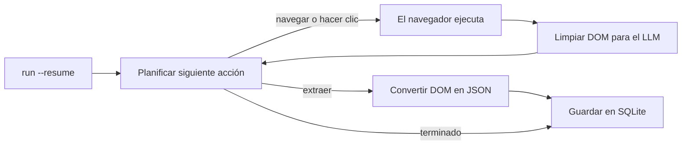

<a id="readme-top"></a>
<p align="center">
  
</p>
<p align="center">
  <strong>Un agente autónomo de investigación web y extracción estructurada a JSON.</strong>
  <br />
  Dale un objetivo en lenguaje natural y un esquema JSON. Planifica su propia navegación, lee la página y devuelve datos estructurados y validados.
</p>

<p align="center">
  <a href="https://github.com/EmanueleTorrisi/verboisy/actions/workflows/ci.yml"></a>
  <a href="https://codecov.io/gh/EmanueleTorrisi/verboisy"></a>
  <a href="https://emanueletorrisi.github.io/verboisy/"></a>
  <a href="#installation"></a>
  <!--<a href="https://pypi.org/project/verboisy/"></a>-->
  
  <a href="../../LICENSE"></a>
  <a href="https://github.com/astral-sh/ruff"></a>
</p>

<p align="center">
  <em>v0.1.0 | Versión anterior a la 1.0 y en desarrollo activo. Hasta la 1.0 pueden producirse cambios incompatibles entre versiones menores.</em>
</p>

<p align="center">
  <a href="../../README.md" title="English" aria-label="English">🇬🇧</a> ·
  <a href="README.it.md" title="Italiano" aria-label="Italiano">🇮🇹</a> ·
  <a href="README.de.md" title="Deutsch" aria-label="Deutsch">🇩🇪</a> ·
  <a href="README.zh-CN.md" title="简体中文" aria-label="简体中文">🇨🇳</a> ·
  <a href="README.fr.md" title="Français" aria-label="Français">🇫🇷</a> ·
  <strong title="Español" aria-label="Español">🇪🇸</strong> ·
  <a href="README.ko.md" title="한국어" aria-label="한국어">🇰🇷</a> ·
  <a href="README.ja.md" title="日本語" aria-label="日本語">🇯🇵</a>
</p>

## Índice

- [Demostración](#demo)
- [Por qué Verboisy](#why-verboisy)
- [Comparación](#compared-to)
- [Ejemplo rápido](#quick-example)
- [Casos de uso](#use-cases)
- [Cómo funciona](#how-it-works)
- [Instalación](#installation)
- [Configuración](#configuration)
- [Uso](#usage)
- [Docker](#docker)
- [Limitaciones conocidas](#known-limitations)
- [Uso responsable](#responsible-use)
- [Documentación](#documentation)
- [Contribuciones](#contributing)
- [Seguridad](#security)
- [Licencia](#license)

<a id="demo"></a>

## Demostración

La [animación histórica](../../docs/demo.gif) es ilustrativa y no verifica el producto. La grabación proporcionada es anterior a la implementación de la reanudación. Utiliza el [procedimiento para una demostración real en directo](../../docs/demo.md) para grabar el comportamiento real del navegador, el modelo, SQLite, las interrupciones y la exportación. Una nueva grabación en directo sigue siendo un requisito de aceptación.

Esta revisión incluye pruebas de regresión sin conexión ejecutables y una comprobación obligatoria de integración con Chromium. Consulta las [comprobaciones de validación y publicación](../../docs/validation.md) antes del despliegue; no constituyen una afirmación de que el producto esté listo para producción.

<a id="why-verboisy"></a>

## Por qué Verboisy

- **Guiado por objetivos, no por selectores.** Describe el objetivo en lenguaje natural. El planificador decide el siguiente clic, desplazamiento o lectura según la página que realmente tiene delante. El modelo intenta adaptarse al DOM observado; un rediseño todavía puede interrumpir la ejecución.
- **Primero el esquema, no una extracción aproximada.** Cada registro se comprueba con tu esquema JSON y se encapsula en un modelo Pydantic antes de guardarse. La validación comprueba la estructura y las restricciones; no demuestra la exactitud de los hechos.
- **Tu modelo, tu infraestructura.** OpenAI, Anthropic o un modelo local de Ollama mediante [LiteLLM](https://github.com/BerriAI/litellm): cambia con una sola variable de entorno. Se ejecuta en tu equipo o tus servidores, no en un servicio alojado opaco.
- **Reanudación integrada.** Cada registro validado se confirma en SQLite antes de procesar el siguiente candidato. `verboisy run --resume` (o `run(resume=True)` en Python) retoma la última ejecución incompleta. Los registros guardados anteriormente sobreviven a una interrupción. La reanudación recupera el progreso y la última URL guardada, pero no el estado de la sesión del navegador.

Este ciclo incluye Playwright asíncrono (Chromium con o sin interfaz), limpieza del DOM ajustada a las ventanas de contexto de los LLM en lugar de volcados HTML sin procesar y exportación JSON o CSV; también puedes consultar SQLite directamente.

<a id="compared-to"></a>

## Comparación

Verboisy combina un agente de navegador autónomo y un extractor validado mediante esquema. Las herramientas cercanas cubren bien uno de esos aspectos; Verboisy se ha creado para ambos.

| | Verboisy | [Browser Use](https://github.com/browser-use/browser-use) | [Firecrawl](https://github.com/firecrawl/firecrawl) | [Crawl4AI](https://github.com/unclecode/crawl4ai) |
| --- | --- | --- | --- | --- |
| Qué describes | un objetivo **y** un esquema JSON | un objetivo | URL + instrucción o esquema | reglas de rastreo + instrucción |
| Navegación | el planificador elige los clics | el planificador elige los clics | rastreo / mapa del sitio | rastreo |
| Validación | esquema JSON + Pydantic, antes de escribir | tu código | esquema de extracción opcional | tu código |
| Persistencia | SQLite por registro, `--resume` | memoria / tu código | API o tu base de datos | tu código |
| Dónde se ejecuta | tu equipo | tu equipo | alojado o autogestionado | tu equipo |

Si ya conoces la URL y solo necesitas Markdown, Firecrawl o Crawl4AI son más sencillos. Si necesitas un agente general para usar el ordenador y validarás los datos después, Browser Use encaja mejor. Si necesitas filas conformes a un esquema y el agente debe encontrarlas, ese es el propósito de Verboisy.

<a id="quick-example"></a>

## Ejemplo rápido

El esquema utiliza JSON Schema. Para una lista de registros, el nivel superior es un `"array"` cuyos `"items"` describen la forma del objeto de cada fila:

```json
{
  "type": "array",
  "items": {
    "type": "object",
    "properties": {
      "name": { "type": "string" },
      "website": { "type": "string" },
      "description": { "type": "string" },
      "batch": { "type": "string" }
    },
    "required": ["name", "website"]
  }
}
```

Verboisy construye dinámicamente un modelo Pydantic a partir del esquema y rechaza las filas que no cumplen antes de que lleguen a SQLite.

Interfaz de línea de comandos (CLI):

```bash
verboisy run \
  --goal "Encuentra startups de IA de la promoción de otoño de 2026 (F26) de Y Combinator" \
  --schema examples/yc_startups/schema.json \
  --export result.json
```

La misma ejecución desde Python:

```python
from verboisy import run

result = run(
    goal="Encuentra startups de IA de la promoción de otoño de 2026 (F26) de Y Combinator",
    schema="examples/yc_startups/schema.json",
    export="result.json",
)

print(result.run_id, len(result.records))
for row in result.records:
    print(row["name"], row["website"])
```

Un posible resultado ilustrativo tendría esta estructura:

```json
[
  {
    "name": "Marrow",
    "website": "https://marrow.example.com",
    "description": "Entornos de pruebas previos a producción para agentes de IA.",
    "batch": "F26"
  },
  {
    "name": "Kiln Trace",
    "website": "https://kilntrace.example.com",
    "description": "Depuración de latencia y costes en flujos de trabajo de agentes.",
    "batch": "F26"
  }
]
```

*(Resultado ilustrativo: los resultados reales dependen del contenido disponible en la página durante la ejecución. Los nombres de ejemplo usan `.example.com` de forma intencionada.)*

Si el proceso se detiene a mitad, retómalo sin repetir las filas guardadas:

```bash
verboisy run --resume
```

```python
result = run(resume=True)
```

<a id="use-cases"></a>

## Casos de uso

Verboisy está pensado para patrones de investigación que merece la pena repetir:

- **Inteligencia competitiva y de mercado:** supervisa periódicamente precios, páginas de productos y anuncios de la competencia en lugar de revisarlos a mano.
- **Investigación de clientes potenciales B2B:** convierte listas de empresas en registros estructurados de datos empresariales y tecnologías, listos para importar a un CRM.
- **Supervisión de comercio electrónico y minorista:** observa cambios de catálogos y precios en tiendas que dependen mucho de JavaScript.
- **Operaciones de investigación (ResOps):** repite el mismo patrón de consulta para cientos de entidades de forma programada.
- **Ingesta para RAG / bases de conocimiento:** alimenta un sistema de recuperación con registros estructurados y documentados, en vez de contexto seleccionado a mano.

Todos estos casos siguen el patrón objetivo + esquema del ejemplo rápido, aplicado a un sitio y una estructura de datos diferentes.

<a id="how-it-works"></a>

## Cómo funciona

Verboisy repite el ciclo principal **planificar → actuar → observar → extraer** hasta que el planificador decide que tiene datos suficientes o agota su presupuesto de pasos.



Cada registro extraído se confirma en SQLite en cuanto se valida, asociado a un `run_id`. Si interrumpes el ciclo por un límite de solicitudes, un fallo o la finalización del proceso, `verboisy run --resume` (o `run(resume=True)`) carga de nuevo objetivo, esquema, filas guardadas, historial y última URL registrada, y continúa. `--resume <id>` selecciona una ejecución específica; `--resume` sin identificador retoma la última incompleta.

`--export` escribe el archivo al finalizar, incluso si la ejecución se ha reanudado. Hasta entonces, los resultados parciales se encuentran en `SQLITE_DB_PATH`.

Puedes consultar la descripción completa de los módulos en [`ARCHITECTURE.md`](../../ARCHITECTURE.md).

<a id="installation"></a>

## Instalación

Requiere Python 3.11 o posterior.

Todavía no está en PyPI. Instala desde el código fuente:

```bash
git clone https://github.com/EmanueleTorrisi/verboisy.git
cd verboisy && pip install -e .
```

Cuando se publique la primera versión, los comandos serán:

```bash
pip install verboisy
```

<a id="configuration"></a>

## Configuración

Copia `.env.example` a `.env`. Pydantic carga todos los ajustes desde `utils/config.py`; lo que no configures utilizará los valores predeterminados siguientes.

```bash
# Obligatorio: al menos un proveedor de LLM
OPENAI_API_KEY=sk-your-api-key-here
# ANTHROPIC_API_KEY=sk-ant-your-api-key-here

# Selección del modelo mediante LiteLLM (p. ej., gpt-4o, claude-sonnet-5, ollama/llama3)
LITELLM_MODEL=gpt-4o

SQLITE_DB_PATH=verboisy.db
VERBOISY_LOG_LEVEL=INFO
VERBOISY_HEADLESS=true
```

| Variable | Predeterminado | Descripción |
| --- | --- | --- |
| `OPENAI_API_KEY` | - | Credenciales de OpenAI. Obligatorio salvo que uses Anthropic o un modelo local. |
| `ANTHROPIC_API_KEY` | - | Credenciales de Anthropic, en lugar de OpenAI. |
| `LITELLM_MODEL` | `gpt-4o` | Identificador de un modelo admitido por [LiteLLM](https://github.com/BerriAI/litellm). |
| `MAX_TOKENS` | `4096` | Tokens máximos por llamada de planificación o extracción. |
| `TEMPERATURE` | `0.0` | Temperatura de muestreo del planificador. |
| `VERBOISY_HEADLESS` | `true` | Ejecutar Chromium sin interfaz. Pon `false` para ver el navegador. |
| `BROWSER_TIMEOUT_MS` | `30000` | Tiempo límite de navegación por página, en ms. |
| `USER_AGENT_ROTATION` | `true` | Elegir un agente de usuario al crear el contexto del navegador; no cambia en cada solicitud. |
| `SQLITE_DB_PATH` | `verboisy.db` | Ruta donde se guardan las ejecuciones y los registros extraídos. |
| `VERBOISY_LOG_LEVEL` | `INFO` | Nivel estándar de registro de Python. `DEBUG` muestra cada paso del planificador. |

Pagas directamente al proveedor de LLM. Las llamadas de planificación y extracción están limitadas por `MAX_TOKENS` (4096 por defecto) con `TEMPERATURE` 0.0. El número de llamadas depende de la navegación, la extracción y los reintentos. No existe un contador de uso alojado.

<a id="usage"></a>

## Uso

### CLI

```bash
verboisy run \
  --goal "Encuentra startups de IA de la promoción de otoño de 2026 (F26) de Y Combinator" \
  --schema examples/yc_startups/schema.json \
  --export result.json
```

El comando registra un `run_id` (también guardado en SQLite). Al agotar el presupuesto devuelve un resultado incompleto y termina con código 2; los errores terminan con 1 y Ctrl-C con 130. Solo FINISH junto con una validación correcta de la colección completan una ejecución. Utiliza su ID para reanudarla más adelante.

| Opción | Abreviatura | Obligatoria | Descripción |
| --- | --- | --- | --- |
| `--goal` | `-g` | Sí, salvo `--resume` | Descripción en lenguaje natural de qué buscar y dónde. Sé específico. |
| `--schema` | `-s` | Sí, salvo `--resume` | Ruta al esquema JSON de los campos que se deben extraer. `array` de `object` en el nivel superior. |
| `--export` | `-e` | No | Ruta de salida. Admite `.json` y `.csv`. Se escribe al finalizar la ejecución. |
| `--resume` | `-r` | No | Reanuda una ejecución. Sin ID, `--resume` continúa la última ejecución incompleta de `SQLITE_DB_PATH`; `--resume <id>` continúa la indicada. Objetivo y esquema se recuperan de la ejecución guardada; aún puedes modificar `--export` y el modo con/sin interfaz. |

Ejecuta `verboisy run --help` para consultar todas las opciones.

Otras opciones son `--max-steps/-m` y `--headless/--headed`. El presupuesto de pasos se renueva al reanudar, aunque los contadores guardados siguen siendo acumulativos. Se acepta un prefijo único del identificador. Una ejecución completada puede volver a exportarse sin llamar al navegador ni al modelo. Los fallos de exportación devuelven un código distinto de cero y permiten reintentar de esta manera. Los resultados vacíos también generan un archivo.

<a id="resume"></a>

### Reanudación

```bash
# Última ejecución incompleta de verboisy.db
verboisy run --resume

# Una ejecución concreta
verboisy run --resume 7f3a2c1b --export result.json
```

Una página puede volver a leerse o extraerse tras una interrupción. Las filas canónicamente idénticas no se insertan de nuevo en la misma ejecución. No se restauran cookies, pestañas abiertas, posición de desplazamiento ni estado temporal de JavaScript. Si no hay ninguna ejecución incompleta, el comando termina con un error y un código distinto de cero que indica la base de datos consultada.

### Python

`run()` es la API pública síncrona; usa `await arun(...)` en notebooks o aplicaciones asíncronas. La CLI es una capa ligera sobre ella.

```python
from pathlib import Path
from verboisy import RunResult, run

result: RunResult = run(
    goal="Encuentra startups de IA de la promoción de otoño de 2026 (F26) de Y Combinator",
    schema="examples/yc_startups/schema.json",  # ruta, Path o dict
    export="result.json",
)

print(result.run_id)
print(result.records[0]["name"])
```

Esquema como diccionario, sin archivo:

```python
result = run(
    goal="Encuentra startups de IA de la promoción de otoño de 2026 (F26) de Y Combinator",
    schema={
        "type": "array",
        "items": {
            "type": "object",
            "properties": {
                "name": {"type": "string"},
                "website": {"type": "string"},
                "description": {"type": "string"},
                "batch": {"type": "string"},
            },
            "required": ["name", "website"],
        },
    },
)
```

Reanudación:

```python
from verboisy import run

# Última ejecución incompleta
result = run(resume=True)

# Ejecución concreta; exportar al finalizar
result = run(resume=result.run_id, export="result.json")
```

Firma:

```python
def run(
    *,
    goal: str | None = None,
    schema: str | Path | dict | None = None,
    export: str | Path | None = None,
    resume: bool | str = False,
    headless: bool | None = None,
    max_steps: int | None = None,
    config: Settings | None = None,
) -> RunResult: ...
```

Campos de `RunResult`:

| Campo | Tipo | Significado |
| --- | --- | --- |
| `run_id` | `str` | ID estable guardado en SQLite. Pásalo a `run(resume=...)`. |
| `records` | `list[dict]` | Todas las filas validadas de esta ejecución hasta el momento. |
| `export_path` | `Path \| None` | Ruta del archivo exportado si se indicó `--export` / `export=` y terminó la ejecución. |
| `db_path` | `Path` | Archivo SQLite utilizado. |
| `completed` | `bool` | `True` después de FINISH y la validación correcta de la colección. |
| `status` | `str` | COMPLETED o PAUSED en un retorno normal. |
| `stop_reason` | `str \| None` | Motivo por el que terminó la llamada. |

Reglas:

- Nueva ejecución: `goal` y `schema` son obligatorios; se omite `resume` o se establece `False`.
- Reanudación: `resume=True` o `resume="<id>"`; `goal` / `schema` son opcionales y se ignoran si la ejecución guardada ya los tiene.
- `headless=None` usa `VERBOISY_HEADLESS`. Pasa `True` / `False` para cambiarlo solo en esta llamada.

<a id="watching-a-run"></a>

### Observar una ejecución

```bash
VERBOISY_HEADLESS=false VERBOISY_LOG_LEVEL=DEBUG \
  verboisy run \
    --goal "Encuentra startups de IA de la promoción de otoño de 2026 (F26) de Y Combinator" \
    --schema examples/yc_startups/schema.json \
    --export result.json
```

Detalles del esquema: la raíz puede ser un array de objetos o el esquema de un único objeto-registro. Siguen admitiéndose los mapas de propiedades antiguos. La validación Draft 2020-12 contempla tipos anidados, diferencias entre campos obligatorios/opcionales/null, enum, patrones, límites numéricos, additionalProperties y formatos estándar. Solo se permiten referencias a fragmentos locales de esquema. Las restricciones de colección, como minItems, se comprueban sobre todas las filas guardadas antes de completar la ejecución. Las exportaciones JSON conservan los valores; el CSV antepone un apóstrofo al texto que parece una fórmula y codifica los valores anidados como JSON.

## Docker

```bash
# Crea y configura .env antes de empezar.
docker compose -f docker/docker-compose.yml up -d --build
docker compose -f docker/docker-compose.yml exec verboisy verboisy run \
  --goal "Encuentra startups de IA de la promoción de otoño de 2026 (F26) de Y Combinator" \
  --schema examples/yc_startups/schema.json \
  --export /data/result.json
docker compose -f docker/docker-compose.yml cp verboisy:/data/result.json ./result.json
```

El contenedor se ejecuta como usuario sin privilegios y lee `../.env` mediante Compose. Un volumen con nombre conserva `/data/verboisy.db` y las exportaciones entre reinicios. La imagen incluye los ejemplos. El soporte de aislamiento de Chromium debe probarse en el host de contenedores de destino; permanece activado por defecto. La compilación y el despliegue de Docker no se ejecutaron en el entorno de auditoría.

<a id="additional-configuration"></a>

## Configuración adicional

| Variable | Predeterminado | Finalidad |
| --- | --- | --- |
| LITELLM_API_KEY | sin establecer | Credencial explícita para otro proveedor/proxy |
| LITELLM_API_BASE | sin establecer | Endpoint explícito de LiteLLM, incluidos modelos locales |
| MAX_STEPS | 20 | Presupuesto de acciones por llamada; modificable mediante CLI/API |
| MAX_TOTAL_TOKENS | 1000000 | Presupuesto local de solicitudes: bytes del prompt más tokens de respuesta reservados por intento; no es un límite exacto de facturación |
| LLM_TIMEOUT_SECONDS | 60 | Tiempo límite para una solicitud al modelo |
| LLM_RETRIES | 2 | Reintentos ante fallos transitorios; JSON mal formado no se reintenta |
| RUN_TIMEOUT_SECONDS | 900 | Tiempo límite de una llamada |
| MAX_DOM_CHARS | 20000 | Límite de caracteres del contexto de página depurado |
| ACTION_DELAY_SECONDS | 0.5 | Pausa entre acciones |
| BROWSER_SANDBOX | true | Activar el aislamiento de Chromium |
| ALLOW_PRIVATE_NETWORK | false | Permitir explícitamente destinos internos/loopback |
| ALLOWED_DOMAINS | [] | Array JSON de nombres de host de destino exactos permitidos; vacío significa hosts públicos |

Los ajustes se cargan de nuevo en cada llamada pública. Las claves de OpenAI y Anthropic en `.env` se dirigen explícitamente al proveedor seleccionado. Los modelos locales pueden usar `LITELLM_API_BASE`. No cambies el proveedor ni los presupuestos durante una llamada mediante variables globales.

<a id="known-limitations"></a>

## Limitaciones conocidas

Esta revisión corrige las rutas principales documentadas, pero aún requiere pruebas de aceptación con un modelo activo y un navegador real en la plataforma de despliegue prevista. Las pruebas sin conexión por sí solas no certifican la exactitud de la investigación autónoma.

- La reanudación recupera la última URL guardada, no una sesión completa del navegador. La paginación de SPA, las sesiones autenticadas y las acciones en curso pueden requerir nueva navegación.
- El bloqueo de redes privadas y las comprobaciones de dominios son medidas de defensa adicionales. El DNS rebinding, el código del navegador y la inyección de prompts exigen aislamiento de despliegue y controles de salida de red.
- Se confía en los autores de esquemas; las expresiones regulares hostiles y los esquemas recursivos no tienen aislamiento de recursos.
- El contexto DOM tiene límites. Las páginas largas pueden necesitar desplazamiento o paginación y omitir datos.
- FINISH significa que el modelo decidió detenerse; comprueba por separado la completitud factual.
- Se admite una sola llamada cooperante por base de datos local. Los duplicados heredados se conservan durante la migración; no es posible corregir por inferencia estados COMPLETED antiguos incorrectos.

Otras limitaciones:

- **Sin cuentas ni historial de trabajos alojado:** usuario único. Los ID se guardan en SQLite local, no en un panel.
- **Sin programación:** inicia las ejecuciones manualmente o con tu propio cron u orquestador. `--resume` sirve para fallos y límites de solicitudes, no es un programador.
- **Sin API HTTP alojada:** las interfaces actuales son CLI, `verboisy.run()` y la imagen Docker.
- **Resultados irregulares en sitios con defensas antibot agresivas:** algunos destinos precisan reintentos o intervención manual.

¿Alguna de estas limitaciones bloquea tu caso de uso? [Abre una incidencia](https://github.com/EmanueleTorrisi/verboisy/issues): es la forma más directa de señalar qué corregir primero.

<a id="responsible-use"></a>

## Uso responsable

Verboisy controla un navegador real en tu nombre. Eres responsable de cumplir las condiciones de cada sitio, `robots.txt`, los límites de frecuencia y las leyes de tu jurisdicción. No lo uses para eludir autenticación ni controles de acceso para los que no tengas autorización.

<a id="documentation"></a>

## Documentación

La documentación completa, incluida la referencia de configuración y los detalles de la API, está publicada en **[emanueletorrisi.github.io/verboisy](https://emanueletorrisi.github.io/verboisy/)**.

<a id="contributing"></a>

## Contribuciones

Se agradecen las contribuciones. Consulta [`CONTRIBUTING.md`](../CONTRIBUTING.md) para preparar el entorno local y conocer las convenciones del código, y respeta el [Código de conducta](../CODE_OF_CONDUCT.md). ¿Quieres empezar? Consulta las incidencias etiquetadas [`good first issue`](https://github.com/EmanueleTorrisi/verboisy/labels/good%20first%20issue).

<a id="security"></a>

## Seguridad

¿Has encontrado una vulnerabilidad? No abras una incidencia pública: utiliza el [reporte privado de vulnerabilidades](https://github.com/EmanueleTorrisi/verboisy/security/advisories/new) o consulta [`SECURITY.md`](../SECURITY.md).

<a id="license"></a>

## Licencia

BSD de 2 cláusulas: consulta [`LICENSE`](../../LICENSE) para leer el texto completo.

---

<p align="center">
  Creado por <a href="https://github.com/EmanueleTorrisi">Emanuele Torrisi</a> · <a href="#readme-top">Volver arriba ↑</a>
</p>
