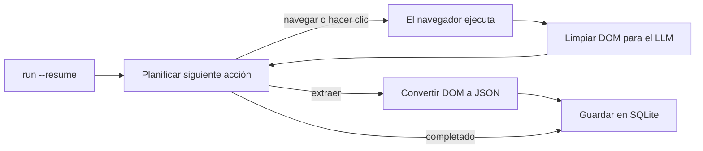

<a id="readme-top"></a>
<p align="center">
  
</p>
<p align="center">
  <strong>Un agente autónomo de investigación web y extracción estructurada a JSON.</strong>
  <br />
  Dale un objetivo en inglés sencillo y un Schema JSON. Planifica su propia navegación, lee la página y devuelve datos estructurados y validados.
</p>

<p align="center">
  <a href="https://github.com/EmanueleTorrisi/verboisy/actions/workflows/ci.yml"></a>
  <a href="https://codecov.io/gh/EmanueleTorrisi/verboisy"></a>
  <a href="https://emanueletorrisi.github.io/verboisy/"></a>
  <a href="#instalación"></a>
  <!--<a href="https://pypi.org/project/verboisy/"></a>-->
  
  <a href="LICENSE"></a>
  <a href="https://github.com/astral-sh/ruff"></a>
</p>

<p align="center">
  <em>v0.1.0 | versión pre-1.0 en desarrollo activo. Se esperan cambios incompatibles entre versiones menores hasta la 1.0.</em>
</p>

<p align="center">
  <a href="../../README.md" title="English" aria-label="English">🇬🇧</a> ·
  <a href="README.it.md" title="Italiano" aria-label="Italiano">🇮🇹</a> ·
  <a href="README.de.md" title="Deutsch" aria-label="Deutsch">🇩🇪</a> ·
  <a href="README.zh-CN.md" title="简体中文" aria-label="简体中文">🇨🇳</a> ·
  <a href="README.fr.md" title="Français" aria-label="Français">🇫🇷</a> ·
  <strong title="Español" aria-label="Español">🇪🇸</strong> ·
  <a href="README.ko.md" title="한국어" aria-label="한국어">🇰🇷</a> ·
  <a href="README.ja.md" title="日本語" aria-label="日本語">🇯🇵</a>
</p>

## Índice

- [Demo](#demo)
- [Por qué Verboisy](#por-qué-verboisy)
- [Comparativa](#comparativa)
- [Ejemplo rápido](#ejemplo-rápido)
- [Casos de uso](#casos-de-uso)
- [Cómo funciona](#cómo-funciona)
- [Instalación](#instalación)
- [Configuración](#configuración)
- [Uso](#uso)
- [Docker](#docker)
- [Limitaciones conocidas](#limitaciones-conocidas)
- [Uso responsable](#uso-responsable)
- [Documentación](#documentación)
- [Contribuciones](#contribuciones)
- [Seguridad](#seguridad)
- [Licencia](#licencia)

## Demo

*Grabación en curso: la CLI ya funciona hoy; consulta el [Ejemplo rápido](#ejemplo-rápido) a continuación para ver entradas y salidas reales mientras tanto.*

## Por qué Verboisy

- **Orientado a objetivos, no a selectores.** Describe el objetivo en inglés sencillo. El planificador decide el siguiente clic, desplazamiento o lectura de la página que tiene delante. Nada codificado de forma rígida que haya que reescribir cuando un sitio rediseña su interfaz.
- **Primero el esquema, no el mejor esfuerzo.** Cada registro se valida contra un modelo de Pydantic generado a partir de tu JSON Schema antes de guardarse. Los datos mal formados nunca llegan a tu base de datos.
- **Trae tu propio modelo, conserva tu propia infraestructura.** OpenAI, Anthropic o un modelo local de Ollama mediante [LiteLLM](https://github.com/BerriAI/litellm): una sola variable de entorno para cambiar. Se ejecuta en tu equipo o en tus servidores, no en una caja negra alojada.
- **Reanudable por diseño.** Cada registro llega a SQLite en el momento en que se valida. `verboisy run --resume` (o `run(resume=True)` en Python) reanuda la última ejecución incompleta. Una caída solo te cuesta el paso actual, no el trabajo ya guardado.

Lo que incluye alrededor de ese ciclo: Playwright asíncrono (Chromium, con o sin interfaz gráfica), limpieza de DOM optimizada para las ventanas de contexto de los LLM en lugar de volcados de HTML crudo, y exportación a JSON o CSV, o consultas directas a la base de datos SQLite.

## Comparativa

Verboisy es el punto de encuentro entre un agente navegador autónomo y un extractor validado por esquema. Las herramientas existentes suelen cubrir bien una de estas funciones; esta está diseñada para ambas.

| | Verboisy | [Browser Use](https://github.com/browser-use/browser-use) | [Firecrawl](https://github.com/firecrawl/firecrawl) | [Crawl4AI](https://github.com/unclecode/crawl4ai) |
| --- | --- | --- | --- | --- |
| Tú describes | un objetivo **y** un Schema JSON | un objetivo | una URL + prompt o esquema | reglas de crawl + un prompt |
| Navegación | el planificador elige los clics | el planificador elige los clics | crawl / sitemap | crawl |
| Validación | Pydantic desde tu esquema, antes de escribir | tu código | esquema de extracción opcional | tu código |
| Persistencia | SQLite por registro, `--resume` | en memoria / tu código | API o tu BD | tu código |
| Dónde se ejecuta | tu equipo | tu equipo | alojado o autoalojado | tu equipo |

Si ya conoces la URL y solo necesitas obtener markdown, Firecrawl o Crawl4AI son más sencillos. Si necesitas un agente de uso general de computadora y validarás más tarde, Browser Use se adapta mejor. Si la salida debe ser filas que coincidan con un esquema y el agente debe encontrarlas, eso es Verboisy.

## Ejemplo rápido

El esquema es JSON Schema. Para una lista de registros, el nivel superior es un `"array"` cuyos `"items"` definen la estructura del objeto de una fila:

```json
{
  "type": "array",
  "items": {
    "type": "object",
    "properties": {
      "name": { "type": "string" },
      "website": { "type": "string" },
      "description": { "type": "string" },
      "batch": { "type": "string" }
    },
    "required": ["name", "website"]
  }
}
```

Verboisy construye un modelo Pydantic a partir de esto en tiempo de ejecución y rechaza las filas que no coinciden antes de que lleguen a SQLite.

CLI:

```bash
verboisy run \
  --goal "Find AI startups from the Y Combinator Fall 2026 (F26) batch" \
  --schema examples/yc_startups/schema.json \
  --export result.json
```

La misma ejecución desde Python:

```python
from verboisy import run

result = run(
    goal="Find AI startups from the Y Combinator Fall 2026 (F26) batch",
    schema="examples/yc_startups/schema.json",
    export="result.json",
)

print(result.run_id, len(result.records))
for row in result.records:
    print(row["name"], row["website"])
```

Cualquiera de las dos formas produce lo siguiente:

```json
[
  {
    "name": "Marrow",
    "website": "[https://marrow.example.com](https://marrow.example.com)",
    "description": "Entornos de prueba (staging) para agentes de IA en producción.",
    "batch": "F26"
  },
  {
    "name": "Kiln Trace",
    "website": "[https://kilntrace.example.com](https://kilntrace.example.com)",
    "description": "Depuración de latencia y costes para flujos de trabajo de agentes.",
    "batch": "F26"
  }
]
```

*(Resultado ilustrativo: los resultados reales dependen de lo que esté activo en la página durante la ejecución. Los nombres de ejemplo usan `.example.com` a propósito.)*

Si el proceso se interrumpe a mitad de camino, reanúdalo sin rehacer las filas guardadas:

```bash
verboisy run --resume
```

```python
result = run(resume=True)
```

## Casos de uso

Verboisy está diseñado para patrones de investigación que vale la pena ejecutar más de una vez:

- **Inteligencia competitiva y de mercado:** realiza un seguimiento de precios de competidores, páginas de productos y anuncios según una programación en lugar de comprobarlo manualmente.
- **Investigación de clientes potenciales B2B:** convierte una lista de nombres de empresas en registros estructurados con datos firmográficos y de stack tecnológico, listos para importar al CRM.
- **Monitoreo de e-commerce y retail:** observa cambios en catálogos y precios en tiendas con un uso intensivo de JavaScript.
- **Operaciones de investigación (ResOps):** ejecuta el mismo patrón de consulta en cientos de entidades de forma recurrente.
- **Ingesta para RAG / bases de conocimiento:** alimenta un pipeline de recuperación con registros estructurados y con fuentes verficiables en lugar de contexto curado a mano.

Cada uno de estos casos sigue el mismo patrón de objetivo más esquema del Ejemplo rápido anterior, simplemente orientado a un sitio y a una estructura diferentes.

## Cómo funciona

Verboisy ejecuta un ciclo principal **planificar → actuar → observar → extraer** hasta que el planificador decide que tiene suficientes datos o alcanza su límite de pasos.



Cada registro extraído se guarda en SQLite en el momento en que se valida, bajo un `run_id`. Interrumpe el ciclo en cualquier momento (un límite de velocidad, un fallo, un proceso terminado) y `verboisy run --resume` (o `run(resume=True)`) recargará el objetivo, el esquema y las filas guardadas de esa ejecución para continuar. `--resume <id>` se dirige a una ejecución específica; `--resume` sin ID toma la última incompleta.

`--export` se escribe cuando finaliza la ejecución (o cuando finaliza una ejecución reanudada). Los resultados parciales permanecen mientras tanto en `SQLITE_DB_PATH`.

Desglose completo de cada módulo en [`ARCHITECTURE.md`](../../ARCHITECTURE.md).

## Instalación

Requiere Python 3.11+.

Aún no está en PyPI. Instalar desde el código fuente:

```bash
git clone [https://github.com/EmanueleTorrisi/verboisy.git](https://github.com/EmanueleTorrisi/verboisy.git)
cd verboisy && pip install -e .
playwright install --with-deps chromium
```

Una vez que se publique la primera versión, se instalará con:

```bash
pip install verboisy
playwright install --with-deps chromium
```

## Configuración

Copia `.env.example` a `.env`. Toda la configuración se carga a través de Pydantic en `utils/config.py`; cualquier opción no definida adoptará los valores predeterminados a continuación.

```bash
# Requerido: al menos un proveedor de LLM
OPENAI_API_KEY=sk-your-api-key-here
# ANTHROPIC_API_KEY=sk-ant-your-api-key-here

# Enrutamiento de modelos de LiteLLM (p. ej., gpt-4o, claude-sonnet-5, ollama/llama3)
LITELLM_MODEL=gpt-4o

SQLITE_DB_PATH=verboisy.db
VERBOISY_LOG_LEVEL=INFO
VERBOISY_HEADLESS=true
```

| Variable | Predeterminado | Descripción |
| --- | --- | --- |
| `OPENAI_API_KEY` | - | Credenciales de OpenAI. Requerido a menos que se use Anthropic o un modelo local. |
| `ANTHROPIC_API_KEY` | - | Credenciales de Anthropic, utilizadas en lugar de OpenAI. |
| `LITELLM_MODEL` | `gpt-4o` | Cualquier cadena de modelo compatible con [LiteLLM](https://github.com/BerriAI/litellm). |
| `MAX_TOKENS` | `4096` | Máximo de tokens por llamada del planificador o de extracción. |
| `TEMPERATURE` | `0.0` | Temperatura de muestreo para el planificador. |
| `VERBOISY_HEADLESS` | `true` | Ejecutar Chromium en modo headless (sin interfaz). Ajusta a `false` para ver el navegador. |
| `BROWSER_TIMEOUT_MS` | `30000` | Tiempo de espera de navegación por página, en ms. |
| `USER_AGENT_ROTATION` | `true` | Rotar user agents entre peticiones. |
| `SQLITE_DB_PATH` | `verboisy.db` | Ubicación donde se persisten las ejecuciones y los registros extraídos. |
| `VERBOISY_LOG_LEVEL` | `INFO` | Nivel de registro estándar de Python. `DEBUG` imprime cada paso del planificador. |

Pagas directamente al proveedor de LLM. Las llamadas de planificación y extracción están limitadas a `MAX_TOKENS` (predeterminado 4096) con `TEMPERATURE` 0.0. Un objetivo de tamaño de directorio suele requerir decenas de llamadas, no cientos. No hay ningún contador o cobro alojado.

## Uso

### CLI

```bash
verboisy run \
  --goal "Find AI startups from the Y Combinator Fall 2026 (F26) batch" \
  --schema examples/yc_startups/schema.json \
  --export result.json
```

El comando imprime un `run_id` (también guardado en SQLite). Utilízalo para reanudar más tarde.

| Opción | Alias | Requerido | Descripción |
| --- | --- | --- | --- |
| `--goal` | `-g` | Sí, excepto con `--resume` | Descripción en inglés sencillo de qué encontrar y dónde. Sé específico. |
| `--schema` | `-s` | Sí, excepto con `--resume` | Ruta a un JSON Schema que describe los campos a extraer. `array` de primer nivel compuesto por `object`s de registro. |
| `--export` | `-e` | No | Ruta de salida. Admite `.json` y `.csv`. Se escribe al finalizar la ejecución. |
| `--resume` | `-r` | No | Reanudar una ejecución. Con solo `--resume` continúa la última ejecución incompleta en `SQLITE_DB_PATH`. `--resume <id>` continúa esa ejecución específica. El objetivo y el esquema se cargan desde la ejecución guardada; `--export` / modo headless aún se pueden sobrescribir. |

Ejecuta `verboisy run --help` para ver la referencia completa de opciones.

### Reanudar

```bash
# Última ejecución incompleta en verboisy.db
verboisy run --resume

# Una ejecución específica
verboisy run --resume 7f3a2c1b --export result.json
```

Las filas ya validadas no se vuelven a extraer. Si no hay ninguna ejecución incompleta, el comando termina con un error indicando la base de datos consultada.

### Python

`run()` es la API pública. La CLI es una capa delgada sobre ella.

```python
from pathlib import Path
from verboisy import RunResult, run

result: RunResult = run(
    goal="Find AI startups from the Y Combinator Fall 2026 (F26) batch",
    schema="examples/yc_startups/schema.json",  # ruta, Path o dict
    export="result.json",
)

print(result.run_id)
print(result.records[0]["name"])
```

Esquema como diccionario, sin necesidad de archivo:

```python
result = run(
    goal="Find AI startups from the Y Combinator Fall 2026 (F26) batch",
    schema={
        "type": "array",
        "items": {
            "type": "object",
            "properties": {
                "name": {"type": "string"},
                "website": {"type": "string"},
                "description": {"type": "string"},
                "batch": {"type": "string"},
            },
            "required": ["name", "website"],
        },
    },
)
```

Reanudar:

```python
from verboisy import run

# Última ejecución incompleta
result = run(resume=True)

# Ejecución específica, guardar la exportación cuando termine
result = run(resume=result.run_id, export="result.json")
```

Firma:

```python
def run(
    *,
    goal: str | None = None,
    schema: str | Path | dict | None = None,
    export: str | Path | None = None,
    resume: bool | str = False,
    headless: bool | None = None,
) -> RunResult: ...
```

Campos de `RunResult`:

| Campo | Tipo | Significado |
| --- | --- | --- |
| `run_id` | `str` | Identificador estable guardado en SQLite. Pásalo a `run(resume=...)`. |
| `records` | `list[dict]` | Cada fila validada hasta el momento para esta ejecución. |
| `export_path` | `Path \| None` | Dónde se escribió el archivo exportado, si se definió `--export` / `export=` y la ejecución terminó. |
| `db_path` | `Path` | El archivo SQLite utilizado. |
| `completed` | `bool` | `True` cuando el planificador se detuvo porque terminó, no por una caída. |

Reglas:

- Nueva ejecución: `goal` y `schema` son obligatorios; `resume` se omite o es `False`.
- Reanudar: `resume=True` o `resume="<id>"`; `goal` / `schema` son opcionales y se ignoran si la ejecución ya los contiene.
- `headless=None` utiliza `VERBOISY_HEADLESS`. Pasa `True` / `False` para sobrescribirlo en esta llamada.

### Observar una ejecución

```bash
VERBOISY_HEADLESS=false VERBOISY_LOG_LEVEL=DEBUG \
  verboisy run \
    --goal "Find AI startups from the Y Combinator Fall 2026 (F26) batch" \
    --schema examples/yc_startups/schema.json \
    --export result.json
```

## Docker

```bash
docker compose -f docker/docker-compose.yml up -d --build
docker compose -f docker/docker-compose.yml exec verboisy verboisy run \
  --goal "Find AI startups from the Y Combinator Fall 2026 (F26) batch" \
  --schema examples/yc_startups/schema.json \
  --export result.json
```

El contenedor se inicia y se mantiene en ejecución, con las dependencias del navegador de Playwright ya instaladas, de modo que los comandos se ejecutan mediante `exec` en lugar de ser el entrypoint del contenedor. Monta o persiste `SQLITE_DB_PATH` si deseas que `--resume` funcione entre reinicios del contenedor. `OPENAI_API_KEY` se pasa automáticamente desde tu shell: expórtalo primero. Para pasar otras variables (`ANTHROPIC_API_KEY`, `LITELLM_MODEL`, etc.), expórtalas también o sustituye la lista `environment:` en `docker/docker-compose.yml` por `env_file: [../.env]`.

## Limitaciones conocidas

Software en fase beta, con total transparencia:

- **Sin cuentas ni historial de tareas alojado:** monousuario. Los ID de ejecución residen en el archivo SQLite local, no en un panel de control.
- **Sin programación de tareas (scheduling):** ejecuta las tareas manualmente o intégralas en tu propio cron u orquestador. `--resume` es para caídas y límites de tasa, no un programador.
- **Sin API HTTP alojada:** la CLI, `verboisy.run()` y la imagen de Docker son las únicas interfaces en este momento.
- **Inconsistente en sitios con fuerte protección anti-bot:** algunos objetivos requerirán reintentos o intervención manual.

¿Has encontrado alguna de estas limitaciones que bloquee tu caso de uso? [Abre un issue](https://github.com/EmanueleTorrisi/verboisy/issues): es la forma más directa de influir en lo que se corrige primero.

## Uso responsable

Verboisy opera un navegador real en tu nombre. Eres responsable de cumplir con los términos de servicio de cada sitio de destino, su `robots.txt`, los límites de tasa y las leyes de tu jurisdicción. No lo utilices para eludir autenticaciones o controles de acceso a los que no tengas autorización.

## Documentación

La documentación completa, incluida la referencia de configuración y los detalles de la API, está publicada en **[emanueletorrisi.github.io/verboisy](https://emanueletorrisi.github.io/verboisy/)**.

## Contribuciones

Las contribuciones son bienvenidas. Consulta [`CONTRIBUTING.md`](../CONTRIBUTING.md) para la configuración local y las convenciones de código, y sigue el [Código de conducta](../CODE_OF_CONDUCT.md). ¿Buscas por dónde empezar? Revisa las incidencias etiquetadas como [`good first issue`](https://github.com/EmanueleTorrisi/verboisy/labels/good%20first%20issue).

## Seguridad

¿Has encontrado una vulnerabilidad? Por favor, no abras una incidencia pública: utiliza la [comunicación privada de vulnerabilidades](https://github.com/EmanueleTorrisi/verboisy/security/advisories/new) o consulta [`SECURITY.md`](../SECURITY.md).

## Licencia

BSD 2-Clause: consulta [`LICENSE`](../../LICENSE) para ver el texto completo.

---

<p align="center">
  Creado por <a href="https://github.com/EmanueleTorrisi">Emanuele Torrisi</a> · <a href="#readme-top">Volver arriba ↑</a>
</p>
