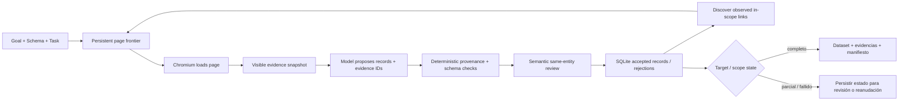

<a id="readme-top"></a>
<p align="center">
  
</p>
<p align="center">
  <strong>Investigación web respaldada por evidencia que convierte fuentes acotadas en datasets tipados.</strong>
  <br />
  Dale a Verboisy un objetivo, un JSON Schema y una política de fuentes. Navega, extrae, verifica procedencia, revisa significado y devuelve datos estructurados auditables.
</p>

<p align="center">
  <a href="https://github.com/EmanueleTorrisi/verboisy/actions/workflows/ci.yml"></a>
  <a href="https://codecov.io/gh/EmanueleTorrisi/verboisy"></a>
  <a href="https://emanueletorrisi.github.io/verboisy/"></a>
  <a href="#installation"></a>
  
  <a href="../../LICENSE"></a>
  <a href="https://github.com/astral-sh/ruff"></a>
</p>

<p align="center">
  <em>v0.2.0rc1 | candidato de lanzamiento. Basado en evidencia, reanudable y explícito sobre cobertura incompleta.</em>
</p>

<p align="center">
  <a href="../../README.md" title="English" aria-label="English">🇬🇧</a> ·
  <a href="README.it.md" title="Italiano" aria-label="Italiano">🇮🇹</a> ·
  <a href="README.de.md" title="Deutsch" aria-label="Deutsch">🇩🇪</a> ·
  <a href="README.zh-CN.md" title="简体中文" aria-label="简体中文">🇨🇳</a> ·
  <a href="README.fr.md" title="Français" aria-label="Français">🇫🇷</a> ·
  <strong title="Español" aria-label="Español">🇪🇸</strong> ·
  <a href="README.ko.md" title="한국어" aria-label="한국어">🇰🇷</a> ·
  <a href="README.ja.md" title="日本語" aria-label="日本語">🇯🇵</a>
</p>

## Contenido

- [Demo](#demo)
- [Por qué Verboisy](#why-verboisy)
- [Comparación](#compared-to)
- [Ejemplo rápido](#quick-example)
- [Casos de uso](#use-cases)
- [Cómo funciona](#how-it-works)
- [Instalación](#installation)
- [Configuración](#configuration)
- [Uso](#usage)
- [Salidas y CSV](#outputs-and-csv)
- [Docker](#docker)
- [Limitaciones conocidas](#known-limitations)
- [Uso responsable](#responsible-use)
- [Documentación](#documentation)
- [Contribuir](#contributing)
- [Seguridad](#security)
- [Licencia](#license)

<a id="demo"></a>
## Demo

La [animación histórica](../../docs/demo.gif) es ilustrativa y anterior al motor de evidencia 0.2. Para el comportamiento actual usa el [flujo de demo en vivo](../../docs/demo.md) y la [guía de validación](../../docs/validation.md).

0.2.0rc1 se ha probado con cobertura offline de statements/branches, Chromium real, instalación limpia de wheel, arranque Docker sandbox, fixtures live repetidas, paginación held-out, interrupción/reanudación, fuentes no disponibles, conflictos de identidad y un caso held-out no e-commerce. Son evidencias de release, no una garantía universal.

<a id="why-verboisy"></a>
## Por qué Verboisy

- **Con evidencia, no “lo dijo el modelo”.** Cada escalar no nulo debe apuntar a evidencia observada; el código valida fuente, scope de entidad, cita literal, tipo, link, transformación y schema.
- **Schema-first sin debilitar el contrato.** JSON Schema Draft 2020-12 define filas y restricciones de colección. Si falta evidencia requerida se rechaza el candidato.
- **Revisión semántica separada.** Tras los controles deterministas, otro paso del modelo revisa relevancia, significado y pertenencia a la misma entidad usando solo la evidencia dada. Es falible.
- **Investigación acotada y scope explícito.** Seeds, hosts, paths, profundidad, páginas, links por página y paginación JS opcional limitan lo observable.
- **Reanudable por diseño.** Estado de páginas, snapshots, candidatos, records aceptados, eventos, contabilidad y cola persisten en SQLite.
- **Los conflictos quedan visibles.** Las identidades deduplican iguales; payloads contradictorios para la misma identidad se ponen en cuarentena.

Playwright/Chromium + SQLite + LiteLLM + JSON/CSV + archivo lateral de evidencias + manifiesto con sumas de comprobación.

<a id="compared-to"></a>
## Comparación

Verboisy está entre un agente de investigación con navegador y un extractor estructurado; su contrato distintivo es la pista de evidencia de cada valor aceptado.

| | Verboisy | Agente general de navegador | Crawler / extractor | Extracción LLM ad hoc |
| --- | --- | --- | --- | --- |
| Describes | objetivo + JSON Schema + política | objetivo | URLs / reglas de crawl | prompt + texto |
| Navegación | links observados acotados + paginación opcional | acciones del modelo | reglas del crawler | normalmente ninguna |
| Procedencia de campos | obligatoria para cada escalar no nulo | tu código | varía | normalmente solo prompt |
| Validación | JSON Schema + evidencia determinista + review semántica | tu código | varía | best effort |
| Persistencia | cola SQLite, capturas, candidatos, registros, eventos | varía | varía | normalmente el llamador |
| Reanudación | id de ejecución durable + frontera persistente | varía | varía | normalmente el llamador |
| Conflictos | cuarentena determinista | caller | caller | caller |

<a id="quick-example"></a>
## Ejemplo rápido

Define exactamente qué significa un registro:

```json
{
  "type": "array",
  "minItems": 2,
  "items": {
    "type": "object",
    "properties": {
      "sku": {"type": "string", "description": "SKU del producto exactamente como lo publica la fuente"},
      "price_usd": {"type": "number", "minimum": 0, "description": "Precio unitario listado en USD; no convertir moneda"},
      "source_url": {"type": "string", "format": "uri", "description": "URL final de la página donde se observó este registro"}
    },
    "required": ["sku", "price_usd", "source_url"],
    "additionalProperties": false
  }
}
```

Después define la política acotada en `task.json`:

```json
{
  "seed_urls": ["https://catalog.example/products"],
  "allowed_hosts": ["catalog.example"],
  "include_paths": ["/products*"],
  "target_records": 20,
  "identity_fields": ["/sku"],
  "max_depth": 3,
  "max_pages": 100,
  "field_rules": {
    "/source_url": {"source": "page_url"}
  }
}
```

Ejecuta:

```bash
verboisy run \
  --goal "Recopila los SKU publicados y los precios listados en USD" \
  --schema schema.json \
  --task task.json \
  --export dataset.json \
  --max-steps 40
```

Una forma de salida ilustrativa:

```json
[
  {"sku": "LAMP-001", "price_usd": 39.95, "source_url": "https://catalog.example/products/lamp-001"},
  {"sku": "CHAIR-014", "price_usd": 129.0, "source_url": "https://catalog.example/products/chair-014"}
]
```

*Los dominios y registros de ejemplo son ilustrativos. Los resultados reales dependen de las páginas observadas.*

<a id="use-cases"></a>
## Casos de uso

Verboisy sirve cuando “dame filas” no basta y también necesitas “¿de dónde salió este valor?”.

- **Mercado y competencia:** catálogos, precios, funciones o anuncios con evidencia por campo.
- **Investigación B2B:** organizaciones/directorios estructurados con identidad y URL fuente.
- **Monitoreo e-commerce:** productos tipados sin ocultar observaciones contradictorias.
- **Research operations:** repetir schema/política sobre páginas controladas y reanudar desde SQLite.
- **Registros y referencias:** tablas técnicas como filas tipadas conservando evidencias exactas.
- **RAG / pipelines:** JSON canónico + sidecar de evidencia + manifest en lugar de prosa sin fuente.

<a id="how-it-works"></a>
## Cómo funciona

0.2 sustituye el viejo bucle libre plan/action por un motor acotado de investigación basada en evidencia:



Un snapshot contiene hechos visibles compactos, links resueltos, scopes de entidad, URL final, timestamp y hash. El HTML observado completo queda en SQLite. El modelo propone candidatos pero no puede saltarse schema/procedencia. `COMPLETED` significa target explícito satisfecho y colección válida, no exhaustividad global.

[`ARCHITECTURE.md`](../../ARCHITECTURE.md)

<a id="installation"></a>
## Instalación

Requiere Python 3.11–3.14.

Tras publicar una versión estable, la instalación normal prevista será:

```bash
pip install verboisy
```

Para esta release candidate no publicada instala la wheel suministrada o el checkout:

```bash
pip install -e .
verboisy --help
```

El primer uso del navegador descarga Chromium compatible antes de llamadas al modelo. Importar o ejecutar `--help` no descarga navegador. Preparación explícita:

```bash
verboisy setup
```

En Linux pueden hacer falta librerías nativas de Chromium, por ejemplo:

```bash
python -m playwright install-deps chromium
```

Verboisy no invoca `sudo` ni desactiva silenciosamente la sandbox.

<a id="configuration"></a>
## Configuración

Copia `.env.example` a `.env` y no versionees secretos.

```bash
OPENAI_API_KEY=sk-your-api-key-here
# ANTHROPIC_API_KEY=sk-ant-your-api-key-here
LITELLM_MODEL=gpt-4o
SQLITE_DB_PATH=verboisy.db
SEARCH_PROVIDER=disabled
BROWSER_SANDBOX=true
ALLOW_PRIVATE_NETWORK=false
```

Ajustes comunes:

| Variable | Propósito |
| --- | --- |
| `OPENAI_API_KEY / ANTHROPIC_API_KEY` | Credenciales del proveedor enrutadas mediante LiteLLM |
| `LITELLM_MODEL` | Identificador del modelo para propuestas y revisiones |
| `LITELLM_API_KEY / LITELLM_API_BASE` | Proveedor alternativo o proxy opcional |
| `SQLITE_DB_PATH` | Base de datos durable de ejecuciones 0.2 |
| `SEARCH_PROVIDER` | Desactivado con semillas conocidas; descubrimiento mediante Brave cuando se configura |
| `BRAVE_SEARCH_API_KEY` | Credencial para la búsqueda de Brave |
| `MAX_TOKENS` | Máximo de tokens de salida del modelo por solicitud |
| `MODEL_REQUEST_BUDGET` | Presupuesto local conservador de unidades de solicitud |
| `LLM_TIMEOUT_SECONDS` | Límite de tiempo por solicitud al modelo |
| `LLM_RETRIES` | Reintentos limitados para respuestas transitorias o inutilizables |
| `RUN_TIMEOUT_SECONDS` | Límite de tiempo por invocación |
| `MAX_DOM_CHARS` | Presupuesto de evidencias por lote del modelo |
| `ACTION_DELAY_SECONDS` | Pausa entre iteraciones de trabajo de página |
| `BROWSER_SANDBOX` | Activa/desactiva el sandbox de Chromium; mantenlo activado |
| `ALLOW_PRIVATE_NETWORK` | Acceso explícito a red privada/loopback; desactivado por defecto |
| `ALLOWED_DOMAINS` | Restricción opcional a hosts de destino exactos |

`verboisy doctor` muestra configuración no secreta y readiness. `verboisy setup` prepara/prueba Chromium sin modelo.

<a id="usage"></a>
## Uso

### CLI

```bash
verboisy run \
  --goal "Recopila los SKU publicados y los precios listados en USD" \
  --schema schema.json \
  --task task.json \
  --export dataset.json \
  --max-steps 40
```

Flags importantes:

| Flag | Requerido | Significado |
| --- | --- | --- |
| `--goal`, `-g` | run nuevo | Natural-language research objective |
| `--schema`, `-s` | run nuevo | JSON Schema path |
| `--task`, `-t` | run nuevo | Bounded source/discovery policy |
| `--export`, `-e` | no | Salida `.json` o `.csv` |
| `--resume`, `-r` | reanudar | Última ejecución incompleta o id de ejecución específico |
| `--max-steps`, `-m` | no | Límite de trabajo para esta invocación |
| `--headless` / `--headed` | no | Sobrescribir la visibilidad del navegador |

Códigos: `0` target completado, `2` parcial/agotado normal, `1` fallo, `130` interrupción.

### Reanudar

```bash
# Reanuda el último run incompleto
verboisy run --resume

# Reanuda un run específico y exporta al parar
verboisy run --resume 7f3a2c1b --export dataset.json
```

La reanudación conserva objetivo, schema, task, records aceptados, cola y contabilidad acumulada. El trabajo interrumpido/activo puede reprocesarse; la identidad determinista evita duplicados iguales.

### Python

`run()` es la API síncrona; usa `await arun(...)` en async.

```python
from verboisy import run

result = run(
    goal="Recopila los SKU publicados y los precios USD",
    schema="schema.json",
    task="task.json",
    export="dataset.json",
    max_steps=40,
)

print(result.run_id)
print(result.status, result.stop_reason)
for record in result.records:
    print(record)
```

<a id="outputs-and-csv"></a>
## Salidas y CSV

Un export JSON genera tres artefactos:

- `dataset.json` — solo los campos pedidos.
- `dataset.json.evidence.json` — registros aceptados con procedencia snapshot/evidencia.
- `dataset.json.manifest.json` — estado, schema/task, metadatos del modelo, validación y hashes SHA-256.

SQLite también conserva frontier, snapshots/HTML, candidatos, rechazos, records, coverage gaps, conflictos y contabilidad.

`csv_mode: "json"` codifica cada celda presente como JSON y conserva tipos exactos. Vacío = ausente; `null` sigue distinto.

`csv_mode: "spreadsheet"` crea celdas convencionales y escapa cadenas tipo fórmula. Es cómodo manualmente pero no canónico.

Verifica los hashes del manifest antes de tratar una copia como la misma generación.

<a id="docker"></a>
## Docker

El contenedor ejecuta Verboisy como usuario no privilegiado y ofrece un límite de despliegue más fuerte que una sesión personal.

```bash
docker build -f docker/Dockerfile -t verboisy:0.2.0rc1 .

docker run --rm --init --shm-size=1g \
  --security-opt seccomp=docker/seccomp_profile.json \
  --entrypoint verboisy \
  verboisy:0.2.0rc1 setup
```

Para workloads reales, persiste SQLite/exports, mantén sandbox y aplica control egress.

<a id="known-limitations"></a>
## Limitaciones conocidas

- El crawl sigue breadth-first links HTTP(S) observados e in-scope; el modelo puede priorizarlos pero no inventar destinos.
- `pagination_selector` soporta paginación JS acotada. Formularios generales, filtros arbitrarios, infinite scroll implícito, descargas, iframe/shadow-root y JS arbitrario no están implementados.
- Autenticación, CAPTCHA, bypass anti-bot, OCR, PDF y joins cross-page están fuera del contrato.
- El contexto DOM/evidencia es acotado; lotes enormes o respuestas inutilizables generan gaps explícitos.
- La procedencia literal prueba observación en el scope admitido, no verdad externa.
- La review semántica es falible.
- `COMPLETED` significa target completado, no completitud global.
- Una fuente no disponible puede dejar el run fallido/incompleto; subir presupuesto repetidamente no reemplaza evidencia.
- Sin `identity_fields`, solo igualdad exacta; con identidad, payloads contradictorios quedan en cuarentena.

<a id="responsible-use"></a>
## Uso responsable

Verboisy maneja un navegador real y guarda material fuente localmente. Eres responsable de términos, robots, rate limits, licencias, privacidad y ley. No eludas autenticación ni controles sin permiso.

Controles URL y sandbox son defense in depth, no aislamiento total. Para browsing no confiable usa cuenta/contenedor/VM dedicado, evita mounts sensibles y restringe egress.

Fuentes y registros pueden contener datos personales o licenciados. Verboisy no cifra SQLite por ti y accesibilidad no implica permiso de redistribución o entrenamiento.

<a id="documentation"></a>
## Documentación

- [Contrato y política de tareas](../../docs/contracts.md)
- [Validación y comprobaciones de lanzamiento](../../docs/validation.md)
- [Búsqueda y recuperación](../../docs/search-and-recovery.md)
- [Migración desde 0.1](../../docs/migration.md)
- [Flujo de demostración en vivo](../../docs/demo.md)
- [Operaciones de lanzamiento](../../docs/release.md)
- [Arquitectura](../../ARCHITECTURE.md)

<a id="contributing"></a>
## Contribuir

Las contribuciones son bienvenidas. Mira [`CONTRIBUTING.md`](../CONTRIBUTING.md). Cubre comportamiento nuevo con pruebas deterministas y no debilites evidencia/sandbox por una fixture.

<a id="security"></a>
## Seguridad

¿Vulnerabilidad? No abras issue público. Usa [reporte privado](https://github.com/EmanueleTorrisi/verboisy/security/advisories/new) o [`SECURITY.md`](../SECURITY.md).

<a id="license"></a>
## Licencia

BSD 2-Clause. Consulta [`LICENSE`](../../LICENSE).

---

<p align="center">
  Creado por <a href="https://github.com/EmanueleTorrisi">Emanuele Torrisi</a> · <a href="#readme-top">Volver arriba ↑</a>
</p>
