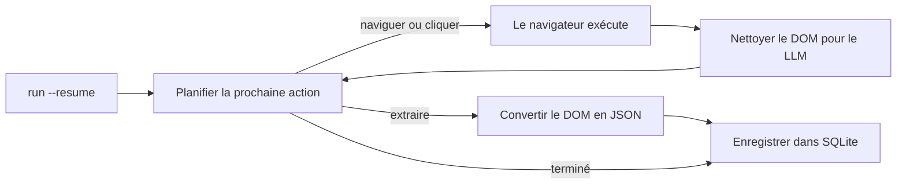

<a id="readme-top"></a>
<p align="center">
  
</p>
<p align="center">
  <strong>Un agent autonome de recherche Web et d'extraction structurée vers JSON.</strong>
  <br />
  Donnez-lui un objectif en langage naturel et un schéma JSON. Il planifie sa navigation, lit la page et renvoie des données structurées et validées.
</p>

<p align="center">
  <a href="https://github.com/EmanueleTorrisi/verboisy/actions/workflows/ci.yml"></a>
  <a href="https://codecov.io/gh/EmanueleTorrisi/verboisy"></a>
  <a href="https://emanueletorrisi.github.io/verboisy/"></a>
  <a href="#installation"></a>
  <!--<a href="https://pypi.org/project/verboisy/"></a>-->
  
  <a href="../../LICENSE"></a>
  <a href="https://github.com/astral-sh/ruff"></a>
</p>

<p align="center">
  <em>v0.1.0 | Version antérieure à la 1.0, activement développée. Attendez-vous à des changements incompatibles entre versions mineures jusqu'à la 1.0.</em>
</p>

<p align="center">
  <a href="../../README.md" title="English" aria-label="English">🇬🇧</a> ·
  <a href="README.it.md" title="Italiano" aria-label="Italiano">🇮🇹</a> ·
  <a href="README.de.md" title="Deutsch" aria-label="Deutsch">🇩🇪</a> ·
  <a href="README.zh-CN.md" title="简体中文" aria-label="简体中文">🇨🇳</a> ·
  <strong title="Français" aria-label="Français">🇫🇷</strong> ·
  <a href="README.es.md" title="Español" aria-label="Español">🇪🇸</a> ·
  <a href="README.ko.md" title="한국어" aria-label="한국어">🇰🇷</a> ·
  <a href="README.ja.md" title="日本語" aria-label="日本語">🇯🇵</a>
</p>

## Sommaire

- [Démo](#demo)
- [Pourquoi Verboisy](#why-verboisy)
- [Comparaison](#compared-to)
- [Exemple rapide](#quick-example)
- [Cas d'utilisation](#use-cases)
- [Fonctionnement](#how-it-works)
- [Installation](#installation)
- [Configuration](#configuration)
- [Utilisation](#usage)
- [Docker](#docker)
- [Limites connues](#known-limitations)
- [Utilisation responsable](#responsible-use)
- [Documentation](#documentation)
- [Contribuer](#contributing)
- [Sécurité](#security)
- [Licence](#license)

<a id="demo"></a>

## Démo

L'[animation historique](../../docs/demo.gif) est illustrative et ne prouve pas le fonctionnement du produit. L'enregistrement fourni précède la mise en œuvre de la reprise. Utilisez la [procédure de démo authentique en direct](../../docs/demo.md) pour enregistrer le comportement réel du navigateur, du modèle, de SQLite, de l'interruption et de l'export. Un nouvel enregistrement en direct reste un critère d'acceptation.

Cette révision comprend des tests de régression hors ligne exécutables et un contrôle d'intégration obligatoire avec Chromium. Consultez les [vérifications de validation et de publication](../../docs/validation.md) avant le déploiement ; cela ne constitue pas une déclaration d'aptitude à la production.

<a id="why-verboisy"></a>

## Pourquoi Verboisy

- **Piloté par l'objectif, pas par les sélecteurs.** Décrivez l'objectif en langage naturel. Le planificateur choisit le prochain clic, défilement ou accès au contenu selon la page réellement affichée. Le modèle essaie de s'adapter au DOM observé ; une refonte du site peut néanmoins interrompre l'exécution.
- **Le schéma d'abord, pas une extraction approximative.** Chaque enregistrement est vérifié par rapport au schéma JSON, puis encapsulé dans un modèle Pydantic avant d'être enregistré. La validation vérifie la structure et les contraintes ; elle ne prouve pas l'exactitude des faits.
- **Votre modèle et votre infrastructure.** OpenAI, Anthropic ou un modèle Ollama local via [LiteLLM](https://github.com/BerriAI/litellm) : une variable d'environnement suffit pour changer. L'exécution a lieu sur votre ordinateur ou vos serveurs, pas dans un service hébergé opaque.
- **Reprise intégrée.** Chaque enregistrement validé est confirmé dans SQLite avant le traitement du candidat suivant. `verboisy run --resume` (ou `run(resume=True)` en Python) reprend la dernière exécution incomplète. Les écritures précédentes survivent à une interruption. La reprise restaure la progression et la dernière URL sauvegardée, mais pas l'état de la session du navigateur.

Ce cycle s'appuie sur Playwright asynchrone (Chromium avec ou sans interface), un nettoyage du DOM adapté aux fenêtres de contexte des LLM plutôt qu'à de brutes extractions HTML, et un export JSON ou CSV ; la base SQLite reste directement interrogeable.

<a id="compared-to"></a>

## Comparaison

Verboisy associe un agent de navigation autonome et un extracteur validé par schéma. Les outils voisins couvrent surtout l'un de ces aspects ; Verboisy a été conçu pour les deux.

| | Verboisy | [Browser Use](https://github.com/browser-use/browser-use) | [Firecrawl](https://github.com/firecrawl/firecrawl) | [Crawl4AI](https://github.com/unclecode/crawl4ai) |
| --- | --- | --- | --- | --- |
| Vous décrivez | un objectif **et** un schéma JSON | un objectif | une URL + une consigne ou un schéma | des règles d'exploration + une consigne |
| Navigation | le planificateur choisit les clics | le planificateur choisit les clics | exploration / plan de site | exploration |
| Validation | schéma JSON + Pydantic, avant écriture | votre code | schéma d'extraction facultatif | votre code |
| Persistance | SQLite par enregistrement, `--resume` | mémoire / votre code | API ou votre base de données | votre code |
| Lieu d'exécution | votre ordinateur | votre ordinateur | hébergé ou auto-hébergé | votre ordinateur |

Si vous connaissez déjà l'URL et souhaitez seulement obtenir du Markdown, Firecrawl ou Crawl4AI sont plus simples. Si vous voulez un agent généraliste d'utilisation de l'ordinateur et comptez valider ensuite, Browser Use convient mieux. Si la sortie doit être constituée de lignes conformes à un schéma que l'agent doit lui-même trouver, c'est le rôle de Verboisy.

<a id="quick-example"></a>

## Exemple rapide

Le schéma utilise JSON Schema. Pour une liste d'enregistrements, le niveau supérieur est un `"array"` dont les `"items"` décrivent la structure de l'objet correspondant à une ligne :

```json
{
  "type": "array",
  "items": {
    "type": "object",
    "properties": {
      "name": { "type": "string" },
      "website": { "type": "string" },
      "description": { "type": "string" },
      "batch": { "type": "string" }
    },
    "required": ["name", "website"]
  }
}
```

Verboisy construit à l'exécution un modèle Pydantic à partir du schéma et rejette les lignes non conformes avant leur arrivée dans SQLite.

Interface en ligne de commande (CLI) :

```bash
verboisy run \
  --goal "Trouver les startups d'IA de la promotion automne 2026 (F26) de Y Combinator" \
  --schema examples/yc_startups/schema.json \
  --export result.json
```

La même exécution depuis Python :

```python
from verboisy import run

result = run(
    goal="Trouver les startups d'IA de la promotion automne 2026 (F26) de Y Combinator",
    schema="examples/yc_startups/schema.json",
    export="result.json",
)

print(result.run_id, len(result.records))
for row in result.records:
    print(row["name"], row["website"])
```

Voici une structure possible de sortie illustrative :

```json
[
  {
    "name": "Marrow",
    "website": "https://marrow.example.com",
    "description": "Environnements de préproduction pour des agents d'IA en production.",
    "batch": "F26"
  },
  {
    "name": "Kiln Trace",
    "website": "https://kilntrace.example.com",
    "description": "Débogage de la latence et des coûts des flux de travail d'agents.",
    "batch": "F26"
  }
]
```

*(Sortie illustrative : les résultats réels dépendent du contenu de la page au moment de l'exécution. Les noms d'exemple utilisent volontairement `.example.com`.)*

Si le processus s'arrête en cours d'exécution, reprenez-le sans retraiter les lignes déjà enregistrées :

```bash
verboisy run --resume
```

```python
result = run(resume=True)
```

<a id="use-cases"></a>

## Cas d'utilisation

Verboisy est conçu pour les recherches qui gagnent à être répétées :

- **Veille concurrentielle et de marché :** suivez régulièrement les prix, pages produit et annonces des concurrents plutôt que de vérifier manuellement.
- **Recherche de prospects B2B :** transformez une liste d'entreprises en fiches structurées sur leurs caractéristiques et technologies, prêtes à importer dans un CRM.
- **Surveillance du commerce électronique et de détail :** observez les changements de catalogues et de prix sur des boutiques fortement dépendantes de JavaScript.
- **Opérations de recherche (ResOps) :** appliquez périodiquement le même modèle de requête à des centaines d'entités.
- **Alimentation de RAG / bases de connaissances :** fournissez à une chaîne de recherche des enregistrements structurés et sourcés plutôt qu'un contexte sélectionné manuellement.

Chacun de ces cas suit le même principe objectif + schéma que l'exemple rapide, appliqué à un autre site et à une autre structure.

<a id="how-it-works"></a>

## Fonctionnement

Verboisy exécute la boucle **planifier → agir → observer → extraire** jusqu'à ce que le planificateur estime disposer d'assez de données ou atteigne sa limite d'étapes.



Chaque enregistrement extrait est confirmé dans SQLite dès sa validation, avec un `run_id`. En cas de limitation de débit, de plantage ou d'arrêt du processus, `verboisy run --resume` (ou `run(resume=True)`) recharge l'objectif, le schéma, les lignes enregistrées, l'historique et la dernière URL sauvegardée, puis continue. `--resume <id>` cible une exécution précise ; `--resume` sans identifiant reprend la dernière exécution incomplète.

`--export` écrit le fichier à la fin de l'exécution, y compris après une reprise. Entre-temps, les résultats partiels restent dans `SQLITE_DB_PATH`.

La description complète des modules se trouve dans [`ARCHITECTURE.md`](../../ARCHITECTURE.md).

<a id="installation"></a>

## Installation

Nécessite Python 3.11 ou une version ultérieure.

Pas encore disponible sur PyPI. Installez depuis les sources :

```bash
git clone https://github.com/EmanueleTorrisi/verboisy.git
cd verboisy
python -m pip install -e .
python -m playwright install chromium
```

Après la première publication, les commandes seront :

```bash
python -m pip install verboisy
python -m playwright install chromium
```

Chromium s'installe pendant la configuration. Verboisy ne télécharge pas de navigateur et ne lance pas le gestionnaire de paquets système pendant une exécution. Utilisez le même compte utilisateur et le même environnement Python pour l'installation et l'exécution. Sous Linux, installez le navigateur et ses dépendances système avec `python -m playwright install --with-deps chromium` (les paquets système nécessitent des droits d'administration). Avec Poetry, utilisez `poetry run playwright install --with-deps chromium`.

<a id="configuration"></a>

## Configuration

Copiez `.env.example` vers `.env`. Pydantic charge tous les paramètres via `utils/config.py` ; les valeurs non définies prennent les valeurs par défaut ci-dessous.

```bash
# Obligatoire : au moins un fournisseur de LLM
OPENAI_API_KEY=sk-your-api-key-here
# ANTHROPIC_API_KEY=sk-ant-your-api-key-here

# Sélection du modèle via LiteLLM (p. ex. gpt-4o, claude-sonnet-5, ollama/llama3)
LITELLM_MODEL=gpt-4o

SQLITE_DB_PATH=verboisy.db
VERBOISY_LOG_LEVEL=INFO
VERBOISY_HEADLESS=true
```

| Variable | Valeur par défaut | Description |
| --- | --- | --- |
| `OPENAI_API_KEY` | - | Identifiants OpenAI. Obligatoires sauf avec Anthropic ou un modèle local. |
| `ANTHROPIC_API_KEY` | - | Identifiants Anthropic, à la place d'OpenAI. |
| `LITELLM_MODEL` | `gpt-4o` | Identifiant de modèle accepté par [LiteLLM](https://github.com/BerriAI/litellm). |
| `MAX_TOKENS` | `4096` | Nombre maximal de jetons par appel de planification ou d'extraction. |
| `TEMPERATURE` | `0.0` | Température d'échantillonnage du planificateur. |
| `VERBOISY_HEADLESS` | `true` | Exécute Chromium sans interface. Utilisez `false` pour voir le navigateur. |
| `BROWSER_TIMEOUT_MS` | `30000` | Délai de navigation maximal par page, en ms. |
| `USER_AGENT_ROTATION` | `true` | Choisit un agent utilisateur lors de la création du contexte du navigateur ; pas de rotation par requête. |
| `SQLITE_DB_PATH` | `verboisy.db` | Emplacement des exécutions et enregistrements extraits. |
| `VERBOISY_LOG_LEVEL` | `INFO` | Niveau standard des journaux Python. `DEBUG` affiche chaque étape du planificateur. |

Vous payez directement le fournisseur de LLM. Les appels de planification et d'extraction sont plafonnés par `MAX_TOKENS` (4096 par défaut), avec `TEMPERATURE` à 0.0. Le nombre d'appels dépend de la navigation, de l'extraction et des nouvelles tentatives. Il n'y a pas de compteur hébergé.

<a id="usage"></a>

## Utilisation

### CLI

```bash
verboisy run \
  --goal "Trouver les startups d'IA de la promotion automne 2026 (F26) de Y Combinator" \
  --schema examples/yc_startups/schema.json \
  --export result.json
```

La commande journalise un `run_id` (également conservé dans SQLite). L'épuisement du budget renvoie un résultat incomplet avec le code de sortie 2 ; les erreurs donnent 1 et Ctrl-C donne 130. Seuls FINISH et une validation réussie de la collection achèvent l'exécution. Conservez l'ID pour la reprendre plus tard.

| Option | Raccourci | Obligatoire | Description |
| --- | --- | --- | --- |
| `--goal` | `-g` | Oui, sauf avec `--resume` | Description en langage naturel de ce qu'il faut trouver et où. Soyez précis. |
| `--schema` | `-s` | Oui, sauf avec `--resume` | Chemin du schéma JSON des champs à extraire. `array` d'`object` au niveau supérieur. |
| `--export` | `-e` | Non | Chemin de sortie. Formats `.json` et `.csv`. Écrit à la fin de l'exécution. |
| `--resume` | `-r` | Non | Reprend une exécution. Seul, `--resume` reprend la dernière incomplète dans `SQLITE_DB_PATH` ; `--resume <id>` reprend celle spécifiée. L'objectif et le schéma viennent de l'exécution enregistrée ; `--export` et le mode avec/sans interface restent modifiables. |

Exécutez `verboisy run --help` pour toutes les options.

Les autres options comprennent `--max-steps/-m` et `--headless/--headed`. La limite d'étapes est renouvelée lors d'une reprise ; les compteurs enregistrés restent cumulatifs. Un préfixe d'ID unique est accepté. Une exécution terminée peut être réexportée sans appel au navigateur ou au modèle. Les erreurs d'export renvoient un code non nul et peuvent être retentées ainsi. Un résultat vide crée également un fichier.

<a id="resume"></a>

### Reprise

```bash
# Dernière exécution incomplète dans verboisy.db
verboisy run --resume

# Exécution précise
verboisy run --resume 7f3a2c1b --export result.json
```

Une page peut être relue ou réextraite après une interruption. Les lignes canoniquement identiques ne sont pas insérées une seconde fois dans la même exécution. Cookies, onglets ouverts, position de défilement et état JavaScript temporaire ne sont pas restaurés. S'il n'existe aucune exécution incomplète, la commande renvoie une erreur et un code non nul indiquant la base consultée.

### Python

`run()` est l'API publique synchrone ; utilisez `await arun(...)` dans les notebooks ou applications asynchrones. La CLI en est une simple couche d'accès.

```python
from pathlib import Path
from verboisy import RunResult, run

result: RunResult = run(
    goal="Trouver les startups d'IA de la promotion automne 2026 (F26) de Y Combinator",
    schema="examples/yc_startups/schema.json",  # chemin, Path ou dict
    export="result.json",
)

print(result.run_id)
print(result.records[0]["name"])
```

Schéma sous forme de dictionnaire, sans fichier :

```python
result = run(
    goal="Trouver les startups d'IA de la promotion automne 2026 (F26) de Y Combinator",
    schema={
        "type": "array",
        "items": {
            "type": "object",
            "properties": {
                "name": {"type": "string"},
                "website": {"type": "string"},
                "description": {"type": "string"},
                "batch": {"type": "string"},
            },
            "required": ["name", "website"],
        },
    },
)
```

Reprise :

```python
from verboisy import run

# Dernière exécution incomplète
result = run(resume=True)

# Exécution précise, export à la fin
result = run(resume=result.run_id, export="result.json")
```

Signature :

```python
def run(
    *,
    goal: str | None = None,
    schema: str | Path | dict | None = None,
    export: str | Path | None = None,
    resume: bool | str = False,
    headless: bool | None = None,
    max_steps: int | None = None,
    config: Settings | None = None,
) -> RunResult: ...
```

Champs de `RunResult` :

| Champ | Type | Signification |
| --- | --- | --- |
| `run_id` | `str` | ID stable stocké dans SQLite. Passez-le à `run(resume=...)`. |
| `records` | `list[dict]` | Toutes les lignes déjà validées pour cette exécution. |
| `export_path` | `Path \| None` | Emplacement de l'export si `--export` / `export=` est défini et l'exécution terminée. |
| `db_path` | `Path` | Fichier SQLite utilisé. |
| `completed` | `bool` | `True` après FINISH et validation réussie de la collection. |
| `status` | `str` | COMPLETED ou PAUSED lors d'un retour normal. |
| `stop_reason` | `str \| None` | Motif de l'arrêt de l'appel. |

Règles :

- Nouvelle exécution : `goal` et `schema` sont obligatoires ; `resume` est omis ou vaut `False`.
- Reprise : `resume=True` ou `resume="<id>"` ; `goal` / `schema` sont facultatifs et ignorés si l'exécution les possède déjà.
- `headless=None` utilise `VERBOISY_HEADLESS`. Passez `True` / `False` pour le remplacer lors de cet appel.

<a id="watching-a-run"></a>

### Observer une exécution

```bash
VERBOISY_HEADLESS=false VERBOISY_LOG_LEVEL=DEBUG \
  verboisy run \
    --goal "Trouver les startups d'IA de la promotion automne 2026 (F26) de Y Combinator" \
    --schema examples/yc_startups/schema.json \
    --export result.json
```

Détails du schéma : la racine peut être un tableau d'objets ou le schéma d'un objet-enregistrement unique. Les anciennes cartes de propriétés restent acceptées. La validation Draft 2020-12 couvre les types imbriqués, les différences obligatoire/facultatif/null, enum, motifs, bornes numériques, additionalProperties et formats standard. Seules les références à des fragments locaux du schéma sont autorisées. Les contraintes de collection, comme minItems, sont vérifiées sur toutes les lignes enregistrées avant la fin. Les exports JSON conservent les valeurs ; le CSV préfixe les textes ressemblant à des formules par une apostrophe et encode les valeurs imbriquées en JSON.

## Docker

```bash
# Créer et configurer .env au préalable.
docker compose -f docker/docker-compose.yml up -d --build
docker compose -f docker/docker-compose.yml exec verboisy verboisy run \
  --goal "Trouver les startups d'IA de la promotion automne 2026 (F26) de Y Combinator" \
  --schema examples/yc_startups/schema.json \
  --export /data/result.json
docker compose -f docker/docker-compose.yml cp verboisy:/data/result.json ./result.json
```

Le conteneur s'exécute avec un utilisateur non privilégié et lit `../.env` via Compose. Un volume nommé conserve `/data/verboisy.db` et les exports après redémarrage. Les exemples sont inclus dans l'image. La prise en charge du bac à sable de Chromium doit être testée sur l'hôte cible ; elle reste activée par défaut. La compilation et le déploiement Docker n'ont pas été réalisés dans l'environnement d'audit.

<a id="additional-configuration"></a>

## Configuration supplémentaire

| Variable | Valeur par défaut | Objet |
| --- | --- | --- |
| LITELLM_API_KEY | non définie | Identifiant explicite pour un autre fournisseur/proxy |
| LITELLM_API_BASE | non définie | Point de terminaison LiteLLM explicite, y compris pour les modèles locaux |
| MAX_STEPS | 20 | Budget d'actions par appel ; modifiable via CLI/API |
| MAX_TOTAL_TOKENS | 1000000 | Budget local des requêtes : octets du prompt plus jetons de réponse réservés par tentative ; pas un plafond exact de facturation |
| LLM_TIMEOUT_SECONDS | 60 | Délai maximal d'une requête au modèle |
| LLM_RETRIES | 2 | Nouvelles tentatives pour les erreurs transitoires ; JSON malformé non retenté |
| RUN_TIMEOUT_SECONDS | 900 | Délai maximal d'un appel |
| MAX_DOM_CHARS | 20000 | Limite de caractères du contexte de page nettoyé |
| ACTION_DELAY_SECONDS | 0.5 | Pause entre les actions |
| BROWSER_SANDBOX | true | Activer le bac à sable de Chromium |
| ALLOW_PRIVATE_NETWORK | false | Autoriser explicitement les destinations internes/loopback |
| ALLOWED_DOMAINS | [] | Tableau JSON des noms d'hôte exacts autorisés ; vide signifie hôtes publics |

Les paramètres sont rechargés à chaque appel public. Les clés OpenAI et Anthropic dans `.env` sont explicitement acheminées vers le fournisseur choisi. Les modèles locaux peuvent utiliser `LITELLM_API_BASE`. Ne changez pas de fournisseur ni de budgets en cours d'appel via des variables globales.

<a id="known-limitations"></a>

## Limites connues

Cette révision corrige les principaux parcours documentés, mais nécessite encore des tests d'acceptation avec un modèle actif et un vrai navigateur sur la plateforme cible. Les tests hors ligne seuls ne certifient pas l'exactitude de la recherche autonome.

- La reprise restaure la dernière URL sauvegardée, pas la session complète du navigateur. Pagination des SPA, sessions authentifiées et actions en cours peuvent nécessiter une nouvelle navigation.
- Le blocage des réseaux privés et les contrôles de domaines constituent des défenses supplémentaires. Le DNS rebinding, le code du navigateur et l'injection de prompts nécessitent une isolation au déploiement et des contrôles du trafic sortant.
- Les auteurs des schémas sont considérés comme fiables ; les regex malveillantes et les schémas récursifs ne sont pas isolés en ressources.
- Le contexte DOM est limité. Les longues pages peuvent nécessiter du défilement ou de la pagination et omettre des données.
- FINISH signifie que le modèle a choisi de s'arrêter ; vérifiez indépendamment l'exhaustivité factuelle.
- Une seule exécution coopérative par base locale est prise en charge. Les doublons historiques sont conservés pendant la migration ; les anciens statuts COMPLETED erronés ne peuvent pas être corrigés par déduction.

Autres limites :

- **Aucun compte ni historique de tâches hébergé :** utilisateur unique. Les ID se trouvent dans SQLite local, pas sur un tableau de bord.
- **Aucune planification :** lancez les exécutions manuellement ou via votre propre cron/orchestrateur. `--resume` sert aux plantages et limitations de débit, pas à planifier.
- **Aucune API HTTP hébergée :** les interfaces actuelles sont la CLI, `verboisy.run()` et l'image Docker.
- **Résultats irréguliers sur les sites dotés d'anti-bots agressifs :** certaines cibles nécessitent plusieurs tentatives ou une intervention manuelle.

L'une de ces limites bloque votre cas d'utilisation ? [Ouvrez un ticket](https://github.com/EmanueleTorrisi/verboisy/issues) pour indiquer directement ce qu'il faudrait corriger en priorité.

<a id="responsible-use"></a>

## Utilisation responsable

Verboisy pilote un vrai navigateur pour votre compte. Vous devez respecter les conditions d'utilisation de chaque site, `robots.txt`, les limites de débit et les lois applicables dans votre juridiction. Ne l'utilisez pas pour contourner une authentification ou des contrôles d'accès auxquels vous n'êtes pas autorisé.

<a id="documentation"></a>

## Documentation

La documentation complète, y compris les paramètres de configuration et les détails de l'API, est publiée sur **[emanueletorrisi.github.io/verboisy](https://emanueletorrisi.github.io/verboisy/)**.

<a id="contributing"></a>

## Contribuer

Les contributions sont bienvenues. Consultez [`CONTRIBUTING.md`](../CONTRIBUTING.md) pour la configuration locale et les conventions de code, et respectez le [Code de conduite](../CODE_OF_CONDUCT.md). Pour commencer, regardez les tickets étiquetés [`good first issue`](https://github.com/EmanueleTorrisi/verboisy/labels/good%20first%20issue).

<a id="security"></a>

## Sécurité

Vous avez trouvé une vulnérabilité ? N'ouvrez pas de ticket public : utilisez le [signalement privé de vulnérabilités](https://github.com/EmanueleTorrisi/verboisy/security/advisories/new) ou consultez [`SECURITY.md`](../SECURITY.md).

<a id="license"></a>

## Licence

BSD à 2 clauses : consultez [`LICENSE`](../../LICENSE) pour le texte intégral.

---

<p align="center">
  Créé par <a href="https://github.com/EmanueleTorrisi">Emanuele Torrisi</a> · <a href="#readme-top">Retour en haut ↑</a>
</p>

Search API and bounded browser recovery: [configuration and limits (English)](../../docs/search-and-recovery.md).
