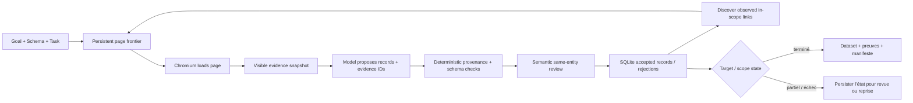

<a id="readme-top"></a>
<p align="center">
  
</p>
<p align="center">
  <strong>Recherche web fondée sur des preuves qui transforme des sources bornées en jeux de données typés.</strong>
  <br />
  Donnez à Verboisy un objectif, un JSON Schema et une politique de sources. Il navigue, extrait, vérifie la provenance, relit le sens et renvoie des données structurées auditables.
</p>

<p align="center">
  <a href="https://github.com/EmanueleTorrisi/verboisy/actions/workflows/ci.yml"></a>
  <a href="https://codecov.io/gh/EmanueleTorrisi/verboisy"></a>
  <a href="https://emanueletorrisi.github.io/verboisy/"></a>
  <a href="#installation"></a>
  
  <a href="../../LICENSE"></a>
  <a href="https://github.com/astral-sh/ruff"></a>
</p>

<p align="center">
  <em>v0.2.0rc1 | version candidate. Fondée sur des preuves, reprenable et explicite sur les limites de couverture.</em>
</p>

<p align="center">
  <a href="../../README.md" title="English" aria-label="English">🇬🇧</a> ·
  <a href="README.it.md" title="Italiano" aria-label="Italiano">🇮🇹</a> ·
  <a href="README.de.md" title="Deutsch" aria-label="Deutsch">🇩🇪</a> ·
  <a href="README.zh-CN.md" title="简体中文" aria-label="简体中文">🇨🇳</a> ·
  <strong title="Français" aria-label="Français">🇫🇷</strong> ·
  <a href="README.es.md" title="Español" aria-label="Español">🇪🇸</a> ·
  <a href="README.ko.md" title="한국어" aria-label="한국어">🇰🇷</a> ·
  <a href="README.ja.md" title="日本語" aria-label="日本語">🇯🇵</a>
</p>

## Sommaire

- [Démo](#demo)
- [Pourquoi Verboisy](#why-verboisy)
- [Comparaison](#compared-to)
- [Exemple rapide](#quick-example)
- [Cas d’usage](#use-cases)
- [Fonctionnement](#how-it-works)
- [Installation](#installation)
- [Configuration](#configuration)
- [Utilisation](#usage)
- [Sorties et CSV](#outputs-and-csv)
- [Docker](#docker)
- [Limites connues](#known-limitations)
- [Utilisation responsable](#responsible-use)
- [Documentation](#documentation)
- [Contribuer](#contributing)
- [Sécurité](#security)
- [Licence](#license)

<a id="demo"></a>
## Démo

L’[ancienne animation](../../docs/demo.gif) est illustrative et précède le moteur de preuves 0.2. Pour le comportement actuel, utilisez le [workflow de démo live](../../docs/demo.md) et le [guide de validation](../../docs/validation.md).

La 0.2.0rc1 a été exercée avec couverture offline des statements/branches, Chromium réel, installation propre de la wheel, démarrage Docker sandboxé, fixtures live répétées, pagination held-out, interruption/reprise, sources indisponibles, conflits d’identité et un cas held-out hors e-commerce. Ces contrôles sont des preuves de release, pas une garantie universelle.

<a id="why-verboisy"></a>
## Pourquoi Verboisy

- **Fondé sur des preuves, pas sur “le modèle l’a dit”.** Chaque scalaire non nul doit référencer une preuve observée; le code contrôle source, scope d’entité, citation littérale, type, lien, transformation et schéma.
- **Schema-first sans assouplissement silencieux.** JSON Schema Draft 2020-12 définit la ligne et les contraintes de collection. Une preuve obligatoire manquante bloque le candidat.
- **Relecture sémantique séparée.** Après les contrôles déterministes, un second passage modèle vérifie pertinence, sens des champs et appartenance à la même entité à partir des seules preuves fournies. Il reste faillible.
- **Recherche bornée, scope explicite.** URLs de départ, hôtes, chemins, profondeur, pages, liens par page et pagination JS optionnelle bornent l’observation.
- **Reprise par construction.** Pages, snapshots, candidats, lignes acceptées, événements, comptabilité modèle et file persistent dans SQLite.
- **Les conflits restent visibles.** Les champs d’identité dédupliquent les lignes identiques; les payloads contradictoires sont mis en quarantaine.

Playwright/Chromium + SQLite + LiteLLM + JSON/CSV + fichier annexe de preuves + manifeste avec sommes de contrôle.

<a id="compared-to"></a>
## Comparaison

Verboisy se situe entre un agent de recherche avec navigateur et un extracteur structuré; son contrat distinctif est la piste de preuve de chaque valeur acceptée.

| | Verboisy | Agent général de navigateur | Crawler / extracteur | Extraction LLM ad hoc |
| --- | --- | --- | --- | --- |
| Vous décrivez | objectif + JSON Schema + politique de sources | objectif | URLs / règles de crawl | prompt + texte de page |
| Navigation | liens observés bornés + pagination optionnelle | actions pilotées par modèle | règles du crawler | souvent aucune |
| Provenance des champs | requise pour chaque scalaire non nul | votre code | variable | souvent seulement le prompt |
| Validation | JSON Schema + preuves déterministes + revue sémantique | votre code | variable | généralement au mieux |
| Persistance | file SQLite, snapshots, candidats, records, événements | variable | variable | souvent côté appelant |
| Reprise | run id durable + frontier persistante | variable | variable | souvent côté appelant |
| Conflits d’identité | quarantaine déterministe | appelant | appelant | appelant |

<a id="quick-example"></a>
## Exemple rapide

Définissez précisément ce qu’est un enregistrement :

```json
{
  "type": "array",
  "minItems": 2,
  "items": {
    "type": "object",
    "properties": {
      "sku": {"type": "string", "description": "SKU produit exactement tel que publié par la source"},
      "price_usd": {"type": "number", "minimum": 0, "description": "Prix unitaire affiché en USD ; ne pas convertir la devise"},
      "source_url": {"type": "string", "format": "uri", "description": "URL finale de la page où cet enregistrement a été observé"}
    },
    "required": ["sku", "price_usd", "source_url"],
    "additionalProperties": false
  }
}
```

Définissez ensuite la politique bornée dans `task.json` :

```json
{
  "seed_urls": ["https://catalog.example/products"],
  "allowed_hosts": ["catalog.example"],
  "include_paths": ["/products*"],
  "target_records": 20,
  "identity_fields": ["/sku"],
  "max_depth": 3,
  "max_pages": 100,
  "field_rules": {
    "/source_url": {"source": "page_url"}
  }
}
```

Exécutez :

```bash
verboisy run \
  --goal "Collecter les SKU publiés et les prix affichés en USD" \
  --schema schema.json \
  --task task.json \
  --export dataset.json \
  --max-steps 40
```

Une forme de sortie illustrative :

```json
[
  {"sku": "LAMP-001", "price_usd": 39.95, "source_url": "https://catalog.example/products/lamp-001"},
  {"sku": "CHAIR-014", "price_usd": 129.0, "source_url": "https://catalog.example/products/chair-014"}
]
```

*Les domaines et lignes d’exemple sont illustratifs. Les résultats réels dépendent des pages effectivement observées.*

<a id="use-cases"></a>
## Cas d’usage

Verboisy est utile lorsque “donnez-moi des lignes” ne suffit pas et qu’il faut aussi répondre à “d’où vient cette valeur ?”.

- **Veille marché et concurrence :** catalogues, prix, fonctions ou annonces avec preuves par champ.
- **Recherche B2B :** organisations/directory structurées avec identité et URL source.
- **Suivi e-commerce :** jeux de produits typés sans masquer les observations contradictoires.
- **Research operations :** répéter schéma et politique sur un ensemble contrôlé, puis reprendre depuis SQLite.
- **Registres et références :** convertir des tables techniques en lignes typées en conservant les preuves exactes.
- **RAG / pipelines :** JSON canonique + sidecar de preuves + manifest plutôt que prose non sourcée.

<a id="how-it-works"></a>
## Fonctionnement

La 0.2 remplace l’ancienne boucle plan/action libre par un moteur de recherche borné fondé sur les preuves :



Un snapshot contient des faits visibles compacts, liens résolus, scopes d’entité, URL finale, horodatage et hash. Le HTML observé complet reste dans SQLite. Le modèle propose des candidats mais ne contourne ni le schéma ni la provenance. `COMPLETED` signifie que le target explicite et la validation de collection sont satisfaits, pas que tout le web a été exhaustivement parcouru.

[`ARCHITECTURE.md`](../../ARCHITECTURE.md)

<a id="installation"></a>
## Installation

Requiert Python 3.11–3.14.

Après publication d’une version stable, l’installation normale prévue sera :

```bash
pip install verboisy
```

Pour cette release candidate non publiée, installez la wheel fournie ou le checkout source :

```bash
pip install -e .
verboisy --help
```

Le premier usage du navigateur télécharge la build Chromium correspondante avant les appels modèle. L’import et `--help` ne téléchargent rien. Préparation explicite :

```bash
verboisy setup
```

Sous Linux, des bibliothèques natives Chromium peuvent être nécessaires, par exemple :

```bash
python -m playwright install-deps chromium
```

Verboisy n’exécute pas `sudo` et ne désactive pas silencieusement la sandbox Chromium.

<a id="configuration"></a>
## Configuration

Copiez `.env.example` vers `.env` et gardez les secrets hors du contrôle de version.

```bash
OPENAI_API_KEY=sk-your-api-key-here
# ANTHROPIC_API_KEY=sk-ant-your-api-key-here
LITELLM_MODEL=gpt-4o
SQLITE_DB_PATH=verboisy.db
SEARCH_PROVIDER=disabled
BROWSER_SANDBOX=true
ALLOW_PRIVATE_NETWORK=false
```

Réglages courants :

| Variable | Rôle |
| --- | --- |
| `OPENAI_API_KEY / ANTHROPIC_API_KEY` | Identifiants fournisseur routés via LiteLLM |
| `LITELLM_MODEL` | Identifiant du modèle pour les propositions et revues |
| `LITELLM_API_KEY / LITELLM_API_BASE` | Fournisseur alternatif ou proxy facultatif |
| `SQLITE_DB_PATH` | Base durable des exécutions 0.2 |
| `SEARCH_PROVIDER` | Désactivé pour des URL de départ connues ; découverte via Brave si configurée |
| `BRAVE_SEARCH_API_KEY` | Identifiant pour la recherche Brave |
| `MAX_TOKENS` | Nombre maximal de tokens de sortie par requête |
| `MODEL_REQUEST_BUDGET` | Budget local conservateur en unités de requête |
| `LLM_TIMEOUT_SECONDS` | Délai maximal par requête modèle |
| `LLM_RETRIES` | Réessais limités pour les réponses transitoires ou inutilisables |
| `RUN_TIMEOUT_SECONDS` | Délai maximal par invocation |
| `MAX_DOM_CHARS` | Budget de preuves par lot envoyé au modèle |
| `ACTION_DELAY_SECONDS` | Pause entre itérations de traitement des pages |
| `BROWSER_SANDBOX` | Active/désactive la sandbox Chromium ; laissez-la activée |
| `ALLOW_PRIVATE_NETWORK` | Accès explicite au réseau privé/loopback ; désactivé par défaut |
| `ALLOWED_DOMAINS` | Restriction facultative aux hôtes de destination exacts |

`verboisy doctor` affiche la configuration non secrète et l’état de l’environnement. `verboisy setup` prépare/teste Chromium sans appel modèle.

<a id="usage"></a>
## Utilisation

### CLI

```bash
verboisy run \
  --goal "Collecter les SKU publiés et les prix affichés en USD" \
  --schema schema.json \
  --task task.json \
  --export dataset.json \
  --max-steps 40
```

Options importantes :

| Flag | Requis | Signification |
| --- | --- | --- |
| `--goal`, `-g` | nouveau run | Natural-language research objective |
| `--schema`, `-s` | nouveau run | JSON Schema path |
| `--task`, `-t` | nouveau run | Bounded source/discovery policy |
| `--export`, `-e` | non | Sortie `.json` ou `.csv` |
| `--resume`, `-r` | reprise | Dernière exécution incomplète ou identifiant précis |
| `--max-steps`, `-m` | non | Limite de travail pour cette invocation |
| `--headless` / `--headed` | non | Remplacer le mode d’affichage du navigateur |

Codes de sortie : `0` target atteint, `2` résultat partiel/épuisé normal, `1` échec, `130` interruption.

### Reprise

```bash
# Reprendre le dernier run incomplet
verboisy run --resume

# Reprendre un run précis et exporter à l’arrêt
verboisy run --resume 7f3a2c1b --export dataset.json
```

La reprise conserve objectif, schéma, task, lignes acceptées, file et comptabilité cumulative. Les pages interrompues/actives redeviennent traitables; l’identité déterministe évite les doublons égaux.

### Python

`run()` est l’API synchrone ; utilisez `await arun(...)` en async.

```python
from verboisy import run

result = run(
    goal="Collecter les SKU publiés et les prix USD",
    schema="schema.json",
    task="task.json",
    export="dataset.json",
    max_steps=40,
)

print(result.run_id)
print(result.status, result.stop_reason)
for record in result.records:
    print(record)
```

<a id="outputs-and-csv"></a>
## Sorties et CSV

Un export JSON produit trois artefacts complémentaires :

- `dataset.json` — uniquement les champs demandés.
- `dataset.json.evidence.json` — lignes acceptées avec provenance snapshot/preuve.
- `dataset.json.manifest.json` — état, schéma/task, métadonnées modèle, validation de collection et hashes SHA-256.

SQLite conserve en plus frontier, snapshots/HTML, candidats, motifs de rejet, records, gaps de couverture, conflits d’identité et comptabilité.

Le `csv_mode: "json"` par défaut encode chaque cellule présente en JSON et préserve exactement les types. Vide = absent ; `null` reste distinct.

`csv_mode: "spreadsheet"` produit des cellules conventionnelles et protège les chaînes de type formule. Plus pratique manuellement, mais pas l’échange typé canonique.

Vérifiez toujours les hashes du manifest avant de considérer une copie comme la même génération.

<a id="docker"></a>
## Docker

Le conteneur fourni exécute Verboisy sans privilèges et constitue une frontière de déploiement plus forte qu’une session navigateur personnelle.

```bash
docker build -f docker/Dockerfile -t verboisy:0.2.0rc1 .

docker run --rm --init --shm-size=1g \
  --security-opt seccomp=docker/seccomp_profile.json \
  --entrypoint verboisy \
  verboisy:0.2.0rc1 setup
```

Pour de vrais workloads, persistez SQLite/exports, gardez la sandbox et appliquez des contrôles egress.

<a id="known-limitations"></a>
## Limites connues

- Le parcours suit en largeur les liens HTTP(S) observés et in-scope ; le modèle peut les prioriser mais pas inventer des destinations arbitraires.
- `pagination_selector` permet une pagination JS bornée. Formulaires généraux, filtres arbitraires, infinite scroll implicite, téléchargements, iframe/shadow-root et JS arbitraire ne sont pas implémentés.
- Authentification, CAPTCHA, anti-bot bypass, OCR, PDF et jointures cross-page sont hors contrat.
- Le contexte DOM/preuves est borné ; les lots trop gros ou réponses inutilisables deviennent des gaps explicites.
- La provenance littérale prouve l’observation dans le scope admis, pas la vérité de la source.
- La revue sémantique est faillible.
- `COMPLETED` signifie target atteint, pas complétude globale.
- Une source indisponible peut laisser le run en échec/incomplet ; augmenter sans cesse le budget ne remplace pas une preuve manquante.
- Sans `identity_fields`, seule l’égalité exacte déduplique ; avec identité, les payloads contradictoires sont mis en quarantaine.

<a id="responsible-use"></a>
## Utilisation responsable

Verboisy pilote un vrai navigateur et stocke les sources localement. Vous êtes responsable des CGU, robots, limites de débit, licences, vie privée et droit applicable. Ne contournez pas d’authentification ou contrôle d’accès sans autorisation.

Contrôles URL et sandbox sont de la défense en profondeur, pas une sandbox réseau totale. Pour des sources non fiables, utilisez compte/conteneur/VM dédiés, évitez les mounts sensibles et limitez l’egress.

Sources et lignes peuvent contenir des données personnelles ou sous licence. Verboisy ne chiffre pas SQLite pour vous et l’accessibilité n’autorise pas automatiquement redistribution ou entraînement.

<a id="documentation"></a>
## Documentation

- [Contrat et politique de tâche](../../docs/contracts.md)
- [Validation et contrôles de publication](../../docs/validation.md)
- [Recherche et récupération](../../docs/search-and-recovery.md)
- [Migration depuis 0.1](../../docs/migration.md)
- [Procédure de démo en direct](../../docs/demo.md)
- [Opérations de publication](../../docs/release.md)
- [Architecture](../../ARCHITECTURE.md)

<a id="contributing"></a>
## Contribuer

Les contributions sont bienvenues. Voir [`CONTRIBUTING.md`](../CONTRIBUTING.md). Couvrez les nouveaux comportements par des tests déterministes et n’affaiblissez pas preuves/sandbox pour une fixture.

<a id="security"></a>
## Sécurité

Vulnérabilité ? N’ouvrez pas d’issue public. Utilisez le [signalement privé](https://github.com/EmanueleTorrisi/verboisy/security/advisories/new) ou [`SECURITY.md`](../SECURITY.md).

<a id="license"></a>
## Licence

BSD 2-Clause. Voir [`LICENSE`](../../LICENSE).

---

<p align="center">
  Créé par <a href="https://github.com/EmanueleTorrisi">Emanuele Torrisi</a> · <a href="#readme-top">Retour en haut ↑</a>
</p>
