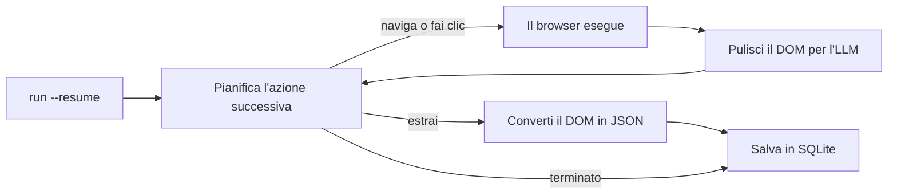

<a id="readme-top"></a>
<p align="center">
  
</p>
<p align="center">
  <strong>Un agente autonomo per la ricerca sul web e l'estrazione di dati strutturati in JSON.</strong>
  <br />
  Descrivi un obiettivo in linguaggio naturale e fornisci uno Schema JSON. L'agente pianifica la navigazione, legge la pagina e restituisce dati strutturati e convalidati.
</p>

<p align="center">
  <a href="https://github.com/EmanueleTorrisi/verboisy/actions/workflows/ci.yml"></a>
  <a href="https://codecov.io/gh/EmanueleTorrisi/verboisy"></a>
  <a href="https://emanueletorrisi.github.io/verboisy/"></a>
  <a href="#installation"></a>
  <!--<a href="https://pypi.org/project/verboisy/"></a>-->
  
  <a href="../../LICENSE"></a>
  <a href="https://github.com/astral-sh/ruff"></a>
</p>

<p align="center">
  <em>v0.1.0 | Versione precedente alla 1.0, in sviluppo attivo. Fino alla 1.0 sono possibili modifiche incompatibili tra versioni minori.</em>
</p>

<p align="center">
  <a href="../../README.md" title="English" aria-label="English">🇬🇧</a> ·
  <strong title="Italiano" aria-label="Italiano">🇮🇹</strong> ·
  <a href="README.de.md" title="Deutsch" aria-label="Deutsch">🇩🇪</a> ·
  <a href="README.zh-CN.md" title="简体中文" aria-label="简体中文">🇨🇳</a> ·
  <a href="README.fr.md" title="Français" aria-label="Français">🇫🇷</a> ·
  <a href="README.es.md" title="Español" aria-label="Español">🇪🇸</a> ·
  <a href="README.ko.md" title="한국어" aria-label="한국어">🇰🇷</a> ·
  <a href="README.ja.md" title="日本語" aria-label="日本語">🇯🇵</a>
</p>

## Indice

- [Demo](#demo)
- [Perché Verboisy](#why-verboisy)
- [Confronto con altri strumenti](#compared-to)
- [Esempio rapido](#quick-example)
- [Casi d'uso](#use-cases)
- [Come funziona](#how-it-works)
- [Installazione](#installation)
- [Configurazione](#configuration)
- [Utilizzo](#usage)
- [Docker](#docker)
- [Limitazioni note](#known-limitations)
- [Uso responsabile](#responsible-use)
- [Documentazione](#documentation)
- [Contribuire](#contributing)
- [Sicurezza](#security)
- [Licenza](#license)

<a id="demo"></a>

## Demo

L'[animazione storica](../../docs/demo.gif) ha scopo illustrativo e non costituisce una verifica del prodotto. La registrazione disponibile precede l'implementazione della ripresa delle esecuzioni. Usa la [procedura per una demo autentica dal vivo](../../docs/demo.md) per registrare il comportamento reale del browser, del modello, di SQLite, dell'interruzione e dell'esportazione. Una nuova registrazione dal vivo rimane un requisito di accettazione.

Questa revisione include test di regressione offline eseguibili e un controllo d'integrazione obbligatorio con Chromium. Prima della distribuzione, consulta i [controlli di convalida e rilascio](../../docs/validation.md): non costituiscono una dichiarazione di idoneità alla produzione.

<a id="why-verboisy"></a>

## Perché Verboisy

- **Guidato dall'obiettivo, non dai selettori.** Descrivi l'obiettivo in linguaggio naturale. Il pianificatore sceglie il clic, lo scorrimento o la lettura successivi in base alla pagina effettivamente visualizzata. Il modello cerca di adattarsi al DOM osservato; una riprogettazione del sito può comunque interrompere l'esecuzione.
- **Prima lo schema, non il «meglio possibile».** Ogni record viene verificato rispetto allo Schema JSON e poi incapsulato in un modello Pydantic prima del salvataggio. La convalida controlla struttura e vincoli, non dimostra l'accuratezza dei fatti.
- **Scegli il modello e mantieni l'infrastruttura.** OpenAI, Anthropic o un modello Ollama locale tramite [LiteLLM](https://github.com/BerriAI/litellm): basta una variabile d'ambiente per cambiarlo. L'esecuzione avviene sul tuo computer o sui tuoi server, non in un servizio ospitato opaco.
- **Ripresa integrata.** Ogni record convalidato viene salvato in SQLite prima di elaborare il candidato successivo. `verboisy run --resume` (oppure `run(resume=True)` in Python) riprende l'ultima esecuzione incompleta. I salvataggi precedenti resistono all'interruzione di un passaggio. La ripresa ripristina i progressi e l'ultimo URL registrato, ma non lo stato della sessione del browser.

Intorno a questo ciclo trovi Playwright asincrono (Chromium con o senza interfaccia), pulizia del DOM adattata alle finestre di contesto degli LLM anziché dump HTML grezzi, esportazione JSON o CSV e accesso diretto al database SQLite.

<a id="compared-to"></a>

## Confronto con altri strumenti

Verboisy unisce un agente browser autonomo e un estrattore convalidato tramite schema. Gli strumenti affini coprono bene uno di questi aspetti; Verboisy è progettato per entrambi.

| | Verboisy | [Browser Use](https://github.com/browser-use/browser-use) | [Firecrawl](https://github.com/firecrawl/firecrawl) | [Crawl4AI](https://github.com/unclecode/crawl4ai) |
| --- | --- | --- | --- | --- |
| Cosa descrivi | un obiettivo **e** uno Schema JSON | un obiettivo | un URL + un prompt o uno schema | regole di scansione + un prompt |
| Navigazione | il pianificatore sceglie i clic | il pianificatore sceglie i clic | scansione / sitemap | scansione |
| Convalida | Schema JSON + Pydantic, prima della scrittura | il tuo codice | schema di estrazione facoltativo | il tuo codice |
| Persistenza | SQLite per record, `--resume` | in memoria / nel tuo codice | API o tuo database | il tuo codice |
| Dove gira | sul tuo computer | sul tuo computer | ospitato o autogestito | sul tuo computer |

Se conosci già l'URL e ti serve solo Markdown, Firecrawl o Crawl4AI sono più semplici. Se cerchi un agente generico per usare il computer e convalidi i dati successivamente, Browser Use è più adatto. Se ti servono righe conformi a uno schema che l'agente deve trovare da sé, entra in gioco Verboisy.

<a id="quick-example"></a>

## Esempio rapido

Lo schema usa JSON Schema. Per un elenco di record, il livello superiore è un `"array"` i cui `"items"` descrivono l'oggetto di ciascuna riga:

```json
{
  "type": "array",
  "items": {
    "type": "object",
    "properties": {
      "name": { "type": "string" },
      "website": { "type": "string" },
      "description": { "type": "string" },
      "batch": { "type": "string" }
    },
    "required": ["name", "website"]
  }
}
```

Verboisy crea dinamicamente un modello Pydantic dallo schema e rifiuta le righe non conformi prima che raggiungano SQLite.

Interfaccia a riga di comando (CLI):

```bash
verboisy run \
  --goal "Trova startup di IA del batch autunnale 2026 (F26) di Y Combinator" \
  --schema examples/yc_startups/schema.json \
  --export result.json
```

La stessa esecuzione da Python:

```python
from verboisy import run

result = run(
    goal="Trova startup di IA del batch autunnale 2026 (F26) di Y Combinator",
    schema="examples/yc_startups/schema.json",
    export="result.json",
)

print(result.run_id, len(result.records))
for row in result.records:
    print(row["name"], row["website"])
```

Un possibile risultato illustrativo ha questa struttura:

```json
[
  {
    "name": "Marrow",
    "website": "https://marrow.example.com",
    "description": "Ambienti di staging per agenti di IA in produzione.",
    "batch": "F26"
  },
  {
    "name": "Kiln Trace",
    "website": "https://kilntrace.example.com",
    "description": "Analisi di latenza e costi per i flussi di lavoro degli agenti.",
    "batch": "F26"
  }
]
```

*(Output illustrativo: i risultati reali dipendono dal contenuto della pagina al momento dell'esecuzione. I nomi di esempio usano intenzionalmente `.example.com`.)*

Se il processo si interrompe a metà, riprendi senza rielaborare le righe già salvate:

```bash
verboisy run --resume
```

```python
result = run(resume=True)
```

<a id="use-cases"></a>

## Casi d'uso

Verboisy è pensato per attività di ricerca da eseguire ripetutamente:

- **Analisi competitiva e di mercato:** monitora periodicamente prezzi, pagine di prodotto e annunci dei concorrenti anziché controllarli manualmente.
- **Ricerca di lead B2B:** trasforma nomi di aziende in record strutturati su caratteristiche aziendali e stack tecnologico, pronti per l'importazione in un CRM.
- **Monitoraggio di e-commerce e vendita al dettaglio:** osserva le variazioni dei cataloghi e dei prezzi in negozi con molto JavaScript.
- **Operazioni di ricerca (ResOps):** ripeti lo stesso schema di ricerca per centinaia di entità a intervalli regolari.
- **Acquisizione per RAG / basi di conoscenza:** alimenta una pipeline di recupero con record strutturati e corredati di fonti, invece di contesto selezionato manualmente.

Tutti questi casi seguono il modello obiettivo + schema dell'esempio rapido, applicato a siti e strutture di dati diversi.

<a id="how-it-works"></a>

## Come funziona

Verboisy ripete il ciclo principale **pianifica → agisci → osserva → estrai** finché il pianificatore ritiene di avere dati sufficienti o esaurisce il numero di passaggi consentiti.



Ogni record estratto viene salvato in SQLite appena supera la convalida, associato a un `run_id`. Se il ciclo si interrompe per un limite di richieste, un arresto anomalo o la terminazione del processo, `verboisy run --resume` (o `run(resume=True)`) ricarica obiettivo, schema, righe salvate, cronologia e ultimo URL registrato e prosegue. `--resume <id>` seleziona un'esecuzione specifica; `--resume` senza ID riprende l'ultima incompleta.

`--export` crea il file alla fine dell'esecuzione, anche quando è stata ripresa. Nel frattempo, i risultati parziali risiedono in `SQLITE_DB_PATH`.

La descrizione completa dei moduli si trova in [`ARCHITECTURE.md`](../../ARCHITECTURE.md).

<a id="installation"></a>

## Installazione

Richiede Python >=3.11,<3.15.

Non è ancora disponibile su PyPI. Installa dal codice sorgente:

```bash
git clone https://github.com/EmanueleTorrisi/verboisy.git
cd verboisy
python -m pip install -e .
python -m playwright install chromium
```

Dopo la prima pubblicazione, il comando sarà:

```bash
python -m pip install verboisy
python -m playwright install chromium
```

Chromium si installa durante la configurazione: Verboisy non scarica browser e non avvia il gestore dei pacchetti di sistema durante un'esecuzione. Usa lo stesso utente del sistema e lo stesso ambiente Python per installazione ed esecuzione. Su Linux, installa il browser e le dipendenze di sistema con `python -m playwright install --with-deps chromium` (i pacchetti di sistema richiedono privilegi di amministratore). Con Poetry, usa `poetry run playwright install --with-deps chromium`.

<a id="configuration"></a>

## Configurazione

Copia `.env.example` in `.env`. Pydantic carica tutte le impostazioni tramite `utils/config.py`; i valori non specificati assumono i valori predefiniti indicati sotto.

```bash
# Obbligatorio: almeno un provider LLM
OPENAI_API_KEY=sk-your-api-key-here
# ANTHROPIC_API_KEY=sk-ant-your-api-key-here

# Instradamento dei modelli LiteLLM (per es. gpt-4o, claude-sonnet-5, ollama/llama3)
LITELLM_MODEL=gpt-4o

SQLITE_DB_PATH=verboisy.db
VERBOISY_LOG_LEVEL=INFO
VERBOISY_HEADLESS=true
```

| Variabile | Predefinito | Descrizione |
| --- | --- | --- |
| `OPENAI_API_KEY` | - | Credenziali OpenAI. Obbligatorie salvo utilizzo di Anthropic o di un modello locale. |
| `ANTHROPIC_API_KEY` | - | Credenziali Anthropic, alternative a OpenAI. |
| `LITELLM_MODEL` | `gpt-4o` | Stringa di un modello supportato da [LiteLLM](https://github.com/BerriAI/litellm). |
| `MAX_TOKENS` | `4096` | Numero massimo di token per chiamata di pianificazione o estrazione. |
| `TEMPERATURE` | `0.0` | Temperatura di campionamento del pianificatore. |
| `VERBOISY_HEADLESS` | `true` | Avvia Chromium senza interfaccia. Imposta `false` per vedere il browser. |
| `BROWSER_TIMEOUT_MS` | `30000` | Tempo massimo di navigazione per pagina, in ms. |
| `USER_AGENT_ROTATION` | `true` | Sceglie uno user agent quando crea il contesto del browser; non lo cambia a ogni richiesta. |
| `SQLITE_DB_PATH` | `verboisy.db` | Percorso di salvataggio delle esecuzioni e dei record estratti. |
| `VERBOISY_LOG_LEVEL` | `INFO` | Livello standard dei log Python. `DEBUG` stampa ogni passaggio del pianificatore. |

Paghi direttamente il provider LLM. Le chiamate di pianificazione ed estrazione sono limitate da `MAX_TOKENS` (predefinito 4096) con `TEMPERATURE` pari a 0.0. Il numero di chiamate dipende da navigazione, estrazione e tentativi successivi. Non esiste un contatore di consumo ospitato.

<a id="usage"></a>

## Utilizzo

### CLI

```bash
verboisy run \
  --goal "Trova startup di IA del batch autunnale 2026 (F26) di Y Combinator" \
  --schema examples/yc_startups/schema.json \
  --export result.json
```

Il comando registra un `run_id`, salvato anche in SQLite. Se esaurisce il budget di passaggi restituisce un risultato incompleto e termina con codice 2; gli errori terminano con 1 e Ctrl-C con 130. Solo FINISH seguito da una convalida riuscita della raccolta completa l'esecuzione. Usa l'ID per riprendere in seguito.

| Opzione | Abbreviazione | Obbligatoria | Descrizione |
| --- | --- | --- | --- |
| `--goal` | `-g` | Sì, salvo `--resume` | Descrizione in linguaggio naturale di cosa trovare e dove. Sii specifico. |
| `--schema` | `-s` | Sì, salvo `--resume` | Percorso dello Schema JSON dei campi da estrarre. `array` di `object` al livello superiore. |
| `--export` | `-e` | No | Percorso del risultato. Supporta `.json` e `.csv`. Viene scritto alla fine dell'esecuzione. |
| `--resume` | `-r` | No | Riprende un'esecuzione. Da solo, `--resume` continua l'ultima esecuzione incompleta in `SQLITE_DB_PATH`; `--resume <id>` riprende quella indicata. Obiettivo e schema vengono caricati dai dati salvati; puoi ancora modificare `--export` e la modalità con/senza interfaccia. |

Esegui `verboisy run --help` per l'elenco completo delle opzioni.

Altre opzioni: `--max-steps/-m` e `--headless/--headed`. Il numero di passaggi disponibili si rinnova alla ripresa, ma i contatori salvati restano cumulativi. È accettato un prefisso univoco dell'ID. Un'esecuzione completa può essere riesportata senza chiamare browser o modello. Gli errori di esportazione restituiscono un codice diverso da zero e consentono di riprovare così. Anche un risultato vuoto genera un file.

<a id="resume"></a>

### Ripresa

```bash
# Ultima esecuzione incompleta in verboisy.db
verboisy run --resume

# Un'esecuzione specifica
verboisy run --resume 7f3a2c1b --export result.json
```

Dopo un'interruzione, una pagina può essere letta o analizzata di nuovo. Le righe identiche nella forma canonica non vengono reinserite nella stessa esecuzione. Cookie, schede aperte, posizione di scorrimento e stato JavaScript temporaneo non vengono ripristinati. Se non esistono esecuzioni incomplete, il comando termina con un errore e un codice diverso da zero, indicando il database consultato.

### Python

`run()` è l'API pubblica sincrona; usa `await arun(...)` nei notebook o nelle applicazioni asincrone. La CLI è un sottile livello sopra questa API.

```python
from pathlib import Path
from verboisy import RunResult, run

result: RunResult = run(
    goal="Trova startup di IA del batch autunnale 2026 (F26) di Y Combinator",
    schema="examples/yc_startups/schema.json",  # percorso, Path o dict
    export="result.json",
)

print(result.run_id)
print(result.records[0]["name"])
```

Schema come dizionario, senza bisogno di file:

```python
result = run(
    goal="Trova startup di IA del batch autunnale 2026 (F26) di Y Combinator",
    schema={
        "type": "array",
        "items": {
            "type": "object",
            "properties": {
                "name": {"type": "string"},
                "website": {"type": "string"},
                "description": {"type": "string"},
                "batch": {"type": "string"},
            },
            "required": ["name", "website"],
        },
    },
)
```

Ripresa:

```python
from verboisy import run

# Ultima esecuzione incompleta
result = run(resume=True)

# Esecuzione specifica: esporta al completamento
result = run(resume=result.run_id, export="result.json")
```

Firma:

```python
def run(
    *,
    goal: str | None = None,
    schema: str | Path | dict | None = None,
    export: str | Path | None = None,
    resume: bool | str = False,
    headless: bool | None = None,
    max_steps: int | None = None,
    config: Settings | None = None,
) -> RunResult: ...
```

Campi di `RunResult`:

| Campo | Tipo | Significato |
| --- | --- | --- |
| `run_id` | `str` | ID stabile salvato in SQLite. Passalo a `run(resume=...)`. |
| `records` | `list[dict]` | Tutte le righe convalidate finora per questa esecuzione. |
| `export_path` | `Path \| None` | Percorso del file esportato, se `--export` / `export=` è specificato e l'esecuzione è terminata. |
| `db_path` | `Path` | File SQLite utilizzato. |
| `completed` | `bool` | `True` dopo FINISH e la convalida riuscita della raccolta. |
| `status` | `str` | COMPLETED o PAUSED alla restituzione normale. |
| `stop_reason` | `str \| None` | Motivo dell'arresto della chiamata. |

Regole:

- Nuova esecuzione: `goal` e `schema` sono obbligatori; `resume` va omesso oppure impostato a `False`.
- Ripresa: `resume=True` oppure `resume="<id>"`; `goal` / `schema` sono facoltativi e vengono ignorati se già presenti nell'esecuzione salvata.
- `headless=None` usa `VERBOISY_HEADLESS`. Passa `True` / `False` per sovrascrivere l'impostazione per questa chiamata.

<a id="watching-a-run"></a>

### Osservare un'esecuzione

```bash
VERBOISY_HEADLESS=false VERBOISY_LOG_LEVEL=DEBUG \
  verboisy run \
    --goal "Trova startup di IA del batch autunnale 2026 (F26) di Y Combinator" \
    --schema examples/yc_startups/schema.json \
    --export result.json
```

Dettagli dello schema: la radice può essere un array di oggetti oppure lo schema di un singolo oggetto-record. Sono ancora supportate le vecchie mappe di proprietà. La convalida Draft 2020-12 comprende tipi annidati, distinzioni tra campi obbligatori/facoltativi/null, enum, pattern, limiti numerici, additionalProperties e formati standard. Sono ammessi solo riferimenti a frammenti locali dello schema. I vincoli sulla raccolta, come minItems, vengono verificati su tutte le righe salvate prima del completamento. Le esportazioni JSON mantengono i valori; il CSV antepone un apostrofo al testo simile a una formula e codifica i valori annidati come JSON.

## Docker

```bash
# Crea e configura prima .env.
docker compose -f docker/docker-compose.yml up -d --build
docker compose -f docker/docker-compose.yml exec verboisy verboisy run \
  --goal "Trova startup di IA del batch autunnale 2026 (F26) di Y Combinator" \
  --schema examples/yc_startups/schema.json \
  --export /data/result.json
docker compose -f docker/docker-compose.yml cp verboisy:/data/result.json ./result.json
```

Il container gira con un utente non privilegiato e legge `../.env` tramite Compose. Un volume denominato conserva `/data/verboisy.db` e le esportazioni tra i riavvii. Gli esempi sono inclusi nell'immagine. Il supporto alla sandbox di Chromium deve essere verificato nell'host container di destinazione; per impostazione predefinita resta attivo. La compilazione e la distribuzione Docker non sono state eseguite nell'ambiente di audit.

<a id="additional-configuration"></a>

## Configurazione aggiuntiva

| Variabile | Predefinito | Scopo |
| --- | --- | --- |
| LITELLM_API_KEY | non impostato | Credenziale esplicita per un altro provider/proxy |
| LITELLM_API_BASE | non impostato | Endpoint LiteLLM esplicito, anche per modelli locali |
| MAX_STEPS | 20 | Numero di azioni per chiamata; sovrascrivibile da CLI/API |
| MAX_TOTAL_TOKENS | 1000000 | Budget locale della richiesta: byte del prompt più token di risposta riservati per tentativo; non è un limite esatto di fatturazione |
| LLM_TIMEOUT_SECONDS | 60 | Scadenza di una richiesta al modello |
| LLM_RETRIES | 2 | Nuovi tentativi per errori temporanei; JSON malformato non ritentato |
| RUN_TIMEOUT_SECONDS | 900 | Scadenza di una chiamata |
| MAX_DOM_CHARS | 20000 | Limite di caratteri del contesto di pagina ripulito |
| ACTION_DELAY_SECONDS | 0.5 | Pausa tra le azioni |
| BROWSER_SANDBOX | true | Attiva la sandbox di Chromium |
| ALLOW_PRIVATE_NETWORK | false | Consente esplicitamente destinazioni interne/loopback |
| ALLOWED_DOMAINS | [] | Array JSON dei nomi host di destinazione esattamente consentiti; vuoto indica host pubblici |

Le impostazioni vengono ricaricate a ogni chiamata pubblica. Le chiavi OpenAI e Anthropic in `.env` sono instradate esplicitamente al provider selezionato. I modelli locali possono usare `LITELLM_API_BASE`. Non modificare provider o budget durante una chiamata tramite variabili globali.

<a id="known-limitations"></a>

## Limitazioni note

Questa revisione corregge i percorsi principali documentati, ma richiede ancora prove di accettazione con un modello attivo e un browser reale sulla piattaforma di distribuzione prevista. I soli test offline non certificano l'accuratezza della ricerca autonoma.

- La ripresa ripristina l'ultimo URL salvato, non l'intera sessione del browser. Paginazione SPA, sessioni autenticate e azioni in corso possono richiedere una nuova navigazione.
- Il blocco della rete privata e i controlli sui domini sono difese aggiuntive. DNS rebinding, codice nel browser e prompt injection richiedono isolamento della distribuzione e controlli del traffico in uscita.
- Si presuppone che chi definisce gli schemi sia attendibile; espressioni regolari ostili e schemi ricorsivi non sono isolati in termini di risorse.
- Il contesto DOM è limitato. Le pagine lunghe possono richiedere scorrimento o paginazione e alcuni dati potrebbero essere omessi.
- FINISH del modello significa che il modello ha scelto di fermarsi; verifica indipendentemente la completezza fattuale.
- È supportata una sola chiamata cooperante per database locale. I duplicati preesistenti vengono conservati durante la migrazione; non è possibile correggere per deduzione vecchi stati COMPLETED errati.

Altri limiti:

- **Nessun account né cronologia di attività ospitata:** utente singolo. Gli ID sono nel file SQLite locale, non in una dashboard.
- **Nessuna pianificazione:** avvia le esecuzioni manualmente o tramite cron o un orchestratore. `--resume` serve per crash e limiti di richieste, non è uno scheduler.
- **Nessuna API HTTP ospitata:** le interfacce attuali sono CLI, `verboisy.run()` e immagine Docker.
- **Comportamento discontinuo sui siti con sistemi anti-bot aggressivi:** alcuni richiedono nuovi tentativi o interventi manuali.

Una di queste limitazioni ostacola il tuo caso d'uso? [Apri una segnalazione](https://github.com/EmanueleTorrisi/verboisy/issues): è il modo più diretto per segnalare cosa correggere per primo.

<a id="responsible-use"></a>

## Uso responsabile

Verboisy controlla un browser reale per tuo conto. Sei responsabile del rispetto dei termini di servizio di ciascun sito, di `robots.txt`, dei limiti di frequenza e delle leggi della tua giurisdizione. Non usarlo per aggirare autenticazione o controlli di accesso per cui non hai autorizzazione.

<a id="documentation"></a>

## Documentazione

La documentazione completa, inclusi tutti i parametri di configurazione e i dettagli API, è disponibile su **[emanueletorrisi.github.io/verboisy](https://emanueletorrisi.github.io/verboisy/)**.

<a id="contributing"></a>

## Contribuire

I contributi sono benvenuti. Consulta [`CONTRIBUTING.md`](../CONTRIBUTING.md) per la configurazione locale e le convenzioni di codice e rispetta il [Codice di condotta](../CODE_OF_CONDUCT.md). Cerchi da dove iniziare? Guarda le segnalazioni etichettate [`good first issue`](https://github.com/EmanueleTorrisi/verboisy/labels/good%20first%20issue).

<a id="security"></a>

## Sicurezza

Hai trovato una vulnerabilità? Non aprire una segnalazione pubblica: usa la [segnalazione privata delle vulnerabilità](https://github.com/EmanueleTorrisi/verboisy/security/advisories/new) o consulta [`SECURITY.md`](../SECURITY.md).

<a id="license"></a>

## Licenza

BSD a 2 clausole: consulta [`LICENSE`](../../LICENSE) per il testo completo.

---

<p align="center">
  Creato da <a href="https://github.com/EmanueleTorrisi">Emanuele Torrisi</a> · <a href="#readme-top">Torna all'inizio ↑</a>
</p>

Search API and bounded browser recovery: [configuration and limits (English)](../../docs/search-and-recovery.md).
