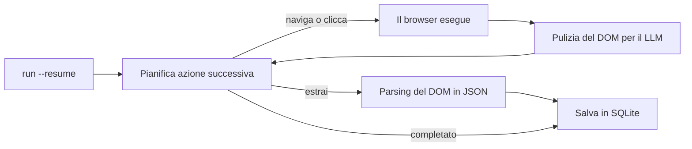

<a id="readme-top"></a>
<p align="center">
  
</p>
<p align="center">
  <strong>Un agente autonomo di ricerca web ed estrazione strutturata da pagine web a JSON.</strong>
  <br />
  Forniscigli un obiettivo in inglese semplice e uno Schema JSON. Pianifica la propria navigazione, legge la pagina e restituisce dati strutturati e validati.
</p>

<p align="center">
  <a href="https://github.com/EmanueleTorrisi/verboisy/actions/workflows/ci.yml"></a>
  <a href="https://codecov.io/gh/EmanueleTorrisi/verboisy"></a>
  <a href="https://emanueletorrisi.github.io/verboisy/"></a>
  <a href="#installazione"></a>
  <!--<a href="https://pypi.org/project/verboisy/"></a>-->
  
  <a href="LICENSE"></a>
  <a href="https://github.com/astral-sh/ruff"></a>
</p>

<p align="center">
  <em>v0.1.0 | versione pre-1.0 e in attivo sviluppo. Aspettati modifiche di rottura tra versioni minori fino alla 1.0.</em>
</p>

<p align="center">
  <a href="../../README.md" title="English" aria-label="English">🇬🇧</a> ·
  <strong title="Italiano" aria-label="Italiano">🇮🇹</strong> ·
  <a href="README.de.md" title="Deutsch" aria-label="Deutsch">🇩🇪</a> ·
  <a href="README.zh-CN.md" title="简体中文" aria-label="简体中文">🇨🇳</a> ·
  <a href="README.fr.md" title="Français" aria-label="Français">🇫🇷</a> ·
  <a href="README.es.md" title="Español" aria-label="Español">🇪🇸</a> ·
  <a href="README.ko.md" title="한국어" aria-label="한국어">🇰🇷</a> ·
  <a href="README.ja.md" title="日本語" aria-label="日本語">🇯🇵</a>
</p>

## Indice

- [Demo](#demo)
- [Perché Verboisy](#perché-verboisy)
- [Confronto](#confronto)
- [Esempio rapido](#esempio-rapido)
- [Casi d'uso](#casi-duso)
- [Come funziona](#come-funziona)
- [Installazione](#installazione)
- [Configurazione](#configurazione)
- [Utilizzo](#utilizzo)
- [Docker](#docker)
- [Limitazioni note](#limitazioni-note)
- [Uso responsabile](#uso-responsabile)
- [Documentazione](#documentazione)
- [Contribuire](#contribuire)
- [Sicurezza](#sicurezza)
- [Licenza](#licenza)

## Demo

<p align="center">
  
</p>

## Perché Verboisy

- **Guidato dagli obiettivi, non dai selettori.** Descrivi l'obiettivo in semplice inglese. Il planner decide il prossimo click, lo scorrimento o la lettura sulla pagina che si trova effettivamente davanti. Nulla è hardcoded da riscrivere quando un sito cambia veste grafica.
- **Schema-first, non best-effort.** Ogni record viene controllato rispetto a un modello Pydantic creato dal tuo JSON Schema prima di essere salvato. I dati formattati male non arrivano mai al tuo database.
- **Porta il tuo modello, mantieni la tua infrastruttura.** OpenAI, Anthropic o un modello Ollama locale tramite [LiteLLM](https://github.com/BerriAI/litellm): una sola variabile d'ambiente per cambiare. Si esegue sulla tua macchina o sui tuoi server, non in una scatola nera gestita da terzi.
- **Riprendibile per progettazione.** Ogni record viene salvato in SQLite nel momento in cui viene validato. `verboisy run --resume` (o `run(resume=True)` in Python) riprende l'ultima esecuzione incompleta. Un crash ti costa solo lo step corrente, non il lavoro già salvato.

Ciò che accompagna questo ciclo: Playwright asincrono (Chromium, headed o headless), pulizia del DOM ottimizzata per le finestre di contesto dei LLM anziché dump di HTML grezzo, ed esportazione in JSON o CSV — oppure interroga direttamente il database SQLite.

## Confronto

Verboisy si colloca all'intersezione tra un agente browser autonomo e un estrattore con validazione di schema. Gli strumenti esistenti coprono bene una di queste esigenze; questo è progettato per entrambe.

| | Verboisy | [Browser Use](https://github.com/browser-use/browser-use) | [Firecrawl](https://github.com/firecrawl/firecrawl) | [Crawl4AI](https://github.com/unclecode/crawl4ai) |
| --- | --- | --- | --- | --- |
| Descrivi | un obiettivo **e** uno Schema JSON | un obiettivo | un URL + prompt o schema | regole di crawl + un prompt |
| Navigazione | il planner sceglie i click | il planner sceglie i click | crawl / sitemap | crawl |
| Validazione | Pydantic dal tuo schema, prima di scrivere | il tuo codice | schema di estrazione opzionale | il tuo codice |
| Persistenza | SQLite per record, `--resume` | in-memory / il tuo codice | API o il tuo DB | il tuo codice |
| Dove si esegue | la tua macchina | la tua macchina | in cloud o self-hosted | la tua macchina |

Se conosci già l'URL e hai bisogno solo del testo in markdown, Firecrawl o Crawl4AI sono più semplici. Se ti serve un agente generale per l'uso del computer e validerai in seguito, Browser Use è più adatto. Se l'output deve contenere righe conformi a uno schema e l'agente deve trovarle, questo è il ruolo di Verboisy.

## Esempio rapido

Lo schema è un JSON Schema. Per un elenco di record, il livello principale è un `"array"` i cui `"items"` rappresentano la struttura dell'oggetto di una riga:

```json
{
  "type": "array",
  "items": {
    "type": "object",
    "properties": {
      "name": { "type": "string" },
      "website": { "type": "string" },
      "description": { "type": "string" },
      "batch": { "type": "string" }
    },
    "required": ["name", "website"]
  }
}
```

Verboisy costruisce un modello Pydantic da questo schema a runtime e rifiuta le righe non conformi prima che arrivino a SQLite.

CLI:

```bash
verboisy run \
  --goal "Find AI startups from the Y Combinator Fall 2026 (F26) batch" \
  --schema examples/yc_startups/schema.json \
  --export result.json
```

Stessa esecuzione da Python:

```python
from verboisy import run

result = run(
    goal="Find AI startups from the Y Combinator Fall 2026 (F26) batch",
    schema="examples/yc_startups/schema.json",
    export="result.json",
)

print(result.run_id, len(result.records))
for row in result.records:
    print(row["name"], row["website"])
```

Entrambe le forme producono questo:

```json
[
  {
    "name": "Marrow",
    "website": "[https://marrow.example.com](https://marrow.example.com)",
    "description": "Ambienti di staging per agenti di IA in produzione.",
    "batch": "F26"
  },
  {
    "name": "Kiln Trace",
    "website": "[https://kilntrace.example.com](https://kilntrace.example.com)",
    "description": "Debugging di latenza e costi per workflow di agenti.",
    "batch": "F26"
  }
]
```

*(Output illustrativo: i risultati reali dipendono da ciò che è presente sulla pagina durante l'esecuzione. I nomi di esempio usano appositamente `.example.com`.)*

Se il processo si interrompe a metà esecuzione, riprendilo senza dover rielaborare le righe già salvate:

```bash
verboisy run --resume
```

```python
result = run(resume=True)
```

## Casi d'uso

Verboisy è pensato per schemi di ricerca che vale la pena eseguire più di una volta:

- **Intelligence di mercato e della concorrenza:** monitora prezzi dei concorrenti, pagine prodotto e annunci in modo pianificato anziché controllare manualmente.
- **Ricerca di lead B2B:** trasforma un elenco di nomi di aziende in record strutturati con dati aziendali e stack tecnologico, pronti per l'importazione nel CRM.
- **Monitoraggio e-commerce e retail:** osserva le variazioni di catalogo e di prezzo su e-commerce ad alto uso di JavaScript.
- **Operations di ricerca (ResOps):** esegui lo stesso modello di query su centinaia di entità con cadenza periodica.
- **Ingestione per RAG / Knowledge Base:** alimenta una pipeline di recupero dati con record strutturati e verificati anziché contesto raccolto a mano.

Ognuno di questi casi segue lo stesso schema di obiettivo più schema dell'Esempio rapido sopra, applicato a un sito e a un formato differenti.

## Come funziona

Verboisy esegue un ciclo principale **pianifica → agisci → osserva → estrai** finché il planner non decide di avere dati sufficienti o raggiunge il limite di passaggi.



Ogni record estratto viene salvato in SQLite nel momento in cui viene validato, con un `run_id`. Interrompi il ciclo in qualsiasi momento — un limite di frequenza, un crash, un processo terminato — poi `verboisy run --resume` (o `run(resume=True)`) ricarica l'obiettivo, lo schema e le righe salvate di quell'esecuzione e prosegue. `--resume <id>` riprende una specifica esecuzione; `--resume` senza ID riprende l'ultima incompleta.

`--export` viene scritto al termine dell'esecuzione (o al termine di un'esecuzione ripresa). I risultati parziali risiedono nel frattempo in `SQLITE_DB_PATH`.

L'analisi dettagliata di ogni modulo si trova in [`ARCHITECTURE.md`](../../ARCHITECTURE.md).

## Installazione

Richiede Python 3.11+.

Non ancora presente su PyPI. Installa da sorgente:

```bash
git clone [https://github.com/EmanueleTorrisi/verboisy.git](https://github.com/EmanueleTorrisi/verboisy.git)
cd verboisy && pip install -e .
playwright install --with-deps chromium
```

Una volta rilasciata la prima versione, la procedura sarà:

```bash
pip install verboisy
playwright install --with-deps chromium
```

## Configurazione

Copia `.env.example` in `.env`. Tutte le impostazioni vengono caricate tramite Pydantic in `utils/config.py`; le opzioni non impostate utilizzeranno i valori predefiniti indicati di seguito.

```bash
# Richiesto: almeno un provider LLM
OPENAI_API_KEY=sk-your-api-key-here
# ANTHROPIC_API_KEY=sk-ant-your-api-key-here

# Routing modello LiteLLM (es. gpt-4o, claude-sonnet-5, ollama/llama3)
LITELLM_MODEL=gpt-4o

SQLITE_DB_PATH=verboisy.db
VERBOISY_LOG_LEVEL=INFO
VERBOISY_HEADLESS=true
```

| Variabile | Predefinito | Descrizione |
| --- | --- | --- |
| `OPENAI_API_KEY` | - | Credenziali OpenAI. Richiesto a meno che non si utilizzi Anthropic o un modello locale. |
| `ANTHROPIC_API_KEY` | - | Credenziali Anthropic, usate in alternativa a OpenAI. |
| `LITELLM_MODEL` | `gpt-4o` | Qualsiasi stringa di modello supportata da [LiteLLM](https://github.com/BerriAI/litellm). |
| `MAX_TOKENS` | `4096` | Token massimi per chiamata del planner o di estrazione. |
| `TEMPERATURE` | `0.0` | Temperatura di sampling per il planner. |
| `VERBOISY_HEADLESS` | `true` | Esegue Chromium in modalità headless. Imposta su `false` per osservare il browser. |
| `BROWSER_TIMEOUT_MS` | `30000` | Timeout di navigazione per pagina, in ms. |
| `USER_AGENT_ROTATION` | `true` | Ruota gli user agent tra le richieste. |
| `SQLITE_DB_PATH` | `verboisy.db` | Percorso in cui vengono salvate le esecuzioni e i record estratti. |
| `VERBOISY_LOG_LEVEL` | `INFO` | Livello di logging standard Python. `DEBUG` stampa ogni passaggio del planner. |

Paghi direttamente il provider LLM. Le chiamate del planner e di estrazione sono limitate a `MAX_TOKENS` (predefinito 4096) con `TEMPERATURE` a 0.0. Un obiettivo di dimensioni considerevoli richiede tipicamente decine di chiamate, non centinaia. Non c'è alcun contatore hosted.

## Utilizzo

### CLI

```bash
verboisy run \
  --goal "Find AI startups from the Y Combinator Fall 2026 (F26) batch" \
  --schema examples/yc_startups/schema.json \
  --export result.json
```

Il comando stampa un `run_id` (memorizzato anche in SQLite). Usalo per riprendere in seguito.

| Flag | Alias | Richiesto | Descrizione |
| --- | --- | --- | --- |
| `--goal` | `-g` | Sì, tranne con `--resume` | Descrizione in inglese semplice di cosa cercare e dove. Sii specifico. |
| `--schema` | `-s` | Sì, tranne con `--resume` | Percorso a un JSON Schema che descrive i campi da estrarre. `array` principale di `object`s di record. |
| `--export` | `-e` | No | Percorso di output. Supporta `.json` e `.csv`. Viene scritto al termine dell'esecuzione. |
| `--resume` | `-r` | No | Riprende un'esecuzione. `--resume` da solo prosegue l'ultima esecuzione incompleta in `SQLITE_DB_PATH`. `--resume <id>` prosegue quella specifica esecuzione. Obiettivo e schema vengono caricati dall'esecuzione salvata; `--export` / la modalità headless possono comunque essere sovrascritti. |

Esegui `verboisy run --help` per il riferimento completo delle opzioni.

### Ripresa (Resume)

```bash
# Ultima esecuzione incompleta in verboisy.db
verboisy run --resume

# Un'esecuzione specifica
verboisy run --resume 7f3a2c1b --export result.json
```

Le righe già validate non vengono estratte di nuovo. Se non ci sono esecuzioni incomplete, il comando termina con un errore indicando il database consultato.

### Python

`run()` è l'API pubblica. La CLI è un sottile wrapper attorno ad essa.

```python
from pathlib import Path
from verboisy import RunResult, run

result: RunResult = run(
    goal="Find AI startups from the Y Combinator Fall 2026 (F26) batch",
    schema="examples/yc_startups/schema.json",  # percorso str, Path o dict
    export="result.json",
)

print(result.run_id)
print(result.records[0]["name"])
```

Schema fornito come dizionario, senza bisogno di un file:

```python
result = run(
    goal="Find AI startups from the Y Combinator Fall 2026 (F26) batch",
    schema={
        "type": "array",
        "items": {
            "type": "object",
            "properties": {
                "name": {"type": "string"},
                "website": {"type": "string"},
                "description": {"type": "string"},
                "batch": {"type": "string"},
            },
            "required": ["name", "website"],
        },
    },
)
```

Ripresa:

```python
from verboisy import run

# Ultima esecuzione incompleta
result = run(resume=True)

# Esecuzione specifica, scrive l'esportazione al termine
result = run(resume=result.run_id, export="result.json")
```

Firma:

```python
def run(
    *,
    goal: str | None = None,
    schema: str | Path | dict | None = None,
    export: str | Path | None = None,
    resume: bool | str = False,
    headless: bool | None = None,
) -> RunResult: ...
```

Campi di `RunResult`:

| Campo | Tipo | Significato |
| --- | --- | --- |
| `run_id` | `str` | ID stabile memorizzato in SQLite. Passalo a `run(resume=...)`. |
| `records` | `list[dict]` | Tutte le righe validate fino a questo momento per l'esecuzione. |
| `export_path` | `Path \| None` | Dove è stata scritta l'esportazione, se `--export` / `export=` era stato impostato e l'esecuzione è terminata. |
| `db_path` | `Path` | Il file SQLite utilizzato. |
| `completed` | `bool` | `True` quando il planner si è fermato perché ha completato il lavoro, non a causa di un errore. |

Regole:

- Nuova esecuzione: `goal` e `schema` sono obbligatori; `resume` va omesso o impostato su `False`.
- Ripresa: `resume=True` o `resume="<id>"`; `goal` / `schema` sono opzionali e ignorati se l'esecuzione li possiede già.
- `headless=None` utilizza il valore di `VERBOISY_HEADLESS`. Passa `True` / `False` per sovrascriverlo per questa chiamata.

### Monitorare un'esecuzione

```bash
VERBOISY_HEADLESS=false VERBOISY_LOG_LEVEL=DEBUG \
  verboisy run \
    --goal "Find AI startups from the Y Combinator Fall 2026 (F26) batch" \
    --schema examples/yc_startups/schema.json \
    --export result.json
```

## Docker

```bash
docker compose -f docker/docker-compose.yml up -d --build
docker compose -f docker/docker-compose.yml exec verboisy verboisy run \
  --goal "Find AI startups from the Y Combinator Fall 2026 (F26) batch" \
  --schema examples/yc_startups/schema.json \
  --export result.json
```

Il container si avvia e rimane in esecuzione con le dipendenze del browser Playwright già installate, in modo che i comandi vengano eseguiti tramite `exec` anziché come entrypoint del container. Monta o mantieni `SQLITE_DB_PATH` se desideri che `--resume` funzioni attraverso i riavvii del container. `OPENAI_API_KEY` viene trasmesso automaticamente dalla tua shell: eseguine prima l'export. Per trasmettere altre variabili (`ANTHROPIC_API_KEY`, `LITELLM_MODEL`, ecc.), esportale a loro volta oppure sostituisci l'elenco `environment:` in `docker/docker-compose.yml` con `env_file: [../.env]`.

## Limitazioni note

Software in versione beta, con massima trasparenza:

- **Nessun sistema di account o cronologia hosted:** monoutente. Gli ID di esecuzione sono salvati nel file SQLite locale, non in una dashboard.
- **Nessuna pianificazione (scheduling):** avvia le esecuzioni manualmente o integrala nei tuoi cron o orchestratori. `--resume` serve per gestire crash e limiti di frequenza, non è uno scheduler.
- **Nessuna API HTTP hosted:** la CLI, `verboisy.run()` e l'immagine Docker sono le uniche interfacce disponibili al momento.
- **Incostante su siti con protezioni anti-bot aggressive:** alcuni target richiederanno tentativi multipli o interventi manuali.

Hai riscontrato uno di questi limiti che blocca il tuo caso d'uso? [Apri un'issue](https://github.com/EmanueleTorrisi/verboisy/issues): è il modo più diretto per influenzare la scaletta delle funzionalità da sviluppare.

## Uso responsabile

Verboisy naviga su un browser reale per tuo conto. Sei responsabile del rispetto dei termini di servizio di ciascun sito di destinazione, del relativo `robots.txt`, dei limiti di frequenza e delle leggi vigenti nella tua giurisdizione. Non utilizzarlo per aggirare autenticazioni o controlli di accesso per i quali non disponi di autorizzazione.

## Documentazione

La documentazione completa, compreso il riferimento di configurazione e i dettagli dell'API, è pubblicata su **[emanueletorrisi.github.io/verboisy](https://emanueletorrisi.github.io/verboisy/)**.

## Contribuire

I contributi sono i benvenuti. Consulta [`CONTRIBUTING.md`](../CONTRIBUTING.md) per l'installazione locale e le convenzioni di codice, e rispetta il [Codice di Condotta](../CODE_OF_CONDUCT.md). Cerchi un punto da cui iniziare? Dai un'occhiata alle issue con l'etichetta [`good first issue`](https://github.com/EmanueleTorrisi/verboisy/labels/good%20first%20issue).

## Sicurezza

Hai riscontrato una vulnerabilità? Per favore non aprire una segnalazione pubblica: utilizza la [segnalazione privata di vulnerabilità](https://github.com/EmanueleTorrisi/verboisy/security/advisories/new) o consulta [`SECURITY.md`](../SECURITY.md).

## Licenza

BSD 2-Clause: consulta [`LICENSE`](../../LICENSE) per il testo completo.

---

<p align="center">
  Creato da <a href="https://github.com/EmanueleTorrisi">Emanuele Torrisi</a> · <a href="#readme-top">Torna su ↑</a>
</p>
