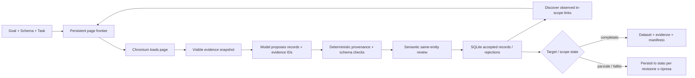

<a id="readme-top"></a>
<p align="center">
  
</p>
<p align="center">
  <strong>Ricerca web con prove che trasforma fonti delimitate in dataset tipizzati.</strong>
  <br />
  Dai a Verboisy un obiettivo, uno schema JSON e una policy delle fonti. Naviga, estrae, verifica la provenienza, controlla il significato e restituisce dati strutturati verificabili.
</p>

<p align="center">
  <a href="https://github.com/EmanueleTorrisi/verboisy/actions/workflows/ci.yml"></a>
  <a href="https://codecov.io/gh/EmanueleTorrisi/verboisy"></a>
  <a href="https://emanueletorrisi.github.io/verboisy/"></a>
  <a href="#installation"></a>
  
  <a href="../../LICENSE"></a>
  <a href="https://github.com/astral-sh/ruff"></a>
</p>

<p align="center">
  <em>v0.2.0rc1 | release candidate. Basato su prove, ripristinabile e intenzionalmente esplicito sulla copertura incompleta.</em>
</p>

<p align="center">
  <a href="../../README.md" title="English" aria-label="English">🇬🇧</a> ·
  <strong title="Italiano" aria-label="Italiano">🇮🇹</strong> ·
  <a href="README.de.md" title="Deutsch" aria-label="Deutsch">🇩🇪</a> ·
  <a href="README.zh-CN.md" title="简体中文" aria-label="简体中文">🇨🇳</a> ·
  <a href="README.fr.md" title="Français" aria-label="Français">🇫🇷</a> ·
  <a href="README.es.md" title="Español" aria-label="Español">🇪🇸</a> ·
  <a href="README.ko.md" title="한국어" aria-label="한국어">🇰🇷</a> ·
  <a href="README.ja.md" title="日本語" aria-label="日本語">🇯🇵</a>
</p>

## Indice

- [Demo](#demo)
- [Perché Verboisy](#why-verboisy)
- [Confronto](#compared-to)
- [Esempio rapido](#quick-example)
- [Casi d'uso](#use-cases)
- [Come funziona](#how-it-works)
- [Installazione](#installation)
- [Configurazione](#configuration)
- [Utilizzo](#usage)
- [Output e CSV](#outputs-and-csv)
- [Docker](#docker)
- [Limitazioni note](#known-limitations)
- [Uso responsabile](#responsible-use)
- [Documentazione](#documentation)
- [Contribuire](#contributing)
- [Sicurezza](#security)
- [Licenza](#license)

<a id="demo"></a>
## Demo

La [vecchia animazione](../../docs/demo.gif) è illustrativa e precede il motore di prove 0.2. Per il comportamento corrente usa il [workflow di demo live](../../docs/demo.md) e la [guida di validazione](../../docs/validation.md).

La 0.2.0rc1 è stata verificata con copertura offline di statement e branch, integrazione Chromium reale, installazione pulita della wheel, avvio sandbox Docker, fixture live ripetute, paginazione held-out, interruzione/ripresa, fonti non disponibili, conflitti di identità e un caso held-out non e-commerce. Sono prove di rilascio, non una garanzia che ogni sito o risposta del modello riesca.

<a id="why-verboisy"></a>
## Perché Verboisy

- **Basato su prove, non “lo ha detto il modello”.** Ogni scalare non nullo deve puntare a prove osservate nella pagina; il codice verifica ID fonte, scope dell’entità, citazioni letterali, tipi, link, trasformazioni e schema.
- **Schema-first senza indebolimenti silenziosi.** JSON Schema Draft 2020-12 definisce la riga e i vincoli della collezione. Se manca una prova obbligatoria, il candidato viene bloccato invece di inventare un valore.
- **Revisione semantica separata.** Dopo i controlli deterministici, un secondo passaggio del modello verifica rilevanza, significato dei campi e appartenenza alla stessa entità usando solo le prove fornite. È fallibile e non è un oracolo di verità esterna.
- **Ricerca delimitata e scope esplicito.** Seed URL, host consentiti, path inclusi/esclusi, profondità, numero pagine, link per pagina e paginazione JavaScript opzionale definiscono ciò che il run può osservare.
- **Ripristinabile per costruzione.** Stato delle pagine, snapshot, candidati, record accettati, eventi, contabilità modello e coda persistono in SQLite.
- **I conflitti restano visibili.** I campi identità deduplicano record uguali; payload contraddittori per la stessa identità vengono messi in quarantena, non fusi.

Playwright/Chromium + SQLite + LiteLLM + JSON/CSV + file laterale delle evidenze + manifesto con checksum.

<a id="compared-to"></a>
## Confronto

Verboisy si colloca tra un agente di ricerca con browser e un estrattore strutturato, ma il suo contratto distintivo è la traccia di prove per ogni valore accettato.

| | Verboisy | Agente browser generico | Crawler / estrattore | Estrazione LLM ad hoc |
| --- | --- | --- | --- | --- |
| Tu descrivi | obiettivo + JSON Schema + policy fonti | obiettivo | URL / regole di crawl | prompt + testo pagina |
| Navigazione | traversal delimitato dei link osservati + paginazione opzionale | azioni guidate dal modello | regole del crawler | di solito nessuna |
| Provenienza dei campi | obbligatoria per ogni scalare non nullo | dipende dal tuo codice | varia | di solito solo prompt |
| Validazione | JSON Schema + prove deterministiche + review semantica | dipende dal tuo codice | varia | best effort |
| Persistenza | coda SQLite, snapshot, candidati, record, eventi | varia | varia | di solito del chiamante |
| Ripresa | run id durevole + frontier persistente | varia | varia | di solito del chiamante |
| Conflitti identità | quarantena deterministica | del chiamante | del chiamante | del chiamante |

<a id="quick-example"></a>
## Esempio rapido

Definisci esattamente cosa significa un record:

```json
{
  "type": "array",
  "minItems": 2,
  "items": {
    "type": "object",
    "properties": {
      "sku": {"type": "string", "description": "SKU del prodotto esattamente come pubblicato dalla fonte"},
      "price_usd": {"type": "number", "minimum": 0, "description": "Prezzo unitario indicato in USD; non convertire valuta"},
      "source_url": {"type": "string", "format": "uri", "description": "URL finale della pagina da cui il record è stato osservato"}
    },
    "required": ["sku", "price_usd", "source_url"],
    "additionalProperties": false
  }
}
```

Poi definisci la policy delimitata delle fonti in `task.json`:

```json
{
  "seed_urls": ["https://catalog.example/products"],
  "allowed_hosts": ["catalog.example"],
  "include_paths": ["/products*"],
  "target_records": 20,
  "identity_fields": ["/sku"],
  "max_depth": 3,
  "max_pages": 100,
  "field_rules": {
    "/source_url": {"source": "page_url"}
  }
}
```

Esegui:

```bash
verboisy run \
  --goal "Raccogli gli SKU pubblicati e i prezzi indicati in USD" \
  --schema schema.json \
  --task task.json \
  --export dataset.json \
  --max-steps 40
```

Un possibile formato di output illustrativo è:

```json
[
  {"sku": "LAMP-001", "price_usd": 39.95, "source_url": "https://catalog.example/products/lamp-001"},
  {"sku": "CHAIR-014", "price_usd": 129.0, "source_url": "https://catalog.example/products/chair-014"}
]
```

*Domini e record dell’esempio sono illustrativi. I risultati reali dipendono dalle pagine effettivamente osservate durante il run.*

<a id="use-cases"></a>
## Casi d'uso

Verboisy è utile quando “dammi delle righe” non basta e serve anche rispondere a “da dove viene questo valore?”

- **Ricerca di mercato e competitiva:** dataset delimitati di cataloghi, prezzi, funzionalità o annunci con prove per campo.
- **Ricerca B2B:** record strutturati di organizzazioni o directory con identità esplicite e URL sorgente.
- **Monitoraggio e-commerce:** dataset tipizzati mantenendo visibili osservazioni in conflitto.
- **Research operations:** ripeti schema e policy su pagine controllate e riprendi il lavoro da SQLite.
- **Registri e dati di riferimento:** tabelle tecniche in righe tipizzate mantenendo prove esatte di booleani, numeri, testo e URL.
- **RAG / pipeline dati:** JSON canonico più sidecar delle prove e manifest, non prosa senza fonte.

<a id="how-it-works"></a>
## Come funziona

La 0.2 sostituisce il vecchio loop libero plan/action con un motore di ricerca delimitato basato su prove:



Uno snapshot contiene fatti visibili compatti, link risolti, ID di scope entità, URL finale, timestamp e content hash. L’HTML osservato completo resta in SQLite. Il modello può proporre candidati, ma non può aggirare schema o controlli di provenienza. `COMPLETED` significa che target esplicito e validazione della collezione sono soddisfatti; non significa che ogni possibile match del web sia stato trovato.

[`ARCHITECTURE.md`](../../ARCHITECTURE.md)

<a id="installation"></a>
## Installazione

Richiede Python 3.11–3.14.

Dopo la pubblicazione di una release stabile, l’installazione ordinaria prevista è:

```bash
pip install verboisy
```

Per questa release candidate non pubblicata, installa la wheel fornita o il checkout sorgente:

```bash
pip install -e .
verboisy --help
```

Il primo utilizzo del browser scarica la build Chromium corrispondente prima delle chiamate al modello. Importare Verboisy o eseguire `--help` non scarica il browser. Per prepararlo esplicitamente:

```bash
verboisy setup
```

Su Linux possono servire anche le librerie native di Chromium. Provisionale con il normale processo amministrativo del sistema, per esempio:

```bash
python -m playwright install-deps chromium
```

Verboisy non invoca `sudo` e non disabilita silenziosamente la sandbox Chromium.

<a id="configuration"></a>
## Configurazione

Copia `.env.example` in `.env` e mantieni le credenziali fuori dal version control.

```bash
OPENAI_API_KEY=sk-your-api-key-here
# ANTHROPIC_API_KEY=sk-ant-your-api-key-here
LITELLM_MODEL=gpt-4o
SQLITE_DB_PATH=verboisy.db
SEARCH_PROVIDER=disabled
BROWSER_SANDBOX=true
ALLOW_PRIVATE_NETWORK=false
```

Impostazioni comuni:

| Variable | Scopo |
| --- | --- |
| `OPENAI_API_KEY / ANTHROPIC_API_KEY` | Credenziali del provider instradate tramite LiteLLM |
| `LITELLM_MODEL` | Identificatore del modello per proposte e revisioni |
| `LITELLM_API_KEY / LITELLM_API_BASE` | Provider alternativo o proxy opzionale |
| `SQLITE_DB_PATH` | Database durevole delle esecuzioni 0.2 |
| `SEARCH_PROVIDER` | Disabilitato con seed noti; scoperta tramite Brave se configurata |
| `BRAVE_SEARCH_API_KEY` | Credenziale per la ricerca Brave |
| `MAX_TOKENS` | Token massimi di output del modello per richiesta |
| `MODEL_REQUEST_BUDGET` | Budget locale conservativo di unità di richiesta |
| `LLM_TIMEOUT_SECONDS` | Scadenza per ogni richiesta al modello |
| `LLM_RETRIES` | Tentativi limitati per risposte transitorie o inutilizzabili |
| `RUN_TIMEOUT_SECONDS` | Scadenza per ogni invocazione |
| `MAX_DOM_CHARS` | Budget delle evidenze per ogni batch del modello |
| `ACTION_DELAY_SECONDS` | Pausa tra iterazioni di lavoro sulle pagine |
| `BROWSER_SANDBOX` | Attiva/disattiva la sandbox Chromium; mantenerla attiva |
| `ALLOW_PRIVATE_NETWORK` | Accesso esplicito a rete privata/loopback; disattivato per default |
| `ALLOWED_DOMAINS` | Restrizione opzionale agli host di destinazione esatti |

`verboisy doctor` mostra configurazione non segreta e readiness dell’ambiente. `verboisy setup` prepara e testa Chromium senza chiamate al modello.

<a id="usage"></a>
## Utilizzo

### CLI

```bash
verboisy run \
  --goal "Raccogli gli SKU pubblicati e i prezzi indicati in USD" \
  --schema schema.json \
  --task task.json \
  --export dataset.json \
  --max-steps 40
```

Flag importanti:

| Flag | Obbligatorio | Significato |
| --- | --- | --- |
| `--goal`, `-g` | nuovo run | Natural-language research objective |
| `--schema`, `-s` | nuovo run | JSON Schema path |
| `--task`, `-t` | nuovo run | Bounded source/discovery policy |
| `--export`, `-e` | no | Output `.json` o `.csv` |
| `--resume`, `-r` | ripresa | Ultima esecuzione incompleta o id specifico |
| `--max-steps`, `-m` | no | Limite di lavoro per questa invocazione |
| `--headless` / `--headed` | no | Sovrascrive la visibilità del browser |

I codici di uscita sono intenzionali: `0` completamento target, `2` risultato parziale/esaurito normale, `1` errore, `130` interruzione.

### Ripresa

```bash
# Riprende l’ultimo run incompleto
verboisy run --resume

# Riprende un run specifico ed esporta quando questa invocazione si ferma
verboisy run --resume 7f3a2c1b --export dataset.json
```

La ripresa mantiene obiettivo, schema, task, record accettati, coda e contabilità cumulativa. Il lavoro pagina interrotto/attivo viene recuperato e può essere processato di nuovo; l’identità deterministica impedisce duplicati uguali.

### Python

`run()` è l’API sincrona; usa `await arun(...)` nelle applicazioni async.

```python
from verboisy import run

result = run(
    goal="Raccogli gli SKU pubblicati e i prezzi USD",
    schema="schema.json",
    task="task.json",
    export="dataset.json",
    max_steps=40,
)

print(result.run_id)
print(result.status, result.stop_reason)
for record in result.records:
    print(record)
```

<a id="outputs-and-csv"></a>
## Output e CSV

Un export JSON produce tre artefatti complementari:

- `dataset.json` — solo i campi richiesti dall’utente.
- `dataset.json.evidence.json` — record accettati con provenienza snapshot/prove.
- `dataset.json.manifest.json` — stato, schema/task, metadati invocazioni modello, validazione collezione e hash SHA-256.

SQLite conserva anche frontier delle pagine, snapshot e HTML, proposte candidate, motivi di rifiuto, record accettati, gap di copertura, conflitti di identità e contabilità.

Il `csv_mode: "json"` predefinito salva ogni cella presente come JSON e preserva i tipi esattamente. Una cella vuota significa assente; `null` resta distinto dall’assenza.

`csv_mode: "spreadsheet"` produce celle convenzionali e protegge stringhe simili a formule. È più comodo manualmente ma non è il formato canonico tipizzato.

Verifica sempre gli hash del manifest prima di trattare un export copiato come la stessa generazione.

<a id="docker"></a>
## Docker

Il container fornito esegue Verboisy come utente non privilegiato ed è pensato come confine di deployment più forte rispetto a una sessione browser personale.

```bash
docker build -f docker/Dockerfile -t verboisy:0.2.0rc1 .

docker run --rm --init --shm-size=1g \
  --security-opt seccomp=docker/seccomp_profile.json \
  --entrypoint verboisy \
  verboisy:0.2.0rc1 setup
```

Per workload reali, persisti database SQLite e directory export, mantieni la sandbox e applica controlli egress adeguati.

<a id="known-limitations"></a>
## Limitazioni note

- Il traversal segue breadth-first i link HTTP(S) osservati e in scope; il modello può prioritizzarli ma non inventare target arbitrari.
- `pagination_selector` supporta paginazione JavaScript delimitata. Workflow generali di form, filtri arbitrari, infinite scroll implicito, download, iframe/shadow-root e JavaScript arbitrario non sono implementati.
- Autenticazione, CAPTCHA, bypass anti-bot, OCR, PDF e join cross-page sono fuori contratto.
- Il contesto DOM/prove è delimitato; batch troppo grandi o risposte modello inutilizzabili diventano gap espliciti.
- La provenienza letterale prova che il valore è stato osservato nello scope ammesso, non che la fonte sia vera.
- La review semantica è fallibile.
- `COMPLETED` è completamento del target, non completezza globale.
- Una fonte non disponibile può lasciare il run fallito/incompleto; aumentare budget ripetutamente non sostituisce prove mancanti.
- Senza `identity_fields` si deduplicano solo record identici; con identità i payload contraddittori vengono messi in quarantena.

<a id="responsible-use"></a>
## Uso responsabile

Verboisy guida un browser reale e memorizza materiale sorgente localmente. Sei responsabile di termini del sito, robots, rate limit, licenze, privacy e legge applicabile. Non usarlo per aggirare autenticazione o controlli di accesso senza permesso.

I controlli URL e la sandbox sono defense in depth, non una sandbox di rete completa. Per browsing non fidato usa account/container/VM dedicati, evita mount sensibili e limita l’egress.

Le pagine sorgente e i record possono contenere dati personali o protetti. Verboisy non cifra SQLite per te e l’accessibilità della fonte non implica permesso di redistribuzione o training.

<a id="documentation"></a>
## Documentazione

- [Contratto e policy del task](../../docs/contracts.md)
- [Validazione e controlli di rilascio](../../docs/validation.md)
- [Ricerca e ripristino](../../docs/search-and-recovery.md)
- [Migrazione da 0.1](../../docs/migration.md)
- [Flusso della demo live](../../docs/demo.md)
- [Operazioni di rilascio](../../docs/release.md)
- [Architettura](../../ARCHITECTURE.md)

<a id="contributing"></a>
## Contribuire

I contributi sono benvenuti. Vedi [`CONTRIBUTING.md`](../CONTRIBUTING.md) per versioni Python supportate, lint/type/test, gate browser e controlli RC. Mantieni il nuovo comportamento coperto da test deterministici e non indebolire prove o sandbox per far passare una fixture.

<a id="security"></a>
## Sicurezza

Hai trovato una vulnerabilità? Non aprire un issue pubblico. Usa il [segnalazione privata delle vulnerabilità](https://github.com/EmanueleTorrisi/verboisy/security/advisories/new) o [`SECURITY.md`](../SECURITY.md).

<a id="license"></a>
## Licenza

BSD 2-Clause. Vedi [`LICENSE`](../../LICENSE).

---

<p align="center">
  Creato da <a href="https://github.com/EmanueleTorrisi">Emanuele Torrisi</a> · <a href="#readme-top">Torna su ↑</a>
</p>
