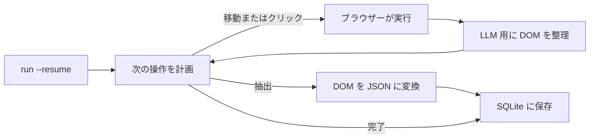

<a id="readme-top"></a>
<p align="center">
  
</p>
<p align="center">
  <strong>Web 調査と構造化 JSON 抽出を自律的に行うエージェント。</strong>
  <br />
  自然言語で目標を伝え、JSON Schema を指定するだけです。エージェントがナビゲーションを計画し、ページを読み取り、検証済みの構造化データを返します。
</p>

<p align="center">
  <a href="https://github.com/EmanueleTorrisi/verboisy/actions/workflows/ci.yml"></a>
  <a href="https://codecov.io/gh/EmanueleTorrisi/verboisy"></a>
  <a href="https://emanueletorrisi.github.io/verboisy/"></a>
  <a href="#installation"></a>
  <!--<a href="https://pypi.org/project/verboisy/"></a>-->
  
  <a href="../../LICENSE"></a>
  <a href="https://github.com/astral-sh/ruff"></a>
</p>

<p align="center">
  <em>v0.1.0 | 1.0 未満の開発中バージョンです。1.0 に達するまでは、マイナーバージョン間で互換性のない変更が発生する可能性があります。</em>
</p>

<p align="center">
  <a href="../../README.md" title="English" aria-label="English">🇬🇧</a> ·
  <a href="README.it.md" title="Italiano" aria-label="Italiano">🇮🇹</a> ·
  <a href="README.de.md" title="Deutsch" aria-label="Deutsch">🇩🇪</a> ·
  <a href="README.zh-CN.md" title="简体中文" aria-label="简体中文">🇨🇳</a> ·
  <a href="README.fr.md" title="Français" aria-label="Français">🇫🇷</a> ·
  <a href="README.es.md" title="Español" aria-label="Español">🇪🇸</a> ·
  <a href="README.ko.md" title="한국어" aria-label="한국어">🇰🇷</a> ·
  <strong title="日本語" aria-label="日本語">🇯🇵</strong>
</p>

## 目次

- [デモ](#demo)
- [Verboisy を使う理由](#why-verboisy)
- [他ツールとの比較](#compared-to)
- [クイック例](#quick-example)
- [ユースケース](#use-cases)
- [仕組み](#how-it-works)
- [インストール](#installation)
- [設定](#configuration)
- [使い方](#usage)
- [Docker](#docker)
- [既知の制限](#known-limitations)
- [責任ある利用](#responsible-use)
- [ドキュメント](#documentation)
- [コントリビューション](#contributing)
- [セキュリティ](#security)
- [ライセンス](#license)

<a id="demo"></a>

## デモ

[過去のアニメーション](../../docs/demo.gif)は説明用であり、製品の動作を検証するものではありません。公開されている録画は再開機能の実装前に作成されています。実際のブラウザー、モデル、SQLite、中断、エクスポートの挙動を記録するには、[実動作のライブデモ手順](../../docs/demo.md)を使用してください。新たなライブ録画は、引き続き受け入れ条件です。

今回の改訂には、実行可能なオフライン回帰テストと必須の Chromium 統合チェックが含まれます。デプロイ前に[検証とリリースのチェック項目](../../docs/validation.md)を確認してください。これは本番運用への準備が整ったという宣言ではありません。

<a id="why-verboisy"></a>

## Verboisy を使う理由

- **セレクターではなく目標で動作。** 目標を自然言語で記述します。プランナーは、実際に表示されているページをもとに次のクリック、スクロール、読み取りを選びます。モデルは観測した DOM に適応しようとしますが、サイトの再設計によって実行が失敗する場合もあります。
- **曖昧な抽出よりスキーマを優先。** 各レコードは JSON Schema に照らして検証され、保存前に Pydantic モデルに包まれます。検証するのは構造と制約であり、情報の事実上の正確性を保証するものではありません。
- **モデルもインフラも自分で選択。** [LiteLLM](https://github.com/BerriAI/litellm) 経由で OpenAI、Anthropic、またはローカルの Ollama モデルを利用できます。環境変数 1 つで切り替えられ、実行場所は自分の PC やサーバーです。不透明なホスト型サービスではありません。
- **中断からの再開を標準装備。** 検証済みレコードは、次の候補を処理する前に SQLite に確定保存されます。`verboisy run --resume`（Python では `run(resume=True)`）は最新の未完了実行を再開します。以前の保存データは途中の処理が中断しても保持されます。進捗と最後に保存した URL は復元されますが、ブラウザーのセッション状態は復元されません。

このループを支えるのは、非同期 Playwright（画面表示あり／なしの Chromium）、生の HTML ダンプではなく LLM のコンテキスト長に合わせた DOM の整理、JSON・CSV エクスポートです。SQLite データベースを直接照会することもできます。

<a id="compared-to"></a>

## 他ツールとの比較

Verboisy は自律型ブラウザーエージェントとスキーマ検証付き抽出ツールを組み合わせたものです。周辺ツールは一方に特化することが多く、Verboisy は両方を目的としています。

| | Verboisy | [Browser Use](https://github.com/browser-use/browser-use) | [Firecrawl](https://github.com/firecrawl/firecrawl) | [Crawl4AI](https://github.com/unclecode/crawl4ai) |
| --- | --- | --- | --- | --- |
| 指定する内容 | 目標**と** JSON Schema | 目標 | URL + 指示文またはスキーマ | クロール規則 + 指示文 |
| ナビゲーション | プランナーがクリックを選択 | プランナーがクリックを選択 | クロール / サイトマップ | クロール |
| 検証 | 書き込み前に JSON Schema + Pydantic | ユーザーのコード | 任意の抽出スキーマ | ユーザーのコード |
| 永続化 | レコードごとに SQLite、`--resume` | メモリ / ユーザーのコード | API または自分の DB | ユーザーのコード |
| 実行場所 | 自分の PC | 自分の PC | ホスト型またはセルフホスト | 自分の PC |

URL が分かっていて Markdown の取得だけが必要なら、Firecrawl や Crawl4AI の方が簡単です。汎用的なコンピューター操作エージェントが必要で、検証は後から行うなら Browser Use が適しています。エージェントが自ら情報を探し、スキーマに一致する行として出力する必要がある場合は Verboisy の出番です。

<a id="quick-example"></a>

## クイック例

スキーマには JSON Schema を使用します。レコードの一覧では、最上位を `"array"` とし、その `"items"` で 1 行分のオブジェクト構造を定義します。

```json
{
  "type": "array",
  "items": {
    "type": "object",
    "properties": {
      "name": { "type": "string" },
      "website": { "type": "string" },
      "description": { "type": "string" },
      "batch": { "type": "string" }
    },
    "required": ["name", "website"]
  }
}
```

Verboisy は実行時にそのスキーマから Pydantic モデルを作成し、一致しない行を SQLite に保存する前に拒否します。

コマンドライン（CLI）：

```bash
verboisy run \
  --goal "Y Combinator の 2026 年秋期バッチ（F26）に参加した AI スタートアップを探す" \
  --schema examples/yc_startups/schema.json \
  --export result.json
```

Python で同じ実行を行う場合：

```python
from verboisy import run

result = run(
    goal="Y Combinator の 2026 年秋期バッチ（F26）に参加した AI スタートアップを探す",
    schema="examples/yc_startups/schema.json",
    export="result.json",
)

print(result.run_id, len(result.records))
for row in result.records:
    print(row["name"], row["website"])
```

出力形式の一例：

```json
[
  {
    "name": "Marrow",
    "website": "https://marrow.example.com",
    "description": "本番環境の AI エージェント向けステージング環境。",
    "batch": "F26"
  },
  {
    "name": "Kiln Trace",
    "website": "https://kilntrace.example.com",
    "description": "エージェントのワークフローにおける遅延とコストのデバッグ。",
    "batch": "F26"
  }
]
```

*（これは説明用の出力です。実際の結果は実行時のページ内容によって異なります。例の名前には意図的に `.example.com` を使用しています。）*

途中でプロセスが停止しても、保存済みの行を再処理せずに再開できます。

```bash
verboisy run --resume
```

```python
result = run(resume=True)
```

<a id="use-cases"></a>

## ユースケース

Verboisy は繰り返し実行する価値のある調査に向いています。

- **競合・市場情報の収集：** 競合の価格、製品ページ、発表を手作業の代わりに定期的に追跡します。
- **B2B 見込み客調査：** 企業名の一覧を企業属性や技術スタックの構造化レコードに変換し、CRM に取り込めるようにします。
- **EC・小売の監視：** JavaScript を多用する店舗サイトの商品カタログや価格の変更を追います。
- **リサーチ運用（ResOps）：** 同じクエリパターンを数百の対象に対して定期的に実行します。
- **RAG・ナレッジベースへの取り込み：** 手作業で集めたコンテキストではなく、出典付きの構造化レコードを検索パイプラインに渡します。

いずれもクイック例と同じ「目標 + スキーマ」の形式で、対象サイトとデータ構造だけを変えています。

<a id="how-it-works"></a>

## 仕組み

Verboisy は、プランナーが十分なデータを得たと判断するか、ステップ数の上限に達するまで、**計画 → 実行 → 観測 → 抽出** を繰り返します。



抽出したレコードは検証に通るとすぐ、`run_id` と関連付けて SQLite に確定保存されます。レート制限、クラッシュ、プロセス終了などでループが中断した場合、`verboisy run --resume`（または `run(resume=True)`）がその実行の目標、スキーマ、保存済みの行、履歴、最後に保存した URL を読み込み、続きを実行します。`--resume <id>` は特定の実行を、ID なしの `--resume` は最新の未完了実行を指定します。

`--export` は実行の終了時にファイルを書き出します（再開後に完了した場合も同様）。それまでは途中結果が `SQLITE_DB_PATH` に保存されます。

各モジュールの詳細は [`ARCHITECTURE.md`](../../ARCHITECTURE.md) を参照してください。

<a id="installation"></a>

## インストール

Python 3.11 以降が必要です。

まだ PyPI には公開されていません。ソースからインストールしてください。

```bash
git clone https://github.com/EmanueleTorrisi/verboisy.git
cd verboisy
python -m pip install -e .
python -m playwright install chromium
```

初回リリース後は次のコマンドを使用できます。

```bash
python -m pip install verboisy
python -m playwright install chromium
```

Chromium はセットアップ時にインストールします。Verboisy は実行中にブラウザーをダウンロードしたり、システムのパッケージマネージャーを起動したりしません。インストールと実行には、同じ OS ユーザーと Python 環境を使用してください。Linux では `python -m playwright install --with-deps chromium` でブラウザーとシステム依存関係をインストールします（システムパッケージには管理者権限が必要です）。Poetry を使用する場合は `poetry run playwright install --with-deps chromium` を実行してください。

<a id="configuration"></a>

## 設定

`.env.example` を `.env` にコピーします。すべての設定は `utils/config.py` で Pydantic を通して読み込まれ、未指定の値には以下のデフォルト値が適用されます。

```bash
# 必須：少なくとも 1 つの LLM プロバイダー
OPENAI_API_KEY=sk-your-api-key-here
# ANTHROPIC_API_KEY=sk-ant-your-api-key-here

# LiteLLM によるモデルの振り分け（例：gpt-4o、claude-sonnet-5、ollama/llama3）
LITELLM_MODEL=gpt-4o

SQLITE_DB_PATH=verboisy.db
VERBOISY_LOG_LEVEL=INFO
VERBOISY_HEADLESS=true
```

| 変数 | デフォルト | 説明 |
| --- | --- | --- |
| `OPENAI_API_KEY` | - | OpenAI の認証情報。Anthropic またはローカルモデルを使わない場合は必須です。 |
| `ANTHROPIC_API_KEY` | - | OpenAI の代わりに使う Anthropic の認証情報。 |
| `LITELLM_MODEL` | `gpt-4o` | [LiteLLM](https://github.com/BerriAI/litellm) がサポートするモデル名。 |
| `MAX_TOKENS` | `4096` | 計画・抽出の各呼び出しにおける最大トークン数。 |
| `TEMPERATURE` | `0.0` | プランナーのサンプリング温度。 |
| `VERBOISY_HEADLESS` | `true` | Chromium を画面なしで実行。`false` でブラウザーを表示。 |
| `BROWSER_TIMEOUT_MS` | `30000` | 1 ページあたりのナビゲーションタイムアウト（ミリ秒）。 |
| `USER_AGENT_ROTATION` | `true` | ブラウザーコンテキスト作成時に User-Agent を選択。リクエストごとの変更はしません。 |
| `SQLITE_DB_PATH` | `verboisy.db` | 実行と抽出レコードの保存先。 |
| `VERBOISY_LOG_LEVEL` | `INFO` | Python の標準ログレベル。`DEBUG` は計画の各ステップを出力します。 |

LLM プロバイダーへの支払いは利用者が直接行います。計画と抽出の呼び出しは `MAX_TOKENS`（デフォルト 4096）で制限され、`TEMPERATURE` は 0.0 です。呼び出し回数はナビゲーション、抽出、再試行によって異なります。ホスト型の使用量メーターはありません。

<a id="usage"></a>

## 使い方

### CLI

```bash
verboisy run \
  --goal "Y Combinator の 2026 年秋期バッチ（F26）に参加した AI スタートアップを探す" \
  --schema examples/yc_startups/schema.json \
  --export result.json
```

コマンドは `run_id` をログに出力し、SQLite にも保存します。ステップ予算を使い切ると未完了の結果を返し、終了コード 2 になります。エラーは 1、Ctrl-C は 130 です。FINISH とコレクション全体の検証成功がそろった場合にだけ完了します。後で再開するにはその ID を使います。

| オプション | 短縮形 | 必須 | 説明 |
| --- | --- | --- | --- |
| `--goal` | `-g` | `--resume` 時以外は必須 | どこで何を探すかを自然言語で具体的に記述します。 |
| `--schema` | `-s` | `--resume` 時以外は必須 | 抽出するフィールドの JSON Schema のパス。最上位はレコードの `object` から成る `array`。 |
| `--export` | `-e` | いいえ | 出力パス。`.json` と `.csv` に対応。実行終了時に書き込みます。 |
| `--resume` | `-r` | いいえ | 実行を再開します。`--resume` 単体では `SQLITE_DB_PATH` 内の最新の未完了実行、`--resume <id>` では指定した実行を再開。目標とスキーマは保存データから取得しますが、`--export` と画面表示モードは変更できます。 |

全オプションは `verboisy run --help` で確認できます。

その他に `--max-steps/-m` と `--headless/--headed` があります。再開時にはステップ枠が更新されますが、保存済みカウンターは累積のままです。一意な実行 ID の接頭辞も使用できます。完了済み ID はブラウザーやモデルを呼び出さずに再エクスポートできます。エクスポート失敗はゼロ以外の終了コードになり、この方法で再試行できます。空の結果でも出力ファイルを作成します。

<a id="resume"></a>

### 再開

```bash
# verboisy.db 内の最新の未完了実行
verboisy run --resume

# 特定の実行
verboisy run --resume 7f3a2c1b --export result.json
```

中断後に同じページが再度読み取られたり抽出されたりする場合があります。同じ実行内で、正規化した内容が同一の行は再挿入されません。Cookie、開いているタブ、スクロール位置、一時的な JavaScript 状態は復元されません。未完了の実行がない場合、調査したデータベース名を含むエラーが出て、ゼロ以外の終了コードになります。

### Python

`run()` は同期の公開 API です。Notebook や非同期アプリでは `await arun(...)` を使用します。CLI はこの API を薄く包んだものです。

```python
from pathlib import Path
from verboisy import RunResult, run

result: RunResult = run(
    goal="Y Combinator の 2026 年秋期バッチ（F26）に参加した AI スタートアップを探す",
    schema="examples/yc_startups/schema.json",  # パス、Path、または dict
    export="result.json",
)

print(result.run_id)
print(result.records[0]["name"])
```

ファイルを使わず辞書としてスキーマを指定する場合：

```python
result = run(
    goal="Y Combinator の 2026 年秋期バッチ（F26）に参加した AI スタートアップを探す",
    schema={
        "type": "array",
        "items": {
            "type": "object",
            "properties": {
                "name": {"type": "string"},
                "website": {"type": "string"},
                "description": {"type": "string"},
                "batch": {"type": "string"},
            },
            "required": ["name", "website"],
        },
    },
)
```

再開：

```python
from verboisy import run

# 最新の未完了実行
result = run(resume=True)

# 特定の実行。完了後にエクスポート
result = run(resume=result.run_id, export="result.json")
```

関数シグネチャ：

```python
def run(
    *,
    goal: str | None = None,
    schema: str | Path | dict | None = None,
    export: str | Path | None = None,
    resume: bool | str = False,
    headless: bool | None = None,
    max_steps: int | None = None,
    config: Settings | None = None,
) -> RunResult: ...
```

`RunResult` のフィールド：

| フィールド | 型 | 意味 |
| --- | --- | --- |
| `run_id` | `str` | SQLite に保存される安定した ID。`run(resume=...)` に渡します。 |
| `records` | `list[dict]` | この実行でこれまでに検証された全行。 |
| `export_path` | `Path \| None` | `--export` / `export=` が指定され、実行が終了した場合の出力先。 |
| `db_path` | `Path` | 使用する SQLite ファイル。 |
| `completed` | `bool` | FINISH とコレクション検証成功の後に `True`。 |
| `status` | `str` | 正常な戻り値では COMPLETED または PAUSED。 |
| `stop_reason` | `str \| None` | 呼び出しが停止した理由。 |

ルール：

- 新規実行：`goal` と `schema` が必要。`resume` は省略するか `False`。
- 再開：`resume=True` または `resume="<id>"`。`goal` / `schema` は省略可能で、保存済みの実行に存在する場合は無視されます。
- `headless=None` は `VERBOISY_HEADLESS` を使用。`True` / `False` で今回の呼び出しだけ上書きします。

<a id="watching-a-run"></a>

### 実行を画面で確認する

```bash
VERBOISY_HEADLESS=false VERBOISY_LOG_LEVEL=DEBUG \
  verboisy run \
    --goal "Y Combinator の 2026 年秋期バッチ（F26）に参加した AI スタートアップを探す" \
    --schema examples/yc_startups/schema.json \
    --export result.json
```

スキーマの詳細：ルートにはオブジェクトの配列、または単一のレコードオブジェクト用スキーマを指定できます。旧形式のプロパティマップも使えます。Draft 2020-12 の検証は、入れ子の型、必須／任意／null の違い、enum、パターン、数値の上下限、additionalProperties、標準フォーマットに対応します。参照できるスキーマはローカルのフラグメントのみです。minItems などコレクション全体の制約は、完了前に保存済みの全行に対して確認されます。JSON エクスポートは値を保持します。CSV では数式に見える文字列の先頭にアポストロフィを付け、入れ子の値を JSON としてエンコードします。

## Docker

```bash
# 先に .env を作成して設定します。
docker compose -f docker/docker-compose.yml up -d --build
docker compose -f docker/docker-compose.yml exec verboisy verboisy run \
  --goal "Y Combinator の 2026 年秋期バッチ（F26）に参加した AI スタートアップを探す" \
  --schema examples/yc_startups/schema.json \
  --export /data/result.json
docker compose -f docker/docker-compose.yml cp verboisy:/data/result.json ./result.json
```

コンテナーは非特権ユーザーで動作し、Compose を介して `../.env` を読み込みます。名前付きボリュームにより、再起動後も `/data/verboisy.db` とエクスポート結果が残ります。サンプルはイメージに含まれます。Chromium サンドボックスの対応状況は対象コンテナーホストで検証する必要があります。デフォルトでは有効です。監査環境では Docker のビルドとデプロイは実行していません。

<a id="additional-configuration"></a>

## 追加設定

| 変数 | デフォルト | 用途 |
| --- | --- | --- |
| LITELLM_API_KEY | 未設定 | 別のプロバイダー／プロキシに渡す明示的な認証情報 |
| LITELLM_API_BASE | 未設定 | ローカルモデルを含む明示的な LiteLLM エンドポイント |
| MAX_STEPS | 20 | 1 回の呼び出しで可能な操作数。CLI/API で上書き可能 |
| MAX_TOTAL_TOKENS | 1000000 | ローカルのリクエスト予算。プロンプトのバイト数と試行ごとの予約応答トークン数の合計で、正確な請求額の上限ではありません |
| LLM_TIMEOUT_SECONDS | 60 | 1 回のモデルリクエストの制限時間 |
| LLM_RETRIES | 2 | 一時的な障害時の再試行回数。不正な JSON は再試行しません |
| RUN_TIMEOUT_SECONDS | 900 | 1 回の呼び出しの制限時間 |
| MAX_DOM_CHARS | 20000 | 整理済みページコンテキストの文字数制限 |
| ACTION_DELAY_SECONDS | 0.5 | 操作間の待機時間 |
| BROWSER_SANDBOX | true | Chromium サンドボックスを有効にする |
| ALLOW_PRIVATE_NETWORK | false | 内部ネットワーク／ループバック宛てを明示的に許可する |
| ALLOWED_DOMAINS | [] | 完全一致で許可する宛先ホスト名の JSON 配列。空なら公開ホスト |

設定は公開 API の呼び出しごとに再読み込みされます。`.env` の OpenAI と Anthropic のキーは、選択したプロバイダーへ明示的に振り分けられます。ローカルモデルには `LITELLM_API_BASE` を使用できます。呼び出し中にグローバル変数でプロバイダーや予算を変更しないでください。

<a id="known-limitations"></a>

## 既知の制限

今回の改訂では文書化された主要な処理経路が修正されましたが、対象デプロイ環境で実際のモデルとブラウザーを使った受け入れ試験がまだ必要です。オフラインテストだけでは、自律調査の正確性は保証されません。

- 再開時に戻るのは最後に保存した URL であり、ブラウザーセッション全体ではありません。SPA のページ送り、認証済みセッション、処理途中の操作には再ナビゲーションが必要になる場合があります。
- プライベートネットワーク遮断とドメイン確認は多層防御の一部です。DNS リバインディング、ブラウザー内コード、プロンプトインジェクションには、デプロイ時の隔離と送信トラフィック制御が必要です。
- スキーマ作成者は信頼できるものとします。悪意ある正規表現や再帰スキーマはリソース隔離されていません。
- DOM コンテキストには上限があります。長いページではスクロールやページ送りが必要になり、一部データが欠落する場合があります。
- モデルの FINISH はモデルが停止を選んだという意味です。事実情報が十分に集まったか、別途確認してください。
- ローカルデータベースごとに、協調して動く呼び出しを 1 つだけサポートします。旧データの重複は移行中も保持され、過去の誤った COMPLETED 状態を推測だけで訂正することはできません。

その他の制限：

- **アカウントやホスト型ジョブ履歴はなし：** 単一ユーザー向け。実行 ID はダッシュボードではなくローカル SQLite にあります。
- **スケジューリング機能はなし：** 手動で実行するか、自分の cron やオーケストレーターに組み込んでください。`--resume` はクラッシュやレート制限後の復旧用で、スケジューラーではありません。
- **ホスト型 HTTP API はなし：** 現在のインターフェースは CLI、`verboisy.run()`、Docker イメージです。
- **強力なボット対策を持つサイトでは不安定：** 対象によっては再試行や手動対応が必要です。

これらの制限で利用に支障がある場合は、[Issue を作成](https://github.com/EmanueleTorrisi/verboisy/issues)して、優先的に修正してほしい点を伝えてください。

<a id="responsible-use"></a>

## 責任ある利用

Verboisy はユーザーに代わって実際のブラウザーを操作します。各サイトの利用規約、`robots.txt`、レート制限、適用される法律を守る責任はユーザーにあります。権限のない認証やアクセス制御を回避する目的で使用しないでください。

<a id="documentation"></a>

## ドキュメント

設定項目の完全な一覧と API の詳細を含むドキュメントは **[emanueletorrisi.github.io/verboisy](https://emanueletorrisi.github.io/verboisy/)** で公開しています。

<a id="contributing"></a>

## コントリビューション

貢献を歓迎します。ローカル環境の構築やコード規約は [`CONTRIBUTING.md`](../CONTRIBUTING.md) を参照し、[行動規範](../CODE_OF_CONDUCT.md)を守ってください。最初の課題を探す場合は、[`good first issue`](https://github.com/EmanueleTorrisi/verboisy/labels/good%20first%20issue) ラベルの Issue を確認してください。

<a id="security"></a>

## セキュリティ

脆弱性を見つけた場合は公開 Issue を作らず、[非公開の脆弱性報告](https://github.com/EmanueleTorrisi/verboisy/security/advisories/new)を使用するか [`SECURITY.md`](../SECURITY.md) を参照してください。

<a id="license"></a>

## ライセンス

BSD 2-Clause。全文は [`LICENSE`](../../LICENSE) を参照してください。

---

<p align="center">
  作成者：<a href="https://github.com/EmanueleTorrisi">Emanuele Torrisi</a> · <a href="#readme-top">ページの先頭へ ↑</a>
</p>

Search API and bounded browser recovery: [configuration and limits (English)](../../docs/search-and-recovery.md).
