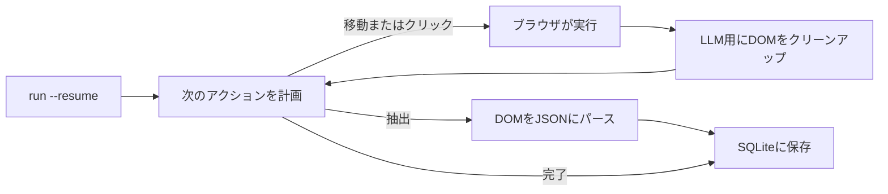

<a id="readme-top"></a>
<p align="center">
  
</p>
<p align="center">
  <strong>自律型のウェブ調査および構造化スクレイピング（JSON変換）エージェント。</strong>
  <br />
  プレーンな英語での目標とJSON Schemaを指定するだけで、自律的にナビゲーションを計画し、ページを読み取り、検証済みの構造化データを返します。
</p>

<p align="center">
  <a href="https://github.com/EmanueleTorrisi/verboisy/actions/workflows/ci.yml"></a>
  <a href="https://codecov.io/gh/EmanueleTorrisi/verboisy"></a>
  <a href="https://emanueletorrisi.github.io/verboisy/"></a>
  <a href="#インストール"></a>
  <!--<a href="https://pypi.org/project/verboisy/"></a>-->
  
  <a href="LICENSE"></a>
  <a href="https://github.com/astral-sh/ruff"></a>
</p>

<p align="center">
  <em>v0.1.0 | 1.0未満のプレリリース版で積極開発中。1.0に達するまではマイナーバージョン間で互換性を破る変更（breaking changes）が発生する可能性があります。</em>
</p>

<p align="center">
  <a href="../../README.md" title="English" aria-label="English">🇬🇧</a> ·
  <a href="README.it.md" title="Italiano" aria-label="Italiano">🇮🇹</a> ·
  <a href="README.de.md" title="Deutsch" aria-label="Deutsch">🇩🇪</a> ·
  <a href="README.zh-CN.md" title="简体中文" aria-label="简体中文">🇨🇳</a> ·
  <a href="README.fr.md" title="Français" aria-label="Français">🇫🇷</a> ·
  <a href="README.es.md" title="Español" aria-label="Español">🇪🇸</a> ·
  <a href="README.ko.md" title="한국어" aria-label="한국어">🇰🇷</a> ·
  <strong title="日本語" aria-label="日本語">🇯🇵</strong>
</p>

## 目次

- [デモ](#デモ)
- [Verboisyの特長](#verboisyの特長)
- [他ツールとの比較](#他ツールとの比較)
- [クイック例](#クイック例)
- [ユースケース](#ユースケース)
- [仕組み](#仕組み)
- [インストール](#インストール)
- [設定](#設定)
- [使い方](#使い方)
- [Docker](#docker)
- [既知の制限事項](#既知の制限事項)
- [責任ある利用](#責任ある利用)
- [ドキュメント](#ドキュメント)
- [貢献](#貢献)
- [セキュリティ](#セキュリティ)
- [ライセンス](#ライセンス)

## デモ

*動画作成中: CLIは現在すでに動作します。実際の入力と出力については、以下の[クイック例](#クイック例)を参照してください。*

## Verboisyの特長

- **セレクター駆動ではなく目標駆動。** 達成したい目的をプレーンな英語で指定します。プランナーが実際の画面を見て、次のクリック、スクロール、読み取り動作を判断します。サイトのデザイン変更に伴って書き直す必要のあるハードコードは一切ありません。
- **ベストエフォートではなくスキーマファースト。** すべてのレコードは保存前に、指定したJSON Schemaから生成されたPydanticモデルに対して検証されます。不正な形式のデータがデータベースに保存されることはありません。
- **好みのモデルと自社インフラを使用。** [LiteLLM](https://github.com/BerriAI/litellm) 経由でOpenAI、Anthropic、またはローカルのOllamaモデルを環境変数1つで切り替え可能。外部のブラックボックスなクラウドではなく、自前のマシンやサーバー上で実行できます。
- **構造上、途中で中断・再開が可能。** 各レコードは検証された瞬間にSQLiteへ保存されます。`verboisy run --resume`（Pythonでは `run(resume=True)`）を実行すると、最後の未完了のセッションから処理を再開します。クラッシュしても失われるのは現在のステップのみで、保存済みのデータは保護されます。

このループの周辺機能：非同期Playwright（Chromium、ヘッドレスまたはヘッドあり）、生のHTMLダンプではなくLLMのコンテキストウィンドウに最適化されたDOMクレンジング、JSONまたはCSV出力、SQLiteデータベースへの直接クエリ。

## 他ツールとの比較

Verboisyは、自律型ブラウザエージェントとスキーマ検証付き抽出ツールの機能を兼ね備えています。既存のツールはどちらか一方に特化していますが、本ツールは両方を実現するために設計されています。

| | Verboisy | [Browser Use](https://github.com/browser-use/browser-use) | [Firecrawl](https://github.com/firecrawl/firecrawl) | [Crawl4AI](https://github.com/unclecode/crawl4ai) |
| --- | --- | --- | --- | --- |
| 入力内容 | 目標 **および** JSON Schema | 目標 | URL + プロンプトまたはスキーマ | クロールルール + プロンプト |
| ナビゲーション | プランナーがクリックを選択 | プランナーがクリックを選択 | クロール / サイトマップ | クロール |
| データ検証 | 保存前にスキーマからPydantic検証 | ユーザーコード側 | 任意で抽出スキーマ | ユーザーコード側 |
| 永続化 | レコードごとにSQLite保存、`--resume` 対応 | メモリ上 / ユーザーコード側 | APIまたはユーザーのDB | ユーザーコード側 |
| 実行場所 | ローカルマシン | ローカルマシン | ホスト型またはセルフホスト | ローカルマシン |

すでにURLが分かっておりMarkdown出力のみが必要な場合は、FirecrawlやCrawl4AIがシンプルです。一般的なPC操作エージェントが必要で後からデータ検証を行う場合は、Browser Useが適しています。出力がスキーマに合致する行データであり、エージェントが自律的にそれを検索・抽出する必要がある場合は、Verboisyが最適です。

## クイック例

スキーマにはJSON Schemaを使用します。レコードのリストを取得する場合、トップレベルは `"array"` とし、その `"items"` に1行分のオブジェクト構造を指定します：

```json
{
  "type": "array",
  "items": {
    "type": "object",
    "properties": {
      "name": { "type": "string" },
      "website": { "type": "string" },
      "description": { "type": "string" },
      "batch": { "type": "string" }
    },
    "required": ["name", "website"]
  }
}
```

Verboisyは実行時にこれからPydanticモデルを構築し、一致しない行がSQLiteに保存されるのをブロックします。

CLI:

```bash
verboisy run \
  --goal "Find AI startups from the Y Combinator Fall 2026 (F26) batch" \
  --schema examples/yc_startups/schema.json \
  --export result.json
```

Pythonからの実行例：

```python
from verboisy import run

result = run(
    goal="Find AI startups from the Y Combinator Fall 2026 (F26) batch",
    schema="examples/yc_startups/schema.json",
    export="result.json",
)

print(result.run_id, len(result.records))
for row in result.records:
    print(row["name"], row["website"])
```

どちらの形式でも以下が出力されます：

```json
[
  {
    "name": "Marrow",
    "website": "[https://marrow.example.com](https://marrow.example.com)",
    "description": "本番環境AIエージェント向けステージング環境。",
    "batch": "F26"
  },
  {
    "name": "Kiln Trace",
    "website": "[https://kilntrace.example.com](https://kilntrace.example.com)",
    "description": "エージェントワークフローのレイテンシとコストのデバッグ。",
    "batch": "F26"
  }
]
```

*(例示用出力：実際の出力結果は実行時にページ上に存在する情報に依存します。サンプル名は意図的に `.example.com` を使用しています。)*

実行の途中でプロセスが終了した場合でも、保存済みの行を再処理することなく再開できます：

```bash
verboisy run --resume
```

```python
result = run(resume=True)
```

## ユースケース

Verboisyは、繰り返し実行する価値のある調査タスクに最適です：

- **競合・市場インテリジェンス:** 競合他社の価格設定、製品ページ、ニュース発表を定期的に自動トラッキング。
- **B2Bリード調査:** 企業名のリストから企業概要や採用技術スタックなどの構造化データへ変換し、CRMに即時インポート。
- **EC・小売モニタリング:** JavaScriptを多用したECサイトでの商品カタログや価格の変動を監視。
- **リサーチオペレーション (ResOps):** 数百のエンティティに対して同じクエリパターンを定期実行。
- **RAG / 知識ベースの取り込み:** 手動収集されたテキストの代わりに、ソース情報付きの構造化レコードを検索パイプラインに供給。

いずれのユースケースも、前述のクイック例と同様の「目標 + スキーマ」パターンであり、対象サイトとデータの形式を変更するだけで対応できます。

## 仕組み

Verboisyは、プランナーが十分なデータを収集したと判断するか、指定されたステップ上限に達するまで、**計画 (plan) → 実行 (act) → 観察 (observe) → 抽出 (extract)** の核心ループを実行します。



抽出された各レコードは、検証を通過した時点で `run_id` とともにSQLiteに即時保存されます。レート制限、クラッシュ、プロセスの強制終了などでループが中断された場合でも、`verboisy run --resume`（または `run(resume=True)`）を実行すると、その実行の目標、スキーマ、保存済みデータを読み込んで再開します。`--resume <id>` で特定の実行を指定でき、IDなしの `--resume` は最新の未完了実行を対象とします。

`--export` は実行完了時（または再開された実行の完了時）に書き出されます。それまでの途中結果は `SQLITE_DB_PATH` に保存されます。

各モジュールの詳細な解説は [`ARCHITECTURE.md`](../../ARCHITECTURE.md) を参照してください。

## インストール

Python 3.11+ が必要です。

現時点ではPyPIに未登録です。ソースからインストールしてください：

```bash
git clone [https://github.com/EmanueleTorrisi/verboisy.git](https://github.com/EmanueleTorrisi/verboisy.git)
cd verboisy && pip install -e .
playwright install --with-deps chromium
```

最初のリリース後は、以下のコマンドでインストール可能になる予定です：

```bash
pip install verboisy
playwright install --with-deps chromium
```

## 設定

`.env.example` を `.env` にコピーします。設定項目は `utils/config.py` 内のPydantic経由で読み込まれます。設定しない項目はデフォルト値が適用されます。

```bash
# 必須: 少なくとも1つのLLMプロバイダー
OPENAI_API_KEY=sk-your-api-key-here
# ANTHROPIC_API_KEY=sk-ant-your-api-key-here

# LiteLLMモデルルーティング (例: gpt-4o, claude-sonnet-5, ollama/llama3)
LITELLM_MODEL=gpt-4o

SQLITE_DB_PATH=verboisy.db
VERBOISY_LOG_LEVEL=INFO
VERBOISY_HEADLESS=true
```

| 変数名 | デフォルト値 | 説明 |
| --- | --- | --- |
| `OPENAI_API_KEY` | - | OpenAI APIキー。Anthropicまたはローカルモデルを使用しない限り必須。 |
| `ANTHROPIC_API_KEY` | - | Anthropic APIキー。OpenAIの代わりに使用。 |
| `LITELLM_MODEL` | `gpt-4o` | [LiteLLM](https://github.com/BerriAI/litellm) がサポートする任意のモデル文字列。 |
| `MAX_TOKENS` | `4096` | 1回の計画または抽出呼び出しあたりの最大トークン数。 |
| `TEMPERATURE` | `0.0` | プランナーのサンプリング温度設定。 |
| `VERBOISY_HEADLESS` | `true` | Chromiumをヘッドレスで実行。ブラウザの動作を確認したい場合は `false` に設定。 |
| `BROWSER_TIMEOUT_MS` | `30000` | ページごとのナビゲーションタイムアウト（ミリ秒）。 |
| `USER_AGENT_ROTATION` | `true` | リクエストごとにUser-Agentをローテーション。 |
| `SQLITE_DB_PATH` | `verboisy.db` | 実行履歴および抽出されたレコードが保存されるSQLiteファイルのパス。 |
| `VERBOISY_LOG_LEVEL` | `INFO` | Pythonの標準ログレベル。`DEBUG` でプランナーの各ステップを出力。 |

LLMプロバイダーの利用料金は直接プロバイダーに支払います。計画および抽出の呼び出しは `MAX_TOKENS`（デフォルト4096）、`TEMPERATURE` 0.0 に制限されます。一般的なリスト収集の目標であれば、API呼び出し回数は数百回ではなく数十回程度で収まります。別途のホスティング手数料などは発生しません。

## 使い方

### CLI

```bash
verboisy run \
  --goal "Find AI startups from the Y Combinator Fall 2026 (F26) batch" \
  --schema examples/yc_startups/schema.json \
  --export result.json
```

コマンドを実行すると `run_id` が出力されます（SQLiteにも保存されます）。後で再開する際にこのIDを使用します。

| フラグ | エイリアス | 必須 | 説明 |
| --- | --- | --- | --- |
| `--goal` | `-g` | `--resume` 指定時以外必須 | 探したい情報と場所についてのプレーンな英語での記述。具体的に記述してください。 |
| `--schema` | `-s` | `--resume` 指定時以外必須 | 抽出フィールドを定義したJSON Schemaのパス。トップレベルはレコード `object` の `array`。 |
| `--export` | `-e` | いいえ | 出力先パス。`.json` および `.csv` をサポート。実行完了時に出力されます。 |
| `--resume` | `-r` | いいえ | 実行を再開。`--resume` のみで `SQLITE_DB_PATH` 内の最新の未完了実行を再開。`--resume <id>` で特定実行を再開。目標とスキーマは保存された実行から読み込まれます（`--export` やヘッドレス設定は上書き可能）。 |

すべてのフラグオプションを確認するには `verboisy run --help` を実行してください。

### 再開 (Resume)

```bash
# verboisy.db 内の最新の未完了実行を再開
verboisy run --resume

# 特定の実行を再開
verboisy run --resume 7f3a2c1b --export result.json
```

すでに検証・保存済みの行が再度抽出されることはありません。未完了の実行が存在しない場合、確認したデータベース名を添えたエラーメッセージを出力して終了します。

### Python

`run()` が公開APIです。CLIはこの関数の薄いラッパーです。

```python
from pathlib import Path
from verboisy import RunResult, run

result: RunResult = run(
    goal="Find AI startups from the Y Combinator Fall 2026 (F26) batch",
    schema="examples/yc_startups/schema.json",  # 文字列パス、Pathオブジェクト、またはdict
    export="result.json",
)

print(result.run_id)
print(result.records[0]["name"])
```

ファイルを使用せず、dict形式でスキーマを直接指定する場合：

```python
result = run(
    goal="Find AI startups from the Y Combinator Fall 2026 (F26) batch",
    schema={
        "type": "array",
        "items": {
            "type": "object",
            "properties": {
                "name": {"type": "string"},
                "website": {"type": "string"},
                "description": {"type": "string"},
                "batch": {"type": "string"},
            },
            "required": ["name", "website"],
        },
    },
)
```

再開処理：

```python
from verboisy import run

# 最新の未完了実行を再開
result = run(resume=True)

# 特定の実行を再開し、完了時にエクスポートファイルを書き出し
result = run(resume=result.run_id, export="result.json")
```

シグネチャ：

```python
def run(
    *,
    goal: str | None = None,
    schema: str | Path | dict | None = None,
    export: str | Path | None = None,
    resume: bool | str = False,
    headless: bool | None = None,
) -> RunResult: ...
```

`RunResult` のフィールド：

| フィールド名 | 型 | 意味 |
| --- | --- | --- |
| `run_id` | `str` | SQLiteに保存されるID。`run(resume=...)` に渡して再開時に使用。 |
| `records` | `list[dict]` | これまでに検証・保存されたすべてのデータ行。 |
| `export_path` | `Path \| None` | `--export` / `export=` が設定され実行が完了した場合のエクスポート先パス。 |
| `db_path` | `Path` | 使用されたSQLiteファイルのパス。 |
| `completed` | `bool` | クラッシュではなく、正常に全タスクが完了して終了した場合は `True`。 |

ルール：

- 新規実行：`goal` および `schema` が必須。`resume` は省略するか `False` を指定。
- 再開：`resume=True` または `resume="<id>"` を指定。`goal` および `schema` は任意（すでに保存されているものが優先されます）。
- `headless=None` の場合は `VERBOISY_HEADLESS` の設定を使用。`True` / `False` を渡すことで一時的に上書き可能。

### 実行のモニタリング

```bash
VERBOISY_HEADLESS=false VERBOISY_LOG_LEVEL=DEBUG \
  verboisy run \
    --goal "Find AI startups from the Y Combinator Fall 2026 (F26) batch" \
    --schema examples/yc_startups/schema.json \
    --export result.json
```

## Docker

```bash
docker compose -f docker/docker-compose.yml up -d --build
docker compose -f docker/docker-compose.yml exec verboisy verboisy run \
  --goal "Find AI startups from the Y Combinator Fall 2026 (F26) batch" \
  --schema examples/yc_startups/schema.json \
  --export result.json
```

コンテナはPlaywrightのブラウザ依存関係がインストールされた状態で起動・保持されるため、コマンドはコンテナのエントリーポイントではなく `exec` 経由で実行されます。コンテナの再起動を挟んでも `--resume` を機能させたい場合は、`SQLITE_DB_PATH` をマウントするか永続化してください。`OPENAI_API_KEY` はシェルから自動的に引き継がれるため、事前にあらかじめ `export` しておいてください。その他の環境変数（`ANTHROPIC_API_KEY`、`LITELLM_MODEL` など）を渡す場合は、同様に `export` するか、`docker/docker-compose.yml` 内の `environment:` を `env_file: [../.env]` に差し替えてください。

## 既知の制限事項

ベータ版ソフトウェアのため、以下の制限があります：

- **ユーザーアカウントやクラウド上の履歴管理なし:** シングルユーザー向け。実行IDはダッシュボードではなくローカルのSQLiteファイルに保存されます。
- **スケジューラ機能なし:** 実行の起動は手動で行うか、既存のcronやオーケストレーターに組み込んでください。`--resume` はクラッシュやレート制限からの復旧用であり、定期実行ツールではありません。
- **ホスト型HTTP APIなし:** 現時点でのインターフェースは CLI、`verboisy.run()`、Dockerイメージのみです。
- **強力なボット対策サイトでの動作不安定:** 一部のターゲットサイトでは、再試行や手動での介入が必要になる場合があります。

ユースケースの妨げとなる問題を見つけましたか？ [Issueを作成](https://github.com/EmanueleTorrisi/verboisy/issues) してください。優先的に対応すべき機能を伝える最も直接的な方法です。

## 責任ある利用

Verboisyはユーザーに代わって実際のブラウザを操作します。対象サイトの利用規約、`robots.txt`、レート制限、および関連法規の遵守はユーザーの責任となります。アクセス権限のない認証の回避やアクセス制限の破りなどの目的で使用しないでください。

## ドキュメント

設定リファレンスやAPIの詳細を含む完全なドキュメントは、**[emanueletorrisi.github.io/verboisy](https://emanueletorrisi.github.io/verboisy/)** で公開されています。

## 貢献

コントリビューションを歓迎します。ローカルでの環境構築やコーディング規約については [`CONTRIBUTING.md`](../CONTRIBUTING.md) を参照し、[行動規範 (Code of Conduct)](../CODE_OF_CONDUCT.md) に従って行動してください。着手する課題をお探しの場合は、[`good first issue`](https://github.com/EmanueleTorrisi/verboisy/labels/good%20first%20issue) のタグが付いたIssueをご確認ください。

## セキュリティ

脆弱性を発見された場合は、公開Issueを作成せず、[プライベートな脆弱性報告](https://github.com/EmanueleTorrisi/verboisy/security/advisories/new) を利用するか、[`SECURITY.md`](../SECURITY.md) を参照してください。

## ライセンス

BSD 2-Clause: 全文は [`LICENSE`](../../LICENSE) を参照してください。

---

<p align="center">
  Built by <a href="https://github.com/EmanueleTorrisi">Emanuele Torrisi</a> · <a href="#readme-top">トップに戻る ↑</a>
</p>
