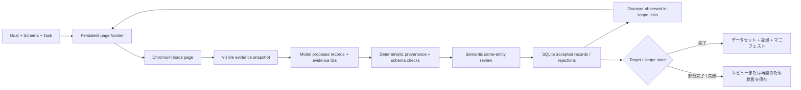

<a id="readme-top"></a>
<p align="center">
  
</p>
<p align="center">
  <strong>証拠に基づく Web リサーチで、範囲を限定したソースを型付きデータセットに変換します。</strong>
  <br />
  Verboisy に目標、JSON Schema、ソースポリシーを渡すと、ブラウズ・抽出・出典検証・意味レビューを行い、監査可能な構造化データを返します。
</p>

<p align="center">
  <a href="https://github.com/EmanueleTorrisi/verboisy/actions/workflows/ci.yml"></a>
  <a href="https://codecov.io/gh/EmanueleTorrisi/verboisy"></a>
  <a href="https://emanueletorrisi.github.io/verboisy/"></a>
  <a href="#installation"></a>
  
  <a href="../../LICENSE"></a>
  <a href="https://github.com/astral-sh/ruff"></a>
</p>

<p align="center">
  <em>v0.2.0rc1 | リリース候補。証拠ベースで再開可能、かつ不完全なカバレッジを明示します。</em>
</p>

<p align="center">
  <a href="../../README.md" title="English" aria-label="English">🇬🇧</a> ·
  <a href="README.it.md" title="Italiano" aria-label="Italiano">🇮🇹</a> ·
  <a href="README.de.md" title="Deutsch" aria-label="Deutsch">🇩🇪</a> ·
  <a href="README.zh-CN.md" title="简体中文" aria-label="简体中文">🇨🇳</a> ·
  <a href="README.fr.md" title="Français" aria-label="Français">🇫🇷</a> ·
  <a href="README.es.md" title="Español" aria-label="Español">🇪🇸</a> ·
  <a href="README.ko.md" title="한국어" aria-label="한국어">🇰🇷</a> ·
  <strong title="日本語" aria-label="日本語">🇯🇵</strong>
</p>

## 目次

- [デモ](#demo)
- [なぜ Verboisy か](#why-verboisy)
- [比較](#compared-to)
- [クイック例](#quick-example)
- [ユースケース](#use-cases)
- [仕組み](#how-it-works)
- [インストール](#installation)
- [設定](#configuration)
- [使い方](#usage)
- [出力と CSV](#outputs-and-csv)
- [Docker](#docker)
- [既知の制約](#known-limitations)
- [責任ある利用](#responsible-use)
- [ドキュメント](#documentation)
- [コントリビュート](#contributing)
- [セキュリティ](#security)
- [ライセンス](#license)

<a id="demo"></a>
## デモ

[旧デモアニメーション](../../docs/demo.gif)は説明用で、0.2 の Evidence Engine より前のものです。現在の挙動は[ライブデモ手順](../../docs/demo.md)と[検証ガイド](../../docs/validation.md)を参照してください。

0.2.0rc1 は、オフライン statement/branch カバレッジ、実 Chromium、クリーンな wheel インストール、Docker sandbox 起動、反復 live fixture、held-out pagination、実 SIGINT/再開、利用不能ソース、identity conflict、非 e-commerce held-out ケースで検証されています。これはリリース証拠であり、全サイト・全モデル応答の成功保証ではありません。

<a id="why-verboisy"></a>
## なぜ Verboisy か

- **「モデルがそう言った」ではなく証拠ベース。** 非 null の各スカラーは観測済みページ証拠を参照し、コードが source ID、entity scope、文字列引用、型、リンク、変換、schema を検証します。
- **契約を黙って弱めない Schema-first。** JSON Schema Draft 2020-12 が行形状と集合制約を定義します。必要証拠がなければ値を創作せず候補を拒否します。
- **意味レビューを分離。** 決定的検証の後、2 回目のモデル呼び出しが提供済み証拠だけから関連性、フィールド意味、同一 entity を確認します。これは誤り得るもので外部真実オラクルではありません。
- **境界付きリサーチ。** Seed URL、許可 host、include/exclude path、深度、ページ数、ページ当たりリンク数、任意の JS pagination が観測範囲を決めます。
- **設計上再開可能。** ページ状態、snapshot、candidate、accepted record、event、モデル計量、queue が SQLite に永続化されます。
- **矛盾を隠さない。** identity field は同一 record を重複排除し、同一 identity の矛盾 payload はマージせず隔離します。

Playwright/Chromium + SQLite + LiteLLM + JSON/CSV + 証拠サイドカー + チェックサム付きマニフェスト。

<a id="compared-to"></a>
## 比較

Verboisy はブラウザ研究エージェントと構造化抽出器の中間に位置し、受理された各値に証拠チェーンを持つ点が特徴です。

| | Verboisy | 汎用ブラウザエージェント | クローラー / 抽出器 | アドホック LLM 抽出 |
| --- | --- | --- | --- | --- |
| 入力 | 目標 + JSON Schema + ソースポリシー | 目標 | URL / クロール規則 | プロンプト + ページ本文 |
| ナビゲーション | 観測済み in-scope link + 任意 pagination | モデル駆動アクション | crawler ルール | 通常なし |
| フィールド出典 | 非 null 各スカラーに必須 | 実装次第 | さまざま | 通常 prompt のみ |
| 検証 | JSON Schema + 決定的証拠 + 意味レビュー | 実装次第 | さまざま | 原則ベストエフォート |
| 永続化 | SQLite のキュー / スナップショット / 候補 / レコード / イベント | さまざま | さまざま | 通常は呼び出し側 |
| 再開 | 永続実行 ID + 探索フロンティア | さまざま | さまざま | 通常は呼び出し側 |
| identity conflict | 決定的隔離 | caller | caller | caller |

<a id="quick-example"></a>
## クイック例

まず 1 レコードの意味を厳密に定義します：

```json
{
  "type": "array",
  "minItems": 2,
  "items": {
    "type": "object",
    "properties": {
      "sku": {"type": "string", "description": "ソースが公開したままの製品 SKU"},
      "price_usd": {"type": "number", "minimum": 0, "description": "表示された USD 単価。通貨換算しない"},
      "source_url": {"type": "string", "format": "uri", "description": "このレコードを観測した最終ページ URL"}
    },
    "required": ["sku", "price_usd", "source_url"],
    "additionalProperties": false
  }
}
```

次に `task.json` で境界付き source policy を定義します：

```json
{
  "seed_urls": ["https://catalog.example/products"],
  "allowed_hosts": ["catalog.example"],
  "include_paths": ["/products*"],
  "target_records": 20,
  "identity_fields": ["/sku"],
  "max_depth": 3,
  "max_pages": 100,
  "field_rules": {
    "/source_url": {"source": "page_url"}
  }
}
```

実行：

```bash
verboisy run \
  --goal "公開されている製品 SKU と表示 USD 価格を収集する" \
  --schema schema.json \
  --task task.json \
  --export dataset.json \
  --max-steps 40
```

出力例：

```json
[
  {"sku": "LAMP-001", "price_usd": 39.95, "source_url": "https://catalog.example/products/lamp-001"},
  {"sku": "CHAIR-014", "price_usd": 129.0, "source_url": "https://catalog.example/products/chair-014"}
]
```

*例のドメインと record は説明用です。実際の結果は run 中に観測したページに依存します。*

<a id="use-cases"></a>
## ユースケース

「行を返す」だけでなく「この値はどこから来たか」も必要な場合に Verboisy が向いています。

- **市場・競合調査：** catalog/price/feature/announcement を field evidence 付きで収集。
- **B2B 調査：** identity field と source URL を持つ組織/directory record。
- **E-commerce 監視：** 矛盾観測を隠さない型付き商品データ。
- **Research Operations：** controlled pages に同じ schema/policy を適用し SQLite から再開。
- **Registry / reference data：** 技術表を bool/number/text/URL の正確な証拠付きで型付き行に変換。
- **RAG / data pipeline：** unsourced prose ではなく canonical JSON + evidence sidecar + manifest。

<a id="how-it-works"></a>
## 仕組み

0.2 は旧自由 plan/action loop を、境界付き Evidence Research Engine に置き換えます：



Snapshot は可視事実、解決済み link、entity-scope ID、最終 URL、timestamp、content hash を持ち、完全な観測 HTML は SQLite に残ります。モデルは candidate を提案できますが schema/provenance 検証を回避できません。`COMPLETED` は明示 target と collection validation の達成であり、Web 全体の網羅性を意味しません。

[`ARCHITECTURE.md`](../../ARCHITECTURE.md)

<a id="installation"></a>
## インストール

Python 3.11–3.14 が必要です。

安定版公開後の通常インストール予定：

```bash
pip install verboisy
```

未公開のこの release candidate では、提供 wheel または source checkout をインストール：

```bash
pip install -e .
verboisy --help
```

最初のブラウザ利用時に、モデル呼び出し前に対応 Chromium を取得します。import や `--help` では取得しません。明示的に準備するには：

```bash
verboisy setup
```

Linux では Chromium の native library が必要な場合があります。例：

```bash
python -m playwright install-deps chromium
```

Verboisy 自身は `sudo` を実行せず、sandbox を黙って無効化しません。

<a id="configuration"></a>
## 設定

`.env.example` を `.env` にコピーし、認証情報を version control に入れないでください。

```bash
OPENAI_API_KEY=sk-your-api-key-here
# ANTHROPIC_API_KEY=sk-ant-your-api-key-here
LITELLM_MODEL=gpt-4o
SQLITE_DB_PATH=verboisy.db
SEARCH_PROVIDER=disabled
BROWSER_SANDBOX=true
ALLOW_PRIVATE_NETWORK=false
```

主な設定：

| Variable | 用途 |
| --- | --- |
| `OPENAI_API_KEY / ANTHROPIC_API_KEY` | LiteLLM 経由で渡すプロバイダー認証情報 |
| `LITELLM_MODEL` | 提案・レビュー呼び出しに使うモデル識別子 |
| `LITELLM_API_KEY / LITELLM_API_BASE` | 任意の代替プロバイダーまたはプロキシ |
| `SQLITE_DB_PATH` | 0.2 実行用の永続データベース |
| `SEARCH_PROVIDER` | 既知の開始 URL では無効化し、必要に応じて Brave 検索を設定 |
| `BRAVE_SEARCH_API_KEY` | Brave 検索の認証情報 |
| `MAX_TOKENS` | 1 リクエストあたりのモデル出力トークン上限 |
| `MODEL_REQUEST_BUDGET` | 保守的なローカル要求単位予算 |
| `LLM_TIMEOUT_SECONDS` | モデル要求ごとのタイムアウト |
| `LLM_RETRIES` | 一時的または利用不能な応答に対する有限回の再試行 |
| `RUN_TIMEOUT_SECONDS` | 1 回の呼び出し全体のタイムアウト |
| `MAX_DOM_CHARS` | モデルバッチごとの証拠ペイロード上限 |
| `ACTION_DELAY_SECONDS` | ページ処理反復の間隔 |
| `BROWSER_SANDBOX` | Chromium サンドボックスの切り替え。通常は有効のまま |
| `ALLOW_PRIVATE_NETWORK` | プライベート/ループバックへの明示アクセス。既定では無効 |
| `ALLOWED_DOMAINS` | 任意の厳密な宛先ホスト制限 |

`verboisy doctor` は秘密を含まない設定と環境状態を表示し、`verboisy setup` はモデル呼び出しなしで Chromium を準備/検査します。

<a id="usage"></a>
## 使い方

### CLI

```bash
verboisy run \
  --goal "公開されている製品 SKU と表示 USD 価格を収集する" \
  --schema schema.json \
  --task task.json \
  --export dataset.json \
  --max-steps 40
```

主なフラグ：

| Flag | 必須 | 意味 |
| --- | --- | --- |
| `--goal`, `-g` | 新規 run | Natural-language research objective |
| `--schema`, `-s` | 新規 run | JSON Schema path |
| `--task`, `-t` | 新規 run | Bounded source/discovery policy |
| `--export`, `-e` | いいえ | `.json` または `.csv` 出力 |
| `--resume`, `-r` | 再開 | 最新の未完了実行または特定の実行 ID |
| `--max-steps`, `-m` | いいえ | この呼び出しで許可する処理量 |
| `--headless` / `--headed` | いいえ | ブラウザ表示モードの上書き |

終了コード：`0` target 完了、`2` 通常の partial/exhausted、`1` failure、`130` interruption。

### 再開

```bash
# 最新の未完了 run を再開
verboisy run --resume

# 指定 run を再開し、この invocation 停止時に export
verboisy run --resume 7f3a2c1b --export dataset.json
```

再開では元の goal/schema/task、accepted record、queue、累積 accounting を保持します。中断/active page work は再度処理可能になり、identity logic が同一 record の重複を防ぎます。

### Python

`run()` は同期 API。async では `await arun(...)` を使用します。

```python
from verboisy import run

result = run(
    goal="公開製品 SKU と USD 価格を収集",
    schema="schema.json",
    task="task.json",
    export="dataset.json",
    max_steps=40,
)

print(result.run_id)
print(result.status, result.stop_reason)
for record in result.records:
    print(record)
```

<a id="outputs-and-csv"></a>
## 出力と CSV

JSON export は 3 つの補完的 artifact を生成します：

- `dataset.json` — ユーザー要求フィールドのみ。
- `dataset.json.evidence.json` — accepted record と snapshot/evidence provenance。
- `dataset.json.manifest.json` — run state、schema/task、model metadata、collection validation、SHA-256 hash。

SQLite にはさらに page frontier、snapshot/HTML、candidate、rejection reason、accepted record、coverage gap、identity conflict、accounting が残ります。

既定の `csv_mode: "json"` は存在する各 cell を JSON として保存し型を正確に保持します。空白は absent、`null` は absent と区別されます。

`csv_mode: "spreadsheet"` は一般的な cell と formula-like string escape を使います。人には扱いやすいですが canonical typed interchange ではありません。

コピーした export を同一 generation とみなす前に manifest hash を確認してください。

<a id="docker"></a>
## Docker

提供コンテナは非特権ユーザーで Verboisy を実行し、個人ブラウザセッションより強い deployment boundary を意図しています。

```bash
docker build -f docker/Dockerfile -t verboisy:0.2.0rc1 .

docker run --rm --init --shm-size=1g \
  --security-opt seccomp=docker/seccomp_profile.json \
  --entrypoint verboisy \
  verboisy:0.2.0rc1 setup
```

実運用では SQLite/export を永続化し、sandbox を有効に保ち、適切な egress 制御を使ってください。

<a id="known-limitations"></a>
## 既知の制約

- crawl は観測済み in-scope HTTP(S) link を breadth-first で追跡します。モデルは優先順位を付けられますが任意 URL を創作できません。
- `pagination_selector` は境界付き JS pagination をサポート。一般 form、任意 filter、implicit infinite scroll、download、iframe/shadow-root、任意 JS action は未実装。
- 認証、CAPTCHA、anti-bot bypass、OCR、PDF、cross-page join は現在の契約外。
- DOM/evidence context は有限で、oversized batch や unusable model response は明示 coverage gap になります。
- literal provenance は値が許可 scope で観測されたことを示すだけで、source 自体の真実性は保証しません。
- semantic review はモデルベースで誤り得ます。
- `COMPLETED` は target completion であり global completeness ではありません。
- unavailable source は run を failed/incomplete にし得ます。予算を繰り返し増やしても missing evidence の代わりにはなりません。
- `identity_fields` がなければ exact record equality のみを dedupe。identity があれば矛盾 payload は隔離されます。

<a id="responsible-use"></a>
## 責任ある利用

Verboisy は実ブラウザを操作し source material をローカル保存します。利用規約、robots、rate limit、license、privacy、法令の順守は利用者の責任です。権限のない認証や access control を回避しないでください。

URL check と Chromium sandbox は defense in depth であり完全な network sandbox ではありません。untrusted browsing では専用 account/container/VM、sensitive mount 回避、egress 制限を使用してください。

source page/record には個人情報やライセンス対象データが含まれる場合があります。Verboisy は SQLite を自動暗号化せず、アクセス可能であることは再配布/学習許可を意味しません。

<a id="documentation"></a>
## ドキュメント

- [契約とタスクポリシー](../../docs/contracts.md)
- [検証とリリースチェック](../../docs/validation.md)
- [検索と復旧](../../docs/search-and-recovery.md)
- [0.1 からの移行](../../docs/migration.md)
- [ライブデモ手順](../../docs/demo.md)
- [リリース運用](../../docs/release.md)
- [アーキテクチャ](../../ARCHITECTURE.md)

<a id="contributing"></a>
## コントリビュート

コントリビューション歓迎。[`CONTRIBUTING.md`](../CONTRIBUTING.md) を参照し、新挙動は決定的テストでカバーし、fixture のためだけに evidence/sandbox rule を弱めないでください。

<a id="security"></a>
## セキュリティ

脆弱性を見つけた場合は公開 issue を作らず、[非公開の脆弱性報告](https://github.com/EmanueleTorrisi/verboisy/security/advisories/new) または [`SECURITY.md`](../SECURITY.md) を利用してください。

<a id="license"></a>
## ライセンス

BSD 2-Clause。[`LICENSE`](../../LICENSE) を参照。

---

<p align="center">
  作者 <a href="https://github.com/EmanueleTorrisi">Emanuele Torrisi</a> · <a href="#readme-top">トップへ ↑</a>
</p>
