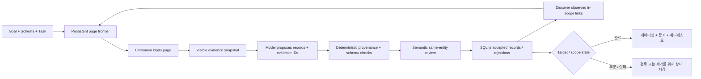

<a id="readme-top"></a>
<p align="center">
  
</p>
<p align="center">
  <strong>근거 기반 웹 리서치로 범위가 제한된 소스를 타입이 보존된 데이터셋으로 변환합니다.</strong>
  <br />
  Verboisy에 목표, JSON Schema, 소스 정책을 주면 브라우징·추출·출처 검증·의미 검토를 수행하고 감사 가능한 구조화 데이터를 반환합니다.
</p>

<p align="center">
  <a href="https://github.com/EmanueleTorrisi/verboisy/actions/workflows/ci.yml"></a>
  <a href="https://codecov.io/gh/EmanueleTorrisi/verboisy"></a>
  <a href="https://emanueletorrisi.github.io/verboisy/"></a>
  <a href="#installation"></a>
  
  <a href="../../LICENSE"></a>
  <a href="https://github.com/astral-sh/ruff"></a>
</p>

<p align="center">
  <em>v0.2.0rc1 | 릴리스 후보. 근거 기반, 재개 가능, 불완전한 커버리지를 명시적으로 다룹니다.</em>
</p>

<p align="center">
  <a href="../../README.md" title="English" aria-label="English">🇬🇧</a> ·
  <a href="README.it.md" title="Italiano" aria-label="Italiano">🇮🇹</a> ·
  <a href="README.de.md" title="Deutsch" aria-label="Deutsch">🇩🇪</a> ·
  <a href="README.zh-CN.md" title="简体中文" aria-label="简体中文">🇨🇳</a> ·
  <a href="README.fr.md" title="Français" aria-label="Français">🇫🇷</a> ·
  <a href="README.es.md" title="Español" aria-label="Español">🇪🇸</a> ·
  <strong title="한국어" aria-label="한국어">🇰🇷</strong> ·
  <a href="README.ja.md" title="日本語" aria-label="日本語">🇯🇵</a>
</p>

## 목차

- [데모](#demo)
- [왜 Verboisy인가](#why-verboisy)
- [비교](#compared-to)
- [빠른 예시](#quick-example)
- [사용 사례](#use-cases)
- [동작 방식](#how-it-works)
- [설치](#installation)
- [설정](#configuration)
- [사용법](#usage)
- [출력과 CSV](#outputs-and-csv)
- [Docker](#docker)
- [알려진 제한](#known-limitations)
- [책임 있는 사용](#responsible-use)
- [문서](#documentation)
- [기여](#contributing)
- [보안](#security)
- [라이선스](#license)

<a id="demo"></a>
## 데모

[이전 애니메이션](../../docs/demo.gif)은 설명용이며 0.2 evidence engine 이전 버전입니다. 현재 동작은 [live demo workflow](../../docs/demo.md)와 [validation guide](../../docs/validation.md)를 사용하세요.

0.2.0rc1은 offline statement/branch coverage, 실제 Chromium, clean wheel 설치, Docker sandbox 시작, 반복 live fixture, held-out pagination, 실제 interruption/resume, unavailable source, identity conflict, non-ecommerce held-out 케이스로 검증되었습니다. 이는 릴리스 근거이지 모든 사이트/모델 응답의 성공 보장은 아닙니다.

<a id="why-verboisy"></a>
## 왜 Verboisy인가

- **“모델이 말했다”가 아니라 근거 기반.** null이 아닌 모든 scalar는 관찰된 페이지 evidence를 가리켜야 하며 코드가 source ID, entity scope, literal quote, type, link, transform, schema를 검사합니다.
- **계약을 몰래 약화하지 않는 Schema-first.** JSON Schema Draft 2020-12가 record shape와 collection constraint를 정의합니다. 필수 evidence가 없으면 값을 만들지 않고 candidate를 막습니다.
- **분리된 semantic review.** 결정적 검증 후 두 번째 모델 호출이 제공된 evidence만으로 relevance, field meaning, same-entity를 확인합니다. 여전히 오류 가능하며 외부 진실 판정기가 아닙니다.
- **명확한 bounded scope.** Seed URL, allowed host, include/exclude path, depth, page 수, links/page, optional JS pagination이 관찰 범위를 정합니다.
- **설계부터 재개 가능.** page state, snapshot, candidate, accepted record, event, model accounting, queue가 SQLite에 저장됩니다.
- **충돌을 숨기지 않음.** identity field는 동일 record를 dedupe하고, 같은 identity의 모순 payload는 merge하지 않고 격리합니다.

Playwright/Chromium + SQLite + LiteLLM + JSON/CSV + 증거 사이드카 + 체크섬 매니페스트.

<a id="compared-to"></a>
## 비교

Verboisy는 브라우저 리서치 에이전트와 구조화 추출기 사이에 있으며, accepted value마다 evidence trail을 남기는 것이 핵심 계약입니다.

| | Verboisy | 범용 브라우저 에이전트 | 크롤러 / 추출기 | 임시 LLM 추출 |
| --- | --- | --- | --- | --- |
| 입력 | 목표 + JSON Schema + 소스 정책 | 목표 | URL / 크롤링 규칙 | 프롬프트 + 페이지 텍스트 |
| 탐색 | 관찰된 in-scope link + optional pagination | 모델 중심 action | crawler rule | 보통 없음 |
| 필드 출처 | 모든 non-null scalar에 필수 | 사용자 코드 | 다양함 | 보통 prompt뿐 |
| 검증 | JSON Schema + 결정적 증거 + 의미 검토 | 사용자 코드 | 다양함 | 일반적으로 최선 노력 |
| 영속성 | SQLite 큐 / 스냅샷 / 후보 / 레코드 / 이벤트 | 다양함 | 다양함 | 보통 호출자 |
| 재개 | 영속 실행 ID + 탐색 프런티어 | 다양함 | 다양함 | 보통 호출자 |
| 식별자 충돌 | 결정적 격리 | 호출자 | 호출자 | 호출자 |

<a id="quick-example"></a>
## 빠른 예시

먼저 record 하나의 의미를 정확히 정의합니다:

```json
{
  "type": "array",
  "minItems": 2,
  "items": {
    "type": "object",
    "properties": {
      "sku": {"type": "string", "description": "소스가 공개한 그대로의 제품 SKU"},
      "price_usd": {"type": "number", "minimum": 0, "description": "표시된 USD 단가; 환율 변환 금지"},
      "source_url": {"type": "string", "format": "uri", "description": "이 record를 관찰한 최종 페이지 URL"}
    },
    "required": ["sku", "price_usd", "source_url"],
    "additionalProperties": false
  }
}
```

그다음 `task.json`에 bounded source policy를 정의합니다:

```json
{
  "seed_urls": ["https://catalog.example/products"],
  "allowed_hosts": ["catalog.example"],
  "include_paths": ["/products*"],
  "target_records": 20,
  "identity_fields": ["/sku"],
  "max_depth": 3,
  "max_pages": 100,
  "field_rules": {
    "/source_url": {"source": "page_url"}
  }
}
```

실행:

```bash
verboisy run \
  --goal "공개된 제품 SKU와 표시된 USD 가격 수집" \
  --schema schema.json \
  --task task.json \
  --export dataset.json \
  --max-steps 40
```

예시 출력 형태:

```json
[
  {"sku": "LAMP-001", "price_usd": 39.95, "source_url": "https://catalog.example/products/lamp-001"},
  {"sku": "CHAIR-014", "price_usd": 129.0, "source_url": "https://catalog.example/products/chair-014"}
]
```

*예시 도메인과 record는 설명용입니다. 실제 결과는 run 중 실제로 관찰한 페이지에 따라 달라집니다.*

<a id="use-cases"></a>
## 사용 사례

“행만 줘”를 넘어서 “이 값이 어디서 왔나?”까지 답해야 할 때 Verboisy가 유용합니다.

- **시장/경쟁 조사:** catalog, price, feature, announcement를 field evidence와 함께 수집.
- **B2B 조사:** explicit identity field와 source URL을 가진 조직/directory record.
- **E-commerce 모니터링:** 모순 관찰을 숨기지 않는 typed product dataset.
- **Research Operations:** controlled pages에 같은 schema/policy를 반복 적용하고 SQLite에서 재개.
- **Registry/reference data:** 기술 표를 boolean/number/text/URL의 정확한 evidence를 유지한 typed row로 변환.
- **RAG/data pipeline:** 출처 없는 prose 대신 canonical JSON + evidence sidecar + manifest 전달.

<a id="how-it-works"></a>
## 동작 방식

0.2는 기존 자유로운 plan/action loop를 bounded evidence research engine으로 교체합니다:



Snapshot은 compact visible fact, resolved link, entity-scope ID, final URL, timestamp, content hash를 포함하고 전체 observed HTML은 SQLite에 저장됩니다. 모델은 candidate를 제안할 수 있지만 schema/provenance 검사를 우회할 수 없습니다. `COMPLETED`는 explicit target과 collection validation 충족을 뜻하며 open web의 전역 완전성을 뜻하지 않습니다.

[`ARCHITECTURE.md`](../../ARCHITECTURE.md)

<a id="installation"></a>
## 설치

Python 3.11–3.14가 필요합니다.

안정 버전이 게시된 뒤 일반 설치 방식은 다음과 같습니다:

```bash
pip install verboisy
```

아직 게시되지 않은 이 release candidate는 제공된 wheel 또는 source checkout으로 설치하세요:

```bash
pip install -e .
verboisy --help
```

브라우저를 처음 실제로 사용할 때 모델 호출 전에 맞는 Chromium build를 내려받습니다. import 또는 `--help`에서는 다운로드하지 않습니다. 명시적 준비:

```bash
verboisy setup
```

Linux에서는 Chromium native library가 필요할 수 있습니다. 예:

```bash
python -m playwright install-deps chromium
```

Verboisy는 스스로 `sudo`를 호출하거나 sandbox를 조용히 끄지 않습니다.

<a id="configuration"></a>
## 설정

`.env.example`을 `.env`로 복사하고 credential을 version control에 넣지 마세요.

```bash
OPENAI_API_KEY=sk-your-api-key-here
# ANTHROPIC_API_KEY=sk-ant-your-api-key-here
LITELLM_MODEL=gpt-4o
SQLITE_DB_PATH=verboisy.db
SEARCH_PROVIDER=disabled
BROWSER_SANDBOX=true
ALLOW_PRIVATE_NETWORK=false
```

주요 설정:

| Variable | 용도 |
| --- | --- |
| `OPENAI_API_KEY / ANTHROPIC_API_KEY` | LiteLLM을 통해 전달되는 공급자 인증 정보 |
| `LITELLM_MODEL` | 제안/검토 호출에 사용할 모델 식별자 |
| `LITELLM_API_KEY / LITELLM_API_BASE` | 선택 가능한 대체 공급자 또는 프록시 |
| `SQLITE_DB_PATH` | 0.2 실행용 영속 데이터베이스 |
| `SEARCH_PROVIDER` | 알려진 시작 URL에서는 비활성화하고 필요하면 Brave 검색 사용 |
| `BRAVE_SEARCH_API_KEY` | Brave 검색 인증 정보 |
| `MAX_TOKENS` | 요청당 모델 출력 토큰 최대값 |
| `MODEL_REQUEST_BUDGET` | 보수적인 로컬 요청 단위 예산 |
| `LLM_TIMEOUT_SECONDS` | 모델 요청당 시간 제한 |
| `LLM_RETRIES` | 일시적이거나 사용할 수 없는 응답에 대한 제한된 재시도 |
| `RUN_TIMEOUT_SECONDS` | 호출 전체 시간 제한 |
| `MAX_DOM_CHARS` | 모델 배치당 증거 페이로드 한도 |
| `ACTION_DELAY_SECONDS` | 페이지 처리 반복 사이 지연 |
| `BROWSER_SANDBOX` | Chromium 샌드박스 전환. 일반적으로 활성화 유지 |
| `ALLOW_PRIVATE_NETWORK` | 사설/루프백 네트워크에 대한 명시적 접근. 기본값은 비활성 |
| `ALLOWED_DOMAINS` | 선택적 정확한 대상 호스트 제한 |

`verboisy doctor`는 비밀이 아닌 설정/환경 상태를 표시하고 `verboisy setup`은 모델 호출 없이 Chromium을 준비/검사합니다.

<a id="usage"></a>
## 사용법

### CLI

```bash
verboisy run \
  --goal "공개된 제품 SKU와 표시된 USD 가격 수집" \
  --schema schema.json \
  --task task.json \
  --export dataset.json \
  --max-steps 40
```

주요 플래그:

| Flag | 필수 | 의미 |
| --- | --- | --- |
| `--goal`, `-g` | 새 실행 | 자연어 조사 목표 |
| `--schema`, `-s` | 새 실행 | JSON Schema 경로 |
| `--task`, `-t` | 새 실행 | 제한된 소스/탐색 정책 |
| `--export`, `-e` | 아니오 | `.json` 또는 `.csv` 출력 |
| `--resume`, `-r` | 재개 | 최신 미완료 실행 또는 특정 실행 ID |
| `--max-steps`, `-m` | 아니오 | 이번 호출의 작업 허용량 |
| `--headless` / `--headed` | 아니오 | 브라우저 표시 모드 재정의 |

종료 코드: `0` target 완료, `2` 정상 partial/exhausted, `1` failure, `130` interruption.

### 재개

```bash
# 최신 미완료 run 재개
verboisy run --resume

# 특정 run 재개 후 이번 invocation이 멈출 때 export
verboisy run --resume 7f3a2c1b --export dataset.json
```

재개 시 원래 goal/schema/task, accepted record, queue, cumulative accounting을 유지합니다. interrupted/active page work는 다시 처리 가능해지고 deterministic identity가 동일 record 중복을 막습니다.

### Python

`run()`은 동기 API이며 async에서는 `await arun(...)`을 사용합니다.

```python
from verboisy import run

result = run(
    goal="공개된 제품 SKU와 USD 가격 수집",
    schema="schema.json",
    task="task.json",
    export="dataset.json",
    max_steps=40,
)

print(result.run_id)
print(result.status, result.stop_reason)
for record in result.records:
    print(record)
```

<a id="outputs-and-csv"></a>
## 출력과 CSV

JSON export는 세 가지 보완 artifact를 만듭니다:

- `dataset.json` — 사용자가 요청한 데이터 필드만.
- `dataset.json.evidence.json` — accepted record와 snapshot/evidence provenance.
- `dataset.json.manifest.json` — run status, schema/task, model invocation metadata, collection validation, SHA-256 hash.

SQLite에는 page frontier, snapshot/HTML, candidate, rejection reason, accepted record, coverage gap, identity conflict, accounting도 남습니다.

기본 `csv_mode: "json"`은 존재하는 각 cell을 JSON으로 저장해 타입을 정확히 보존합니다. 빈 cell은 absent, `null`은 absent와 구분됩니다.

`csv_mode: "spreadsheet"`는 일반 spreadsheet cell과 formula-like string escape를 사용합니다. 사람이 보기 쉽지만 canonical typed interchange는 아닙니다.

복사한 export를 같은 generation으로 간주하기 전에 manifest hash를 검증하세요.

<a id="docker"></a>
## Docker

제공 컨테이너는 non-root user로 Verboisy를 실행하며 개인 브라우저 세션보다 강한 deployment boundary를 목표로 합니다.

```bash
docker build -f docker/Dockerfile -t verboisy:0.2.0rc1 .

docker run --rm --init --shm-size=1g \
  --security-opt seccomp=docker/seccomp_profile.json \
  --entrypoint verboisy \
  verboisy:0.2.0rc1 setup
```

실제 workload에서는 SQLite/export를 영속화하고 sandbox를 유지하며 egress control을 적용하세요.

<a id="known-limitations"></a>
## 알려진 제한

- crawl은 관찰된 in-scope HTTP(S) link를 breadth-first로 따릅니다. 모델은 우선순위만 지정하고 임의 target을 만들 수 없습니다.
- `pagination_selector`는 bounded JS pagination을 지원합니다. 일반 form workflow, 임의 filter, implicit infinite scroll, download, iframe/shadow-root, arbitrary JS action은 미구현입니다.
- authentication, CAPTCHA, anti-bot bypass, OCR, PDF, cross-page join은 현재 계약 밖입니다.
- DOM/evidence context는 bounded이며 oversized batch나 unusable model response는 explicit coverage gap이 됩니다.
- literal provenance는 허용 scope에서 관찰되었음을 증명할 뿐 source 자체의 사실성을 증명하지 않습니다.
- semantic review는 model-based이며 fallible합니다.
- `COMPLETED`는 target completion이지 global completeness가 아닙니다.
- unavailable source는 run을 failed/incomplete로 만들 수 있으며 예산 반복 증가는 missing evidence를 대체하지 않습니다.
- `identity_fields`가 없으면 exact equality만 dedupe; identity가 있으면 contradictory payload는 quarantine됩니다.

<a id="responsible-use"></a>
## 책임 있는 사용

Verboisy는 실제 브라우저를 조작하고 source material을 로컬에 저장합니다. 사이트 약관, robots, rate limit, license, privacy, 법 준수는 사용자 책임입니다. 권한 없는 authentication/access control을 우회하지 마세요.

URL 검사와 sandbox는 defense in depth이지 완전한 network sandbox가 아닙니다. untrusted browsing은 전용 account/container/VM, 민감 mount 회피, 제한된 egress로 실행하세요.

source page와 record에는 개인정보/라이선스 데이터가 포함될 수 있습니다. Verboisy는 SQLite를 자동 암호화하지 않으며 접근 가능성이 재배포/학습 허가를 뜻하지 않습니다.

<a id="documentation"></a>
## 문서

- [계약 및 작업 정책](../../docs/contracts.md)
- [검증 및 릴리스 점검](../../docs/validation.md)
- [검색 및 복구](../../docs/search-and-recovery.md)
- [0.1에서 마이그레이션](../../docs/migration.md)
- [라이브 데모 절차](../../docs/demo.md)
- [릴리스 운영](../../docs/release.md)
- [아키텍처](../../ARCHITECTURE.md)

<a id="contributing"></a>
## 기여

기여를 환영합니다. [`CONTRIBUTING.md`](../CONTRIBUTING.md)를 참고하세요. 새 동작은 deterministic test로 커버하고 fixture를 위해 evidence/sandbox 규칙을 약화하지 마세요.

<a id="security"></a>
## 보안

취약점을 발견했다면 public issue를 만들지 말고 [비공개 취약점 신고](https://github.com/EmanueleTorrisi/verboisy/security/advisories/new) 또는 [`SECURITY.md`](../SECURITY.md)를 사용하세요.

<a id="license"></a>
## 라이선스

BSD 2-Clause. [`LICENSE`](../../LICENSE) 참고.

---

<p align="center">
  제작 <a href="https://github.com/EmanueleTorrisi">Emanuele Torrisi</a> · <a href="#readme-top">맨 위로 ↑</a>
</p>
