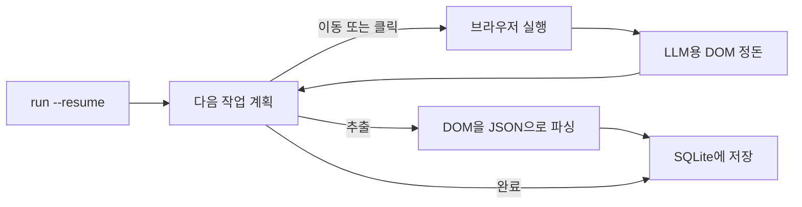

<a id="readme-top"></a>
<p align="center">
  
</p>
<p align="center">
  <strong>자율형 웹 리서치 및 구조화된 Scrape-to-JSON 에이전트.</strong>
  <br />
  일반 영어로 작성된 목표와 JSON Schema를 입력하면, 스스로 탐색 경로를 계획하고 페이지를 읽어 검증된 구조화 데이터를 반환합니다.
</p>

<p align="center">
  <a href="https://github.com/EmanueleTorrisi/verboisy/actions/workflows/ci.yml"></a>
  <a href="https://codecov.io/gh/EmanueleTorrisi/verboisy"></a>
  <a href="https://emanueletorrisi.github.io/verboisy/"></a>
  <a href="#설치"></a>
  <!--<a href="https://pypi.org/project/verboisy/"></a>-->
  
  <a href="LICENSE"></a>
  <a href="https://github.com/astral-sh/ruff"></a>
</p>

<p align="center">
  <em>v0.1.0 | pre-1.0 버전이며 활발히 개발 중입니다. 1.0 버전 이전까지는 마이너 버전 간 하위 호환성을 깨뜨리는 변경(breaking changes)이 발생할 수 있습니다.</em>
</p>

<p align="center">
  <a href="../../README.md" title="English" aria-label="English">🇬🇧</a> ·
  <a href="README.it.md" title="Italiano" aria-label="Italiano">🇮🇹</a> ·
  <a href="README.de.md" title="Deutsch" aria-label="Deutsch">🇩🇪</a> ·
  <a href="README.zh-CN.md" title="简体中文" aria-label="简体中文">🇨🇳</a> ·
  <a href="README.fr.md" title="Français" aria-label="Français">🇫🇷</a> ·
  <a href="README.es.md" title="Español" aria-label="Español">🇪🇸</a> ·
  <strong title="한국어" aria-label="한국어">🇰🇷</strong> ·
  <a href="README.ja.md" title="日本語" aria-label="日本語">🇯🇵</a>
</p>

## 목차

- [데모](#데모)
- [Verboisy를 선택해야 하는 이유](#verboisy를-선택해야-하는-이유)
- [다른 도구와의 비교](#다른-도구와의-비교)
- [빠른 예시](#빠른-예시)
- [활용 사례](#활용-사례)
- [작동 방식](#작동-방식)
- [설치](#설치)
- [설정](#설정)
- [사용법](#사용법)
- [Docker](#docker)
- [알려진 제한 사항](#알려진-제한-사항)
- [책임감 있는 사용](#책임감-있는-사용)
- [문서](#문서)
- [기여하기](#기여하기)
- [보안](#보안)
- [라이선스](#라이선스)

## 데모

*녹화 진행 중: CLI는 현재 정상 작동합니다. 그동안 실제 입력 및 출력 예시는 아래 [빠른 예시](#빠른-예시)를 참고하세요.*

## Verboisy를 선택해야 하는 이유

- **셀렉터 중심이 아닌 목표 중심.** 달성하고자 하는 목표를 일반 영어로 설명하세요. 플래너가 실제 화면을 보고 다음 클릭, 스크롤 또는 읽기 작업을 판단합니다. 사이트가 리뉴얼되어도 코드를 새로 작성할 필요가 없습니다.
- **최선의 노력(best-effort)이 아닌 스키마 우선.** 모든 레코드는 저장되기 전에 JSON Schema로 생성된 Pydantic 모델을 통해 검증됩니다. 형식이 잘못된 데이터는 데이터베이스에 절대 저장되지 않습니다.
- **자체 모델 및 인프라 활용.** [LiteLLM](https://github.com/BerriAI/litellm)을 통해 OpenAI, Anthropic 또는 로컬 Ollama 모델을 환경 변수 하나로 전환할 수 있습니다. 외부 클라우드가 아닌 로컬 장비나 자체 서버에서 실행됩니다.
- **구조적으로 재개 가능.** 모든 레코드는 검증되는 즉시 SQLite에 저장됩니다. `verboisy run --resume`(또는 Python의 `run(resume=True)`)을 실행하면 마지막 미완료 실행을 이어서 진행합니다. 시스템이 다운되더라도 현재 작업 단계만 손실되며 이미 저장된 데이터는 안전합니다.

이 핵심 루프 외에 제공되는 기능: 비동기 Playwright(Chromium, 헤드리스 또는 일반 모드 지원), 원시 HTML 덤프 대신 LLM 컨텍스트 창에 맞게 정돈된 DOM 클리닝, JSON 또는 CSV 내보내기, SQLite 데이터베이스 직접 조회.

## 다른 도구와의 비교

Verboisy는 자율형 브라우저 에이전트와 스키마 검증 추출 도구의 장점을 결합한 프로젝트입니다. 기존 도구들이 둘 중 하나에 집중되어 있다면, Verboisy는 두 가지 모두를 위해 구축되었습니다.

| | Verboisy | [Browser Use](https://github.com/browser-use/browser-use) | [Firecrawl](https://github.com/firecrawl/firecrawl) | [Crawl4AI](https://github.com/unclecode/crawl4ai) |
| --- | --- | --- | --- | --- |
| 입력 방식 | 목표 **및** JSON Schema | 목표 | URL + 프롬프트 또는 스키마 | 크롤링 규칙 + 프롬프트 |
| 탐색 방식 | 플래너가 클릭 선택 | 플래너가 클릭 선택 | 크롤링 / 사이트맵 | 크롤링 |
| 데이터 검증 | 저장 전 스키마 기반 Pydantic 검증 | 사용자 코드 작성 | 선택적 추출 스키마 | 사용자 코드 작성 |
| 데이터 저장 | 레코드 단위 SQLite 저장, `--resume` 지원 | 메모리 / 사용자 코드 | API 또는 사용자 DB | 사용자 코드 |
| 실행 환경 | 로컬 장비 | 로컬 장비 | 호스팅 또는 셀프 호스팅 | 로컬 장비 |

이미 URL을 알고 있고 마크다운 변환만 필요한 경우 Firecrawl이나 Crawl4AI가 더 간단합니다. 범용 컴퓨터 조작 에이전트가 필요하고 나중에 검증할 예정이라면 Browser Use가 적합합니다. 출력 결과가 스키마에 부합하는 데이터여야 하고 에이전트가 이를 직접 찾아야 한다면, Verboisy가 정답입니다.

## 빠른 예시

스키마는 JSON Schema 형식을 따릅니다. 레코드 목록을 추출할 때 최상위 구조는 `"array"`이며, `"items"`에는 각 행에 해당하는 객체 형태를 정의합니다:

```json
{
  "type": "array",
  "items": {
    "type": "object",
    "properties": {
      "name": { "type": "string" },
      "website": { "type": "string" },
      "description": { "type": "string" },
      "batch": { "type": "string" }
    },
    "required": ["name", "website"]
  }
}
```

Verboisy는 런타임에 이를 기반으로 Pydantic 모델을 생성하고, 스키마와 일치하지 않는 행이 SQLite에 저장되는 것을 차단합니다.

CLI:

```bash
verboisy run \
  --goal "Find AI startups from the Y Combinator Fall 2026 (F26) batch" \
  --schema examples/yc_startups/schema.json \
  --export result.json
```

Python 코드 예시:

```python
from verboisy import run

result = run(
    goal="Find AI startups from the Y Combinator Fall 2026 (F26) batch",
    schema="examples/yc_startups/schema.json",
    export="result.json",
)

print(result.run_id, len(result.records))
for row in result.records:
    print(row["name"], row["website"])
```

두 방식 모두 다음과 같은 결과를 생성합니다:

```json
[
  {
    "name": "Marrow",
    "website": "[https://marrow.example.com](https://marrow.example.com)",
    "description": "운영 AI 에이전트를 위한 스테이징 환경.",
    "batch": "F26"
  },
  {
    "name": "Kiln Trace",
    "website": "[https://kilntrace.example.com](https://kilntrace.example.com)",
    "description": "에이전트 워크플로를 위한 지연 시간 및 비용 디버깅.",
    "batch": "F26"
  }
]
```

*(예시 출력 결과: 실제 결과는 실행 시점의 웹 페이지 데이터에 따라 달라집니다. 예시 이름에는 의도적으로 `.example.com`을 사용했습니다.)*

작업 도중 프로세스가 중단되더라도 이미 저장된 레코드를 재처리하지 않고 이어서 진행할 수 있습니다:

```bash
verboisy run --resume
```

```python
result = run(resume=True)
```

## 활용 사례

Verboisy는 반복적으로 실행해야 하는 리서치 패턴에 최적화되어 있습니다:

- **경쟁사 및 시장 정보 수집:** 경쟁사의 가격 정책, 제품 페이지, 공지 사항을 매번 수동으로 확인하지 않고 정기적으로 트래킹.
- **B2B 리드 조사:** 기업 이름 목록을 기업 정보 및 테크 스택이 포함된 구조화 데이터로 변환하여 CRM에 즉시 임포트.
- **이커머스 및 리테일 모니터링:** JavaScript 비중이 높은 쇼핑몰 사이트에서 상품 카탈로그 및 가격 변동 추적.
- **리서치 오퍼레이션 (ResOps):** 수백 개 엔티티를 대상으로 동일한 조회 패턴을 주기적으로 실행.
- **RAG / 지식 베이스 구축:** 수동 작성된 문맥 대신 출처가 확인된 구조화 데이터를 검색 파이프라인에 공급.

각 사례는 위 [빠른 예시](#빠른-예시)와 동일하게 '목표 + 스키마' 패턴을 따르며, 대상 사이트와 데이터 형태만 다릅니다.

## 작동 방식

Verboisy는 플래너가 충분한 데이터를 수집했거나 단계 제한에 도달할 때까지 **계획 (plan) → 실행 (act) → 관찰 (observe) → 추출 (extract)** 의 핵심 루프를 수행합니다.



추출된 모든 레코드는 검증을 통과하는 즉시 `run_id`와 함께 SQLite에 커밋됩니다. 속도 제한, 다운, 프로세스 강제 종료 등 어느 시점에서 루프가 중단되더라도 `verboisy run --resume`(또는 `run(resume=True)`)을 실행하면 저장된 목표, 스키마, 데이터를 불러와 이어서 진행합니다. `--resume <id>`로 특정 실행을 지정할 수 있으며, ID가 없는 `--resume`은 가장 최근의 미완료 실행을 진행합니다.

`--export` 결과는 실행이 완료되거나 재개된 작업이 끝날 때 작성됩니다. 중간 결과는 `SQLITE_DB_PATH`에 지속적으로 업데이트됩니다.

각 모듈에 대한 상세한 설명은 [`ARCHITECTURE.md`](../../ARCHITECTURE.md)에서 확인할 수 있습니다.

## 설치

Python 3.11 이상이 필요합니다.

아직 PyPI에 등록되지 않았습니다. 소스 코드에서 설치하세요:

```bash
git clone [https://github.com/EmanueleTorrisi/verboisy.git](https://github.com/EmanueleTorrisi/verboisy.git)
cd verboisy && pip install -e .
playwright install --with-deps chromium
```

첫 번째 정식 버전이 출시되면 다음과 같이 설치 가능합니다:

```bash
pip install verboisy
playwright install --with-deps chromium
```

## 설정

`.env.example` 파일을 `.env`로 복사하세요. 모든 설정은 `utils/config.py`에서 Pydantic을 통해 로드되며, 설정하지 않은 항목은 아래 기본값을 사용합니다.

```bash
# 필수: 최소 하나의 LLM 프로바이더 설정
OPENAI_API_KEY=sk-your-api-key-here
# ANTHROPIC_API_KEY=sk-ant-your-api-key-here

# LiteLLM 모델 라우팅 (예: gpt-4o, claude-sonnet-5, ollama/llama3)
LITELLM_MODEL=gpt-4o

SQLITE_DB_PATH=verboisy.db
VERBOISY_LOG_LEVEL=INFO
VERBOISY_HEADLESS=true
```

| 변수명 | 기본값 | 설명 |
| --- | --- | --- |
| `OPENAI_API_KEY` | - | OpenAI 인증 키. Anthropic이나 로컬 모델을 사용하지 않는 경우 필수. |
| `ANTHROPIC_API_KEY` | - | OpenAI 대신 사용할 Anthropic 인증 키. |
| `LITELLM_MODEL` | `gpt-4o` | [LiteLLM](https://github.com/BerriAI/litellm)이 지원하는 모든 모델 문자열. |
| `MAX_TOKENS` | `4096` | 플래너 또는 추출 호출당 최대 토큰 수. |
| `TEMPERATURE` | `0.0` | 플래너의 샘플링 온도 설정. |
| `VERBOISY_HEADLESS` | `true` | Chromium을 헤드리스 모드로 실행. 브라우저 동작을 확인하려면 `false`로 설정. |
| `BROWSER_TIMEOUT_MS` | `30000` | 페이지당 탐색 타임아웃(밀리초). |
| `USER_AGENT_ROTATION` | `true` | 요청 간 User-Agent 로테이션 적용. |
| `SQLITE_DB_PATH` | `verboisy.db` | 실행 기록 및 추출 데이터가 저장되는 SQLite 경로. |
| `VERBOISY_LOG_LEVEL` | `INFO` | 파이썬 표준 로깅 수준. `DEBUG` 설정 시 플래너의 모든 단계 출력. |

LLM 프로바이더 비용은 직접 지불합니다. 플래너 및 추출 호출은 `TEMPERATURE` 0.0 조건에서 `MAX_TOKENS`(기본값 4096)로 제한됩니다. 일반적인 목록 수집 작업은 수백 번이 아닌 수십 번의 호출 정도로 처리됩니다. 별도의 호스팅 요금은 청구되지 않습니다.

## 사용법

### CLI

```bash
verboisy run \
  --goal "Find AI startups from the Y Combinator Fall 2026 (F26) batch" \
  --schema examples/yc_startups/schema.json \
  --export result.json
```

명령어를 실행하면 `run_id`가 출력됩니다(SQLite에도 저장됨). 나중에 작업을 재개할 때 사용하세요.

| 옵션 | 단축키 | 필수 여부 | 설명 |
| --- | --- | --- | --- |
| `--goal` | `-g` | 예 (`--resume` 사용 시 제외) | 찾고자 하는 내용과 위치에 대한 영어 설명. 구체적으로 작성하세요. |
| `--schema` | `-s` | 예 (`--resume` 사용 시 제외) | 추출할 필드가 정의된 JSON Schema 경로. 레코드 `object`들을 담는 최상위 `array` 형태. |
| `--export` | `-e` | 아니오 | 출력 경로. `.json` 및 `.csv` 지원. 실행 완료 시 파일 생성. |
| `--resume` | `-r` | 아니오 | 작업 재개. `--resume`만 입력하면 `SQLITE_DB_PATH`에서 가장 최근의 미완료 실행을 이어서 진행. `--resume <id>` 입력 시 해당 ID의 실행 진행. 목표와 스키마는 저장된 실행 기록에서 로드되며, `--export` / 헤드리스 여부는 덮어쓸 수 있습니다. |

전체 플래그 목록을 확인하려면 `verboisy run --help`를 실행하세요.

### 재개 (Resume)

```bash
# verboisy.db에서 가장 최근 미완료 실행 재개
verboisy run --resume

# 특정 실행 재개
verboisy run --resume 7f3a2c1b --export result.json
```

이미 검증된 레코드는 다시 추출하지 않습니다. 미완료 실행이 없는 경우, 검색한 데이터베이스 이름을 표시하는 에러와 함께 종료됩니다.

### Python

`run()` 함수가 공개 API 역할을 합니다. CLI는 이 함수를 래핑한 형태입니다.

```python
from pathlib import Path
from verboisy import RunResult, run

result: RunResult = run(
    goal="Find AI startups from the Y Combinator Fall 2026 (F26) batch",
    schema="examples/yc_startups/schema.json",  # 경로 문자열, Path 객체, 또는 dict
    export="result.json",
)

print(result.run_id)
print(result.records[0]["name"])
```

파일 없이 dict 형태로 스키마를 직접 전달하는 예시:

```python
result = run(
    goal="Find AI startups from the Y Combinator Fall 2026 (F26) batch",
    schema={
        "type": "array",
        "items": {
            "type": "object",
            "properties": {
                "name": {"type": "string"},
                "website": {"type": "string"},
                "description": {"type": "string"},
                "batch": {"type": "string"},
            },
            "required": ["name", "website"],
        },
    },
)
```

재개 처리:

```python
from verboisy import run

# 가장 최근 미완료 실행 재개
result = run(resume=True)

# 특정 실행 재개 및 완료 시 내보내기 파일 생성
result = run(resume=result.run_id, export="result.json")
```

시그니처:

```python
def run(
    *,
    goal: str | None = None,
    schema: str | Path | dict | None = None,
    export: str | Path | None = None,
    resume: bool | str = False,
    headless: bool | None = None,
) -> RunResult: ...
```

`RunResult` 필드:

| 필드 | 타입 | 의미 |
| --- | --- | --- |
| `run_id` | `str` | SQLite에 저장된 고유 ID. `run(resume=...)`에 전달하여 재개. |
| `records` | `list[dict]` | 현재까지 이 실행에서 검증되어 저장된 모든 행. |
| `export_path` | `Path \| None` | `--export` / `export=`가 설정되고 실행이 완료된 경우 저장된 파일 경로. |
| `db_path` | `Path` | 사용된 SQLite 파일 경로. |
| `completed` | `bool` | 다운되지 않고 플래너가 작업을 정상적으로 완료하여 멈춘 경우 `True`. |

규칙:

- 새로운 실행: `goal` 및 `schema` 필수; `resume` 생략 또는 `False`.
- 재개: `resume=True` 또는 `resume="<id>"`; `goal` / `schema`는 선택 사항이며 기존 실행 기록이 있으면 무시됨.
- `headless=None` 설정 시 `VERBOISY_HEADLESS` 환경 변수를 사용. `True` / `False`를 전달하여 이번 호출 시 덮어쓰기 가능.

### 실행 모니터링

```bash
VERBOISY_HEADLESS=false VERBOISY_LOG_LEVEL=DEBUG \
  verboisy run \
    --goal "Find AI startups from the Y Combinator Fall 2026 (F26) batch" \
    --schema examples/yc_startups/schema.json \
    --export result.json
```

## Docker

```bash
docker compose -f docker/docker-compose.yml up -d --build
docker compose -f docker/docker-compose.yml exec verboisy verboisy run \
  --goal "Find AI startups from the Y Combinator Fall 2026 (F26) batch" \
  --schema examples/yc_startups/schema.json \
  --export result.json
```

컨테이너가 시작되면 Playwright 브라우저 의존성이 설치된 상태로 유지되므로 명령어는 컨테이너 엔트리포인트 대신 `exec`를 통해 실행됩니다. 컨테이너를 재시작해도 `--resume` 기능이 유지되도록 하려면 `SQLITE_DB_PATH`를 바인드 마운트하거나 볼륨으로 관리하세요. `OPENAI_API_KEY`는 터미널 쉘에서 자동으로 전달되므로 사전에 `export` 해주세요. 다른 변수(`ANTHROPIC_API_KEY`, `LITELLM_MODEL` 등)를 전달하려면 똑같이 `export` 하거나 `docker/docker-compose.yml` 파일의 `environment:` 목록을 `env_file: [../.env]`로 변경하세요.

## 알려진 제한 사항

베타 버전 소프트웨어로서 솔직히 밝히는 제한 사항입니다:

- **계정 및 온라인 작업 기록 미지원:** 단일 사용자 전용. 실행 ID는 대시보드가 아닌 로컬 SQLite 파일에만 기록됩니다.
- **스케줄링 미지원:** 작업을 수동으로 실행하거나 자체 cron, 오케스트레이터에 연결하여 사용하세요. `--resume`은 크래시 및 속도 제한 대응용이며 스케줄러가 아닙니다.
- **온라인 HTTP API 미지원:** 현재는 CLI, `verboisy.run()`, Docker 이미지만 인터페이스로 제공됩니다.
- **강력한 봇 방지 사이트에서의 불안정성:** 일부 대상 사이트에서는 재시도나 수동 개입이 필요할 수 있습니다.

해당 제한 사항이 사용 목적에 걸림돌이 되나요? [이슈(Issue)를 등록해 주세요](https://github.com/EmanueleTorrisi/verboisy/issues): 개선 우선순위에 반영하는 가장 빠른 방법입니다.

## 책임감 있는 사용

Verboisy는 사용자를 대신하여 실제 브라우저를 조작합니다. 대상 사이트의 이용 약관, `robots.txt`, 속도 제한 및 해당 지역의 법률을 준수할 책임은 사용자에게 있습니다. 권한이 없는 인증이나 접근 제어를 우회하는 목적으로 사용하지 마세요.

## 문서

전체 설정 문서 및 API 상세 정보를 포함한 전체 문서는 **[emanueletorrisi.github.io/verboisy](https://emanueletorrisi.github.io/verboisy/)**에서 확인할 수 있습니다.

## 기여하기

기여는 언제나 환영합니다. 로컬 환경 설정 및 코딩 컨벤션은 [`CONTRIBUTING.md`](../CONTRIBUTING.md)를 참고하시고, [행동 강령 (Code of Conduct)](../CODE_OF_CONDUCT.md)을 준수해 주세요. 어디서부터 시작해야 할지 모르겠다면 [`good first issue`](https://github.com/EmanueleTorrisi/verboisy/labels/good%20first%20issue) 태그가 붙은 이슈를 확인해 보세요.

## 보안

보안 취약점을 발견하셨나요? 공개 이슈를 열지 마시고 [비공개 취약점 제보](https://github.com/EmanueleTorrisi/verboisy/security/advisories/new) 기능을 이용하거나 [`SECURITY.md`](../SECURITY.md)를 참고해 주세요.

## 라이선스

BSD 2-Clause: 전문은 [`LICENSE`](../../LICENSE) 파일을 참조하세요.

---

<p align="center">
  Built by <a href="https://github.com/EmanueleTorrisi">Emanuele Torrisi</a> · <a href="#readme-top">맨 위로 이동 ↑</a>
</p>
