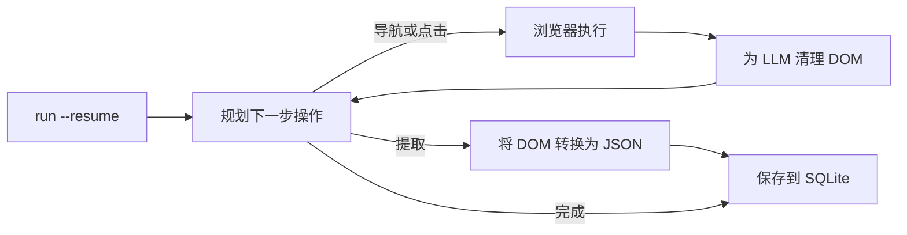

<a id="readme-top"></a>
<p align="center">
  
</p>
<p align="center">
  <strong>自主式网页研究与结构化 JSON 抓取智能体。</strong>
  <br />
  只需用自然语言描述目标并提供 JSON Schema。智能体会自行规划浏览路径、读取页面，返回经过验证的结构化数据。
</p>

<p align="center">
  <a href="https://github.com/EmanueleTorrisi/verboisy/actions/workflows/ci.yml"></a>
  <a href="https://codecov.io/gh/EmanueleTorrisi/verboisy"></a>
  <a href="https://emanueletorrisi.github.io/verboisy/"></a>
  <a href="#installation"></a>
  <!--<a href="https://pypi.org/project/verboisy/"></a>-->
  
  <a href="../../LICENSE"></a>
  <a href="https://github.com/astral-sh/ruff"></a>
</p>

<p align="center">
  <em>v0.1.0 | 尚未达到 1.0，仍在积极开发中。在发布 1.0 之前，次版本之间可能出现不兼容的变更。</em>
</p>

<p align="center">
  <a href="../../README.md" title="English" aria-label="English">🇬🇧</a> ·
  <a href="README.it.md" title="Italiano" aria-label="Italiano">🇮🇹</a> ·
  <a href="README.de.md" title="Deutsch" aria-label="Deutsch">🇩🇪</a> ·
  <strong title="简体中文" aria-label="简体中文">🇨🇳</strong> ·
  <a href="README.fr.md" title="Français" aria-label="Français">🇫🇷</a> ·
  <a href="README.es.md" title="Español" aria-label="Español">🇪🇸</a> ·
  <a href="README.ko.md" title="한국어" aria-label="한국어">🇰🇷</a> ·
  <a href="README.ja.md" title="日本語" aria-label="日本語">🇯🇵</a>
</p>

## 目录

- [演示](#demo)
- [为什么选择 Verboisy](#why-verboisy)
- [工具比较](#compared-to)
- [快速示例](#quick-example)
- [使用场景](#use-cases)
- [工作原理](#how-it-works)
- [安装](#installation)
- [配置](#configuration)
- [使用方法](#usage)
- [Docker](#docker)
- [已知限制](#known-limitations)
- [负责任地使用](#responsible-use)
- [文档](#documentation)
- [参与贡献](#contributing)
- [安全](#security)
- [许可证](#license)

<a id="demo"></a>

## 演示

[早期演示动图](../../docs/demo.gif)仅供说明，不能作为产品功能已得到验证的证据。现有录屏制作于断点恢复功能实现之前。请使用[真实实时演示流程](../../docs/demo.md)，记录浏览器、模型、SQLite、中断和导出的实际行为。替换后的真实录屏仍是验收条件之一。

本次修订包含可执行的离线回归测试，以及必须通过的 Chromium 集成检查。部署前请阅读[验证与发布检查](../../docs/validation.md)；这些检查并不代表项目已可用于生产环境。

<a id="why-verboisy"></a>

## 为什么选择 Verboisy

- **以目标驱动，而非以选择器驱动。** 使用自然语言描述任务。规划器会根据眼前实际显示的页面，决定下一次点击、滚动或读取操作。模型会尝试适应观察到的 DOM，但网站改版仍可能导致运行失败。
- **以 Schema 为先，而非尽力猜测。** 每条记录在保存前都经过 JSON Schema 检查，并封装为 Pydantic 模型。验证只检查结构和约束，不保证事实准确。
- **模型和基础设施由你掌控。** 通过 [LiteLLM](https://github.com/BerriAI/litellm) 使用 OpenAI、Anthropic 或本地 Ollama 模型；只需更改一个环境变量即可切换。程序运行在你的计算机或服务器上，而非不透明的托管服务中。
- **原生支持恢复。** 每条通过验证的记录都会先写入 SQLite，再处理下一个候选对象。`verboisy run --resume`（或 Python 中的 `run(resume=True)`）可继续最近一次未完成的运行。之前已提交的数据不会因某一步中断而丢失。恢复时加载保存的进度和最后一个检查点 URL，但不会还原浏览器会话状态。

核心循环配有异步 Playwright（Chromium 可显示窗口或无头运行）、针对 LLM 上下文窗口而非原始 HTML 转储设计的 DOM 清理，以及 JSON/CSV 导出；也可以直接查询 SQLite 数据库。

<a id="compared-to"></a>

## 工具比较

Verboisy 将自主浏览器智能体与基于 Schema 验证的数据提取器结合起来。相关工具通常擅长其中一个方面；Verboisy 面向两者同时设计。

| | Verboisy | [Browser Use](https://github.com/browser-use/browser-use) | [Firecrawl](https://github.com/firecrawl/firecrawl) | [Crawl4AI](https://github.com/unclecode/crawl4ai) |
| --- | --- | --- | --- | --- |
| 输入内容 | 目标**和** JSON Schema | 目标 | URL + 提示词或 Schema | 爬取规则 + 提示词 |
| 导航方式 | 规划器选择点击操作 | 规划器选择点击操作 | 爬取 / 站点地图 | 爬取 |
| 验证方式 | 写入前使用 JSON Schema + Pydantic | 由你编写代码 | 可选的提取 Schema | 由你编写代码 |
| 持久化 | 每条记录写入 SQLite，支持 `--resume` | 内存 / 你的代码 | API 或你的数据库 | 你的代码 |
| 运行位置 | 你的计算机 | 你的计算机 | 托管或自托管 | 你的计算机 |

如果已经知道 URL，而且只需要 Markdown，Firecrawl 或 Crawl4AI 更简单。如果需要通用的计算机操作智能体，并打算稍后验证数据，Browser Use 更合适。如果输出必须是符合 Schema 的多行数据，且需要智能体自行找到这些数据，那正是 Verboisy 的用途。

<a id="quick-example"></a>

## 快速示例

使用 JSON Schema 定义数据结构。对于记录列表，顶层是 `"array"`，其中 `"items"` 定义每一行对应的对象结构：

```json
{
  "type": "array",
  "items": {
    "type": "object",
    "properties": {
      "name": { "type": "string" },
      "website": { "type": "string" },
      "description": { "type": "string" },
      "batch": { "type": "string" }
    },
    "required": ["name", "website"]
  }
}
```

Verboisy 在运行时根据 Schema 创建 Pydantic 模型，并在数据写入 SQLite 之前拒绝不符合要求的行。

命令行界面（CLI）：

```bash
verboisy run \
  --goal "查找 Y Combinator 2026 年秋季批次（F26）的人工智能初创公司" \
  --schema examples/yc_startups/schema.json \
  --export result.json
```

使用 Python 运行相同任务：

```python
from verboisy import run

result = run(
    goal="查找 Y Combinator 2026 年秋季批次（F26）的人工智能初创公司",
    schema="examples/yc_startups/schema.json",
    export="result.json",
)

print(result.run_id, len(result.records))
for row in result.records:
    print(row["name"], row["website"])
```

示例输出可能具有以下结构：

```json
[
  {
    "name": "Marrow",
    "website": "https://marrow.example.com",
    "description": "用于生产级人工智能智能体的预发布测试环境。",
    "batch": "F26"
  },
  {
    "name": "Kiln Trace",
    "website": "https://kilntrace.example.com",
    "description": "排查智能体工作流程的延迟与成本问题。",
    "batch": "F26"
  }
]
```

*（示意输出：实际结果取决于运行时页面上显示的内容。示例名称有意使用 `.example.com` 域名。）*

如果进程中途停止，可以继续运行，而不必重新处理已保存的行：

```bash
verboisy run --resume
```

```python
result = run(resume=True)
```

<a id="use-cases"></a>

## 使用场景

Verboisy 专为值得重复执行的研究任务设计：

- **竞品与市场情报：** 定期跟踪竞争对手的价格、产品页面和公告，而不是手动检查。
- **B2B 潜在客户研究：** 将公司名称列表转化为结构化的企业属性与技术栈记录，以便导入 CRM。
- **电商与零售监控：** 观察大量使用 JavaScript 的商店中的商品目录及价格变化。
- **研究运营（ResOps）：** 定期对数百个实体运行相同的查询模式。
- **RAG / 知识库导入：** 将带有来源信息的结构化记录输入检索流水线，而非手动挑选上下文。

上述场景都遵循快速示例中的“目标 + Schema”模式，只是面向不同的网站和数据结构。

<a id="how-it-works"></a>

## 工作原理

Verboisy 循环执行 **规划 → 操作 → 观察 → 提取**，直到规划器认为已收集足够的数据，或用完允许的步骤数。



每条提取出的记录一旦通过验证，就会立即以相应的 `run_id` 提交到 SQLite。无论循环是因速率限制、崩溃还是进程被终止而中断，`verboisy run --resume`（或 `run(resume=True)`）都会重新加载该次运行的目标、Schema、已保存的行、历史记录和最后一个检查点 URL，然后继续。`--resume <id>` 指定某次运行；不带 ID 的 `--resume` 选择最近一次未完成的运行。

`--export` 在运行完成时写出文件（恢复后完成也一样）。完成之前，部分结果保存在 `SQLITE_DB_PATH` 中。

各模块的详细说明见 [`ARCHITECTURE.md`](../../ARCHITECTURE.md)。

<a id="installation"></a>

## 安装

需要 Python >=3.11,<3.15。

目前尚未发布到 PyPI。请从源码安装：

```bash
git clone https://github.com/EmanueleTorrisi/verboisy.git
cd verboisy
python -m pip install -e .
python -m playwright install chromium
```

首个版本发布后，可以使用：

```bash
python -m pip install verboisy
python -m playwright install chromium
```

Chromium 应在配置阶段安装。Verboisy 不会在运行任务时下载浏览器或启动系统包管理器。安装和运行时请使用同一个操作系统用户及 Python 环境。在 Linux 上，运行 `python -m playwright install --with-deps chromium` 安装浏览器及系统依赖（安装系统包需要管理员权限）。使用 Poetry 时，请运行 `poetry run playwright install --with-deps chromium`。

<a id="configuration"></a>

## 配置

将 `.env.example` 复制为 `.env`。所有设置都通过 `utils/config.py` 中的 Pydantic 加载；未设置的项目使用下方默认值。

```bash
# 必填：至少配置一个 LLM 提供商
OPENAI_API_KEY=sk-your-api-key-here
# ANTHROPIC_API_KEY=sk-ant-your-api-key-here

# 通过 LiteLLM 选择模型（例如 gpt-4o、claude-sonnet-5、ollama/llama3）
LITELLM_MODEL=gpt-4o

SQLITE_DB_PATH=verboisy.db
VERBOISY_LOG_LEVEL=INFO
VERBOISY_HEADLESS=true
```

| 变量 | 默认值 | 说明 |
| --- | --- | --- |
| `OPENAI_API_KEY` | - | OpenAI 凭据；除非使用 Anthropic 或本地模型，否则必填。 |
| `ANTHROPIC_API_KEY` | - | Anthropic 凭据，可替代 OpenAI 凭据。 |
| `LITELLM_MODEL` | `gpt-4o` | [LiteLLM](https://github.com/BerriAI/litellm) 支持的任意模型标识。 |
| `MAX_TOKENS` | `4096` | 每次规划或提取调用的最大 token 数。 |
| `TEMPERATURE` | `0.0` | 规划器的采样温度。 |
| `VERBOISY_HEADLESS` | `true` | 无头运行 Chromium；设为 `false` 可查看浏览器窗口。 |
| `BROWSER_TIMEOUT_MS` | `30000` | 每个页面的导航超时，单位为毫秒。 |
| `USER_AGENT_ROTATION` | `true` | 创建浏览器上下文时选择 User-Agent；不会逐请求轮换。 |
| `SQLITE_DB_PATH` | `verboisy.db` | 运行记录和提取数据的存储位置。 |
| `VERBOISY_LOG_LEVEL` | `INFO` | 标准 Python 日志级别；`DEBUG` 打印规划器的每个步骤。 |

你直接向 LLM 提供商付费。规划和提取调用受 `MAX_TOKENS` 限制（默认 4096），`TEMPERATURE` 为 0.0。调用次数取决于导航、提取和重试情况。项目不提供托管计量服务。

<a id="usage"></a>

## 使用方法

### CLI

```bash
verboisy run \
  --goal "查找 Y Combinator 2026 年秋季批次（F26）的人工智能初创公司" \
  --schema examples/yc_startups/schema.json \
  --export result.json
```

命令会记录 `run_id`（同时存入 SQLite）。步骤预算耗尽时返回未完成的结果，退出码为 2；一般错误的退出码为 1，Ctrl-C 为 130。只有 FINISH 和成功的集合验证同时满足，运行才算完成。可用该 ID 在之后恢复运行。

| 参数 | 简写 | 是否必填 | 说明 |
| --- | --- | --- | --- |
| `--goal` | `-g` | 是，使用 `--resume` 时除外 | 用自然语言具体描述要在什么位置查找什么内容。 |
| `--schema` | `-s` | 是，使用 `--resume` 时除外 | 待提取字段的 JSON Schema 路径。顶层为包含记录 `object` 的 `array`。 |
| `--export` | `-e` | 否 | 输出路径，支持 `.json` 和 `.csv`；运行结束时写入。 |
| `--resume` | `-r` | 否 | 恢复运行。单独使用 `--resume` 可继续 `SQLITE_DB_PATH` 中最近一次未完成的运行；`--resume <id>` 则继续指定运行。目标和 Schema 从已保存的运行中读取，`--export` 及是否显示浏览器仍可覆盖。 |

运行 `verboisy run --help` 查看全部参数。

其他参数包括 `--max-steps/-m` 和 `--headless/--headed`。恢复时会重新分配步骤预算，但已保存的计数器仍累计计算。可以使用唯一的运行 ID 前缀。已完成的运行可不调用浏览器或模型，直接重新导出。导出失败会返回非零退出码，因此可以通过这种方式重试。即使结果为空，也会创建输出文件。

<a id="resume"></a>

### 恢复运行

```bash
# 恢复 verboisy.db 中最近一次未完成的运行
verboisy run --resume

# 恢复指定的运行
verboisy run --resume 7f3a2c1b --export result.json
```

中断后，页面可能被再次读取或提取。规范化后相同的行不会在同一次运行中重复插入。Cookie、打开的标签页、滚动位置和临时 JavaScript 状态不会恢复。如果不存在未完成的运行，命令会以非零退出码报错，并指出所检查的数据库。

### Python

`run()` 是同步公共 API；在 Notebook 或异步应用中使用 `await arun(...)`。CLI 只是该 API 的轻量封装。

```python
from pathlib import Path
from verboisy import RunResult, run

result: RunResult = run(
    goal="查找 Y Combinator 2026 年秋季批次（F26）的人工智能初创公司",
    schema="examples/yc_startups/schema.json",  # 路径、Path 或 dict
    export="result.json",
)

print(result.run_id)
print(result.records[0]["name"])
```

也可以直接传入字典作为 Schema，无需文件：

```python
result = run(
    goal="查找 Y Combinator 2026 年秋季批次（F26）的人工智能初创公司",
    schema={
        "type": "array",
        "items": {
            "type": "object",
            "properties": {
                "name": {"type": "string"},
                "website": {"type": "string"},
                "description": {"type": "string"},
                "batch": {"type": "string"},
            },
            "required": ["name", "website"],
        },
    },
)
```

恢复运行：

```python
from verboisy import run

# 最近一次未完成的运行
result = run(resume=True)

# 指定运行，完成后导出
result = run(resume=result.run_id, export="result.json")
```

函数签名：

```python
def run(
    *,
    goal: str | None = None,
    schema: str | Path | dict | None = None,
    export: str | Path | None = None,
    resume: bool | str = False,
    headless: bool | None = None,
    max_steps: int | None = None,
    config: Settings | None = None,
) -> RunResult: ...
```

`RunResult` 的字段：

| 字段 | 类型 | 含义 |
| --- | --- | --- |
| `run_id` | `str` | 存储在 SQLite 中的稳定 ID，可传给 `run(resume=...)`。 |
| `records` | `list[dict]` | 本次运行到目前为止所有已验证的行。 |
| `export_path` | `Path \| None` | 如果设置了 `--export` / `export=` 且运行已结束，则为导出文件路径。 |
| `db_path` | `Path` | 所使用的 SQLite 文件。 |
| `completed` | `bool` | FINISH 且集合验证成功后为 `True`。 |
| `status` | `str` | 正常返回时为 COMPLETED 或 PAUSED。 |
| `stop_reason` | `str \| None` | 本次调用停止的原因。 |

规则：

- 新运行：必须提供 `goal` 和 `schema`；`resume` 省略或设为 `False`。
- 恢复：使用 `resume=True` 或 `resume="<id>"`；`goal` / `schema` 可选，且在已保存的运行包含这些值时会被忽略。
- `headless=None` 使用 `VERBOISY_HEADLESS`；传入 `True` / `False` 可仅覆盖此次调用的设置。

<a id="watching-a-run"></a>

### 观察运行过程

```bash
VERBOISY_HEADLESS=false VERBOISY_LOG_LEVEL=DEBUG \
  verboisy run \
    --goal "查找 Y Combinator 2026 年秋季批次（F26）的人工智能初创公司" \
    --schema examples/yc_startups/schema.json \
    --export result.json
```

Schema 说明：根节点可以是对象数组，也可以是单条记录对象的 Schema。仍兼容旧版属性映射。Draft 2020-12 验证涵盖嵌套类型、必填/可选/null 的区别、enum、正则模式、数值范围、additionalProperties 和标准格式。只允许本地片段 Schema 引用。minItems 等集合约束会在完成前针对所有已保存的行检查。JSON 导出保留原始值；CSV 会在类似公式的文本前加单引号，并将嵌套值编码为 JSON。

## Docker

```bash
# 请先创建并配置 .env。
docker compose -f docker/docker-compose.yml up -d --build
docker compose -f docker/docker-compose.yml exec verboisy verboisy run \
  --goal "查找 Y Combinator 2026 年秋季批次（F26）的人工智能初创公司" \
  --schema examples/yc_startups/schema.json \
  --export /data/result.json
docker compose -f docker/docker-compose.yml cp verboisy:/data/result.json ./result.json
```

容器以非特权用户运行，通过 Compose 读取 `../.env`。命名卷会在重启后保留 `/data/verboisy.db` 和导出文件。镜像中包含示例。必须在目标容器主机上测试 Chromium 沙箱支持；沙箱默认保持启用。审计环境中没有执行 Docker 构建或部署。

<a id="additional-configuration"></a>

## 其他配置

| 变量 | 默认值 | 用途 |
| --- | --- | --- |
| LITELLM_API_KEY | 未设置 | 用于其他提供商或代理的显式凭据 |
| LITELLM_API_BASE | 未设置 | 显式 LiteLLM 端点，包括本地模型 |
| MAX_STEPS | 20 | 每次调用允许的操作数，可通过 CLI/API 覆盖 |
| MAX_TOTAL_TOKENS | 1000000 | 本地请求预算：提示词字节数加每次尝试预留的响应 token；并非准确的计费上限 |
| LLM_TIMEOUT_SECONDS | 60 | 单次模型请求的超时 |
| LLM_RETRIES | 2 | 临时失败时的重试次数；格式错误的 JSON 不会重试 |
| RUN_TIMEOUT_SECONDS | 900 | 单次调用的超时 |
| MAX_DOM_CHARS | 20000 | 清理后页面上下文的字符数上限 |
| ACTION_DELAY_SECONDS | 0.5 | 操作之间的暂停时间 |
| BROWSER_SANDBOX | true | 启用 Chromium 沙箱 |
| ALLOW_PRIVATE_NETWORK | false | 显式允许内部网络/回环地址 |
| ALLOWED_DOMAINS | [] | 精确允许的目标主机名 JSON 数组；为空表示允许公共主机 |

每次公共 API 调用都会重新加载设置。`.env` 中的 OpenAI 和 Anthropic 密钥会明确路由到所选提供商。本地模型可以使用 `LITELLM_API_BASE`。不要在单次调用过程中通过全局变量更改提供商或预算。

<a id="known-limitations"></a>

## 已知限制

本次修订修复了文档记录的核心路径，但仍需在预定部署平台上使用真实模型和真实浏览器进行验收。仅凭离线测试不能证明自主研究结果准确。

- 恢复功能仅还原最后保存的 URL，而非完整浏览器会话。SPA 分页、已登录会话和进行中的操作可能需要重新导航。
- 私有网络拦截和域名检查属于纵深防御。DNS 重绑定、浏览器代码和提示词注入还需要部署隔离及出站流量控制。
- 假定 Schema 作者可信；针对恶意正则表达式和递归 Schema 没有独立的资源隔离。
- DOM 上下文存在上限。长页面可能需要滚动或分页，也可能遗漏数据。
- 模型输出 FINISH 仅表示模型决定停止；应独立检查事实信息是否完整。
- 每个本地数据库只支持一个协作中的调用。迁移时保留旧版重复数据；无法通过推断自动纠正旧的错误 COMPLETED 状态。

其他限制：

- **没有账户或托管任务历史：** 仅支持单用户。运行 ID 存储在本地 SQLite，而非仪表盘。
- **没有内置调度：** 手动运行，或接入自己的 cron/编排工具。`--resume` 用于崩溃或速率限制后的恢复，并不是调度器。
- **没有托管 HTTP API：** 当前接口是 CLI、`verboisy.run()` 和 Docker 镜像。
- **对激进反爬网站的表现不稳定：** 部分目标需要重试或人工干预。

以上限制影响了你的使用场景？请[提交 Issue](https://github.com/EmanueleTorrisi/verboisy/issues)，直接反馈最希望优先修复的内容。

<a id="responsible-use"></a>

## 负责任地使用

Verboisy 会代表你操控真实浏览器。你有责任遵守目标网站的服务条款、`robots.txt`、速率限制和所在司法辖区的法律。不要用它绕过未经授权的身份验证或访问控制。

<a id="documentation"></a>

## 文档

完整文档，包括配置参考和 API 详细信息，发布于 **[emanueletorrisi.github.io/verboisy](https://emanueletorrisi.github.io/verboisy/)**。

<a id="contributing"></a>

## 参与贡献

欢迎贡献！请参阅 [`CONTRIBUTING.md`](../CONTRIBUTING.md) 了解本地环境设置和编码规范，并遵守[行为准则](../CODE_OF_CONDUCT.md)。不知道从哪里开始？可以查看标记为 [`good first issue`](https://github.com/EmanueleTorrisi/verboisy/labels/good%20first%20issue) 的问题。

<a id="security"></a>

## 安全

发现漏洞？请勿创建公开 Issue；请使用[私密漏洞报告](https://github.com/EmanueleTorrisi/verboisy/security/advisories/new)，或查看 [`SECURITY.md`](../SECURITY.md)。

<a id="license"></a>

## 许可证

BSD 2-Clause：完整内容请参阅 [`LICENSE`](../../LICENSE)。

---

<p align="center">
  作者：<a href="https://github.com/EmanueleTorrisi">Emanuele Torrisi</a> · <a href="#readme-top">返回顶部 ↑</a>
</p>

Search API and bounded browser recovery: [configuration and limits (English)](../../docs/search-and-recovery.md).
