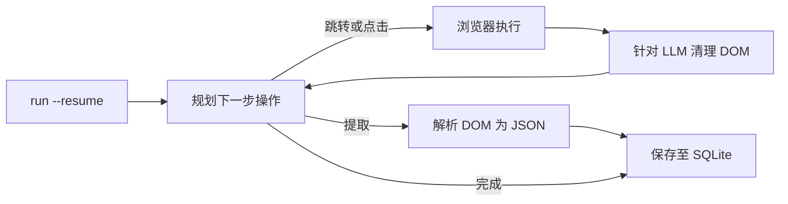

<a id="readme-top"></a>
<p align="center">
  
</p>
<p align="center">
  <strong>自主式 Web 调研与结构化抓取到 JSON 的 Agent 智能体。</strong>
  <br />
  只需提供自然语言描述的目标和 JSON Schema，它便会自动规划导航路线、阅读页面并返回经过校验的结构化 JSON 数据。
</p>

<p align="center">
  <a href="https://github.com/EmanueleTorrisi/verboisy/actions/workflows/ci.yml"></a>
  <a href="https://codecov.io/gh/EmanueleTorrisi/verboisy"></a>
  <a href="https://emanueletorrisi.github.io/verboisy/"></a>
  <a href="#安装"></a>
  <!--<a href="https://pypi.org/project/verboisy/"></a>-->
  
  <a href="LICENSE"></a>
  <a href="https://github.com/astral-sh/ruff"></a>
</p>

<p align="center">
  <em>v0.1.0 | 处于 1.0 之前的积极开发阶段。在 1.0 版本之前，次要版本之间可能会包含破坏性变更 (breaking changes)。</em>
</p>

<p align="center">
  <a href="../../README.md" title="English" aria-label="English">🇬🇧</a> ·
  <a href="README.it.md" title="Italiano" aria-label="Italiano">🇮🇹</a> ·
  <a href="README.de.md" title="Deutsch" aria-label="Deutsch">🇩🇪</a> ·
  <strong title="简体中文" aria-label="简体中文">🇨🇳</strong> ·
  <a href="README.fr.md" title="Français" aria-label="Français">🇫🇷</a> ·
  <a href="README.es.md" title="Español" aria-label="Español">🇪🇸</a> ·
  <a href="README.ko.md" title="한국어" aria-label="한국어">🇰🇷</a> ·
  <a href="README.ja.md" title="日本語" aria-label="日本語">🇯🇵</a>
</p>

## 目录

- [演示](#演示)
- [为什么选择 Verboisy](#为什么选择-verboisy)
- [对比](#对比)
- [快速示例](#快速示例)
- [应用场景](#应用场景)
- [工作原理](#工作原理)
- [安装](#安装)
- [配置](#配置)
- [使用方法](#使用方法)
- [Docker](#docker)
- [已知局限](#已知局限)
- [合规与负责任使用](#合规与负责任使用)
- [文档](#文档)
- [贡献指南](#贡献指南)
- [安全性](#安全性)
- [开源许可](#开源许可)

## 演示

<p align="center">
  
</p>

## 为什么选择 Verboisy

- **目标驱动，而非选择器驱动。** 用简洁的英语描述目标。规划器 (Planner) 会根据当前呈现的真实页面决定下一步的点击、滚动或读取操作。无需编写任何硬编码选择器，网站改版也不必重写代码。
- **Schema 优先，而非尽力而为 (best-effort)。** 每条记录在保存前都会根据由你的 JSON Schema 生成的 Pydantic 模型进行校验。格式错误的数据绝不会进入你的数据库。
- **自选模型，掌控自有基础设施。** 通过 [LiteLLM](https://github.com/BerriAI/litellm) 接入 OpenAI、Anthropic 或本地 Ollama 模型：只需修改一个环境变量即可无缝切换。运行在你的本机或服务器上，而不是托管在第三方的黑盒云服务中。
- **天生支持中断恢复 (Resumable)。** 校验通过的每条记录都会在第一时间写入 SQLite。执行 `verboisy run --resume`（或在 Python 中调用 `run(resume=True)`）即可继续未完成的运行。意外崩溃只会损失当前单步，而不会丢失已保存的工作。

围绕这一闭环提供的配套支持：异步 Playwright（Chromium，支持有头/无头模式）、针对 LLM 上下文窗口特别优化而非直接 Dump 原始 HTML 的 DOM 清理机制、JSON 或 CSV 导出功能——也可以直接查询 SQLite 数据库。

## 对比

Verboisy 是自主式浏览器 Agent 与 Schema 校验提取器的结合体。市面上的相关工具往往只专注于其中一方，而 Verboisy 专为两者的有机结合而设计。

| | Verboisy | [Browser Use](https://github.com/browser-use/browser-use) | [Firecrawl](https://github.com/firecrawl/firecrawl) | [Crawl4AI](https://github.com/unclecode/crawl4ai) |
| --- | --- | --- | --- | --- |
| 需求描述 | 目标 **以及** JSON Schema | 目标 | URL + Prompt 或 Schema | 爬取规则 + Prompt |
| 页面导航 | 规划器选择点击 | 规划器选择点击 | 爬取 / 站点地图 | 爬取 |
| 数据校验 | 写入前根据你的 Schema 生成 Pydantic 校验 | 自行编写代码 | 可选提取 Schema | 自行编写代码 |
| 数据持久化 | 单条记录存入 SQLite，支持 `--resume` | 内存 / 自行编写代码 | API 或自定义数据库 | 自行编写代码 |
| 运行位置 | 本地机器 | 本地机器 | 云端托管或私有化部署 | 本地机器 |

如果你已经明确知道 URL 且只需要输出 Markdown，Firecrawl 或 Crawl4AI 会更简单；如果你需要通用型的电脑操作 Agent 并打算事后校验，Browser Use 更合适；而如果输出必须是符合 Schema 的数据行，且需要 Agent 自主去寻找它们，那么 Verboisy 就是最佳选择。

## 快速示例

Schema 采用 JSON Schema 格式。对于记录列表，顶层为 `"array"`，其 `"items"` 定义了单行对象的字段结构：

```json
{
  "type": "array",
  "items": {
    "type": "object",
    "properties": {
      "name": { "type": "string" },
      "website": { "type": "string" },
      "description": { "type": "string" },
      "batch": { "type": "string" }
    },
    "required": ["name", "website"]
  }
}
```

Verboisy 会在运行时据此构建 Pydantic 模型，并在不匹配的数据行写入 SQLite 之前予以拒绝。

CLI 命令行：

```bash
verboisy run \
  --goal "Find AI startups from the Y Combinator Fall 2026 (F26) batch" \
  --schema examples/yc_startups/schema.json \
  --export result.json
```

在 Python 中运行相同任务：

```python
from verboisy import run

result = run(
    goal="Find AI startups from the Y Combinator Fall 2026 (F26) batch",
    schema="examples/yc_startups/schema.json",
    export="result.json",
)

print(result.run_id, len(result.records))
for row in result.records:
    print(row["name"], row["website"])
```

两种方式均会生成如下格式的数据：

```json
[
  {
    "name": "Marrow",
    "website": "[https://marrow.example.com](https://marrow.example.com)",
    "description": "用于生产级 AI 智能体的预发布环境 (Staging)。",
    "batch": "F26"
  },
  {
    "name": "Kiln Trace",
    "website": "[https://kilntrace.example.com](https://kilntrace.example.com)",
    "description": "针对智能体工作流的延迟与成本调试工具。",
    "batch": "F26"
  }
]
```

*（示例输出：真实结果取决于运行时的页面在线内容。示例中的名称故意使用了 `.example.com`。）*

如果进程在中途中断，可以直接继续运行，无需重新提取已保存的数据行：

```bash
verboisy run --resume
```

```python
result = run(resume=True)
```

## 应用场景

Verboisy 专为值得多次重复执行的调研任务而设计：

- **竞品与市场情报：** 按计划定时跟踪竞品价格、产品页面和官方公告，无需人工手动检查。
- **B2B 线索调研：** 将企业名称列表转化为结构化的企业基本面与技术栈记录，可直接导入 CRM 系统。
- **电商与零售监控：** 监控重度依赖 JavaScript 的电商页面中的商品目录与价格变动。
- **调研运营 (ResOps)：** 定期针对数百个实体批量运行相同的查询任务。
- **RAG / 知识库数据入库：** 为检索管道提供结构化且附带来源出处的数据记录，而非手动整理的文本上下文。

以上场景都遵循与上文 [快速示例](#快速示例) 相同的“目标 + Schema”模式，只需针对不同网站配置对应的数据结构。

## 工作原理

Verboisy 循环执行核心流程：**规划 (plan) → 行动 (act) → 观察 (observe) → 提取 (extract)**，直到规划器判断已收集到足够数据或达到设定的步骤预算上限。



每条提取出的记录在通过校验的瞬间都会被写入 SQLite 数据库，并赋予唯一的 `run_id`。如果循环在任何节点中断（如触发 API 限流、程序崩溃或进程被杀死），调用 `verboisy run --resume`（或 Python 中的 `run(resume=True)`）即可重新加载该次运行的目标、Schema 和已保存数据并继续执行。`--resume <id>` 用于指定恢复具体的运行任务；不带 ID 的 `--resume` 则默认恢复最新一次未完成的任务。

`--export` 文件会在运行完成（或恢复运行完成）时写入。在此期间，阶段性结果会一直保存在 `SQLITE_DB_PATH` 中。

各模块的详细说明请参阅 [`ARCHITECTURE.md`](../../ARCHITECTURE.md)。

## 安装

需要 Python 3.11+。

暂未发布至 PyPI，请从源码安装：

```bash
git clone [https://github.com/EmanueleTorrisi/verboisy.git](https://github.com/EmanueleTorrisi/verboisy.git)
cd verboisy && pip install -e .
playwright install --with-deps chromium
```

首次正式发布后，安装方式将简化为：

```bash
pip install verboisy
playwright install --with-deps chromium
```

## 配置

将 `.env.example` 复制为 `.env`。所有配置项均通过 `utils/config.py` 中的 Pydantic 进行加载；未设置的项将使用下表中的默认值。

```bash
# 必填项：至少需要配置一个 LLM 提供商
OPENAI_API_KEY=sk-your-api-key-here
# ANTHROPIC_API_KEY=sk-ant-your-api-key-here

# LiteLLM 模型路由 (例如 gpt-4o, claude-sonnet-5, ollama/llama3)
LITELLM_MODEL=gpt-4o

SQLITE_DB_PATH=verboisy.db
VERBOISY_LOG_LEVEL=INFO
VERBOISY_HEADLESS=true
```

| 变量名 | 默认值 | 描述 |
| --- | --- | --- |
| `OPENAI_API_KEY` | - | OpenAI 凭证。除非使用 Anthropic 或本地模型，否则必填。 |
| `ANTHROPIC_API_KEY` | - | Anthropic 凭证，用于替代 OpenAI。 |
| `LITELLM_MODEL` | `gpt-4o` | [LiteLLM](https://github.com/BerriAI/litellm) 支持的任何模型字符串。 |
| `MAX_TOKENS` | `4096` | 每次规划器或提取调用所允许的最大 Token 数。 |
| `TEMPERATURE` | `0.0` | 规划器的采样温度。 |
| `VERBOISY_HEADLESS` | `true` | 是否无头运行 Chromium。设为 `false` 可实时观察浏览器界面。 |
| `BROWSER_TIMEOUT_MS` | `30000` | 单个页面的导航超时时间（毫秒）。 |
| `USER_AGENT_ROTATION` | `true` | 在请求之间轮换 User-Agent。 |
| `SQLITE_DB_PATH` | `verboisy.db` | 持久化存储运行记录和提取结果的 SQLite 路径。 |
| `VERBOISY_LOG_LEVEL` | `INFO` | 标准 Python 日志级别。`DEBUG` 级别将打印规划器的每一步细节。 |

你直接向 LLM 提供商支付費用。规划器与提取调用受 `MAX_TOKENS`（默认 4096）限制，`TEMPERATURE` 设为 0.0。通常情况下，完成一个目录规模的任务只需数十次调用，而非数百次。不存在任何托管平台的计费中介。

## 使用方法

### CLI 命令行

```bash
verboisy run \
  --goal "Find AI startups from the Y Combinator Fall 2026 (F26) batch" \
  --schema examples/yc_startups/schema.json \
  --export result.json
```

该命令会输出一个 `run_id`（同时保存在 SQLite 中）。后续可使用此 ID 恢复运行。

| 选项 Flag | 缩写 | 是否必填 | 描述 |
| --- | --- | --- | --- |
| `--goal` | `-g` | 是（除非使用了 `--resume`） | 用简洁英语说明寻找什么以及去哪里找。请尽量明确具体。 |
| `--schema` | `-s` | 是（除非使用了 `--resume`） | 指向描述待提取字段的 JSON Schema 文件路径。顶层须为包含记录 `object` 的 `array`。 |
| `--export` | `-e` | 否 | 输出导出路径。支持 `.json` 与 `.csv`。在任务运行完成时写入。 |
| `--resume` | `-r` | 否 | 恢复运行任务。单独使用 `--resume` 将恢复 `SQLITE_DB_PATH` 中最新一次未完成的任务；`--resume <id>` 恢复指定的任务。目标和 Schema 将从已保存的任务中加载；`--export` / 无头模式等参数仍可进行重写。 |

运行 `verboisy run --help` 可查看完整的选项说明。

### 恢复运行 (Resume)

```bash
# 恢复 verboisy.db 中最新一次未完成的任务
verboisy run --resume

# 恢复指定 ID 的任务
verboisy run --resume 7f3a2c1b --export result.json
```

已通过校验的数据行不会被重复提取。如果没有未完成的任务，命令将退出并返回错误信息，指出所查询的数据库文件。

### Python 代码调用

`run()` 是对外暴露的 API，CLI 本质上是对其进行的封装。

```python
from pathlib import Path
from verboisy import RunResult, run

result: RunResult = run(
    goal="Find AI startups from the Y Combinator Fall 2026 (F26) batch",
    schema="examples/yc_startups/schema.json",  # 可传字符串路径、Path 对象或 dict
    export="result.json",
)

print(result.run_id)
print(result.records[0]["name"])
```

直接传入字典 (dict) 格式的 Schema，无需创建本地文件：

```python
result = run(
    goal="Find AI startups from the Y Combinator Fall 2026 (F26) batch",
    schema={
        "type": "array",
        "items": {
            "type": "object",
            "properties": {
                "name": {"type": "string"},
                "website": {"type": "string"},
                "description": {"type": "string"},
                "batch": {"type": "string"},
            },
            "required": ["name", "website"],
        },
    },
)
```

恢复运行：

```python
from verboisy import run

# 恢复最新一次未完成的任务
result = run(resume=True)

# 恢复指定任务，并在完成后导出结果
result = run(resume=result.run_id, export="result.json")
```

函数签名：

```python
def run(
    *,
    goal: str | None = None,
    schema: str | Path | dict | None = None,
    export: str | Path | None = None,
    resume: bool | str = False,
    headless: bool | None = None,
) -> RunResult: ...
```

`RunResult` 返回对象的字段说明：

| 字段 | 类型 | 含义 |
| --- | --- | --- |
| `run_id` | `str` | 存储在 SQLite 中的固定唯一 ID。可作为参数传给 `run(resume=...)`。 |
| `records` | `list[dict]` | 截至当前本次运行中所有通过校验的数据行。 |
| `export_path` | `Path \| None` | 如果设置了 `--export` / `export=` 且运行成功完成，表示导出文件的保存路径。 |
| `db_path` | `Path` | 当前使用的 SQLite 文件路径。 |
| `completed` | `bool` | 当规划器因为任务完成而正常停止（而非程序崩溃）时为 `True`。 |

规则：

- 新建任务：`goal` 和 `schema` 为必填项；`resume` 应省略或设为 `False`。
- 恢复任务：使用 `resume=True` 或 `resume="<id>"`；如果已保存的任务中包含 `goal` / `schema`，传入的对应参数会被忽略。
- `headless=None` 时将默认使用 `VERBOISY_HEADLESS` 的配置。传 `True` / `False` 可显式覆盖本次调用的配置。

### 实时查看运行过程

```bash
VERBOISY_HEADLESS=false VERBOISY_LOG_LEVEL=DEBUG \
  verboisy run \
    --goal "Find AI startups from the Y Combinator Fall 2026 (F26) batch" \
    --schema examples/yc_startups/schema.json \
    --export result.json
```

## Docker

```bash
docker compose -f docker/docker-compose.yml up -d --build
docker compose -f docker/docker-compose.yml exec verboisy verboisy run \
  --goal "Find AI startups from the Y Combinator Fall 2026 (F26) batch" \
  --schema examples/yc_startups/schema.json \
  --export result.json
```

容器启动后将保持运行状态，且 Playwright 的浏览器依赖已预先安装，因此命令是通过 `exec` 执行而非作为容器入口 (entrypoint)。如果希望在容器重启后继续使用 `--resume` 功能，请挂载或持久化 `SQLITE_DB_PATH`。`OPENAI_API_KEY` 会自动从终端 Shell 传入，请确保在运行前已 `export` 该变量。如需透传其他环境变量（`ANTHROPIC_API_KEY`、`LITELLM_MODEL` 等），可以提前 `export` 它们，或者将 `docker/docker-compose.yml` 中的 `environment:` 列表替换为 `env_file: [../.env]`。

## 已知局限

目前软件处于 Beta 阶段，在此提前说明已知问题：

- **无多账户或云端任务历史记录：** 仅支持单用户。运行 ID 存放在本地 SQLite 文件中，而非在线控制台。
- **无内置定时任务调度：** 请手动触发运行，或将其接入你现有的 cron / 任务编排工具。`--resume` 是为处理意外崩溃和 API 限流设计的，并非定时调度器。
- **无云端 HTTP API：** 目前仅支持命令行 CLI、`verboisy.run()` 和 Docker 镜像三种交互方式。
- **在强力反爬虫网站上表现不稳定：** 面对部分目标网站时可能需要多次重试或人工干预。

上述问题是否阻碍了你的使用场景？欢迎 [提交 Issue](https://github.com/EmanueleTorrisi/verboisy/issues)：这是最直接影响项目优先修复方向的方式。

## 合规与负责任使用

Verboisy 会代表你操作真实的浏览器。你有责任遵守目标网站的服务条款、`robots.txt` 协议、访问频率限制以及所在地区的法律法规。切勿将其用于绕过未获授权的身份验证或访问控制。

## 文档

包含完整的配置参考和 API 细节的完整文档已发布至 **[emanueletorrisi.github.io/verboisy](https://emanueletorrisi.github.io/verboisy/)**。

## 贡献指南

欢迎参与贡献！本地环境搭建与代码规范请参阅 [`CONTRIBUTING.md`](../CONTRIBUTING.md)，并请遵守 [行为准则 (Code of Conduct)](../CODE_OF_CONDUCT.md)。想寻找入手点？可以查看带有 [`good first issue`](https://github.com/EmanueleTorrisi/verboisy/labels/good%20first%20issue) 标签的 Issue。

## 安全性

发现了安全漏洞？请勿创建公开 Issue：请使用 [私密漏洞报告](https://github.com/EmanueleTorrisi/verboisy/security/advisories/new) 或参阅 [`SECURITY.md`](../SECURITY.md)。

## 开源许可

BSD 2-Clause 许可：完整文本请参阅 [`LICENSE`](../../LICENSE)。

---

<p align="center">
  由 <a href="https://github.com/EmanueleTorrisi">Emanuele Torrisi</a> 构建 · <a href="#readme-top">返回顶部 ↑</a>
</p>
