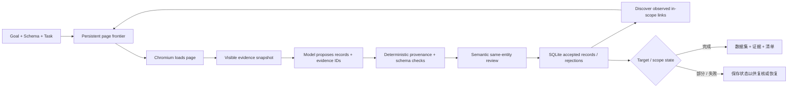

<a id="readme-top"></a>
<p align="center">
  
</p>
<p align="center">
  <strong>以证据为基础的 Web 研究：把有边界的来源转换为类型化数据集。</strong>
  <br />
  给 Verboisy 一个目标、JSON Schema 和来源策略。它会浏览、抽取、校验来源证据、复核语义，并返回可审计的结构化数据。
</p>

<p align="center">
  <a href="https://github.com/EmanueleTorrisi/verboisy/actions/workflows/ci.yml"></a>
  <a href="https://codecov.io/gh/EmanueleTorrisi/verboisy"></a>
  <a href="https://emanueletorrisi.github.io/verboisy/"></a>
  <a href="#installation"></a>
  
  <a href="../../LICENSE"></a>
  <a href="https://github.com/astral-sh/ruff"></a>
</p>

<p align="center">
  <em>v0.2.0rc1 | 候选发布版。以证据为基础、可恢复，并明确说明覆盖范围可能不完整。</em>
</p>

<p align="center">
  <a href="../../README.md" title="English" aria-label="English">🇬🇧</a> ·
  <a href="README.it.md" title="Italiano" aria-label="Italiano">🇮🇹</a> ·
  <a href="README.de.md" title="Deutsch" aria-label="Deutsch">🇩🇪</a> ·
  <strong title="简体中文" aria-label="简体中文">🇨🇳</strong> ·
  <a href="README.fr.md" title="Français" aria-label="Français">🇫🇷</a> ·
  <a href="README.es.md" title="Español" aria-label="Español">🇪🇸</a> ·
  <a href="README.ko.md" title="한국어" aria-label="한국어">🇰🇷</a> ·
  <a href="README.ja.md" title="日本語" aria-label="日本語">🇯🇵</a>
</p>

## 目录

- [演示](#demo)
- [为什么选择 Verboisy](#why-verboisy)
- [对比](#compared-to)
- [快速示例](#quick-example)
- [使用场景](#use-cases)
- [工作原理](#how-it-works)
- [安装](#installation)
- [配置](#configuration)
- [使用](#usage)
- [输出与 CSV](#outputs-and-csv)
- [Docker](#docker)
- [已知限制](#known-limitations)
- [负责任使用](#responsible-use)
- [文档](#documentation)
- [贡献](#contributing)
- [安全](#security)
- [许可证](#license)

<a id="demo"></a>
## 演示

[历史动画](../../docs/demo.gif)仅用于示意，早于 0.2 证据引擎。当前行为请参考[真实演示流程](../../docs/demo.md)和[验证指南](../../docs/validation.md)。

0.2.0rc1 已通过离线 statement/branch 覆盖、真实 Chromium、干净 wheel 安装、Docker sandbox 启动、重复 live fixture、独立分页、真实中断/恢复、不可用来源、身份冲突以及一个非电商独立案例。这些是发布证据，不代表所有网站或模型响应都一定成功。

<a id="why-verboisy"></a>
## 为什么选择 Verboisy

- **以证据为基础，而不是“模型说了算”。** 每个非 null 标量都必须指向页面中观察到的证据；代码会检查来源 ID、实体 scope、字面引文、类型、链接、转换和 schema。
- **Schema-first，不静默放宽约束。** JSON Schema Draft 2020-12 定义记录形状和集合约束。缺少必需证据时拒绝候选，而不是编造值。
- **独立语义复核。** 通过确定性校验后，第二次模型调用只基于给定证据检查相关性、字段含义和是否属于同一实体。它仍可能出错，并不是外部事实真值机。
- **研究边界明确。** Seed URL、允许 host、include/exclude path、深度、页数、每页链接数和可选 JS 分页共同定义可观察范围。
- **从设计上可恢复。** 页面状态、snapshot、候选、已接受记录、事件、模型计量和队列持久化到 SQLite。
- **冲突不会被隐藏。** 声明的 identity 字段用于去重；同一身份的矛盾 payload 会被隔离而不是合并。

Playwright/Chromium + SQLite + LiteLLM + JSON/CSV + 证据附属文件 + 带校验和的清单。

<a id="compared-to"></a>
## 对比

Verboisy 介于浏览器研究代理与结构化抽取器之间；它最特别的契约是每个被接受值都保留证据链。

| | Verboisy | 通用浏览器代理 | 爬虫 / 抽取器 | 临时 LLM 抽取 |
| --- | --- | --- | --- | --- |
| 你提供 | 目标 + JSON Schema + 来源策略 | 目标 | URL / 抓取规则 | 提示词 + 页面文本 |
| 导航 | 有边界的已观察链接 + 可选分页 | 模型驱动动作 | 爬取规则 | 通常没有 |
| 字段来源 | 每个非 null 标量都必需 | 取决于你的代码 | 不一 | 通常只有提示词 |
| 验证 | JSON Schema + 确定性证据 + 语义复核 | 取决于你的代码 | 不一 | 通常为尽力而为 |
| 持久化 | SQLite 队列、snapshot、候选、记录、事件 | 不一 | 不一 | 通常由调用方维护 |
| 恢复 | 持久执行 ID + 探索前沿 | 不一 | 不一 | 通常由调用方维护 |
| 身份冲突 | 确定性隔离 | 调用方 | 调用方 | 调用方 |

<a id="quick-example"></a>
## 快速示例

先精确定义“一条记录”是什么：

```json
{
  "type": "array",
  "minItems": 2,
  "items": {
    "type": "object",
    "properties": {
      "sku": {"type": "string", "description": "来源实际发布的产品 SKU"},
      "price_usd": {"type": "number", "minimum": 0, "description": "页面列出的美元单价；不要换算货币"},
      "source_url": {"type": "string", "format": "uri", "description": "观察到该记录时浏览器最终所在页面 URL"}
    },
    "required": ["sku", "price_usd", "source_url"],
    "additionalProperties": false
  }
}
```

然后在 `task.json` 中定义有边界的来源策略：

```json
{
  "seed_urls": ["https://catalog.example/products"],
  "allowed_hosts": ["catalog.example"],
  "include_paths": ["/products*"],
  "target_records": 20,
  "identity_fields": ["/sku"],
  "max_depth": 3,
  "max_pages": 100,
  "field_rules": {
    "/source_url": {"source": "page_url"}
  }
}
```

运行：

```bash
verboisy run \
  --goal "收集已发布的产品 SKU 和页面列出的美元价格" \
  --schema schema.json \
  --task task.json \
  --export dataset.json \
  --max-steps 40
```

示例输出形状：

```json
[
  {"sku": "LAMP-001", "price_usd": 39.95, "source_url": "https://catalog.example/products/lamp-001"},
  {"sku": "CHAIR-014", "price_usd": 129.0, "source_url": "https://catalog.example/products/chair-014"}
]
```

*示例域名和记录仅用于说明。真实结果取决于运行中实际观察到的页面。*

<a id="use-cases"></a>
## 使用场景

当“给我几行数据”还不够、你还需要回答“这个值从哪里来？”时，Verboisy 很适合。

- **市场与竞品研究：** 有边界的目录、价格、功能或公告数据，并保留字段级证据。
- **B2B 研究：** 结构化组织/目录记录，带显式身份字段和来源 URL。
- **电商监控：** 类型化产品数据，不把矛盾观察静默合并。
- **Research Operations：** 在受控页面集合上重复同一 schema/策略，并从 SQLite 恢复。
- **注册表与参考数据：** 把技术表格转换为类型化记录，同时保留布尔、数字、文本和 URL 的精确证据。
- **RAG / 数据流水线：** 交付规范 JSON + 证据 sidecar + manifest，而不是无来源文本。

<a id="how-it-works"></a>
## 工作原理

0.2 用“有边界的证据研究引擎”替代旧的自由 plan/action 循环：



Snapshot 包含紧凑的可见事实、已解析链接、实体 scope ID、最终 URL、时间戳和 content hash。完整观察 HTML 仍保存在 SQLite。模型只能提出候选，无法绕过 schema 或来源校验。`COMPLETED` 表示显式 target 和集合校验已满足，并不表示对开放网络实现全局穷举。

[`ARCHITECTURE.md`](../../ARCHITECTURE.md)

<a id="installation"></a>
## 安装

需要 Python 3.11–3.14。

稳定版发布后，常规安装方式计划为：

```bash
pip install verboisy
```

当前候选版尚未正式发布，请安装提供的 wheel 或源码 checkout：

```bash
pip install -e .
verboisy --help
```

首次真正使用浏览器时，会在模型调用前下载匹配的 Chromium。导入 Verboisy 或执行 `--help` 不会下载浏览器。可显式准备：

```bash
verboisy setup
```

Linux 还可能需要 Chromium 原生依赖，例如：

```bash
python -m playwright install-deps chromium
```

Verboisy 不会自行调用 `sudo`，也不会为了通过测试而静默关闭 Chromium sandbox。

<a id="configuration"></a>
## 配置

把 `.env.example` 复制为 `.env`，不要把密钥提交到版本控制。

```bash
OPENAI_API_KEY=sk-your-api-key-here
# ANTHROPIC_API_KEY=sk-ant-your-api-key-here
LITELLM_MODEL=gpt-4o
SQLITE_DB_PATH=verboisy.db
SEARCH_PROVIDER=disabled
BROWSER_SANDBOX=true
ALLOW_PRIVATE_NETWORK=false
```

常用设置：

| Variable | 用途 |
| --- | --- |
| `OPENAI_API_KEY / ANTHROPIC_API_KEY` | 通过 LiteLLM 路由的供应商凭据 |
| `LITELLM_MODEL` | 用于提议/复核调用的模型标识 |
| `LITELLM_API_KEY / LITELLM_API_BASE` | 可选的替代供应商或代理 |
| `SQLITE_DB_PATH` | 0.2 执行使用的持久数据库 |
| `SEARCH_PROVIDER` | 已知起始 URL 时禁用；配置后可通过 Brave 发现来源 |
| `BRAVE_SEARCH_API_KEY` | Brave 搜索凭据 |
| `MAX_TOKENS` | 每次请求的模型最大输出 token 数 |
| `MODEL_REQUEST_BUDGET` | 保守的本地请求单位预算 |
| `LLM_TIMEOUT_SECONDS` | 每次模型请求的超时时间 |
| `LLM_RETRIES` | 对临时或不可用响应进行有限次数重试 |
| `RUN_TIMEOUT_SECONDS` | 每次调用的总超时时间 |
| `MAX_DOM_CHARS` | 每个模型批次的证据负载预算 |
| `ACTION_DELAY_SECONDS` | 页面处理迭代之间的延迟 |
| `BROWSER_SANDBOX` | Chromium 沙箱开关；应保持启用 |
| `ALLOW_PRIVATE_NETWORK` | 显式允许私有/回环网络；默认关闭 |
| `ALLOWED_DOMAINS` | 可选的精确目标主机限制 |

`verboisy doctor` 显示非敏感配置和环境状态；`verboisy setup` 在不调用模型的情况下准备/测试 Chromium。

<a id="usage"></a>
## 使用

### CLI

```bash
verboisy run \
  --goal "收集已发布的产品 SKU 和页面列出的美元价格" \
  --schema schema.json \
  --task task.json \
  --export dataset.json \
  --max-steps 40
```

重要参数：

| Flag | 是否必需 | 含义 |
| --- | --- | --- |
| `--goal`, `-g` | 新执行 | 自然语言研究目标 |
| `--schema`, `-s` | 新执行 | JSON Schema 路径 |
| `--task`, `-t` | 新执行 | 有边界的来源/发现策略 |
| `--export`, `-e` | 否 | `.json` 或 `.csv` 输出 |
| `--resume`, `-r` | 恢复 | 最新未完成执行或指定执行 ID |
| `--max-steps`, `-m` | 否 | 本次调用允许的工作量 |
| `--headless` / `--headed` | 否 | 覆盖浏览器显示模式 |

退出码：`0` target 完成，`2` 正常的部分/耗尽结果，`1` 失败，`130` 中断。

### 恢复

```bash
# 恢复最近一个未完成 run
verboisy run --resume

# 恢复指定 run，并在本次调用停止时导出
verboisy run --resume 7f3a2c1b --export dataset.json
```

恢复会保留原目标、schema、task 策略、已接受记录、队列和累计模型计量。中断/active 页面会重新变为可处理；确定性 identity 逻辑阻止相同记录重复。

### Python

`run()` 是同步 API；异步应用中使用 `await arun(...)`。

```python
from verboisy import run

result = run(
    goal="收集已发布的产品 SKU 和美元价格",
    schema="schema.json",
    task="task.json",
    export="dataset.json",
    max_steps=40,
)

print(result.run_id)
print(result.status, result.stop_reason)
for record in result.records:
    print(record)
```

<a id="outputs-and-csv"></a>
## 输出与 CSV

JSON 导出会生成三个互补文件：

- `dataset.json` — 只有用户请求的数据字段。
- `dataset.json.evidence.json` — 已接受记录及 snapshot/证据来源。
- `dataset.json.manifest.json` — run 状态、schema/task、模型调用元数据、集合校验和 SHA-256 hash。

SQLite 还保留页面 frontier、snapshot/HTML、候选、拒绝原因、已接受记录、coverage gap、身份冲突和计量。

默认 `csv_mode: "json"` 会把每个存在的单元格编码为 JSON，精确保留类型。空白代表缺失；`null` 与缺失仍不同。

`csv_mode: "spreadsheet"` 输出常规表格单元格，并转义类似公式的字符串。更方便人工查看，但不是规范的类型保持交换格式。

把复制后的导出视为同一代文件之前，请校验 manifest hash。

<a id="docker"></a>
## Docker

官方容器以非特权用户运行 Verboisy，作为比个人浏览器会话更强的部署边界。

```bash
docker build -f docker/Dockerfile -t verboisy:0.2.0rc1 .

docker run --rm --init --shm-size=1g \
  --security-opt seccomp=docker/seccomp_profile.json \
  --entrypoint verboisy \
  verboisy:0.2.0rc1 setup
```

真实 workload 中请持久化 SQLite 和导出目录，保持 sandbox 开启，并施加合适的网络 egress 控制。

<a id="known-limitations"></a>
## 已知限制

- 遍历按 breadth-first 跟随实际观察且 in-scope 的 HTTP(S) 链接；模型只能优先排序，不能凭空创造任意目标。
- `pagination_selector` 支持有边界的 JS 分页。通用表单、任意筛选、隐式无限滚动、下载、iframe/shadow-root 和任意 JavaScript 动作未实现。
- 认证流程、CAPTCHA、反爬绕过、OCR、PDF 抽取和跨页面实体 join 不在当前契约内。
- DOM/证据上下文有上限；过大的 batch 或不可用模型响应会成为显式 coverage gap。
- 字面来源校验只证明值在允许实体 scope 中被观察到，不证明来源本身真实。
- 语义复核依赖模型，仍可能出错。
- `COMPLETED` 表示 target 完成，不是全局完整性声明。
- 不可用来源可能导致 run 失败/不完整；反复提高预算不能替代缺失证据。
- 没有 `identity_fields` 时只对完全相同记录去重；有 identity 时，矛盾 payload 会被隔离。

<a id="responsible-use"></a>
## 负责任使用

Verboisy 驱动真实浏览器并在本地保存来源材料。你需要自行遵守目标站点条款、robots、限速、许可证、隐私要求和法律。不要绕过你无权通过的认证或访问控制。

URL 检查和 Chromium sandbox 属于纵深防御，不是完整的恶意网络隔离。处理不可信浏览时使用专用账号/容器/VM，避免敏感挂载，并限制 egress。

来源页面和抽取记录可能包含个人或受许可数据。Verboisy 不会自动为 SQLite 加密；可访问并不意味着可再分发或用于训练。

<a id="documentation"></a>
## 文档

- [契约与任务策略](../../docs/contracts.md)
- [验证与发布检查](../../docs/validation.md)
- [搜索与恢复](../../docs/search-and-recovery.md)
- [从 0.1 迁移](../../docs/migration.md)
- [真实演示流程](../../docs/demo.md)
- [发布运维](../../docs/release.md)
- [架构](../../ARCHITECTURE.md)

<a id="contributing"></a>
## 贡献

欢迎贡献。参见 [`CONTRIBUTING.md`](../CONTRIBUTING.md)。新行为请用确定性测试覆盖，不要为了某个 fixture 而削弱证据或 sandbox 规则。

<a id="security"></a>
## 安全

发现漏洞？请不要公开提 issue。使用[私密漏洞报告](https://github.com/EmanueleTorrisi/verboisy/security/advisories/new)或 [`SECURITY.md`](../SECURITY.md)。

<a id="license"></a>
## 许可证

BSD 2-Clause。见 [`LICENSE`](../../LICENSE)。

---

<p align="center">
  作者 <a href="https://github.com/EmanueleTorrisi">Emanuele Torrisi</a> · <a href="#readme-top">返回顶部 ↑</a>
</p>
