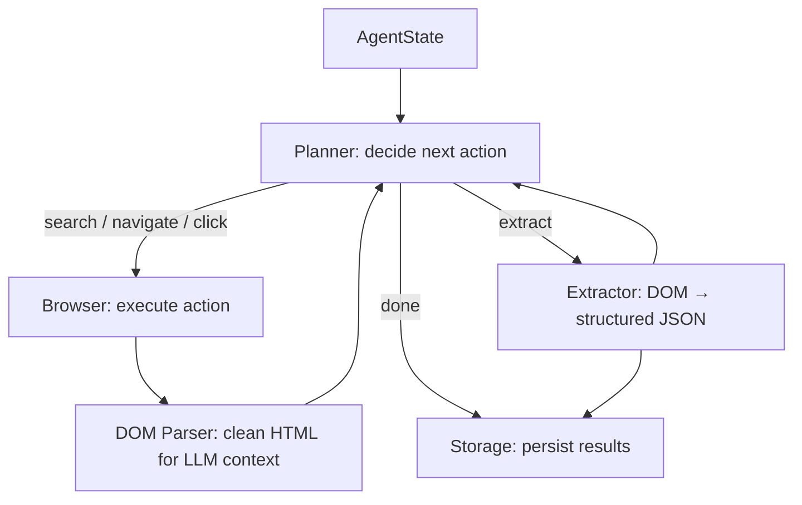

# Architecture

Verboisy runs one core loop: **plan → act → observe → extract**, repeated until the
planner decides it has enough structured data or hits a budget limit (max steps, max
tokens, or a timeout).

1. **`core/state.py`** holds `AgentState` — goal, target schema, action history, records
   extracted so far, remaining budget. Single source of truth for a run.
2. **`core/planner.py`** reads `AgentState` plus current page context and asks the LLM
   (via `llm/client.py`) to choose the next action: `search`, `navigate`, `click`,
   `extract`, or `done`. Prompts live separately in `llm/prompts.py`.
3. **`browser/context.py`** executes navigation/click actions via Playwright.
   `browser/stealth.py` applies evasions before any page loads.
4. **`browser/dom_parser.py`** strips the resulting page to what the LLM actually needs
   — no scripts, styles, nav/footer boilerplate. This is the step `tests/fixtures/`
   exists to test deterministically.
5. On `extract`, **`extractor/engine.py`** maps cleaned DOM to the caller's JSON schema;
   **`extractor/schema_builder.py`** turns that schema into a Pydantic model at runtime.
6. **`storage/sqlite.py`** persists each validated record as it's produced, so a crashed
   run doesn't lose earlier progress. **`storage/exporters.py`** dumps to CSV/JSON.

## Why a state machine, not one long prompt

Explicit `AgentState` transitions — instead of looping inside a single giant prompt —
make the agent resumable, testable, and debuggable: any transition can be logged or
replayed, a step budget caps runaway loops, and the LLM backend can be swapped without
touching browser or extraction code.

## Extending it

- New action type → add a case to the planner's action enum + a handler in
  `core/agent.py`'s dispatch loop.
- New LLM provider → nothing to change; `llm/client.py` wraps LiteLLM.
- New export format → add a function to `storage/exporters.py`, kept decoupled from
  `sqlite.py` on purpose.
