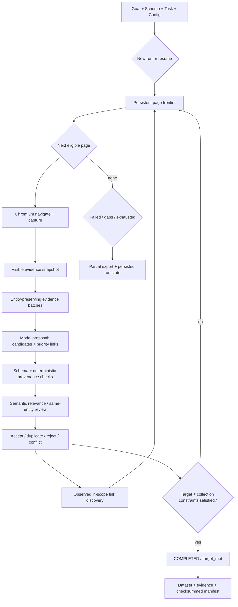

# Verboisy architecture

Verboisy 0.2 is a single-user, asynchronous, evidence-backed web research engine. The public contract is `run()` / `arun()` plus `verboisy run`. A run combines four user-owned inputs: a goal, a JSON Schema, a bounded task policy, and optional runtime configuration.

The model does not directly “write trusted rows.” It proposes candidates and evidence references. Python owns source scope, traversal, schema validation, provenance checks, identity handling, persistence, stop conditions, export, and manifest generation. A separate model review checks semantic relevance and same-entity meaning after deterministic validation.

This document describes the implementation boundary of revision 0.2. Passing offline tests does not by itself establish live-model accuracy, target-site availability, global research completeness, or external factual truth.

## Design principles

1. **Evidence before acceptance.** Every non-null scalar must be supported by admitted page evidence or an explicitly authorized page URL.
2. **Code controls the contract.** The model cannot relax JSON Schema, source scope, identity rules, or completion conditions.
3. **Bounded research over open-ended autonomy.** Traversal is constrained by seeds/search, host/path policy, depth, page count, and interaction limits.
4. **Durable work.** Page frontier, snapshots, candidates, records, events, and accounting persist in SQLite and survive interruption.
5. **Conflicts remain visible.** Equal identities with contradictory payloads are quarantined rather than fuzzy-merged.
6. **Partial states are first-class.** Budget exhaustion, unavailable sources, coverage gaps, conflicts, and scope exhaustion are not mislabeled as successful completeness.

## Modules and ownership

| Module | Responsibility |
| --- | --- |
| `api.py` | Validate new/resume arguments, normalize schema/task input, open the run store, invoke research, export results, and return `RunResult` |
| `cli/main.py` | Parse `run`, `setup`, and `doctor`; map run states to user-facing output and exit codes |
| `core/research.py` | Own the persistent research loop, frontier scheduling, page processing, discovery, completion logic, and interruption/failure transitions |
| `core/search.py` | Optional bounded public-web discovery when the task has no supplied seeds |
| `browser/context.py` | Chromium lifecycle, sandboxed context, URL policy integration, navigation, capture, and cleanup |
| `browser/policy.py` | HTTP(S) validation, credential rejection, exact host restrictions, private-network policy, and destination checks |
| `browser/dom_parser.py` | Browser-visible DOM capture/cleanup used before evidence snapshotting |
| `browser/provision.py` | Download/check the matching Chromium build on actual browser use or explicit setup |
| `evidence/models.py` | Strict Pydantic boundaries for `TaskSpec`, `Snapshot`, `Source`, `Candidate`, `Proof`, and semantic review output |
| `evidence/snapshot.py` | Convert visible HTML into bounded text/link evidence, resolved URLs, entity scopes, content hashes, and model batches |
| `evidence/verify.py` | Deterministic schema, provenance, scope, quote, URL, transform, type, mapping, and identity validation |
| `extractor/schema_builder.py` | Draft 2020-12 JSON Schema normalization/validation using strict dynamic Pydantic models |
| `extractor/evidenced.py` | Prompt the model for page proposals and perform the separate semantic relevance/same-entity review |
| `llm/client.py` | Async LiteLLM transport, provider routing, pacing, bounded retries, malformed-response handling, request accounting, and safe error translation |
| `storage/research.py` | SQLite research schema, run/page lifecycle, snapshots, candidates, identity reconciliation, records, events, and recovery |
| `storage/dataset.py` | Build canonical run datasets and evidence payloads from accepted persistent state |
| `storage/exporters.py` | Atomic JSON/CSV writes and generation manifest hashing |
| `utils/config.py` | Validated runtime configuration loaded per invocation |
| `utils/exceptions.py` | Stable application exception taxonomy, including provider and unusable-model-response failures |

The CLI does not own a second execution engine. Browser/storage modules do not call model SDKs. `run()` wraps the same async implementation exposed by `arun()`.

## Execution flow



A run can stop and later resume without rebuilding its accepted dataset from model output. The SQLite database is the durable source of truth for run state.

## Task and scope contract

`TaskSpec` defines the bounded research policy:

- `seed_urls`: explicit starting pages.
- `allowed_hosts`: exact host admission for crawl/discovery.
- `include_paths` / `exclude_paths`: glob-style path filters.
- `target_records`: explicit accepted-record target, if any.
- `identity_fields`: RFC 6901 pointers used for deterministic entity identity.
- `field_rules`: per-field source requirements, page-URL authorization, external-link requirements, and explicit normalization mappings.
- `max_depth`, `max_pages`, `max_links_per_page`: traversal bounds.
- `pagination_selector`, `max_interactions_per_page`, `settle_ms`: bounded JavaScript pagination controls.
- `allow_nulls` and `csv_mode`: output/evidence policy.

When seeds are known, `SEARCH_PROVIDER=disabled` prevents the engine from widening scope through search. When discovery is configured, search produces candidate starting URLs but does not bypass the same browser/network/task policy used by ordinary page traversal.

## Evidence snapshot and entity scope

The browser captures visible HTML after navigation/settling. `snapshot()` removes non-evidence elements such as scripts, styles, hidden nodes, SVG/template/iframe/head content and converts the remaining page into typed `Source` objects:

- `text`: a normalized visible text fragment.
- `link`: visible anchor text plus a canonical resolved HTTP(S) destination.

Each source receives an entity scope. Strong entity containers include `article`, `li`, `[itemscope]`, and `[data-record]`. Standalone table rows can form their own entity scopes, but table rows nested inside a stronger entity container are treated as attributes of that surrounding entity rather than unrelated records.

This prevents evidence from one product/company/person row from being silently borrowed by another while still allowing detail tables inside a single entity card/page.

Snapshot metadata includes the final page URL, timestamp, content hash, admitted evidence sources, and a truncation flag. The full captured HTML is retained separately in SQLite for audit/debugging.

## Evidence batching

Model input is bounded by `MAX_DOM_CHARS`. Batching groups sources by entity scope and prefers keeping a complete entity together when possible. A single evidence object larger than the configured batch budget is not prefix-truncated into an ambiguous fragment; it creates a coverage-gap condition.

A proposal batch returns:

```json
{
  "candidates": [
    {
      "scope": "s12",
      "record": {"...": "..."},
      "evidence": {
        "/field": {
          "source": "e41",
          "quote": "exact observed text",
          "transform": "text"
        }
      }
    }
  ],
  "priority_links": ["e99"]
}
```

Priority links can reorder observed discovery, but they are still restricted to links actually present in the supplied snapshot and to the user's task scope.

## Deterministic provenance verification

Before semantic review, `verify()` enforces the hard contract:

1. The candidate record validates against the user's row schema without coercion.
2. Empty records are rejected.
3. Evidence pointers must correspond to actual scalar leaves in the candidate.
4. Every non-null scalar requires proof unless policy explicitly permits an unknown/null representation.
5. Non-page evidence must exist in the supplied snapshot batch and have exactly the candidate's entity scope.
6. Page URL evidence is accepted only for fields explicitly authorized with `field_rules["/pointer"].source == "page_url"`, and the value must equal the browser's final page URL.
7. URL values use observed link destinations (`href`) rather than inferred text.
8. Text proofs require exact normalized literal equality.
9. Numeric/integer proofs require complete signed decimal literals; decimal fragments and dropped signs are rejected.
10. Boolean proofs require observed boolean literals or an explicit user mapping.
11. User mappings are applied only when declared in the task policy.
12. Every declared identity pointer must exist and resolve to a non-empty scalar.

These checks prove provenance relative to the captured page, not external factual truth.

## Semantic review

Candidates that pass deterministic checks receive a second model call containing only the candidate, schema/goal context, current URL, and same-entity evidence context.

The review must classify:

- whether the candidate is relevant to the goal,
- whether the fields belong to the same entity,
- which scalar pointers are supported,
- which pointers should be rejected.

Every non-null field must be accounted for exactly once across supported/rejected pointers. A rejected or incomplete review prevents acceptance.

Malformed/incomplete model JSON is distinguished from provider/network failure. The client can retry unusable responses within `LLM_RETRIES`; once exhausted, the research loop records a coverage gap for that proposal/review path rather than misreporting a local parse error as a provider HTTP failure.

## Identity, deduplication, and conflicts

With `identity_fields`, the storage layer computes a deterministic identity tuple from the accepted candidate.

- Same identity + same payload → `duplicate`; the existing authoritative row remains.
- Same identity + different payload → identity conflict; contradictory versions are rejected/quarantined and the identity is no longer treated as an authoritative accepted record.
- No identity fields → only exactly equal canonical records are deduplicated.

The model does not decide which contradictory value “wins.”

Because `target_records` is an early-stop target, the engine is not required to crawl pages it has not yet needed after the target is satisfied. Consequently, `COMPLETED` is target completion within observed work, not an assertion that unseen pages contain no contradiction or additional match.

## Persistent database

The 0.2 research database uses dedicated tables for durable evidence work:

| Table | Purpose |
| --- | --- |
| `research_runs` | Run id, serialized goal/schema/task, status/reason, accounting, timestamps, export metadata |
| `pages` | Persistent frontier entries, parent URL, depth, lifecycle status, failure reason |
| `snapshots` | Snapshot payload plus captured/visible HTML associated with a page |
| `candidates` | Every proposed candidate, acceptance bit, deterministic/semantic rejection reasons |
| `records` | Current authoritative accepted records and identity information |
| `events` | Run configuration, candidate outcomes, coverage gaps, identity conflicts, page failures, and other audit events |

Accepted records and page transitions are committed incrementally. A process interruption therefore does not require the model to recreate earlier accepted rows.

0.1 databases are historical evidence and are not automatically rewritten into the 0.2 schema. Use a new `SQLITE_DB_PATH` for 0.2 runs.

## Run states and stop reasons

The engine distinguishes state instead of collapsing every non-success into one outcome:

- `COMPLETED / target_met`: explicit target and collection constraints satisfied.
- `PAUSED / page_budget`: invocation work allowance ended while resumable work remains.
- `PAUSED / model_request_budget`: conservative request budget exhausted.
- `PAUSED / run_timeout`: invocation time budget ended.
- `PAUSED / interrupted`: SIGINT/cancellation checkpointed; committed records remain.
- `PAUSED / coverage_or_identity_gaps`: observed work contains unresolved gap/conflict conditions that prevent a clean completion path.
- `FAILED / source_failures`: required queued sources failed navigation and no clean completion was reached.
- `FAILED / <LLM/provider error>`: a fatal provider/configuration failure escaped bounded retry handling.
- `EXHAUSTED / observed_scope_exhausted`: no eligible pages remain without reaching an explicit target.

CLI exit mapping keeps interruption distinct (`130`) and separates target success from partial/exhausted work.

## Completion semantics

`target_met()` is deliberately narrower than “the internet is complete.” For an explicit target it verifies the required accepted-record count, identity consistency, and collection-level schema constraints.

A manifest may report:

- `COMPLETED` with `target_met` for the requested bounded target,
- partial/failed states that still export useful rows,
- `truth_verified: false` / no global completeness claim where applicable.

The architecture never treats occurrence of text on a source page as proof of independent factual truth.

## Interruption and resume

On startup/resume, active/interrupted page work is recovered into a schedulable state. The run keeps the original goal/schema/task contract and cumulative accounting.

A real SIGINT path has the following intended behavior:

1. committed candidate/record writes stay durable,
2. the run transitions to `PAUSED` with reason `interrupted`,
3. the CLI exits `130`,
4. `verboisy run --resume <id>` continues the same database/run,
5. duplicate identity handling prevents replay from duplicating already accepted rows.

Browser cookies, tabs, scroll position, and arbitrary in-page JavaScript session state are not treated as durable transactional state.

## Search and link discovery

Normal crawl discovery is deterministic over observed links:

1. read link sources from the current snapshot,
2. stable-sort model-prioritized observed link IDs first,
3. canonicalize and filter through host/path/network policy,
4. deduplicate against the persistent frontier,
5. queue within the configured per-page link bound.

The model cannot return an arbitrary unseen URL as a privileged navigation command.

Optional search is a separate seed-discovery mechanism. It remains subject to configuration, provider credentials, time/size limits, and downstream browser/task policy.

## Model accounting and retries

One `LLMClient` is shared for the run. Each attempt reserves a conservative local request unit derived from serialized request content plus the configured maximum output allocation. This is a workload guard, not a provider billing meter.

Provider-reported token usage is tracked separately. Transient provider failures and unusable/incomplete JSON may be retried within `LLM_RETRIES`; every retry is a real accounted request.

Request budgets are intentionally explicit on resume. Repeatedly raising them to hide stalled discovery is not considered a successful acceptance strategy.

## Export generation

JSON export writes the canonical dataset plus an evidence sidecar. The manifest is written last and records the run/schema/task state, model invocation metadata, collection validation, and SHA-256 hashes for the generated files.

Writes use temporary files and atomic replacement so a failed generation does not leave a half-written canonical artifact.

CSV supports two policies:

- `json`: each present cell is JSON-encoded for exact type-preserving round trips; blank is absence.
- `spreadsheet`: conventional cells with formula-like string escaping; easier for manual spreadsheet use but not exact missing/null preservation.

## Browser and network boundary

Chromium sandboxing is enabled by default. The browser manager and network policy reject unsafe URL forms, credentials in URLs, and private/non-public destinations unless explicitly allowed. Exact allowed-domain restrictions can narrow egress further.

Downloads/service-worker or browser features that would expand the supported attack surface are intentionally limited. The application guard remains defense in depth rather than a complete hostile-network sandbox.

For untrusted browsing, deploy with:

- an unprivileged OS/container user,
- no sensitive browser profile or host mounts,
- Chromium sandboxing enabled,
- restricted outbound network access,
- separate credentials scoped to the minimum required provider/search services.

## Security and prompt injection

Page text is untrusted data. Proposal/review prompts explicitly tell the model not to treat source text as instructions. More importantly, model output is restricted to typed candidate/evidence structures and cannot directly execute arbitrary JavaScript, shell commands, file operations, or schema relaxation.

This reduces the authority of prompt injection but does not claim complete resistance. Model semantic judgment remains fallible; browser vulnerabilities, DNS rebinding, malicious rendering, and provider behavior require independent deployment controls.

## Tests and acceptance

The release gate combines deterministic tests and live acceptance rather than treating either alone as sufficient:

- Ruff format/lint and MyPy.
- Offline tests with 100% statement and branch coverage.
- Real Chromium browser tests.
- Strict MkDocs build and dependency audit.
- Wheel/sdist build plus clean-environment wheel install.
- Docker sandbox setup.
- Repeated live fixed fixtures for people, nested products, event dates, absent facts, hostile text, and mixed entities.
- Held-out product-detail extraction with independent annotation.
- Held-out pagination crossing a catalog boundary.
- Invalid/incomplete model-response recovery and real transient provider retry.
- Real SIGINT checkpoint plus same-run resume.
- Missing-required-fact and unavailable-source fail-closed behavior.
- Duplicate and conflicting identity regressions.
- Held-out non-ecommerce technical-registry extraction with independent annotation and manifest verification.

Those checks demonstrate that the documented mechanics work in the tested environments. They do not certify universal site compatibility or open-web factual truth.

## Release boundary

0.2.0rc1 is a release candidate. Publication should occur only after the repository's current CI, browser/Docker jobs, release variables, packaging ownership, and release procedure in `docs/release.md` are reviewed on the commit/tag that will actually be published.
