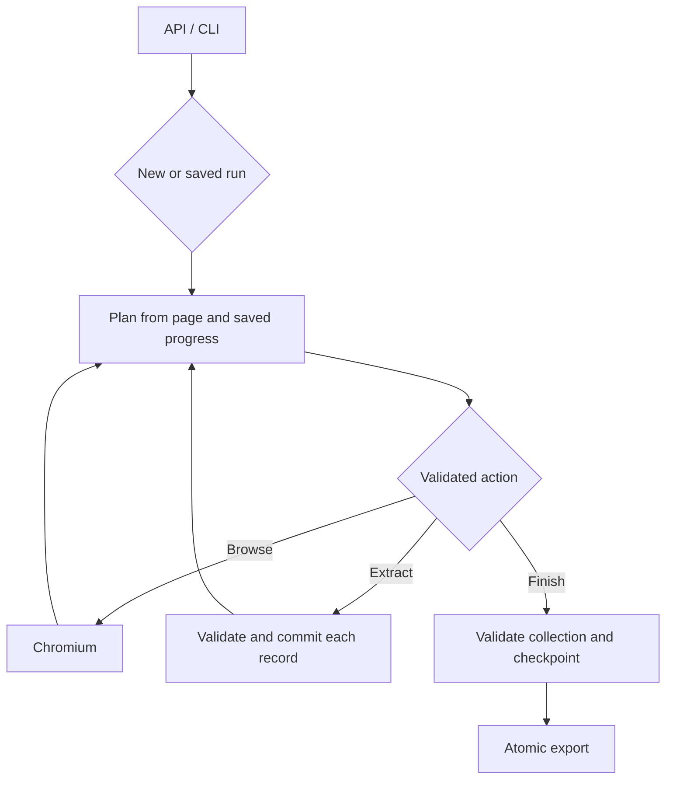

# Verboisy architecture

Verboisy is a single-user, asynchronous browser research agent. The public contract is
`run()` / `arun()` plus `verboisy run`. A model chooses actions; Python validates
the action, performs it, validates records, and commits them to SQLite.

This document describes the implementation in this repository. Live model accuracy,
exact restoration of JavaScript state, and target-site availability are separate
acceptance questions; passing offline tests does not establish them.

## Modules and ownership

| Module | Responsibility |
| --- | --- |
| `api.py` | Validate input, create/restore a run, invoke the agent, export completed results, return `RunResult` |
| `cli/main.py` | Parse the actual `run` subcommand and optional-value `--resume`; invoke the public API |
| `core/state.py` | Serializable run state, action history, validated action vocabulary |
| `core/planner.py` | Give the model cleaned page text, controls, schema, recent history and records |
| `core/agent.py` | Execute actions, commit records, checkpoint progress, handle stop conditions and cleanup |
| `browser/context.py` | Chromium lifecycle, request interception, timeouts, optional browser fingerprint adjustments |
| `browser/policy.py` | HTTP(S), credential-free URLs, optional exact domain allowlist, public-address checks |
| `browser/dom_parser.py` | Deterministic HTML cleanup and interactive-control summary |
| `extractor/schema_builder.py` | Draft 2020-12 JSON Schema validation wrapped in dynamic Pydantic models |
| `extractor/engine.py` | Model response to validated record iterator; final collection validation |
| `llm/client.py` | Async LiteLLM calls, key routing, bounded transient retries, request budget and usage |
| `storage/sqlite.py` | Additive schema migration, per-record commits, checkpoints, exact-content deduplication, run lock |
| `storage/exporters.py` | Atomic JSON/CSV writes; CSV formula escaping |
| `utils/config.py` | One validated configuration per public invocation; no eager environment validation on import |

The browser and storage do not call model SDKs. The CLI does not own a second
execution loop. The synchronous wrapper rejects an already-running event loop;
notebooks and async applications use `await arun(...)`.

## Execution and state

Action names are `NAVIGATE`, `SEARCH`, `CLICK`, `TYPE`, `CHECK`, `SELECT`, `SCROLL`,
`WAIT`, `EXTRACT`, and `FINISH`. SEARCH uses `SEARCH_PROVIDER`: legacy Google
browser search, the Brave Search API, or disabled. Brave results are checkpointed
as discovery links; extraction still reads the actual browser page. API credentials
are sent only to the fixed Brave endpoint, without redirects or browser fallback.
The API obeys the network/domain policy and has total time and response-size limits.
Browser interactions use strict locators with bounded operation timeouts.
CHECK sets native checkbox/radio state; SELECT uses an observed native option value.
TYPE submits with Enter by default; `submit:false` only fills, including empty text.
No action accepts arbitrary JavaScript, operating-system commands, or file paths.

Only a successfully validated FINISH produces COMPLETED. Exhausted steps, request
budget, invocation time, or the interaction recovery budget produce PAUSED.
Unavailable search also pauses. Fatal errors produce FAILED. Async cancellation
produces INTERRUPTED. All except COMPLETED are candidates for bare resume.

Every invocation gets a fresh step/time/request allowance. `step_count` and
provider-reported `token_count` remain cumulative. The local request budget reserves
UTF-8 prompt bytes plus the maximum response tokens for each attempt. It bounds
request volume conservatively; it is not an exact provider billing or hidden-token cap.

Intent (step, action, selector and URL) is checkpointed before dispatch. Interaction
failures are retained in `state_json` (last ten) and passed to the next planner with
fresh HTML. They consume both step and failure allowances, and do not enter
successful action history. Search errors pause immediately without a provider fallback.
A successful action's resulting URL and history entry are checkpointed together.
Validated rows are committed separately before adding them to in-memory results.
Thus a malformed later candidate cannot discard previously committed candidates.
A crash between a record commit and an action checkpoint can repeat extraction;
the database suppresses duplicate canonical JSON records within that run.

## Schema contract

Accepted roots are an array with object items, an object schema, and the legacy
flat property mapping. Normalization preserves the original rules. Draft 2020-12
constraints, nested objects/arrays, enum, patterns, numeric bounds, required fields,
additionalProperties and supported formats are enforced by `jsonschema`.
The explicit format dependency extra is essential: otherwise some format checks
silently do nothing. Pydantic wraps the validated values; it does not coerce a string
into a number. Missing optional properties stay absent; explicit null must be allowed.

Only local fragment references are accepted. Remote schema fetching is disabled
using an empty reference registry. Schemas should still come from a trusted author:
pathological regular expressions or recursive constraints can consume resources.
Collection constraints such as minItems are checked over all saved rows on FINISH.

Schema validity proves shape and constraints, not that a model's statements are true.
The extraction prompt includes the goal and directs the model to use page evidence.
The example website field additionally requires an HTTP(S) URI. Values such as batch
must come from the page; prompt instructions alone cannot guarantee factual accuracy.

## Database and recovery

The actual tables are `runs`, `extractions`, and `history`; existing names are retained.

| Table | Data |
| --- | --- |
| runs | run id, goal, schema, status, timestamps, serialized checkpoint in state_json |
| extractions | run id, source URL, JSON record, created_at, canonical record_hash |
| history | run id, action, parameters, resulting URL, timestamp |

Migration adds state_json and record_hash without dropping tables or records. Existing
duplicate legacy rows are retained; only the first receives the dedup hash. Legacy
runs lacking a checkpoint retain records/goal/schema, but cannot recover a URL or
step budget that the original software never saved. Original COMPLETED rows remain
COMPLETED, including any that the defective old budget logic marked incorrectly;
there is insufficient evidence to relabel them automatically.

Foreign keys are enforced for new writes. Queries use bound parameters. A per-database
OS-backed lock allows one cooperating research invocation at a time, released on close
or process death. Direct SQL writers are outside that cooperative protocol.
The database belongs on a local filesystem; distributed or multi-host workers are
outside the supported architecture.

Resume accepts a full id, a unique prefix, or the latest incomplete run. It restores
goal, schema, records, history, export destination, counters and last checkpointed URL.
Saved goal/schema override replacement arguments. Browser cookies, session storage,
open tabs, scroll position, and transient JavaScript widgets are not restored.
The planner must navigate again when those states matter. Previously saved identical
rows cannot be duplicated by replay, but repeated browser actions themselves are not
transactional and are not guaranteed exactly once.

A completed run selected by id can be re-exported without model/browser access.
Export failure is nonzero and preserves the completed database rows. JSON and CSV
replace the destination only after a successful temporary write; empty results are
also exported. CSV nests dictionaries/lists as JSON and prefixes formula-like string
cells and headers with an apostrophe.

## Security boundary

Chromium sandboxing is enabled by default; downloads and service workers are disabled,
and WebSockets are closed. Main actions and intercepted HTTP requests use the URL
policy. Private, loopback, link-local, and non-public destinations are blocked unless
the operator explicitly sets ALLOW_PRIVATE_NETWORK=true. ALLOWED_DOMAINS can restrict
destinations to exact hostnames, including asset hosts the target requires.

These application checks are defense in depth, not a complete network sandbox.
DNS rebinding, browser protocol details, browser vulnerabilities, popups and in-page
code need an OS/container network boundary for hostile sites. Use an isolated account,
no personal browser session or sensitive mounts, and network egress controls.
The shipped container is a deployment starting point; its sandbox support needs validation.

Model prompts mark page text as untrusted. There is no claim of complete prompt-injection
resistance, anti-bot bypass, automatic legal compliance, or guaranteed research completeness.
Provider keys loaded from .env are passed explicitly to the selected provider and hidden
in configuration representations. Verboisy error messages avoid raw provider responses;
third-party SDK logging remains part of the operator's review.

## Tests, build and release

Unit tests cover schemas, parsers, actions, exporters and configuration. Integration
tests exercise real SQLite migration, interruption, replay and export. A local HTTP
stub tests the production LiteLLM transport. The browser test drives actual Chromium
and the actual CLI against a local page and an explicitly simulated model endpoint.
It is a transport/orchestration test, not evidence of autonomous model intelligence.

`VERBOISY_REQUIRE_BROWSER=1 poetry run pytest -m browser` fails if Chromium cannot run.
The ordinary suite skips browser tests when Chromium is unavailable. Live provider
acceptance and the authentic recording workflow are in `docs/demo.md`.
CI runs locked dependencies, lint, type checks, unit/integration tests, a required browser
job, docs build and package build. Release publication builds the tag's source only after
its own checks, and verifies that the release tag matches package metadata.
