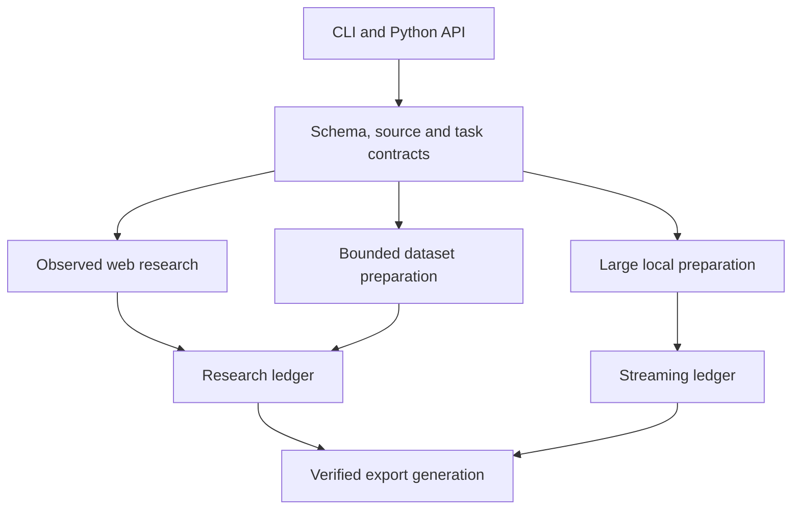

<!-- Copyright (c) 2026 Emanuele Torrisi. See LICENSE for applicable terms. -->

# Architecture and contracts

Verboisy separates acquisition, evidence validation, admission and presentation.
The separation matters during recovery: a model response, partially downloaded
file, console message or interrupted export cannot become accepted evidence merely
because another step succeeded. The public CLI and Python interfaces normalize
explicit contracts before executing one of three workflows.

## Ownership

| Boundary | Principal modules | Owns | Does not own |
| --- | --- | --- | --- |
| User intent | `cli`, `api`, `product`, `evidence.models` | Options, schema/task normalization, recovery selection | Independent truth claims or source authorization by model text |
| Provider execution | `llm.client`, provider profiles, `core.search` | Request parameters, credentials/endpoints, role routing, reservations and journals | Candidate admission or unapproved budget increases |
| Web acquisition | `core.research`, `browser`, `evidence.snapshot` | Persistent frontier, scope checks, observed DOM snapshots | Dataset decoding or credential entry inferred from pages |
| File acquisition | `extractor.local`, `download`, `transport`, `storage.assets` | Explicit grants, bounded bytes, DNS-pinned HTTP and immutable capture | Arbitrary file execution or interactive authentication |
| Deterministic adapters | `dataset`, `docx`, `xlsx`, `projection`, unit/descriptor/temporal helpers | Declared parsing and explicit replayable projections | Silent coercion or arbitrary multimedia understanding |
| Evidence admission | `evidence.verify`, semantic review, `storage.admission` | Schema checks, observed citations, scope, stable identity and acceptance | Model self-certification |
| Research recovery | `storage.research`, journals and saved-evidence readers | Runs, queues, candidates, snapshots, records, events and accounting | Resetting expenditure on resume |
| Large preparation | `streaming` and `cli.streaming` | Chunk capture, bounded row commits, keyset paging and streaming exports | Materialized web research or global entity fusion |
| Output semantics | `output`, `presentation`, `time_series`, `research_summary` | Ordered views, display choices and scoped diagnostics | Mutating raw evidence or certifying missing real-world facts |
| Distribution | `storage.dataset`, `asset_bundle`, `lineage`, `proof` | Portable assets, checksums, contributor/cell lineage and proof | Cryptographic authenticity or factual truth |

## Web research

1. Normalize the schema, identity, source scope and saved display preferences.
2. Reserve and journal permitted discovery/provider attempts. Search results locate
   sources; they do not independently support exported values.
3. Persist the frontier, navigate under declared scope and capture observed sources.
4. Obtain bounded proposals. Verify the schema, citations, transformations and entity
   scope before semantic review can admit a candidate.
5. Persist accepted identity and evidence, evaluate the research contract, then prepare
   an output generation. Public row IDs are assigned after grouping and ordering.

Source text is untrusted data. Prompt instructions are not a complete injection
barrier. Network controls, process isolation and authorization remain independent
requirements. Browser scope checks and a dataset downloader's DNS pinning are
separate mechanisms; neither is a universal browser/network sandbox.

## Bounded local and HTTP datasets

A declaration selects a format and source. Local files require explicit directory
grants. HTTP sources use permitted origins, bounded redirects/downloads and
origin-scoped credential headers. Secrets are excluded from public capture metadata.
An external file name cannot redirect storage outside the controlled asset boundary.

Parsing is deterministic. CSV/TSV preserve strings and reject ambiguous widths;
JSON/JSONL preserve types and reject duplicate keys/non-finite values. Text preserves
physical line locations. Office adapters reject unsafe archive/XML structures and
formulas under their declared subset. Arbitrary asset mode captures/indexes bytes.
It does not interpret those bytes as a supported document or image.

Source bytes, hashes and locators remain separate from projected values. Explicit
projection plans bind units, descriptors and temporal context to observed source
cells. A transformed value must be replayable; changing display preferences cannot
rewrite the original capture. Completed capture can support resume after the original
source disappears, subject to the adapter's saved integrity and authorization contract.

## Large local preparation

The ordinary research API returns a materialized record list. The `stream` API is a
separate contract returning counts and status with bounded paging through `StreamLedger`.
Its ledger must not be substituted for `ResearchStore`.

| Stored entity | Purpose | Recovery boundary |
| --- | --- | --- |
| Job contract | Fixed source, format, schema, projection and limits | Resume cannot silently replace the contract |
| Source chunks | Bounded immutable bytes with chunk and aggregate hashes | Partial capture admits no rows; completed capture is verified before use |
| Row batch | Source/output values, ordinals and physical locators | Rows and committed progress advance in the same SQLite transaction |
| Export generation | Output, evidence JSONL, exact source and manifest | Stage and verify before replacing the manifest last |

CSV, TSV, JSONL, text and opaque asset capture are supported. Memory-mapped access
is disabled and batch buffers have row and byte ceilings. Database, input, record
and row ceilings are saved independently. SQLite rollback journals and export files
require additional disk space. Keyset pages are bounded; no `fetchall` of all rows
is required. Resume may reparse preceding source rows, so repeated tiny invocations
are not a constant-time seek contract.

A hard termination can leave a stale status label or a rollback journal. The committed
checkpoint is authoritative. Opening the writer can recover SQLite before read-only
inspection. No incomplete export manifest should certify a mixed generation. This
path does not implement large HTTP streams, semantic deduplication, sorting or aggregation.

## Requirements and proposals

Range conflicts and broader research suggestions use the same saved change boundary.
Every affected field and goal requires checked evidence. Offers are bounded and
explicit: the baseline, replacement goal/schema/task and evidence are persisted.

Ordinary resume declines the offer and continues the previous contract. Accepting
resume applies the exact pending replacement after baseline validation. Equivalent
declined requirements remain declined when optional task fields are added by a software
upgrade. Automatic alternatives cannot remove protected identity, field or time-series
contracts. No proposal implicitly authorizes a new credential, source grant or spending cap.

## Time-series and display semantics

A time-series task declares its timestamp, grouping keys, optional timezone assumption
and optional fixed cadence. Declared identity must distinguish the timestamp and series.
Chronology compares actual instants before public IDs and display formatting. Printed
offsets remain source values. Ambiguous/nonexistent local clocks are diagnosed, not guessed.

Duplicate, invalid, off-grid and gap counts concern accepted observations. Missing counts
are arithmetic between observed endpoints; no missing rows are allocated or interpolated.
Calendar dates and fixed elapsed seconds have different contracts. A report is not an
endpoint-coverage or global-completeness certificate. All-null notices use the same scope.

Display defaults are kg/metres/dmy. Supported conversions require observed unit context;
ISO dates can be formatted without guessing a source locale. Accepted values, stable
identity and raw evidence remain separate from the displayed output.

## Portable lineage

Ordinary manifests bind each public row to its internal evidence identity or grouped
contributors. Cell lineage explains supported scalar conversions and grouped derivations.
Relevant events and preserved source assets travel with the generation. Proof headings
refer to public outputs and contributors rather than inventing extra exported rows.

Streaming uses its own `stream-1` bundle, with per-row evidence JSONL and exact source
bytes. The ordinary portable-asset reader does not consume that bundle version. In
both cases, checksums prove consistency with the supplied manifest, not independent
signature authenticity or external factual correctness. Export publication is per
destination; multiple destinations are not one filesystem transaction.

## Python and C++

Python owns product policy, evidence, persistence, providers and public interfaces.
Optional C++17 quote matching/batching and Unicode-boundary helpers have Python references,
differential tests and standalone native tests. Build tooling records binary provenance.
Normal installation requires no compiler; unavailable native execution must preserve
the supported Python path. Native components are selected for measured workloads and semantic equivalence.

## Verification scope

Behavioral tests exercise request boundaries, recovery, projections, lineage and
schema integrity. Full statement/branch coverage measures execution of tested code.
Browser tests verify rendered acquisition and redirect policy; optional native paths
have differential and standalone suites. Repository checks cover documentation,
metadata and publication guards.

Task quality is assessed separately against annotated sources. Measurements identify
the tested implementation, source set, model profile and runtime conditions; they
do not establish web-wide completeness or universal throughput.

## Contract boundaries and durable output

`utils/json_payload.py` owns strict finite JSON and bounded regular-file reads.
`extractor/schema_paths.py` indexes local references and declared array positions;
`research_contract.py` validates resolved ordinary contracts before state creation.
`reference_dataset.py` verifies SmartID formats and source/manifest bindings.

`streaming/integrity.py` checks saved contracts, capture hashes, checkpoint prefixes,
row projection and completed EOF. Resume validates the prefix once and retains its
positioned parser. Paging owns a read snapshot only when the caller does not already
own a transaction; at most 32 connection/revision stamps cache validation without
retaining row payloads. The first read may scan the capture and committed prefix.

Shaping preserves absence and typed scalar group identity. Exact integer sums and
rational intermediate averages produce finite JSON or fail before publication.
Browser acquisition supports one primary page; context ownership guards deny secondary
pages/frames, while primary-page Fetch guards mediate redirects. Denied target counts
become safe acquisition gaps. This is best-effort browser policy, not DNS pinning;
production deployments still need independently qualified egress isolation.

Exporters flush files and sync supported directory entries. Streaming stages files
and publishes the manifest last. Unsupported directory sync, Windows and network
filesystems do not acquire an asserted power-loss guarantee.
