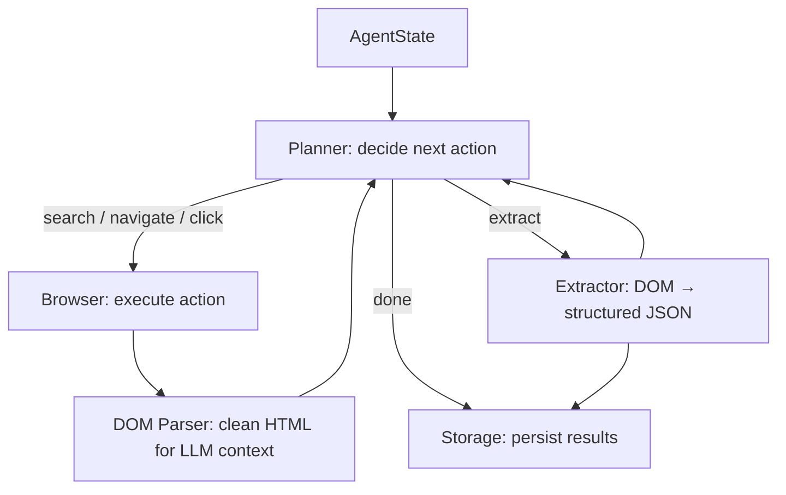

# Verboisy Architecture

Verboisy is designed as an autonomous, state-driven agent. Rather than relying on rigid, pre-programmed scraping scripts, it operates on a dynamic event loop *Plan → Act → Observe → Extract* which repeats until the planner fulfills its structural requirements or reaches a predefined resource budget (e.g., max steps, max tokens, or timeouts).

This document outlines the core loop, the module breakdown, and the underlying design philosophies that make the system resilient and extensible.

## The Core Loop

At the highest level, Verboisy's execution behaves as a finite state machine. The LLM dictates the state transitions based on the current context, while the underlying Python engine executes the side effects (browsing, parsing, and storing).

## Module Breakdown

The codebase is strictly compartmentalized by domain, ensuring that LLM logic, browser automation, and data storage do not tightly couple.

### 1. Core Logic (`core/`)
The orchestration layer that manages the lifecycle of a run.
* **`core/state.py`**: Contains `AgentState`, the single source of truth for a run. It holds the objective, the target JSON schema, action history, extracted records, and the remaining step/token budget.
* **`core/planner.py`**: The decision engine. It evaluates the `AgentState` alongside the current page context and queries the LLM (via `llm/client.py`) to select the next discrete action: `search`, `navigate`, `click`, `extract`, or `done`.
* **`core/agent.py`**: The dispatch loop that routes the planner's decisions to the appropriate browser or extraction handlers.

### 2. Browser Automation (`browser/`)
The interface between the agent and the target websites.
* **`browser/context.py`**: Manages Playwright instances and executes standard navigation or interaction commands.
* **`browser/stealth.py`**: Applies required evasions (e.g., masking WebDriver flags, spoofing user agents) before any page load to minimize bot-detection friction.
* **`browser/dom_parser.py`**: A critical preprocessing step. It strips bloated HTML into a token-efficient representation (removing scripts, styles, and boilerplate navigation) before it reaches the LLM context window. *(Note: Deterministically tested via `tests/fixtures/`)*.

### 3. Extraction Engine (`extractor/`)
The translation layer that converts unstructured DOM text into validated data.
* **`extractor/engine.py`**: Maps the cleaned DOM context against the user-provided JSON schema during an `extract` action.
* **`extractor/schema_builder.py`**: Dynamically compiles the static JSON schema into an active Pydantic model at runtime, ensuring robust validation.

### 4. Storage & Export (`storage/`)
The persistence layer designed for fault tolerance.
* **`storage/sqlite.py`**: Persists each validated Pydantic record to SQLite the exact moment it is produced.
* **`storage/exporters.py`**: Handles final formatting, transforming the SQLite records into user-friendly `.csv` or `.json` exports upon completion.

## Design Philosophy

> **Why a State Machine over a Mega-Prompt?**

Many early AI agents trap the LLM in a single, continuously expanding prompt loop. Verboisy explicitly separates execution into discrete, observable state transitions. We chose this architecture for three core reasons:

1.  **Resumability by Default:** Because state and extracted records are persisted independently at every step, a crash, network timeout, or exhausted budget does not destroy earlier progress.
2.  **Testability & Debugging:** Every state transition can be logged, audited, or replayed in isolation. If a page parse fails, you can debug `dom_parser.py` without triggering an expensive LLM call.
3.  **Provider Agnosticism:** The LLM backend is completely abstracted. The planner relies on `llm/client.py` (which wraps LiteLLM), meaning switching from OpenAI to a local Ollama model requires zero changes to the browser or extraction logic.

## Extending Verboisy

The modular design makes extending Verboisy's capabilities straightforward. Here is how to approach the most common feature additions:

* **Add a new action type** (e.g., `scroll_to_bottom`): Add the case to the planner's action `Enum` and add the corresponding execution handler in `core/agent.py`'s dispatch loop.
* **Add a new LLM provider**: Zero structural changes. `llm/client.py` utilizes LiteLLM, so as long as LiteLLM supports it, Verboisy supports it.
* **Add a new export format** (e.g., `parquet`): Add a dedicated export function inside `storage/exporters.py`. *(Keep it decoupled from the core `sqlite.py` logic.)*
