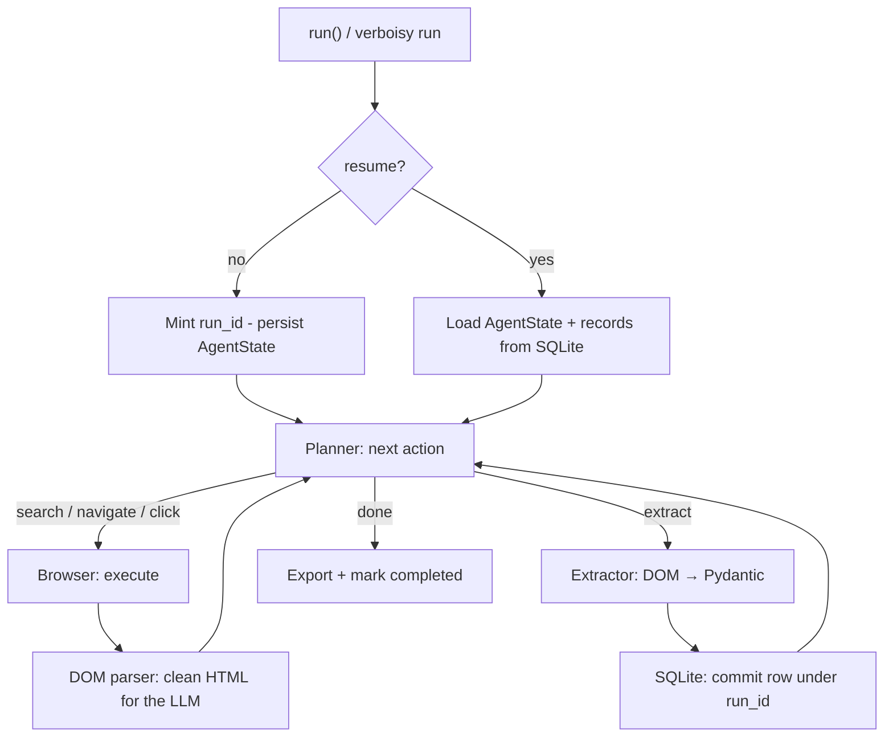

# Verboisy Architecture

Verboisy is a state-driven agent, not a selector script. A run is a loop - **plan → act → observe → extract** - until the planner has enough validated records or hits its step / token / timeout budget.

The LLM chooses the next transition. Python executes the side effects: browse, parse, validate, commit. That split is the whole design. It is why a crash does not wipe the run, why `dom_parser.py` can be tested without an API key, and why swapping OpenAI for Ollama does not touch the extractor.

This document is the map of that loop. The user-facing contract lives in [`README.md`](README.md). If the two disagree, the README is what you ship and this file is wrong.

## Public surface

Everything outside the loop is a thin wrapper around one function:

```python
from verboisy import RunResult, run

result: RunResult = run(
    goal="...",
    schema="schema.json",  # path, Path, or dict
    export="result.json",
)

result = run(resume=True)
result = run(resume=result.run_id, export="result.json")
```

```bash
verboisy run --goal "..." --schema schema.json --export result.json
verboisy run --resume
verboisy run --resume 7f3a2c1b --export result.json
```

The CLI in `cli.py` parses flags and calls `run()`. `run()` lives in `api.py` (re-exported from `verboisy/__init__.py`). It owns: create-or-restore `AgentState`, run the dispatch loop, return `RunResult`.

| `RunResult` field | Meaning |
| --- | --- |
| `run_id` | Stable id in SQLite. Pass it to `run(resume=...)`. |
| `records` | Every validated row for this run so far. |
| `export_path` | Where the export was written, if asked and the run finished. |
| `db_path` | The SQLite file used. |
| `completed` | `True` only when the planner chose `done`, not when the process died. |

Rules `run()` must enforce:

- New run: `goal` and `schema` required; `resume` omitted or `False`.
- Resume: `resume=True` (latest incomplete) or `resume="<id>"`; saved goal/schema win.
- Nothing to resume → raise / exit non-zero, naming `SQLITE_DB_PATH`.
- `headless=None` reads `VERBOISY_HEADLESS`.

## The core loop

A run is a finite state machine. `AgentState` is the only mutable object the loop trusts.



On `extract`, the row is validated **then** committed, then the planner is called again. Saving is not a final step. `done` is.

Budget is part of state, not a hope. If max steps, max tokens, or a page timeout fires, the run stops, `completed` stays `False`, and `--resume` can continue it.

## Module breakdown

LLM calls, Playwright, and SQLite do not import each other. They meet only in `core/agent.py`.

```text
verboisy/
  __init__.py          RunResult, run
  api.py               run() - create/restore state, drive the loop, return
  cli.py               argparse/typer wrapper around run()
  core/
    state.py           AgentState
    planner.py         next action
    agent.py           dispatch loop
  browser/
    context.py         Playwright session
    stealth.py         browser defaults that look like a real client
    dom_parser.py      HTML → token-cheap page context
  extractor/
    engine.py          cleaned DOM + schema → candidate rows
    schema_builder.py  JSON Schema → Pydantic model
  storage/
    sqlite.py          runs + records
    exporters.py       SQLite → .json / .csv
  llm/
    client.py          LiteLLM wrapper
  utils/
    config.py          Pydantic settings from env
```

### `core/` - orchestration

- **`state.py` - `AgentState`.** Source of truth for one `run_id`: goal, JSON Schema, compiled Pydantic model, action history, extracted records, remaining step/token budget, `completed`, optional export path. Serialize this (minus the live Pydantic class, which is rebuilt from the stored schema) and you can resume.
- **`planner.py`.** Reads `AgentState` plus the current cleaned DOM. Calls `llm/client.py`. Returns one action: `search`, `navigate`, `click`, `extract`, or `done`. It does not touch the browser.
- **`agent.py`.** The `while` loop. Routes the action to browser or extractor, updates state, stops on `done` or exhausted budget.

### `browser/` - the page

- **`context.py`.** Playwright Chromium: navigate, click, type, wait. Headless from config or `run(headless=...)`.
- **`stealth.py`.** Applied once per browser context, before the first navigation. Masks obvious automation signals (`navigator.webdriver`, default UA). This is not a bypass product; it is why a public directory does not 403 on the first request. Keep the details here, not in the README.
- **`dom_parser.py`.** Strips scripts, styles, and boilerplate into a representation that fits an LLM context window. Deterministic. Tested against `tests/fixtures/` with no LLM in the loop. If a parse is wrong, fix this file, do not "prompt harder".

### `extractor/` - DOM to rows

- **`schema_builder.py`.** JSON Schema (file or dict) → Pydantic model, at runtime. The top level is an `array` of record `object`s.
- **`engine.py`.** On `extract`, maps the cleaned DOM through the model. Invalid rows never reach SQLite. Valid rows go to `storage/sqlite.py` immediately, then back into `AgentState.records` so the planner can see what it already has.

### `storage/` - fault tolerance

- **`sqlite.py`.** Two tables, one file (`SQLITE_DB_PATH`, default `verboisy.db`):

  | Table | Role |
  | --- | --- |
  | `runs` | `run_id`, goal, schema JSON, status (`running` / `completed` / `failed`), step count, timestamps, optional export path |
  | `records` | `run_id`, validated JSON payload, inserted_at, optional content hash |

  A row is `INSERT`ed as soon as it validates. That commit is the resume checkpoint. Dedup on `(run_id, hash)` so `--resume` cannot double-write the same record.

- **`exporters.py`.** Reads records for a `run_id` and writes `.json` or `.csv`. Called when the planner returns `done`, not on every extract. Keep this decoupled from `sqlite.py`.

`--resume` / `run(resume=...)` is a load, not a new feature: `SELECT` the run, rebuild `AgentState`, skip hashes already stored, continue the loop.

### `llm/` - the only model boundary

- **`client.py`.** LiteLLM. Planner and extractor both call this. Provider, model, `MAX_TOKENS`, and `TEMPERATURE` come from `utils/config.py`. OpenAI → Anthropic → `ollama/llama3` is an env var, not a refactor.

### `utils/` - config

- **`config.py`.** Pydantic settings. Matches the table in the README. No second source of defaults.

## Design philosophy

> Why a state machine instead of one mega-prompt?

A single expanding prompt is simpler to demo and worse at everything else.

1. **Resumability is a commit, not a flag.** `--resume` only works because every validated row is already on disk. The flag reloads state. The architecture made the flag cheap.
2. **Testability without tokens.** `dom_parser.py`, `schema_builder.py`, and `exporters.py` are pure. Fixture in, structure out. Keep LLM calls behind `llm/client.py` so unit tests do not need a key.
3. **Provider agnosticism.** Browser and storage must not import an SDK. If they do, the LiteLLM story is fake.
4. **Schema is a gate, not a hint.** Pydantic failure means the row does not exist. The planner may retry extract; storage never sees the miss.

## Extending

| You want | You change |
| --- | --- |
| A new action (`scroll`, `type`, `wait`) | Action enum in `planner.py` + handler in `agent.py`. If it needs the page, add a method on `browser/context.py`. |
| A new LLM provider | Nothing, if LiteLLM supports the model string. If it does not, wrap it in `llm/client.py` only. |
| A new export (`parquet`, `ndjson`) | One function in `storage/exporters.py`. Detect by suffix in `run(export=...)`. |
| A new planner signal (e.g. current URL) | Field on `AgentState`, filled by `agent.py` after the browser acts. Do not sneak it into the prompt from `context.py`. |
| Dedup / crawl budget tweaks | `storage/sqlite.py` hashes and the budget fields on `AgentState`. |

Do not add a second persistence path. If it is a record, it goes through SQLite first.

## What this is not

- Not a hosted job queue. `run_id` lives in a local file.
- Not a scheduler. `--resume` is for crashes and rate limits.
- Not a general computer-use agent. The action set is browsing plus extract. Filesystem, email, and OS control are out of scope.
- Not vision-first. The planner sees cleaned DOM, not screenshots. Adding screenshots is a new observation channel, not a one-line change.

Pre-1.0: module paths can move; the loop, the commit-before-continue rule, and `run()` as the only public entrypoint should not.
