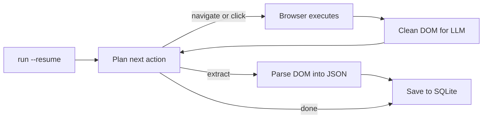

<a id="readme-top"></a>
<p align="center">
  
</p>
<p align="center">
  <strong>An autonomous web research and structured scrape-to-JSON agent.</strong>
  <br />
  Give it a goal in plain English and a JSON Schema. It plans its own navigation, reads the page, and hands back validated, structured data.
</p>

<p align="center">
  <a href="https://github.com/EmanueleTorrisi/verboisy/actions/workflows/ci.yml"></a>
  <a href="https://codecov.io/gh/EmanueleTorrisi/verboisy"></a>
  <a href="https://emanueletorrisi.github.io/verboisy/"></a>
  <a href="#installation"></a>
  <!--<a href="https://pypi.org/project/verboisy/"></a>-->
  
  <a href="LICENSE"></a>
  <a href="https://github.com/astral-sh/ruff"></a>
</p>

<p align="center">
  <em>v0.1.0 | pre-1.0 and actively developed. Expect breaking changes between minor versions until 1.0.</em>
</p>

<p align="center">
  <strong title="English" aria-label="English">🇬🇧</strong> ·
  <a href=".github/readme/README.it.md" title="Italiano" aria-label="Italiano">🇮🇹</a> ·
  <a href=".github/readme/README.de.md" title="Deutsch" aria-label="Deutsch">🇩🇪</a> ·
  <a href=".github/readme/README.zh-CN.md" title="简体中文" aria-label="简体中文">🇨🇳</a> ·
  <a href=".github/readme/README.fr.md" title="Français" aria-label="Français">🇫🇷</a> ·
  <a href=".github/readme/README.es.md" title="Español" aria-label="Español">🇪🇸</a> ·
  <a href=".github/readme/README.ko.md" title="한국어" aria-label="한국어">🇰🇷</a> ·
  <a href=".github/readme/README.ja.md" title="日本語" aria-label="日本語">🇯🇵</a>
</p>

## Table of Contents

- [Demo](#demo)
- [Why Verboisy](#why-verboisy)
- [Compared to](#compared-to)
- [Quick Example](#quick-example)
- [Use Cases](#use-cases)
- [How It Works](#how-it-works)
- [Installation](#installation)
- [Configuration](#configuration)
- [Usage](#usage)
- [Docker](#docker)
- [Known Limitations](#known-limitations)
- [Responsible Use](#responsible-use)
- [Documentation](#documentation)
- [Contributing](#contributing)
- [Security](#security)
- [License](#license)

## Demo

<p align="center">
  
</p>

## Why Verboisy

- **Goal-driven, not selector-driven.** Describe the objective in plain English. The planner decides the next click, scroll, or read from the page actually in front of it. Nothing hardcoded to rewrite when a site redesigns.
- **Schema-first, not best-effort.** Every record is checked against a Pydantic model built from your JSON Schema before it's saved. Malformed data never reaches your database.
- **Bring your own model, keep your own infrastructure.** OpenAI, Anthropic, or a local Ollama model via [LiteLLM](https://github.com/BerriAI/litellm): one environment variable to switch. Runs on your machine or your servers, not a hosted black box.
- **Resumable by construction.** Every record lands in SQLite the moment it validates. `verboisy run --resume` (or `run(resume=True)` in Python) picks up the latest incomplete run. A crash costs you the current step, not the work already saved.

What ships around that loop: async Playwright (Chromium, headed or headless), DOM cleaning tuned for LLM context windows instead of raw HTML dumps, and JSON or CSV export - or query the SQLite database directly.

## Compared to

Verboisy is the overlap of an autonomous browser agent and a schema-validated extractor. Nearby tools cover one of those well; this is built for both.

| | Verboisy | [Browser Use](https://github.com/browser-use/browser-use) | [Firecrawl](https://github.com/firecrawl/firecrawl) | [Crawl4AI](https://github.com/unclecode/crawl4ai) |
| --- | --- | --- | --- | --- |
| You describe | a goal **and** a JSON Schema | a goal | a URL + prompt or schema | crawl rules + a prompt |
| Navigation | planner chooses clicks | planner chooses clicks | crawl / sitemap | crawl |
| Validation | Pydantic from your schema, before write | your code | optional extract schema | your code |
| Persistence | SQLite per record, `--resume` | in-memory / your code | API or your DB | your code |
| Where it runs | your machine | your machine | hosted or self-host | your machine |

If you already know the URL and only need markdown out, Firecrawl or Crawl4AI are simpler. If you need a general computer-use agent and will validate later, Browser Use is a better fit. If the output has to be rows that match a schema, and the agent has to find them, that's Verboisy.

## Quick Example

The schema is JSON Schema. For a list of records, the top level is an `"array"` whose `"items"` are the object shape of one row:

```json
{
  "type": "array",
  "items": {
    "type": "object",
    "properties": {
      "name": { "type": "string" },
      "website": { "type": "string" },
      "description": { "type": "string" },
      "batch": { "type": "string" }
    },
    "required": ["name", "website"]
  }
}
```

Verboisy builds a Pydantic model from that at runtime and rejects rows that don't match before they hit SQLite.

CLI:

```bash
verboisy run \
  --goal "Find AI startups from the Y Combinator Fall 2026 (F26) batch" \
  --schema examples/yc_startups/schema.json \
  --export result.json
```

Same run from Python:

```python
from verboisy import run

result = run(
    goal="Find AI startups from the Y Combinator Fall 2026 (F26) batch",
    schema="examples/yc_startups/schema.json",
    export="result.json",
)

print(result.run_id, len(result.records))
for row in result.records:
    print(row["name"], row["website"])
```

Either form produces this:

```json
[
  {
    "name": "Marrow",
    "website": "https://marrow.example.com",
    "description": "Staging environments for production AI agents.",
    "batch": "F26"
  },
  {
    "name": "Kiln Trace",
    "website": "https://kilntrace.example.com",
    "description": "Latency and cost debugging for agent workflows.",
    "batch": "F26"
  }
]
```

*(Illustrative output: real results depend on what's live on the page at run time. Example names use `.example.com` on purpose.)*

If the process dies mid-run, pick it up without redoing saved rows:

```bash
verboisy run --resume
```

```python
result = run(resume=True)
```

## Use Cases

Verboisy is built for research patterns worth running more than once:

- **Competitive & market intelligence:** track competitor pricing, product pages, and announcements on a schedule instead of checking by hand.
- **B2B lead research:** turn a list of company names into structured firmographic and tech-stack records, ready for CRM import.
- **E-commerce & retail monitoring:** watch catalog and price changes across JavaScript-heavy storefronts.
- **Research operations (ResOps):** run the same query pattern across hundreds of entities on a recurring schedule.
- **RAG / knowledge-base ingestion:** feed a retrieval pipeline with structured, sourced records instead of hand-curated context.

Each of these is the same goal-plus-schema pattern as the Quick Example above, just pointed at a different site and a different shape.

## How It Works

Verboisy runs one core loop **plan → act → observe → extract** until the planner decides it has enough data or hits its step budget.



Every extracted record is committed to SQLite the moment it validates, under a `run_id`. Interrupt the loop at any point - a rate limit, a crash, a killed process - then `verboisy run --resume` (or `run(resume=True)`) reloads that run's goal, schema, and saved rows and continues. `--resume <id>` targets a specific run; `--resume` with no id takes the latest incomplete one.

`--export` is written when the run finishes (or when a resumed run finishes). Partial results live in `SQLITE_DB_PATH` in the meantime.

Full breakdown of each module in [`ARCHITECTURE.md`](ARCHITECTURE.md).

## Installation

Requires Python 3.11+.

Not on PyPI yet. Install from source:

```bash
git clone https://github.com/EmanueleTorrisi/verboisy.git
cd verboisy && pip install -e .
playwright install --with-deps chromium
```

Once the first release ships, this will be:

```bash
pip install verboisy
playwright install --with-deps chromium
```

## Configuration

Copy `.env.example` to `.env`. All settings load through Pydantic in `utils/config.py`; anything you don't set falls back to the defaults below.

```bash
# Required: at least one LLM provider
OPENAI_API_KEY=sk-your-api-key-here
# ANTHROPIC_API_KEY=sk-ant-your-api-key-here

# LiteLLM model routing (e.g. gpt-4o, claude-sonnet-5, ollama/llama3)
LITELLM_MODEL=gpt-4o

SQLITE_DB_PATH=verboisy.db
VERBOISY_LOG_LEVEL=INFO
VERBOISY_HEADLESS=true
```

| Variable | Default | Description |
| --- | --- | --- |
| `OPENAI_API_KEY` | - | OpenAI credentials. Required unless using Anthropic or a local model. |
| `ANTHROPIC_API_KEY` | - | Anthropic credentials, used instead of OpenAI. |
| `LITELLM_MODEL` | `gpt-4o` | Any [LiteLLM](https://github.com/BerriAI/litellm)-supported model string. |
| `MAX_TOKENS` | `4096` | Max tokens per planner or extraction call. |
| `TEMPERATURE` | `0.0` | Sampling temperature for the planner. |
| `VERBOISY_HEADLESS` | `true` | Run Chromium headless. Set `false` to watch the browser. |
| `BROWSER_TIMEOUT_MS` | `30000` | Navigation timeout per page, in ms. |
| `USER_AGENT_ROTATION` | `true` | Rotate user agents between requests. |
| `SQLITE_DB_PATH` | `verboisy.db` | Where runs and extracted records are persisted. |
| `VERBOISY_LOG_LEVEL` | `INFO` | Standard Python logging level. `DEBUG` prints every planner step. |

You pay the LLM provider directly. Planner and extraction calls are capped at `MAX_TOKENS` (default 4096) with `TEMPERATURE` 0.0. A directory-sized goal is typically tens of calls, not hundreds. There is no hosted meter.

## Usage

### CLI

```bash
verboisy run \
  --goal "Find AI startups from the Y Combinator Fall 2026 (F26) batch" \
  --schema examples/yc_startups/schema.json \
  --export result.json
```

The command prints a `run_id` (also stored in SQLite). Use it to resume later.

| Flag | Alias | Required | Description |
| --- | --- | --- | --- |
| `--goal` | `-g` | Yes, unless `--resume` | Plain-English description of what to find and where. Be specific. |
| `--schema` | `-s` | Yes, unless `--resume` | Path to a JSON Schema describing the fields to extract. Top-level `array` of record `object`s. |
| `--export` | `-e` | No | Output path. Supports `.json` and `.csv`. Written when the run finishes. |
| `--resume` | `-r` | No | Resume a run. Bare `--resume` continues the latest incomplete run in `SQLITE_DB_PATH`. `--resume <id>` continues that run. Goal and schema are loaded from the saved run; `--export` / headedness can still be overridden. |

Run `verboisy run --help` for the full flag reference.

### Resume

```bash
# Latest incomplete run in verboisy.db
verboisy run --resume

# A specific run
verboisy run --resume 7f3a2c1b --export result.json
```

Already-validated rows are not extracted again. If there is no incomplete run, the command exits non-zero with an error naming the database it looked in.

### Python

`run()` is the public API. The CLI is a thin wrapper around it.

```python
from pathlib import Path
from verboisy import RunResult, run

result: RunResult = run(
    goal="Find AI startups from the Y Combinator Fall 2026 (F26) batch",
    schema="examples/yc_startups/schema.json",  # path, Path, or dict
    export="result.json",
)

print(result.run_id)
print(result.records[0]["name"])
```

Schema as a dict, no file required:

```python
result = run(
    goal="Find AI startups from the Y Combinator Fall 2026 (F26) batch",
    schema={
        "type": "array",
        "items": {
            "type": "object",
            "properties": {
                "name": {"type": "string"},
                "website": {"type": "string"},
                "description": {"type": "string"},
                "batch": {"type": "string"},
            },
            "required": ["name", "website"],
        },
    },
)
```

Resume:

```python
from verboisy import run

# Latest incomplete run
result = run(resume=True)

# Specific run, write the export when it finishes
result = run(resume=result.run_id, export="result.json")
```

Signature:

```python
def run(
    *,
    goal: str | None = None,
    schema: str | Path | dict | None = None,
    export: str | Path | None = None,
    resume: bool | str = False,
    headless: bool | None = None,
) -> RunResult: ...
```

`RunResult` fields:

| Field | Type | Meaning |
| --- | --- | --- |
| `run_id` | `str` | Stable id stored in SQLite. Pass it to `run(resume=...)`. |
| `records` | `list[dict]` | Every validated row for this run so far. |
| `export_path` | `Path \| None` | Where the export was written, if `--export` / `export=` was set and the run finished. |
| `db_path` | `Path` | The SQLite file used. |
| `completed` | `bool` | `True` when the planner stopped because it was done, not because it crashed. |

Rules:

- New run: `goal` and `schema` are required; `resume` is omitted or `False`.
- Resume: `resume=True` or `resume="<id>"`; `goal` / `schema` are optional and ignored if the run already has them.
- `headless=None` uses `VERBOISY_HEADLESS`. Pass `True` / `False` to override for this call.

### Watching a run

```bash
VERBOISY_HEADLESS=false VERBOISY_LOG_LEVEL=DEBUG \
  verboisy run \
    --goal "Find AI startups from the Y Combinator Fall 2026 (F26) batch" \
    --schema examples/yc_startups/schema.json \
    --export result.json
```

## Docker

```bash
docker compose -f docker/docker-compose.yml up -d --build
docker compose -f docker/docker-compose.yml exec verboisy verboisy run \
  --goal "Find AI startups from the Y Combinator Fall 2026 (F26) batch" \
  --schema examples/yc_startups/schema.json \
  --export result.json
```

The container starts and stays running, with Playwright's browser dependencies already installed, so commands run via `exec` rather than as the container's entrypoint. Mount or persist `SQLITE_DB_PATH` if you want `--resume` to work across container restarts. `OPENAI_API_KEY` is passed through from your shell automatically: export it first. To pass through other variables (`ANTHROPIC_API_KEY`, `LITELLM_MODEL`, etc.), either export those too or swap the `environment:` list in `docker/docker-compose.yml` for `env_file: [../.env]`.

## Known Limitations

Beta software, and upfront about it:

- **No accounts or hosted job history:** single-user. Run ids live in the local SQLite file, not a dashboard.
- **No scheduling:** trigger runs manually or wire them into your own cron or orchestrator. `--resume` is for crashes and rate limits, not a scheduler.
- **No hosted HTTP API:** the CLI, `verboisy.run()`, and the Docker image are the interfaces right now.
- **Inconsistent on aggressively anti-bot sites:** some targets will need retries or manual intervention.

Hit one of these that blocks your use case? [Open an issue](https://github.com/EmanueleTorrisi/verboisy/issues): it's the most direct way to influence what gets fixed first.

## Responsible Use

Verboisy drives a real browser on your behalf. You are responsible for complying with each target site's terms of service, `robots.txt`, rate limits, and the law in your jurisdiction. Do not use it to bypass authentication or access controls you do not have.

## Documentation

Full docs, including the complete configuration reference and API details, are published at **[emanueletorrisi.github.io/verboisy](https://emanueletorrisi.github.io/verboisy/)**.

## Contributing

Contributions are welcome. See [`CONTRIBUTING.md`](.github/CONTRIBUTING.md) for local setup and coding conventions, and please follow the [Code of Conduct](.github/CODE_OF_CONDUCT.md). Looking for a place to start? Check issues tagged [`good first issue`](https://github.com/EmanueleTorrisi/verboisy/labels/good%20first%20issue).

## Security

Found a vulnerability? Please don't open a public issue: use [private vulnerability reporting](https://github.com/EmanueleTorrisi/verboisy/security/advisories/new) or see [`SECURITY.md`](.github/SECURITY.md).

## License

BSD 2-Clause: see [`LICENSE`](LICENSE) for the full text.

---

<p align="center">
  Built by <a href="https://github.com/EmanueleTorrisi">Emanuele Torrisi</a> · <a href="#readme-top">Back to top ↑</a>
</p>
