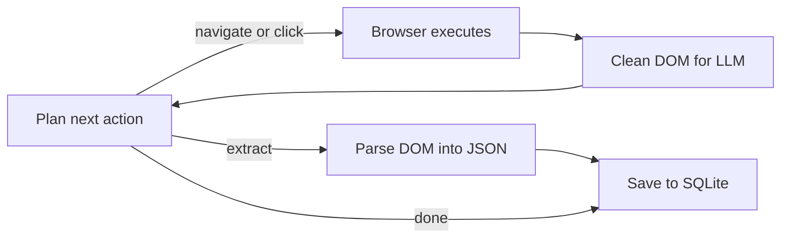

<a id="readme-top"></a>
<p align="center">
  
</p>
<p align="center">
  <strong>An autonomous web research and structured scrape-to-JSON agent.</strong>
  <br />
  Give it a goal in plain English and a JSON schema — it plans its own navigation, reads the page, and hands back validated, structured data.
</p>

<p align="center">
  <a href="https://github.com/EmanueleTorrisi/verboisy/actions/workflows/ci.yml"></a>
  <a href="https://codecov.io/gh/EmanueleTorrisi/verboisy"></a>
  <a href="https://emanueletorrisi.github.io/verboisy/"></a>
  <a href="https://pypi.org/project/verboisy/"></a>
  
  <a href="LICENSE"></a>
  <a href="https://github.com/astral-sh/ruff"></a>
</p>

<p align="center">
  <em>v0.1.0 — pre-1.0 and actively developed. Expect breaking changes between minor versions until 1.0.</em>
</p>

<p align="center">
  <strong title="English" aria-label="English">🇬🇧</strong> ·
  <a href=".github/readme/README.it.md" title="Italiano" aria-label="Italiano">🇮🇹</a> ·
  <a href=".github/readme/README.de.md" title="Deutsch" aria-label="Deutsch">🇩🇪</a> ·
  <a href=".github/readme/README.zh-CN.md" title="简体中文" aria-label="简体中文">🇨🇳</a> ·
  <a href=".github/readme/README.fr.md" title="Français" aria-label="Français">🇫🇷</a> ·
  <a href=".github/readme/README.es.md" title="Español" aria-label="Español">🇪🇸</a> ·
  <a href=".github/readme/README.ko.md" title="한국어" aria-label="한국어">🇰🇷</a> ·
  <a href=".github/readme/README.ja.md" title="日本語" aria-label="日本語">🇯🇵</a>
</p>

## Table of Contents

-  [Features](#features)
-  [Quick Example](#quick-example)
-  [How It Works](#how-it-works)
-  [Installation](#installation)
-  [Configuration](#configuration)
-  [Usage](#usage)
-  [Docker](#docker)
-  [Documentation](#documentation)
-  [Contributing](#contributing)
-  [Security](#security)
-  [License](#license)

## Features

- **Autonomous browsing** — give it a goal in plain English; it plans its own navigation instead of following a fixed selector script.
- **Schema-first extraction** — describe the shape you want as a JSON Schema; Verboisy builds a Pydantic model from it at runtime and validates every record before it's saved.
- **Any LLM you want** — OpenAI, Anthropic, or a local Ollama model, via [LiteLLM](https://github.com/BerriAI/litellm). Swap providers with one environment variable.
- **Built for real pages** — async Playwright with stealth evasions, plus DOM cleaning tuned for LLM context windows instead of raw HTML dumps.
- **Resumable by default** — every extracted record is written to SQLite as it's found, so a crashed run doesn't lose earlier progress.
- **Export anywhere** — JSON or CSV out of the box, or query the SQLite database directly.

## Quick Example

<!-- TODO: swap in an asciinema or GIF recording of `verboisy run` here — it's the single highest-leverage thing missing from this README. -->

Given a schema like this:

```json
{
  "type": "array",
  "items": {
    "type": "object",
    "properties": {
      "name": { "type": "string" },
      "website": { "type": "string" },
      "description": { "type": "string" },
      "batch": { "type": "string" }
    },
    "required": ["name", "website"]
  }
}
```

...this command:

```bash
verboisy run \
  --goal "Find the latest AI startups from YCombinator W24" \
  --schema examples/yc_startups/schema.json \
  --export result.json
```

...produces this:

```json
[
  {
    "name": "Aurora Labs",
    "website": "https://aurora-labs.example.com",
    "description": "Battery diagnostics for EV fleets.",
    "batch": "W24"
  },
  {
    "name": "Fernbank",
    "website": "https://fernbank.example.com",
    "description": "Automated bookkeeping for small farms.",
    "batch": "W24"
  }
]
```

*(Illustrative output — real results depend on what's live on the page at run time.)*

## How It Works

Verboisy runs one core loop — plan → act → extract — until the planner decides it has enough data or hits its step budget.



Full breakdown of each module in [`ARCHITECTURE.md`](ARCHITECTURE.md).

## Installation

Requires Python 3.11+.

```bash
pip install verboisy
playwright install --with-deps chromium
```

> Not on PyPI yet? Install from source until the first release ships:
> ```bash
> git clone https://github.com/EmanueleTorrisi/verboisy.git
> cd verboisy && pip install -e .
> playwright install --with-deps chromium
> ```

## Configuration

Copy `.env.example` to `.env`. All settings load through Pydantic in `utils/config.py`; anything you don't set falls back to the defaults below.

```bash
# Required — at least one LLM provider
OPENAI_API_KEY=sk-your-api-key-here
# ANTHROPIC_API_KEY=sk-ant-your-api-key-here

# LiteLLM model routing (e.g. gpt-4o, claude-sonnet-5, ollama/llama3)
LITELLM_MODEL=gpt-4o

SQLITE_DB_PATH=verboisy_runs.db
VERBOISY_LOG_LEVEL=INFO
VERBOISY_HEADLESS=True
```

| Variable | Default | Description |
|---|---|---|
| `OPENAI_API_KEY` | — | OpenAI credentials. Required unless using Anthropic. |
| `ANTHROPIC_API_KEY` | — | Anthropic credentials, used instead of OpenAI. |
| `LITELLM_MODEL` | `gpt-4o` | Any [LiteLLM](https://github.com/BerriAI/litellm)-supported model string. |
| `MAX_TOKENS` | `4096` | Max tokens per planner/extraction call. |
| `TEMPERATURE` | `0.0` | Sampling temperature for the planner. |
| `VERBOISY_HEADLESS`¹ | `true` | Run Chromium headless. |
| `BROWSER_TIMEOUT_MS` | `30000` | Navigation timeout per page, in ms. |
| `USER_AGENT_ROTATION` | `true` | Rotate user agents between requests. |
| `SQLITE_DB_PATH` | `verboisy.db` | Where extracted records are persisted. |
| `VERBOISY_LOG_LEVEL`¹ | `INFO` | Standard Python logging level. |

¹ Not wired up yet — see below.

## Usage

```bash
verboisy run \
  --goal "Find the latest AI startups from YCombinator W24" \
  --schema examples/yc_startups/schema.json \
  --export result.json
```

| Flag | Alias | Required | Description |
|---|---|---|---|
| `--goal` | `-g` | Yes | Plain-English description of what to find and where. Be specific. |
| `--schema` | `-s` | Yes | Path to a JSON schema describing the fields to extract. |
| `--export` | `-e` | No | Output path. Supports `.json` and `.csv`. |

Run `verboisy run --help` for the full flag reference.

## Docker

```bash
docker compose -f docker/docker-compose.yml up -d --build
docker compose -f docker/docker-compose.yml exec verboisy verboisy run \
  --goal "Find the latest AI startups from YCombinator W24" \
  --schema examples/yc_startups/schema.json \
  --export result.json
```

The container starts and stays running, with Playwright's browser dependencies already installed, so commands run via `exec` rather than as the container's entrypoint. `OPENAI_API_KEY` is passed through from your shell automatically — export it first. To pass through other variables (`ANTHROPIC_API_KEY`, `LITELLM_MODEL`, etc.), either export those too or swap the `environment:` list in `docker/docker-compose.yml` for `env_file: [../.env]`.

## Documentation

Full docs — including the complete configuration reference and API details — are published at **[emanueletorrisi.github.io/verboisy](https://emanueletorrisi.github.io/verboisy/)**.

## Contributing

Contributions are welcome. See [`CONTRIBUTING.md`](CONTRIBUTING.md) for local setup and coding conventions, and please follow the [Code of Conduct](CODE_OF_CONDUCT.md). Looking for a place to start? Check issues tagged [`good first issue`](https://github.com/EmanueleTorrisi/verboisy/labels/good%20first%20issue).

## Security

Found a vulnerability? Please don't open a public issue — use [private vulnerability reporting](https://github.com/EmanueleTorrisi/verboisy/security/advisories/new) or see [`SECURITY.md`](SECURITY.md).

## License

BSD 2-Clause — see [`LICENSE`](LICENSE) for the full text.

---

<p align="center">
  Built by <a href="https://github.com/EmanueleTorrisi">Emanuele Torrisi</a> · <a href="#readme-top">Back to top ↑</a>
</p>
