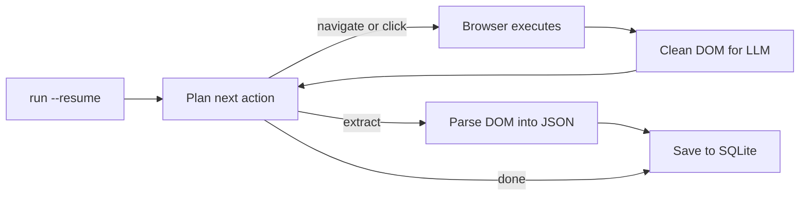

<a id="readme-top"></a>
<p align="center">
  
</p>
<p align="center">
  <strong>An autonomous web research and structured scrape-to-JSON agent.</strong>
  <br />
  Give it a goal in plain English and a JSON Schema. It plans its own navigation, reads the page, and hands back validated, structured data.
</p>

<p align="center">
  <a href="https://github.com/EmanueleTorrisi/verboisy/actions/workflows/ci.yml"></a>
  <a href="https://codecov.io/gh/EmanueleTorrisi/verboisy"></a>
  <a href="https://emanueletorrisi.github.io/verboisy/"></a>
  <a href="#installation"></a>
  <!--<a href="https://pypi.org/project/verboisy/"></a>-->
  
  <a href="LICENSE"></a>
  <a href="https://github.com/astral-sh/ruff"></a>
</p>

<p align="center">
  <em>v0.1.0 | pre-1.0 and actively developed. Expect breaking changes between minor versions until 1.0.</em>
</p>

<p align="center">
  <strong title="English" aria-label="English">🇬🇧</strong> ·
  <a href=".github/readme/README.it.md" title="Italiano" aria-label="Italiano">🇮🇹</a> ·
  <a href=".github/readme/README.de.md" title="Deutsch" aria-label="Deutsch">🇩🇪</a> ·
  <a href=".github/readme/README.zh-CN.md" title="简体中文" aria-label="简体中文">🇨🇳</a> ·
  <a href=".github/readme/README.fr.md" title="Français" aria-label="Français">🇫🇷</a> ·
  <a href=".github/readme/README.es.md" title="Español" aria-label="Español">🇪🇸</a> ·
  <a href=".github/readme/README.ko.md" title="한국어" aria-label="한국어">🇰🇷</a> ·
  <a href=".github/readme/README.ja.md" title="日本語" aria-label="日本語">🇯🇵</a>
</p>

## Table of Contents

- [Demo](#demo)
- [Why Verboisy](#why-verboisy)
- [Compared to](#compared-to)
- [Quick Example](#quick-example)
- [Use Cases](#use-cases)
- [How It Works](#how-it-works)
- [Installation](#installation)
- [Configuration](#configuration)
- [Usage](#usage)
- [Docker](#docker)
- [Known Limitations](#known-limitations)
- [Responsible Use](#responsible-use)
- [Documentation](#documentation)
- [Contributing](#contributing)
- [Security](#security)
- [License](#license)

## Demo

The [historical animation](docs/demo.gif) is illustrative and does not verify the product.
The supplied recording predates the implementation of resume. Use the
[authentic live-demo workflow](docs/demo.md) to record actual browser, model, SQLite,
interruption and export behavior. A replacement live recording remains an acceptance gate.

This revision includes executable offline regressions and a required Chromium integration
check. Read [validation and release checks](docs/validation.md) before deployment;
it is not a claim of production readiness.

## Why Verboisy

- **Goal-driven, not selector-driven.** Describe the objective in plain English. The planner decides the next click, scroll, or read from the page actually in front of it. The model attempts to adapt to the observed DOM; redesigns can still break a run.
- **Schema-first, not best-effort.** Every record is checked against your JSON Schema, then wrapped in a Pydantic model before it is saved. Validation checks structure and constraints; it does not prove factual accuracy.
- **Bring your own model, keep your own infrastructure.** OpenAI, Anthropic, or a local Ollama model via [LiteLLM](https://github.com/BerriAI/litellm): one environment variable to switch. Runs on your machine or your servers, not a hosted black box.
- **Resumable by construction.** Each validated record is committed to SQLite before processing the next candidate. `verboisy run --resume` (or `run(resume=True)` in Python) picks up the latest incomplete run. Earlier commits survive an interrupted step. Resume restores saved progress and the last checkpointed URL; browser session state is not restored.

What ships around that loop: async Playwright (Chromium, headed or headless), DOM cleaning tuned for LLM context windows instead of raw HTML dumps, and JSON or CSV export - or query the SQLite database directly.

## Compared to

Verboisy is the overlap of an autonomous browser agent and a schema-validated extractor. Nearby tools cover one of those well; this is built for both.

| | Verboisy | [Browser Use](https://github.com/browser-use/browser-use) | [Firecrawl](https://github.com/firecrawl/firecrawl) | [Crawl4AI](https://github.com/unclecode/crawl4ai) |
| --- | --- | --- | --- | --- |
| You describe | a goal **and** a JSON Schema | a goal | a URL + prompt or schema | crawl rules + a prompt |
| Navigation | planner chooses clicks | planner chooses clicks | crawl / sitemap | crawl |
| Validation | JSON Schema + Pydantic, before write | your code | optional extract schema | your code |
| Persistence | SQLite per record, `--resume` | in-memory / your code | API or your DB | your code |
| Where it runs | your machine | your machine | hosted or self-host | your machine |

If you already know the URL and only need markdown out, Firecrawl or Crawl4AI are simpler. If you need a general computer-use agent and will validate later, Browser Use is a better fit. If the output has to be rows that match a schema, and the agent has to find them, that's Verboisy.

## Quick Example

The schema is JSON Schema. For a list of records, the top level is an `"array"` whose `"items"` are the object shape of one row:

```json
{
  "type": "array",
  "items": {
    "type": "object",
    "properties": {
      "name": { "type": "string" },
      "website": { "type": "string" },
      "description": { "type": "string" },
      "batch": { "type": "string" }
    },
    "required": ["name", "website"]
  }
}
```

Verboisy builds a Pydantic model from that at runtime and rejects rows that don't match before they hit SQLite.

CLI:

For general discovery, configure `SEARCH_PROVIDER=brave` and `BRAVE_SEARCH_API_KEY`;
see [search and recovery](docs/search-and-recovery.md). The compatibility default,
`google`, uses browser search and can be blocked by Google.

```bash
verboisy run \
  --goal "Find AI startups from the Y Combinator Fall 2026 (F26) batch" \
  --schema examples/yc_startups/schema.json \
  --export result.json
```

Same run from Python:

```python
from verboisy import run

result = run(
    goal="Find AI startups from the Y Combinator Fall 2026 (F26) batch",
    schema="examples/yc_startups/schema.json",
    export="result.json",
)

print(result.run_id, len(result.records))
for row in result.records:
    print(row["name"], row["website"])
```

A possible illustrative output shape is:

```json
[
  {
    "name": "Marrow",
    "website": "https://marrow.example.com",
    "description": "Staging environments for production AI agents.",
    "batch": "F26"
  },
  {
    "name": "Kiln Trace",
    "website": "https://kilntrace.example.com",
    "description": "Latency and cost debugging for agent workflows.",
    "batch": "F26"
  }
]
```

*(Illustrative output: real results depend on what's live on the page at run time. Example names use `.example.com` on purpose.)*

If the process dies mid-run, pick it up without redoing saved rows:

```bash
verboisy run --resume
```

```python
result = run(resume=True)
```

## Use Cases

Verboisy is built for research patterns worth running more than once:

- **Competitive & market intelligence:** track competitor pricing, product pages, and announcements on a schedule instead of checking by hand.
- **B2B lead research:** turn a list of company names into structured firmographic and tech-stack records, ready for CRM import.
- **E-commerce & retail monitoring:** watch catalog and price changes across JavaScript-heavy storefronts.
- **Research operations (ResOps):** run the same query pattern across hundreds of entities on a recurring schedule.
- **RAG / knowledge-base ingestion:** feed a retrieval pipeline with structured, sourced records instead of hand-curated context.

Each of these is the same goal-plus-schema pattern as the Quick Example above, just pointed at a different site and a different shape.

## How It Works

Verboisy runs one core loop **plan → act → observe → extract** until the planner decides it has enough data or hits its step budget.



Every extracted record is committed to SQLite the moment it validates, under a `run_id`. Interrupt the loop at any point - a rate limit, a crash, a killed process - then `verboisy run --resume` (or `run(resume=True)`) reloads that run's goal, schema, saved rows, history and last checkpointed URL, then continues. `--resume <id>` targets a specific run; `--resume` with no id takes the latest incomplete one.

`--export` is written when the run finishes (or when a resumed run finishes). Partial results live in `SQLITE_DB_PATH` in the meantime.

Full breakdown of each module in [`ARCHITECTURE.md`](ARCHITECTURE.md).

## Installation

Requires Python 3.11+.

Not on PyPI yet. Install from source:

```bash
git clone https://github.com/EmanueleTorrisi/verboisy.git
cd verboisy
python -m pip install -e .
python -m playwright install chromium
```

Once the first release ships, this will be:

```bash
python -m pip install verboisy
python -m playwright install chromium
```

Chromium is installed during setup; Verboisy does not download browsers or run a system package manager during a run. Use the same OS user and Python environment for installation and execution. On Linux, install the browser and its system dependencies with `python -m playwright install --with-deps chromium` (system packages require administrator privileges). With Poetry, use `poetry run playwright install --with-deps chromium`.

## Configuration

Copy `.env.example` to `.env`. All settings load through Pydantic in `utils/config.py`; anything you don't set falls back to the defaults below.

```bash
# Required: at least one LLM provider
OPENAI_API_KEY=sk-your-api-key-here
# ANTHROPIC_API_KEY=sk-ant-your-api-key-here

# LiteLLM model routing (e.g. gpt-4o, claude-sonnet-5, ollama/llama3)
LITELLM_MODEL=gpt-4o

SQLITE_DB_PATH=verboisy.db
VERBOISY_LOG_LEVEL=INFO
VERBOISY_HEADLESS=true
```

| Variable | Default | Description |
| --- | --- | --- |
| `OPENAI_API_KEY` | - | OpenAI credentials. Required unless using Anthropic or a local model. |
| `ANTHROPIC_API_KEY` | - | Anthropic credentials, used instead of OpenAI. |
| `LITELLM_MODEL` | `gpt-4o` | Any [LiteLLM](https://github.com/BerriAI/litellm)-supported model string. |
| `MAX_TOKENS` | `4096` | Max tokens per planner or extraction call. |
| `TEMPERATURE` | `0.0` | Sampling temperature for the planner. |
| `VERBOISY_HEADLESS` | `true` | Run Chromium headless. Set `false` to watch the browser. |
| `BROWSER_TIMEOUT_MS` | `30000` | Navigation timeout per page, in ms. |
| `BROWSER_ACTION_TIMEOUT_MS` | `10000` | Timeout per click, fill, submit, checkbox or select operation. |
| `MAX_ACTION_FAILURES` | `3` | Failed interactions allowed per invocation before pausing; each also consumes a step. |
| `SEARCH_PROVIDER` | `google` | `google` browser search, `brave` Search API, or `disabled` to reject SEARCH. |
| `BRAVE_SEARCH_API_KEY` | unset | Separate credential for the optional Brave Search API. |
| `SEARCH_TIMEOUT_SECONDS` | `30` | Total deadline for one Brave search request. |
| `USER_AGENT_ROTATION` | `true` | Choose a user agent when creating a browser context; no per-request rotation. |
| `SQLITE_DB_PATH` | `verboisy.db` | Where runs and extracted records are persisted. |
| `VERBOISY_LOG_LEVEL` | `INFO` | Standard Python logging level. `DEBUG` prints every planner step. |

You pay the LLM provider directly. Planner and extraction calls are capped at `MAX_TOKENS` (default 4096) with `TEMPERATURE` 0.0. The number of calls depends on navigation, extraction and retries. There is no hosted meter.

## Usage

### CLI

```bash
verboisy run \
  --goal "Find AI startups from the Y Combinator Fall 2026 (F26) batch" \
  --schema examples/yc_startups/schema.json \
  --export result.json
```

The command logs a `run_id` (also stored in SQLite). Budget exhaustion, unavailable search and the interaction-failure limit pause the run and exit 2; fatal errors exit 1 and Ctrl-C exits 130. Only FINISH plus successful collection validation completes a run. Use it to resume later.

| Flag | Alias | Required | Description |
| --- | --- | --- | --- |
| `--goal` | `-g` | Yes, unless `--resume` | Plain-English description of what to find and where. Be specific. |
| `--schema` | `-s` | Yes, unless `--resume` | Path to a JSON Schema describing the fields to extract. Top-level `array` of record `object`s. |
| `--export` | `-e` | No | Output path. Supports `.json` and `.csv`. Written when the run finishes. |
| `--resume` | `-r` | No | Resume a run. Bare `--resume` continues the latest incomplete run in `SQLITE_DB_PATH`. `--resume <id>` continues that run. Goal and schema are loaded from the saved run; `--export` / headedness can still be overridden. |

Run `verboisy run --help` for the full flag reference.

Additional flags are `--max-steps/-m` and `--headless/--headed`. The step allowance renews
on resume; saved counters remain cumulative. A unique run-id prefix is accepted.
A completed id can be re-exported without a browser/model call. Export errors are
nonzero and can be retried this way. Empty results create an output file too.

### Resume

```bash
# Latest incomplete run in verboisy.db
verboisy run --resume

# A specific run
verboisy run --resume 7f3a2c1b --export result.json
```

A page may be read or extracted again after interruption. Canonically identical rows are not inserted again within the run. Cookies, open tabs, scroll position and transient JavaScript state are not restored. If there is no incomplete run, the command exits non-zero with an error naming the database it looked in.

### Python

`run()` is the synchronous public API; use `await arun(...)` inside notebooks or async applications. The CLI is a thin wrapper around it.

```python
from pathlib import Path
from verboisy import RunResult, run

result: RunResult = run(
    goal="Find AI startups from the Y Combinator Fall 2026 (F26) batch",
    schema="examples/yc_startups/schema.json",  # path, Path, or dict
    export="result.json",
)

print(result.run_id)
print(result.records[0]["name"])
```

Schema as a dict, no file required:

```python
result = run(
    goal="Find AI startups from the Y Combinator Fall 2026 (F26) batch",
    schema={
        "type": "array",
        "items": {
            "type": "object",
            "properties": {
                "name": {"type": "string"},
                "website": {"type": "string"},
                "description": {"type": "string"},
                "batch": {"type": "string"},
            },
            "required": ["name", "website"],
        },
    },
)
```

Resume:

```python
from verboisy import run

# Latest incomplete run
result = run(resume=True)

# Specific run, write the export when it finishes
result = run(resume=result.run_id, export="result.json")
```

Signature:

```python
def run(
    *,
    goal: str | None = None,
    schema: str | Path | dict | None = None,
    export: str | Path | None = None,
    resume: bool | str = False,
    headless: bool | None = None,
    max_steps: int | None = None,
    config: Settings | None = None,
) -> RunResult: ...
```

`RunResult` fields:

| Field | Type | Meaning |
| --- | --- | --- |
| `run_id` | `str` | Stable id stored in SQLite. Pass it to `run(resume=...)`. |
| `records` | `list[dict]` | Every validated row for this run so far. |
| `export_path` | `Path \| None` | Where the export was written, if `--export` / `export=` was set and the run finished. |
| `db_path` | `Path` | The SQLite file used. |
| `completed` | `bool` | `True` after FINISH and successful collection validation. |
| `status` | `str` | COMPLETED or PAUSED on a normal return. |
| `stop_reason` | `str \| None` | Why the invocation stopped. |

Rules:

- New run: `goal` and `schema` are required; `resume` is omitted or `False`.
- Resume: `resume=True` or `resume="<id>"`; `goal` / `schema` are optional and ignored if the run already has them.
- `headless=None` uses `VERBOISY_HEADLESS`. Pass `True` / `False` to override for this call.

### Watching a run

```bash
VERBOISY_HEADLESS=false VERBOISY_LOG_LEVEL=DEBUG \
  verboisy run \
    --goal "Find AI startups from the Y Combinator Fall 2026 (F26) batch" \
    --schema examples/yc_startups/schema.json \
    --export result.json
```

Schema details: roots may be an array of objects or a single record object schema.
Legacy property maps still work. Draft 2020-12 validation covers nested types,
required/optional/null differences, enum, patterns, numeric bounds, additionalProperties
and standard formats. Only local fragment schema references are allowed. Collection
constraints such as minItems are checked over all saved rows before completion.
JSON exports retain values; CSV prefixes formula-like text with an apostrophe and
encodes nested values as JSON.

## Docker

```bash
# Create and configure .env first.
docker compose -f docker/docker-compose.yml up -d --build
docker compose -f docker/docker-compose.yml exec verboisy verboisy run \
  --goal "Find AI startups from the Y Combinator Fall 2026 (F26) batch" \
  --schema examples/yc_startups/schema.json \
  --export /data/result.json
docker compose -f docker/docker-compose.yml cp verboisy:/data/result.json ./result.json
```

The container runs as an unprivileged user and reads `../.env` through Compose.
A named volume persists `/data/verboisy.db` and exports across restarts. Examples
are included in the image. Chromium sandbox support must be tested on the target
container host; the default remains enabled. Docker build and deployment were not
executed in the audit environment.

## Additional configuration

| Variable | Default | Purpose |
| --- | --- | --- |
| LITELLM_API_KEY | unset | Explicit credential for another provider/proxy |
| LITELLM_API_BASE | unset | Explicit LiteLLM endpoint, including local models |
| MAX_STEPS | 20 | Action allowance per invocation; CLI/API can override |
| MAX_TOTAL_TOKENS | 1000000 | Local request budget: prompt bytes plus reserved response tokens per attempt; not an exact billing cap |
| LLM_TIMEOUT_SECONDS | 60 | Deadline for one model request |
| LLM_RETRIES | 2 | Retries for transient failures; malformed JSON is not retried |
| RUN_TIMEOUT_SECONDS | 900 | Deadline for one invocation |
| MAX_DOM_CHARS | 20000 | Cleaned page context character limit |
| ACTION_DELAY_SECONDS | 0.5 | Pause between actions |
| BROWSER_SANDBOX | true | Enable Chromium sandboxing |
| ALLOW_PRIVATE_NETWORK | false | Explicitly permit internal/loopback destinations |
| ALLOWED_DOMAINS | [] | JSON array of permitted exact destination hostnames; empty means public hosts |

Settings load afresh for each public invocation. OpenAI and Anthropic keys in `.env`
are explicitly routed to the selected provider. Local models can use `LITELLM_API_BASE`.
Do not change provider or budgets mid-invocation through global variables.

## Known Limitations

This revision repairs the documented core paths but still requires live-model and
real-browser acceptance on the intended deployment platform. Offline tests alone do
not certify autonomous research accuracy.

- Resume restores the last saved URL, not a complete browser session. SPA pagination,
  authenticated sessions and in-flight actions may need fresh navigation.
- Private-network blocking and domain checks are defense in depth. DNS rebinding,
  browser code and prompt injection require deployment isolation and egress controls.
- Schema authors are trusted; adversarial regex/recursive schemas are not resource-isolated.
- DOM context is bounded. Long pages may need scrolling/pagination and can omit data.
- Model FINISH means the model elected to stop; independently check factual completeness.
- Google browser search can return automated-traffic warnings. Brave Search needs its
  own API key and available quota; there is no automatic provider fallback or CAPTCHA bypass.
- Failed interactions retain the selector and sanitized error type, then replan from
  fresh HTML within a bounded allowance. This does not guarantee every site works.
- One cooperating invocation per local database is supported. Existing legacy duplicates
  are preserved during migration; old incorrect COMPLETED statuses cannot be inferred away.

Other limits:

- **No accounts or hosted job history:** single-user. Run ids live in the local SQLite file, not a dashboard.
- **No scheduling:** trigger runs manually or wire them into your own cron or orchestrator. `--resume` is for crashes and rate limits, not a scheduler.
- **No hosted HTTP API:** the CLI, `verboisy.run()`, and the Docker image are the interfaces right now.
- **Inconsistent on aggressively anti-bot sites:** some targets will need retries or manual intervention.

Hit one of these that blocks your use case? [Open an issue](https://github.com/EmanueleTorrisi/verboisy/issues): it's the most direct way to influence what gets fixed first.

## Responsible Use

Verboisy drives a real browser on your behalf. You are responsible for complying with each target site's terms of service, `robots.txt`, rate limits, and the law in your jurisdiction. Do not use it to bypass authentication or access controls you do not have.

## Documentation

Full docs, including the complete configuration reference and API details, are published at **[emanueletorrisi.github.io/verboisy](https://emanueletorrisi.github.io/verboisy/)**.

## Contributing

Contributions are welcome. See [`CONTRIBUTING.md`](.github/CONTRIBUTING.md) for local setup and coding conventions, and please follow the [Code of Conduct](.github/CODE_OF_CONDUCT.md). Looking for a place to start? Check issues tagged [`good first issue`](https://github.com/EmanueleTorrisi/verboisy/labels/good%20first%20issue).

## Security

Found a vulnerability? Please don't open a public issue: use [private vulnerability reporting](https://github.com/EmanueleTorrisi/verboisy/security/advisories/new) or see [`SECURITY.md`](.github/SECURITY.md).

## License

BSD 2-Clause: see [`LICENSE`](LICENSE) for the full text.

---

<p align="center">
  Built by <a href="https://github.com/EmanueleTorrisi">Emanuele Torrisi</a> · <a href="#readme-top">Back to top ↑</a>
</p>
