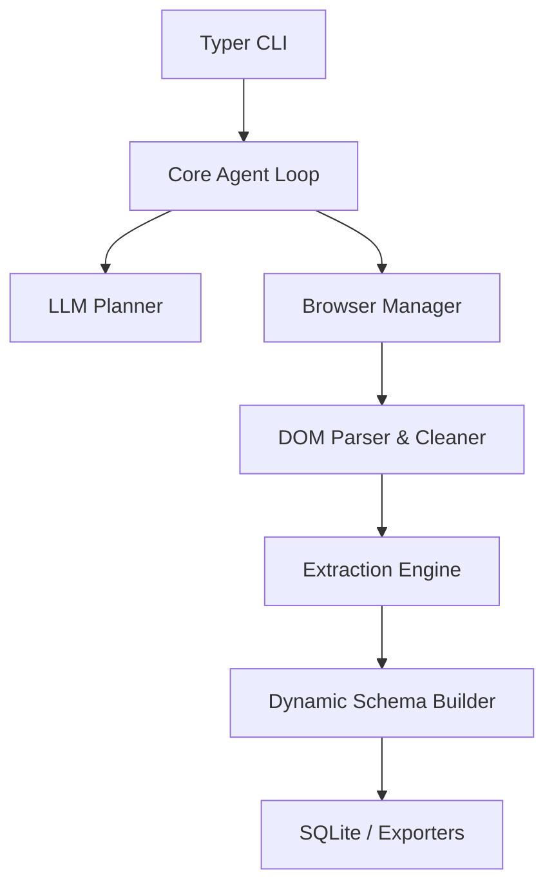

# Verboisy

An autonomous web research and structured scrape-to-JSON agent built for the enterprise.
Powered by Playwright, Pydantic v2, and LiteLLM.

## Architecture

## Installation

pip install verboisy
playwright install --with-deps chromium

## Configuration

Copy .env.example to .env and set your API keys:

OPENAI_API_KEY=sk-...
LITELLM_MODEL=gpt-4o

## Usage

verboisy run \
  --goal "Find the latest AI startups from YCombinator W24" \
  --schema examples/yc_startups/schema.json \
  --export result.json

Verboisy was written by Emanuele Torrisi and is released under the BSD 2 clause license.
