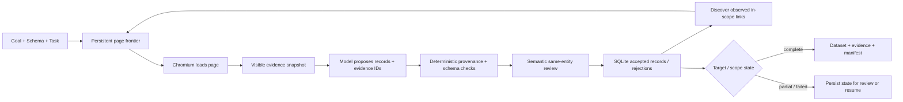

<a id="readme-top"></a>
<p align="center">
  
</p>
<p align="center">
  <strong>Evidence-backed web research that turns bounded sources into typed datasets.</strong>
  <br />
  Give Verboisy a goal, a JSON Schema, and a source policy. It browses, extracts, verifies provenance, reviews meaning, and returns auditable structured data.
</p>

<p align="center">
  <a href="https://github.com/EmanueleTorrisi/verboisy/actions/workflows/ci.yml"></a>
  <a href="https://codecov.io/gh/EmanueleTorrisi/verboisy"></a>
  <a href="https://emanueletorrisi.github.io/verboisy/"></a>
  <a href="#installation"></a>
  
  <a href="LICENSE"></a>
  <a href="https://github.com/astral-sh/ruff"></a>
</p>

<p align="center">
  <em>v0.2.0rc1 | release candidate. Evidence-backed, resumable, and intentionally explicit about incomplete coverage.</em>
</p>

<p align="center">
  <strong title="English" aria-label="English">🇬🇧</strong> ·
  <a href=".github/readme/README.it.md" title="Italiano" aria-label="Italiano">🇮🇹</a> ·
  <a href=".github/readme/README.de.md" title="Deutsch" aria-label="Deutsch">🇩🇪</a> ·
  <a href=".github/readme/README.zh-CN.md" title="简体中文" aria-label="简体中文">🇨🇳</a> ·
  <a href=".github/readme/README.fr.md" title="Français" aria-label="Français">🇫🇷</a> ·
  <a href=".github/readme/README.es.md" title="Español" aria-label="Español">🇪🇸</a> ·
  <a href=".github/readme/README.ko.md" title="한국어" aria-label="한국어">🇰🇷</a> ·
  <a href=".github/readme/README.ja.md" title="日本語" aria-label="日本語">🇯🇵</a>
</p>

## Table of Contents

- [Demo](#demo)
- [Why Verboisy](#why-verboisy)
- [Compared to](#compared-to)
- [Quick Example](#quick-example)
- [Use Cases](#use-cases)
- [How It Works](#how-it-works)
- [Installation](#installation)
- [Configuration](#configuration)
- [Usage](#usage)
- [Outputs and CSV](#outputs-and-csv)
- [Docker](#docker)
- [Known Limitations](#known-limitations)
- [Responsible Use](#responsible-use)
- [Documentation](#documentation)
- [Contributing](#contributing)
- [Security](#security)
- [License](#license)

<a id="demo"></a>
## Demo

The historical animation in [`docs/demo.gif`](docs/demo.gif) is illustrative and predates the 0.2 evidence engine. For current behavior, use the [live-demo workflow](docs/demo.md) and the [validation guide](docs/validation.md).

0.2.0rc1 has been exercised with offline statement/branch coverage, real Chromium integration, clean wheel installation, Docker sandbox startup, repeated live fixtures, held-out pagination, interruption/resume, unavailable sources, identity conflicts, and a held-out non-ecommerce registry case. Those checks are release evidence, not a guarantee that every website, model response, or open-web discovery run will succeed.

<a id="why-verboisy"></a>
## Why Verboisy

- **Evidence-backed, not “the model said so.”** Every non-null scalar must point to observed page evidence. Deterministic code checks source IDs, entity scope, literal quotes, types, links, allowed transforms, and schema constraints before a record can be accepted.
- **Schema-first, without silently weakening your contract.** Draft 2020-12 schemas define the row shape and collection constraints. Missing required evidence blocks the candidate instead of inventing a value or relaxing the schema.
- **Meaning gets a separate review.** After deterministic provenance checks, a second model pass reviews relevance, field meaning, and same-entity association using only supplied evidence. This improves semantic discipline but is still fallible; it is not an external truth oracle.
- **Bounded research, explicit scope.** Seed URLs, allowed hosts, include/exclude paths, depth, page count, links per page, and optional JavaScript pagination define what the run may observe.
- **Resumable by construction.** Page state, snapshots, candidates, accepted records, events, model accounting, and queue state persist in SQLite. A real SIGINT can be resumed without losing committed records.
- **Conflicts stay visible.** User-declared identity fields deduplicate equal records. Contradictory records for the same identity are quarantined instead of being silently merged.

What ships around that loop: Playwright/Chromium, visible-DOM evidence snapshots, bounded model calls through LiteLLM, deterministic provenance verification, SQLite persistence, JSON/CSV export, evidence sidecars, and checksummed manifests.

<a id="compared-to"></a>
## Compared to

Verboisy sits between a browser research agent and a structured extractor, but its distinguishing contract is the evidence trail around every accepted value.

| | Verboisy | General browser agent | Crawler / extractor | Ad-hoc LLM extraction |
| --- | --- | --- | --- | --- |
| You describe | goal + JSON Schema + source policy | goal | URLs / crawl rules | prompt + page text |
| Navigation | bounded observed-link traversal + optional pagination | model-driven actions | crawler rules | usually none |
| Field provenance | required per non-null scalar | depends on your code | varies | usually prompt-only |
| Validation | JSON Schema + deterministic evidence checks + semantic review | depends on your code | varies | usually best-effort |
| Persistence | SQLite queue, snapshots, candidates, records, events | varies | varies | usually caller-owned |
| Resume | durable run id and persisted frontier | varies | varies | usually caller-owned |
| Identity conflicts | quarantined deterministically | caller-owned | caller-owned | caller-owned |

If you only need page text or Markdown, a dedicated crawler may be simpler. If you need a general-purpose computer-use agent, use a tool built for arbitrary interactions. Verboisy is for bounded research where the output must be a typed dataset with inspectable provenance and explicit failure states.

<a id="quick-example"></a>
## Quick Example

Define exactly what one record means:

```json
{
  "type": "array",
  "minItems": 2,
  "items": {
    "type": "object",
    "properties": {
      "sku": {
        "type": "string",
        "description": "Product SKU exactly as published by the source"
      },
      "price_usd": {
        "type": "number",
        "minimum": 0,
        "description": "Listed unit price in USD; do not convert currency"
      },
      "source_url": {
        "type": "string",
        "format": "uri",
        "description": "Final page URL from which this record was observed"
      }
    },
    "required": ["sku", "price_usd", "source_url"],
    "additionalProperties": false
  }
}
```

Then define the bounded source policy in `task.json`:

```json
{
  "seed_urls": ["https://catalog.example/products"],
  "allowed_hosts": ["catalog.example"],
  "include_paths": ["/products*"],
  "target_records": 20,
  "identity_fields": ["/sku"],
  "max_depth": 3,
  "max_pages": 100,
  "field_rules": {
    "/source_url": {"source": "page_url"}
  }
}
```

Run it:

```bash
verboisy run \
  --goal "Collect published product SKUs and listed USD prices" \
  --schema schema.json \
  --task task.json \
  --export dataset.json \
  --max-steps 40
```

A possible illustrative output shape is:

```json
[
  {
    "sku": "LAMP-001",
    "price_usd": 39.95,
    "source_url": "https://catalog.example/products/lamp-001"
  },
  {
    "sku": "CHAIR-014",
    "price_usd": 129.0,
    "source_url": "https://catalog.example/products/chair-014"
  }
]
```

The example domains and records are illustrative. Real results depend on the pages actually observed during the run.

<a id="use-cases"></a>
## Use Cases

Verboisy is useful when “give me rows” is not enough and you also need to answer “where did this value come from?”

- **Market and competitive research:** bounded catalog, pricing, feature, or announcement datasets with per-field evidence.
- **B2B research:** structured organization or directory records with explicit identity fields and source URLs.
- **E-commerce monitoring:** typed product datasets while keeping conflicting observations visible instead of merging them away.
- **Research operations:** repeat a schema and source policy across a controlled set of pages, then resume interrupted work from SQLite.
- **Registry and reference data:** collect tables or technical registries into typed rows while preserving exact boolean, numeric, text, and URL evidence.
- **RAG / data-pipeline ingestion:** hand downstream systems canonical JSON plus an evidence sidecar and manifest rather than unsourced prose.

<a id="how-it-works"></a>
## How It Works

0.2 replaces the old free-form plan/action loop with a bounded evidence research engine:



A page snapshot contains compact visible facts, resolved links, entity-scope IDs, the final page URL, timestamp, and content hash. The complete observed HTML is also retained in SQLite. Model output can propose candidates, but cannot bypass schema or provenance checks.

`COMPLETED` means the configured accepted-record target and collection validation were satisfied. It does **not** claim that every possible match on the open web was found. Without an explicit target, observed-scope exhaustion is reported separately and still requires review.

See [`ARCHITECTURE.md`](ARCHITECTURE.md) for the implementation details.

<a id="installation"></a>
## Installation

Requires Python 3.11–3.14.

After a stable release is published, ordinary installation is intended to be:

```bash
pip install verboisy
```

For this unpublished release candidate, install the supplied wheel or checked-out source:

```bash
pip install -e .
verboisy --help
```

The first browser use downloads the matching Chromium build before model calls. Importing Verboisy or running `--help` does not download a browser. To prepare it explicitly:

```bash
verboisy setup
```

Linux may also need native Chromium libraries. Provision them using the target system's normal administration process, for example:

```bash
python -m playwright install-deps chromium
```

Verboisy does not invoke `sudo` and does not silently disable the Chromium sandbox to make a run pass.

<a id="configuration"></a>
## Configuration

Copy `.env.example` to `.env` and keep credentials out of version control.

```bash
OPENAI_API_KEY=sk-your-api-key-here
# ANTHROPIC_API_KEY=sk-ant-your-api-key-here

LITELLM_MODEL=gpt-4o
SQLITE_DB_PATH=verboisy.db
SEARCH_PROVIDER=disabled
BROWSER_SANDBOX=true
ALLOW_PRIVATE_NETWORK=false
```

Common settings:

| Variable | Purpose |
| --- | --- |
| `OPENAI_API_KEY` / `ANTHROPIC_API_KEY` | Provider credentials routed through LiteLLM |
| `LITELLM_MODEL` | Model identifier used for proposal/review calls |
| `LITELLM_API_KEY` / `LITELLM_API_BASE` | Optional alternate provider or proxy routing |
| `SQLITE_DB_PATH` | Durable run database; use a new path for 0.2 rather than reusing 0.1 evidence |
| `SEARCH_PROVIDER` | `disabled` for known seeds; Brave-backed discovery when configured |
| `BRAVE_SEARCH_API_KEY` | Credential for Brave search when discovery is enabled |
| `MAX_TOKENS` | Maximum model output tokens per request |
| `MODEL_REQUEST_BUDGET` | Conservative local request-unit budget, including reserved output allowance |
| `LLM_TIMEOUT_SECONDS` | Deadline for one model request |
| `LLM_RETRIES` | Bounded retry count for transient or unusable model responses |
| `RUN_TIMEOUT_SECONDS` | Deadline for one invocation |
| `MAX_DOM_CHARS` | Evidence payload budget per model batch |
| `ACTION_DELAY_SECONDS` | Delay between page-work iterations |
| `BROWSER_SANDBOX` | Keep Chromium sandboxing enabled by default |
| `ALLOW_PRIVATE_NETWORK` | Explicitly allow private/loopback destinations; off by default |
| `ALLOWED_DOMAINS` | Optional exact destination-host restriction |

`verboisy doctor` prints non-secret configuration and environment readiness. `verboisy setup` prepares and tests Chromium without making model calls.

<a id="usage"></a>
## Usage

### CLI

```bash
verboisy run \
  --goal "Collect the first 20 published products with SKU, price, and source URL" \
  --schema schema.json \
  --task task.json \
  --export dataset.json \
  --max-steps 40
```

Important flags:

| Flag | Required | Meaning |
| --- | --- | --- |
| `--goal`, `-g` | new run | Natural-language research objective |
| `--schema`, `-s` | new run | JSON Schema path |
| `--task`, `-t` | new run | Bounded source/discovery policy |
| `--export`, `-e` | no | `.json` or `.csv` output destination |
| `--resume`, `-r` | resume | Resume the latest incomplete run or a specific run id |
| `--max-steps`, `-m` | no | Work allowance for this invocation |
| `--headless` / `--headed` | no | Browser visibility override |

Exit codes are intentionally meaningful: `0` for target completion, `2` for a normal partial/exhausted result, `1` for failure, and `130` for interruption.

### Resume

```bash
# Resume the latest incomplete run
verboisy run --resume

# Resume a specific run and export when this invocation stops
verboisy run --resume 7f3a2c1b --export dataset.json
```

Resume keeps the original goal, schema, task policy, accepted records, queue, and cumulative accounting. Interrupted/active page work is recovered and may be processed again; deterministic identity handling prevents equal records from being duplicated.

### Python

`run()` is the synchronous API; use `await arun(...)` from async applications.

```python
from verboisy import run

result = run(
    goal="Collect published product SKUs and USD prices",
    schema="schema.json",
    task="task.json",
    export="dataset.json",
    max_steps=40,
)

print(result.run_id)
print(result.status, result.stop_reason)
for record in result.records:
    print(record)
```

A task can also be supplied as structured data rather than a file. Completed run IDs can be re-exported without another browser or model call.

<a id="outputs-and-csv"></a>
## Outputs and CSV

A JSON export produces three complementary artifacts:

- `dataset.json` — only the user-requested data fields.
- `dataset.json.evidence.json` — the accepted records with snapshot/evidence provenance.
- `dataset.json.manifest.json` — run status, schema/task policy, model invocation metadata, collection validation, and SHA-256 hashes for the generation.

SQLite retains more than the export: the durable page frontier, snapshots and HTML, candidate proposals, rejection reasons, accepted records, coverage-gap events, identity conflicts, and run accounting.

Default `csv_mode: "json"` stores every present cell as JSON. That preserves types exactly: strings stay JSON strings, booleans stay booleans, nested structures stay JSON, blank means absent, and `null` remains distinct from absence. Decode cells with `json.loads` when round-tripping.

`csv_mode: "spreadsheet"` produces conventional spreadsheet-friendly cells and escapes formula-like strings. It is easier to open manually, but loses the exact missing-vs-null distinction and should not be treated as the canonical typed interchange format.

Always verify the manifest hashes before treating a copied export as the same generation.

<a id="docker"></a>
## Docker

The shipped container runs Verboisy as an unprivileged user and is intended as a stronger deployment boundary than running hostile browsing in a personal browser session.

```bash
docker build -f docker/Dockerfile -t verboisy:0.2.0rc1 .

docker run --rm --init --shm-size=1g \
  --security-opt seccomp=docker/seccomp_profile.json \
  --entrypoint verboisy \
  verboisy:0.2.0rc1 setup
```

For real workloads, persist the SQLite database and export directory, keep the browser sandbox enabled, and apply network egress controls appropriate to the targets you permit.

<a id="known-limitations"></a>
## Known Limitations

0.2.0rc1 deliberately does less than a general computer-use agent:

- Traversal follows observed in-scope HTTP(S) links breadth-first. The model can prioritize observed links but cannot invent arbitrary navigation targets.
- A user-supplied `pagination_selector` supports bounded JavaScript pagination. General form workflows, arbitrary filters, implicit infinite scroll, downloads, iframe/shadow-root extraction, and arbitrary JavaScript actions are not implemented.
- Authentication flows, CAPTCHAs, anti-bot bypass, OCR, PDF extraction, and cross-page entity joins are outside the current contract.
- DOM/evidence context is bounded. Oversized or unusable model batches become explicit coverage gaps rather than silent success.
- Literal provenance checks establish that a value was observed in the admitted entity scope; they do not prove that the source itself is factually correct.
- Semantic review is model-based and fallible. It reduces obvious same-entity/meaning mistakes but is not independent external verification.
- `COMPLETED` is target completion, not a claim of global or open-web completeness.
- An unavailable source can make the run fail or remain incomplete. Raising budgets repeatedly is not a substitute for missing evidence.
- Without `identity_fields`, only exact-record equality can be deduplicated. With identity fields, contradictory payloads are quarantined rather than merged.

<a id="responsible-use"></a>
## Responsible Use

Verboisy drives a real browser and stores source material locally. You are responsible for target-site terms, robots policies, rate limits, licenses, privacy obligations, and applicable law. Do not use it to bypass authentication or access controls you do not have permission to cross.

Application URL checks and Chromium sandboxing are defense in depth, not a complete hostile-network sandbox. For untrusted browsing, use a dedicated account/container or VM, avoid sensitive mounts, and restrict network egress.

Source pages and extracted records can contain personal or licensed data. Verboisy does not encrypt the SQLite database for you and source accessibility does not imply permission to redistribute or train on the content.

<a id="documentation"></a>
## Documentation

- [Contract and task policy](docs/contracts.md)
- [Validation and release checks](docs/validation.md)
- [Search and recovery](docs/search-and-recovery.md)
- [Migration from 0.1](docs/migration.md)
- [Live-demo workflow](docs/demo.md)
- [Release operations](docs/release.md)
- [Architecture](ARCHITECTURE.md)

<a id="contributing"></a>
## Contributing

Contributions are welcome. See [`CONTRIBUTING.md`](.github/CONTRIBUTING.md) for the supported Python versions, lint/type/test commands, browser gate, and release-candidate checks. Keep new behavior covered by deterministic tests and avoid weakening evidence or sandbox rules merely to make a fixture pass.

<a id="security"></a>
## Security

Found a vulnerability? Please do not open a public issue. Use [private vulnerability reporting](https://github.com/EmanueleTorrisi/verboisy/security/advisories/new) or follow [`SECURITY.md`](.github/SECURITY.md).

<a id="license"></a>
## License

BSD 2-Clause. See [`LICENSE`](LICENSE).

---

<p align="center">
  Built by <a href="https://github.com/EmanueleTorrisi">Emanuele Torrisi</a> · <a href="#readme-top">Back to top ↑</a>
</p>
