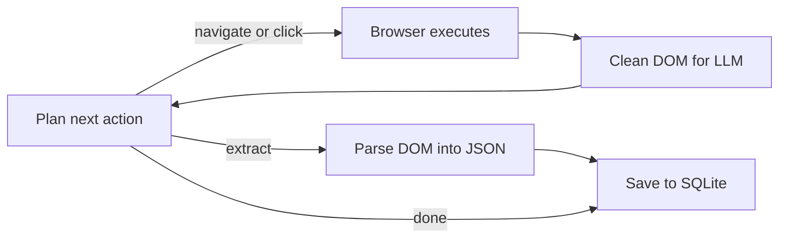

<a id="readme-top"></a>
<p align="center">
  
</p>
<p align="center">
  <strong>An autonomous web research and structured scrape-to-JSON agent.</strong>
  <br />
  Give it a goal in plain English and a JSON schema — it plans its own navigation, reads the page, and hands back validated, structured data.
</p>

<p align="center">
  <a href="https://github.com/EmanueleTorrisi/verboisy/actions/workflows/ci.yml"></a>
  <a href="https://codecov.io/gh/EmanueleTorrisi/verboisy"></a>
  <a href="https://emanueletorrisi.github.io/verboisy/"></a>
  <a href="#installation"></a>
  
  <a href="LICENSE"></a>
  <a href="https://github.com/astral-sh/ruff"></a>
</p>

<p align="center">
  <em>v0.1.0 — pre-1.0 and actively developed. Expect breaking changes between minor versions until 1.0.</em>
</p>

<p align="center">
  <strong title="English" aria-label="English">🇬🇧</strong> ·
  <a href=".github/readme/README.it.md" title="Italiano" aria-label="Italiano">🇮🇹</a> ·
  <a href=".github/readme/README.de.md" title="Deutsch" aria-label="Deutsch">🇩🇪</a> ·
  <a href=".github/readme/README.zh-CN.md" title="简体中文" aria-label="简体中文">🇨🇳</a> ·
  <a href=".github/readme/README.fr.md" title="Français" aria-label="Français">🇫🇷</a> ·
  <a href=".github/readme/README.es.md" title="Español" aria-label="Español">🇪🇸</a> ·
  <a href=".github/readme/README.ko.md" title="한국어" aria-label="한국어">🇰🇷</a> ·
  <a href=".github/readme/README.ja.md" title="日本語" aria-label="日本語">🇯🇵</a>
</p>

## Table of Contents

- [Demo](#demo)
- [Why Verboisy](#why-verboisy)
- [Features](#features)
- [Quick Example](#quick-example)
- [Use Cases](#use-cases)
- [How It Works](#how-it-works)
- [Installation](#installation)
- [Configuration](#configuration)
- [Usage](#usage)
- [Docker](#docker)
- [Known Limitations](#known-limitations)
- [Documentation](#documentation)
- [Contributing](#contributing)
- [Security](#security)
- [License](#license)

## Demo

*Recording in progress — the CLI works today; see [Quick Example](#quick-example) below for real input and output in the meantime.*

<!--
  Replace the italic line above with a real recording before this goes
  public — it's the single highest-leverage thing missing from this page.
  Until it's there, leave the line as-is: it degrades gracefully. A
  half-finished embed does not — it just shows a broken image icon.

  Recommended: asciinema — tiny file size, text stays selectable and
  searchable, reads well in both light and dark GitHub themes.

    asciinema rec docs/demo.cast
    # run a real goal end to end, e.g. the Quick Example below
    asciinema upload docs/demo.cast

  Then paste this in, with REPLACE_ME swapped for the ID asciinema gives you:

  [](https://asciinema.org/a/REPLACE_ME)

  A GIF works too — same idea, just a heavier file.
-->

## Why Verboisy

- **Goal-driven, not selector-driven.** Describe the objective in plain English; the planner decides the next click, scroll, or read from the page actually in front of it. Nothing hardcoded to rewrite when a site redesigns.
- **Schema-first, not best-effort.** Every record is checked against a Pydantic model built from your JSON Schema before it's saved — malformed data never reaches your database.
- **Bring your own model, keep your own infrastructure.** OpenAI, Anthropic, or a local Ollama model via [LiteLLM](https://github.com/BerriAI/litellm) — one environment variable to switch. Runs on your machine or your servers, not a hosted black box.
- **Resumable by construction.** Every record lands in SQLite the moment it's extracted, so a crash, a rate limit, or a killed process costs you the current step, not the run.

## Features

- **Autonomous browsing** — give it a goal in plain English; it plans its own navigation instead of following a fixed selector script.
- **Schema-first extraction** — describe the shape you want as a JSON Schema; Verboisy builds a Pydantic model from it at runtime and validates every record before it's saved.
- **Any LLM you want** — OpenAI, Anthropic, or a local Ollama model, via [LiteLLM](https://github.com/BerriAI/litellm). Swap providers with one environment variable.
- **Built for real pages** — async Playwright with stealth evasions, plus DOM cleaning tuned for LLM context windows instead of raw HTML dumps.
- **Resumable by default** — every extracted record is written to SQLite as it's found, so a crashed run doesn't lose earlier progress.
- **Export anywhere** — JSON or CSV out of the box, or query the SQLite database directly.

## Quick Example

Given a schema like this:

```json
{
  "type": "array",
  "items": {
    "type": "object",
    "properties": {
      "name": { "type": "string" },
      "website": { "type": "string" },
      "description": { "type": "string" },
      "batch": { "type": "string" }
    },
    "required": ["name", "website"]
  }
}
```

...this command:

```bash
verboisy run \
  --goal "Find the latest AI startups from YCombinator W24" \
  --schema examples/yc_startups/schema.json \
  --export result.json
```

...produces this:

```json
[
  {
    "name": "Aurora Labs",
    "website": "https://aurora-labs.example.com",
    "description": "Battery diagnostics for EV fleets.",
    "batch": "W24"
  },
  {
    "name": "Fernbank",
    "website": "https://fernbank.example.com",
    "description": "Automated bookkeeping for small farms.",
    "batch": "W24"
  }
]
```

*(Illustrative output — real results depend on what's live on the page at run time.)*

## Use Cases

Verboisy is built for research patterns worth running more than once:

- **Competitive & market intelligence** — track competitor pricing, product pages, and announcements on a schedule instead of checking by hand.
- **B2B lead research** — turn a list of company names into structured firmographic and tech-stack records, ready for CRM import.
- **E-commerce & retail monitoring** — watch catalog and price changes across JavaScript-heavy storefronts.
- **Research operations (ResOps)** — run the same query pattern across hundreds of entities on a recurring schedule.
- **RAG / knowledge-base ingestion** — feed a retrieval pipeline with structured, sourced records instead of hand-curated context.

Each of these is the same goal-plus-schema pattern as the Quick Example above, just pointed at a different site and a different shape.

## How It Works

Verboisy runs one core loop — plan → act → extract — until the planner decides it has enough data or hits its step budget.



Every extracted record is written to SQLite the moment it's found, so the loop can be interrupted at any point — a rate limit, a crash, a killed process — and pick back up without redoing finished work.

Full breakdown of each module in [`ARCHITECTURE.md`](ARCHITECTURE.md).

## Installation

Requires Python 3.11+.

Not on PyPI yet — install from source:

```bash
git clone https://github.com/EmanueleTorrisi/verboisy.git
cd verboisy && pip install -e .
playwright install --with-deps chromium
```

Once the first release ships, this will be:

```bash
pip install verboisy
playwright install --with-deps chromium
```

## Configuration

Copy `.env.example` to `.env`. All settings load through Pydantic in `utils/config.py`; anything you don't set falls back to the defaults below.

```bash
# Required — at least one LLM provider
OPENAI_API_KEY=sk-your-api-key-here
# ANTHROPIC_API_KEY=sk-ant-your-api-key-here

# LiteLLM model routing (e.g. gpt-4o, claude-sonnet-5, ollama/llama3)
LITELLM_MODEL=gpt-4o

SQLITE_DB_PATH=verboisy_runs.db
VERBOISY_LOG_LEVEL=INFO
VERBOISY_HEADLESS=True
```

| Variable | Default | Description |
|---|---|---|
| `OPENAI_API_KEY` | — | OpenAI credentials. Required unless using Anthropic. |
| `ANTHROPIC_API_KEY` | — | Anthropic credentials, used instead of OpenAI. |
| `LITELLM_MODEL` | `gpt-4o` | Any [LiteLLM](https://github.com/BerriAI/litellm)-supported model string. |
| `MAX_TOKENS` | `4096` | Max tokens per planner/extraction call. |
| `TEMPERATURE` | `0.0` | Sampling temperature for the planner. |
| `VERBOISY_HEADLESS` | `true` | Run Chromium headless. |
| `BROWSER_TIMEOUT_MS` | `30000` | Navigation timeout per page, in ms. |
| `USER_AGENT_ROTATION` | `true` | Rotate user agents between requests. |
| `SQLITE_DB_PATH` | `verboisy.db` | Where extracted records are persisted. |
| `VERBOISY_LOG_LEVEL` | `INFO` | Standard Python logging level. |

## Usage

```bash
verboisy run \
  --goal "Find the latest AI startups from YCombinator W24" \
  --schema examples/yc_startups/schema.json \
  --export result.json
```

| Flag | Alias | Required | Description |
|---|---|---|---|
| `--goal` | `-g` | Yes | Plain-English description of what to find and where. Be specific. |
| `--schema` | `-s` | Yes | Path to a JSON schema describing the fields to extract. |
| `--export` | `-e` | No | Output path. Supports `.json` and `.csv`. |

Run `verboisy run --help` for the full flag reference.

## Docker

```bash
docker compose -f docker/docker-compose.yml up -d --build
docker compose -f docker/docker-compose.yml exec verboisy verboisy run \
  --goal "Find the latest AI startups from YCombinator W24" \
  --schema examples/yc_startups/schema.json \
  --export result.json
```

The container starts and stays running, with Playwright's browser dependencies already installed, so commands run via `exec` rather than as the container's entrypoint. `OPENAI_API_KEY` is passed through from your shell automatically — export it first. To pass through other variables (`ANTHROPIC_API_KEY`, `LITELLM_MODEL`, etc.), either export those too or swap the `environment:` list in `docker/docker-compose.yml` for `env_file: [../.env]`.

## Known Limitations

Beta software, and upfront about it:

- **No authentication or job history** — single-user, one run at a time.
- **No scheduling** — trigger runs manually or wire them into your own cron or orchestrator.
- **No hosted API** — the CLI and the Docker image are the only interfaces right now.
- **Inconsistent on aggressively anti-bot sites** — some targets will need retries or manual intervention.

Hit one of these that blocks your use case? [Open an issue](https://github.com/EmanueleTorrisi/verboisy/issues) — it's the most direct way to influence what gets fixed first.

## Documentation

Full docs — including the complete configuration reference and API details — are published at **[emanueletorrisi.github.io/verboisy](https://emanueletorrisi.github.io/verboisy/)**.

## Contributing

Contributions are welcome. See [`CONTRIBUTING.md`](.github/CONTRIBUTING.md) for local setup and coding conventions, and please follow the [Code of Conduct](.github/CODE_OF_CONDUCT.md). Looking for a place to start? Check issues tagged [`good first issue`](https://github.com/EmanueleTorrisi/verboisy/labels/good%20first%20issue).

## Security

Found a vulnerability? Please don't open a public issue — use [private vulnerability reporting](https://github.com/EmanueleTorrisi/verboisy/security/advisories/new) or see [`SECURITY.md`](.github/SECURITY.md).

## License

BSD 2-Clause — see [`LICENSE`](LICENSE) for the full text.

---

<p align="center">
  Built by <a href="https://github.com/EmanueleTorrisi">Emanuele Torrisi</a> · <a href="#readme-top">Back to top ↑</a>
</p>
